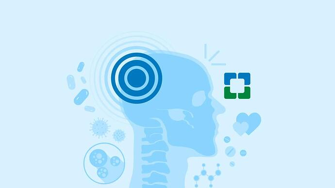

---

id: 607664

title: "一个词汇 Hypomania | 轻躁狂"

created_at: 2025-04-28T10:35:27.937Z

username: stevessr

display_username: "🐟"

---

# 一个词汇 Hypomania | 轻躁狂

与躺平不同的，感觉自己很有信心，很有动力，

就像—— **天欲其亡，必令其狂**

短暂地活着，像超新星的爆发一样

leading：Rian Doris讲述自己灵感迸发，开始哐哐招人，改革公司

症状描述：感觉就是火力无限，燃尽精力

对，还有表示部分领域的行为为 **Hypomania**所推进（天才疯子一念间）

治疗：减少外源性激素类摄入（咖啡因等……）

诱导：控制自己喽（常见 但是 很难）

后悔：热情过后，发现自己把公司搞得一团糟，开始砍掉其他业务，专注于核心业务（对，投入passion）

and more: 专注于一条道；数据科学规划未来（额……大数据……打破错觉）；先写计划，再检查可行性，才执行（这样消耗而外精力）

last：控制激素（还是很难……）

[image704×1074 147 KB](https://cdn3.ldstatic.com/original/4X/b/0/a/b0a8ffac4099f68b65d453a6301cd3620ce392a7.png)

b站某个搬运的，时间比ytb的长1s

[战略性躺平：真正的效率，始于停止折磨自己！| 心流状态神经学专家 Rian Doris 中英字幕 1080P_哔哩哔哩_bilibili](https://www.bilibili.com/video/BV1n25pznEBY/)

### [轻躁狂](https://zh.wikipedia.org/wiki/%E8%BD%BB%E8%BA%81%E7%8B%82)

轻躁狂（hypomania，台湾又称轻躁症），又称轻躁狂发作（hypomanic episode），是指一个人持续升高（欣快）或者急躁的心境状态以及在这个状态之下产生的相应的想法或者行为。许多轻度狂躁者都有性欲亢进的表现。

 一个人处于轻度狂躁状态时，表现为睡眠需求减少，变得非常外向、好斗并且精力充沛。然而，轻度狂躁者的各项生理功能都十分正常，这点与重度狂躁者不同。

 由于轻度狂躁者并无精神病症状和其他夸张的症状，所以对生理功能的影响也比较小。轻度狂躁属于一种双极情II型障碍和循环性情感症，也有可能发生在分裂型情感性障碍中。轻度狂躁也有可能由于在正常和狂躁状态之下不停的切换而表现为双极情I型障碍。有些双极情I型障碍者同时患有轻度狂躁和重度狂躁。当重度狂躁状态向正常状态转换时，有可能会发生轻度狂躁。轻度狂躁的特征表现有时候被鉴定为富有创造性和精力充沛。很多富有创造性的天才被报道由于患有轻度狂躁或者双相情感障碍的其他症状而导致了他们的成功。传统上认为轻度狂躁的特征表现包括：心境幸福欣快，脑子异常灵活，精力充沛，渴望成功等。一个比轻度狂躁更轻微一些的症状叫做情感增盛。

 精神疾病诊断与统计手册...

> [DSM-IV-TR](https://en.wikipedia.org/wiki/DSM-IV-TR) 将轻躁狂发作定义为在至少四天内，出现情绪高涨加上以下三种症状，或出现易怒情绪加上以下四种症状，且行为明显不同于患者未抑郁时的典型行为：

>

> [pressured speech 压力性言论](https://en.wikipedia.org/wiki/Pressured_speech)

> inflated [self-esteem](https://en.wikipedia.org/wiki/Self-esteem) or [grandiosity](https://en.wikipedia.org/wiki/Grandiosity)

>

> [自尊心](https://en.wikipedia.org/wiki/Self-esteem)膨胀或[自大](https://en.wikipedia.org/wiki/Grandiosity)

> decreased need for [sleep](https://en.wikipedia.org/wiki/Sleep)

>

> [睡眠](https://en.wikipedia.org/wiki/Sleep)需求减少

> [flight of ideas](https://en.wikipedia.org/wiki/Glossary_of_psychiatry#F) or the subjective experience that [thoughts are racing](https://en.wikipedia.org/wiki/Racing_thoughts)

>

> [思绪奔腾](https://en.wikipedia.org/wiki/Glossary_of_psychiatry#F)或[思绪飞驰](https://en.wikipedia.org/wiki/Racing_thoughts)的主观体验

> easily [distracted](https://en.wikipedia.org/wiki/Distraction)

>

> 容易[分心](https://en.wikipedia.org/wiki/Distraction)

> increase in goal-directed activity (e.g., social activity, at work, or [hypersexuality](https://en.wikipedia.org/wiki/Hypersexuality)), or [psychomotor agitation](https://en.wikipedia.org/wiki/Psychomotor_agitation)

>

> 目标导向活动增加（例如社交活动、工作或[性欲亢进 ](https://en.wikipedia.org/wiki/Hypersexuality)），或[精神运动性激动](https://en.wikipedia.org/wiki/Psychomotor_agitation)

> involvement in pleasurable activities that may have a high potential for negative psycho-social or physical consequences (e.g., sexual indiscretions, reckless driving, physical and verbal conflicts, inappropriate professional and/or financial behavior, etc.).[[23]](https://en.wikipedia.org/wiki/Hypomania#cite_note-23)

>

> 参与一些可能带来负面心理社会后果或身体后果的愉悦活动（例如，性行为不当、鲁莽驾驶、身体和言语冲突、不恰当的职业和/或财务行为等）。 [[ 23 ]](https://en.wikipedia.org/wiki/Hypomania#cite_note-23)

当你精力突然爆发的时候，去配环境吧（bushi）

### [Hypomania: What Is It, Comparison vs Mania, Symptoms & Treatment](https://my.clevelandclinic.org/health/diseases/21774-hypomania)

A hypomanic episode is a period of abnormally elevated, extreme changes in mood, behavior, activity and energy level. It’s a less severe condition than mania.

不是牛马该有的好品质

---

*来源: https://linux.do/t/topic/607664.json*

