---

id: 615206

title: "【Infini 虚拟卡】快速下卡避坑指南 (非AFF帖，猫狗卡都行！)"

created_at: 2025-05-01T07:12:49.509Z

username: Uiharu_Kazari

display_username: "初春饰利"

---

# 【Infini 虚拟卡】快速下卡避坑指南 (非AFF帖，猫狗卡都行！)

## 重要说明：

这张 Infini VISA 卡应该是目前门槛最低的虚拟卡！现在有活动，通过别人的 AFF 链接开卡(自己找嗷)，支付 6.6U 后会有返还，最终做到 1U 甚至 0U 开卡。(注意：本帖不含任何 AFF 链接，请放心阅读！)

## 补充更新的地方：

这个方法是我的经验之谈，总的来说还是看脸，脸黑进入人工审核序列就尴尬了…

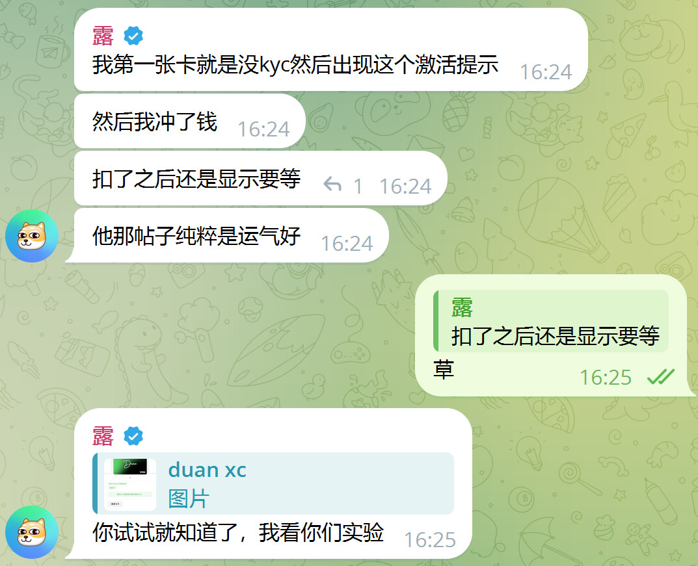

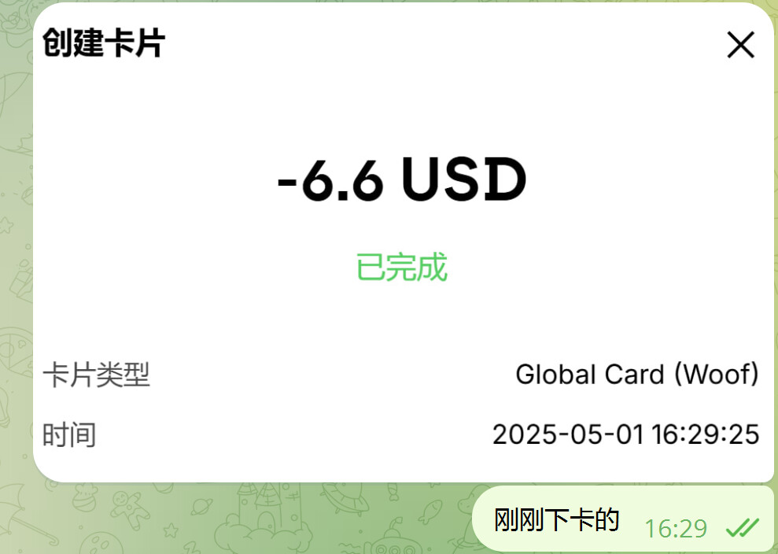

指路：

推特呀YouTube甚至论坛的深海板块都有的，深海板块是佬友的AFF，这位佬友人品可靠我比较推荐他的AFF！

---

最近在官方群和其他地方看到不少朋友踩坑，注册 Infini 卡后卡在审核好几天，然后还可能失败退款。为了让大家少走弯路，分享一个“多快好省”的下卡小技巧。

PS：

目前KYC你爱咋咋地你开心就好，元宇宙级别的KYC，你可以成为任何人！(

重要：

**千万别一注册完就急吼吼KYC然后等KYC过了再充U开卡！不然你的申请可能要被卡3-7天失败了才退U！**

### 正确的“丝滑”下卡姿势：

**核心思路：先别管 KYC，第一时间把卡申请下来，确认下卡正常再充钱！**

**具体步骤：**

1. **注册并申请卡片 (先不 KYC！)：**

完成注册。

直接点击 **“即刻获取”**

选择你想要的卡片类型。

下一步填写名字等信息（按提示，目前似乎可以随意填写）。

**检查开卡费用：** 如果你走了别人的 AFF 链接，应该会显示需要支付 6.6U 左右。如果显示的费用不对(这是享受 AFF 返还的基础)，直接**注销账号**然后再通过 AFF 链接重新注册。

2. **关键一步：光速检查卡片状态！(重点中的重点！)**

提交申请后，立即查看卡片状态。

**理想情况：** 刚开始可能短暂显示 **“申请审核中，预计需要 3-7 个工作日”** (如下图)，但**几乎立刻或几十秒内**刷新一下，就变成了 **“请存入卡激活费以激活您的卡片。”** (如下图)。

**出现这个“请存入卡激活费”的状态，就代表你的卡已经秒下了！**  只是等你充U激活而已。

**如果状态长时间 (比如超过 1-2 分钟) 卡在“审核中/处理中”**，没有任何变化：**果断放弃！** 直接去**注销这个账号**，换个邮箱或注销然后原始邮箱注册也行。千万别傻等审核！

> **总结核心流程：注册 → 申请卡(不先KYC) → 观察状态变化 (几十秒内必须从“审核中”变为“请存入激活费”) → 若成功秒变，则充 U 激活；若长时间卡审核，则注销重来！**

图例：

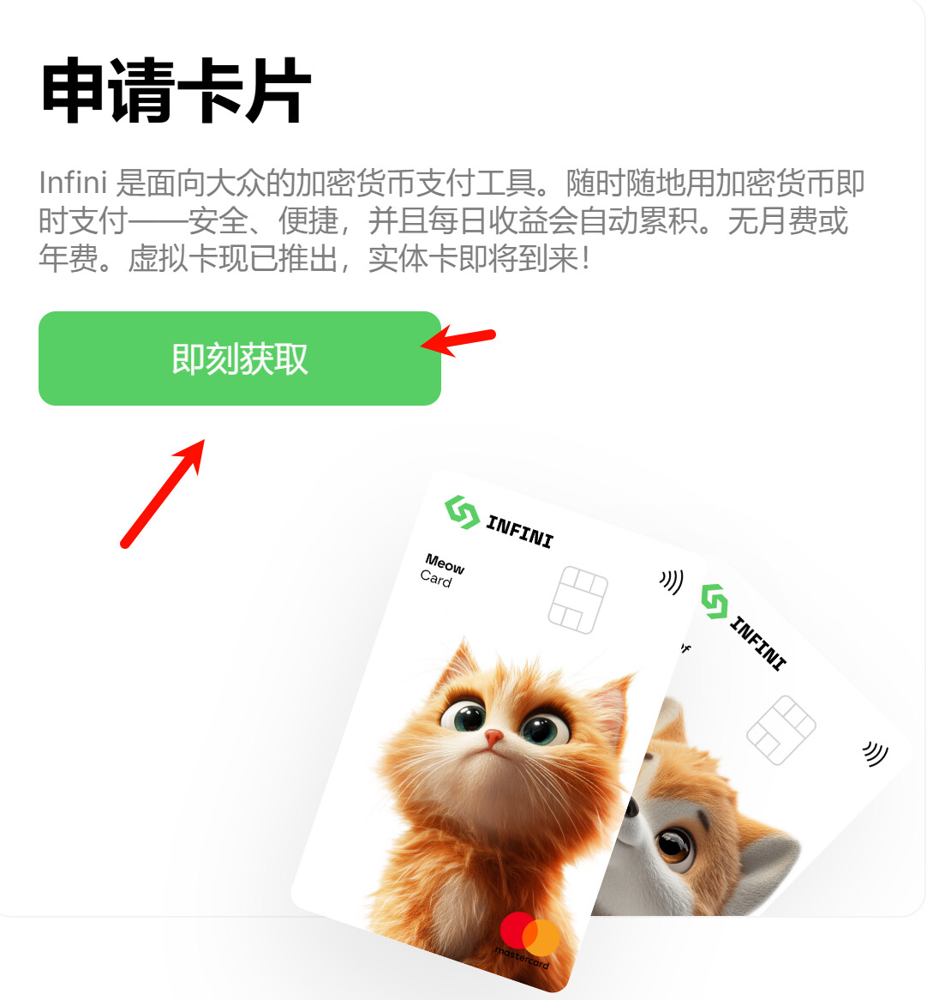

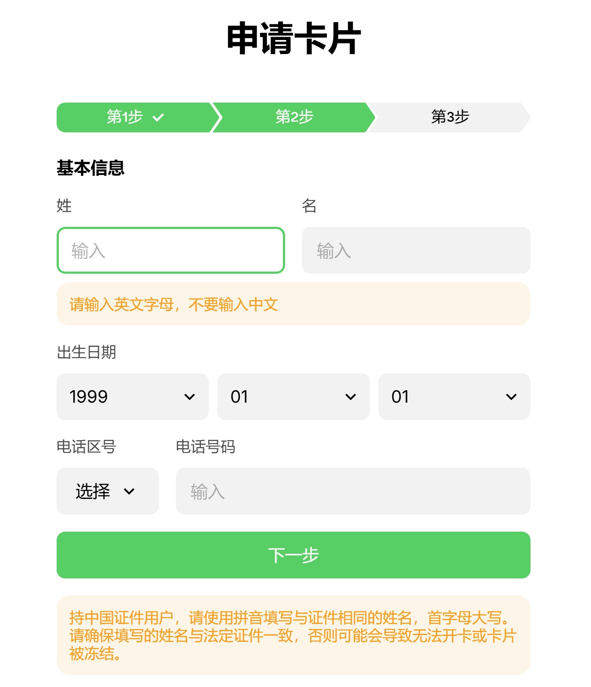

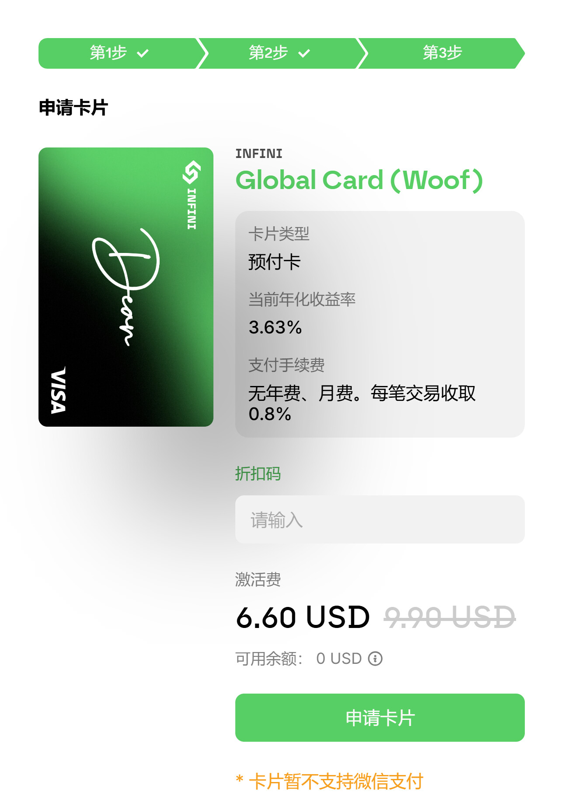

快速下卡的状态：

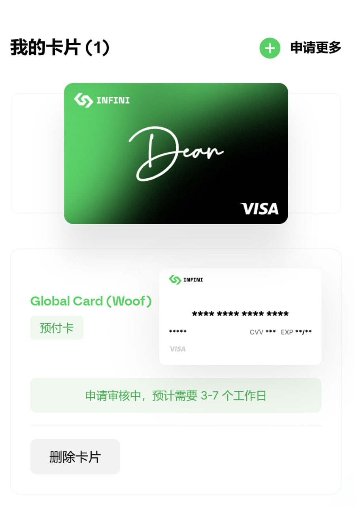

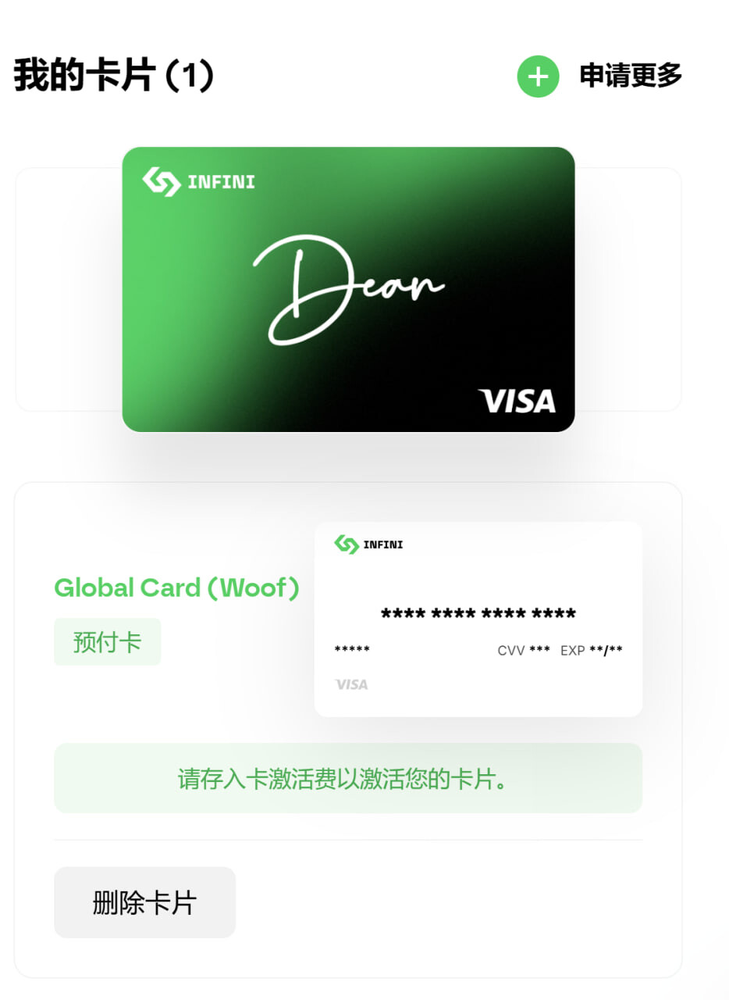

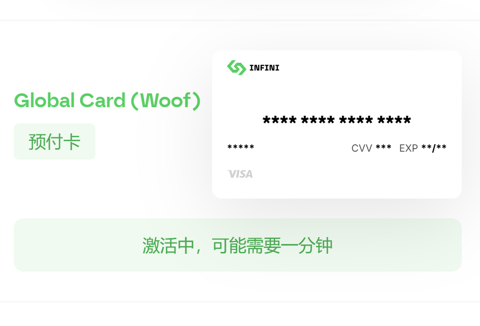

被喜提卡脖子的状态(持续超过1分钟)：

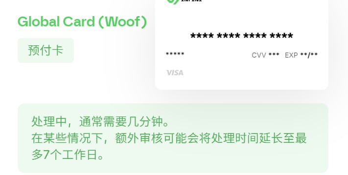

我的开卡速度(测了5张随机找一个当样本举例的)：

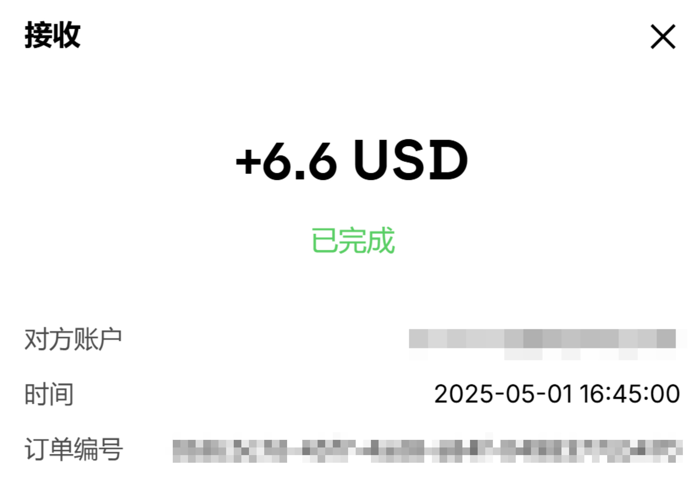

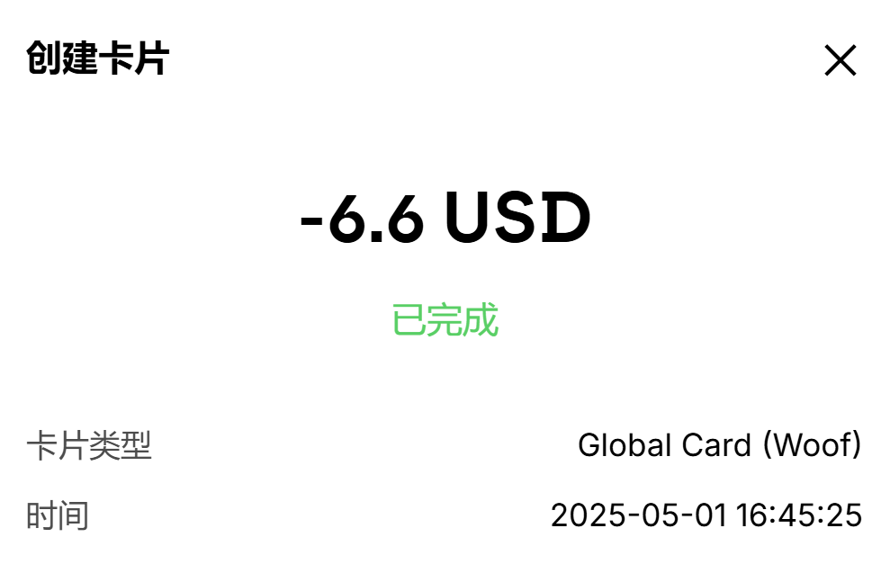

今日战果：

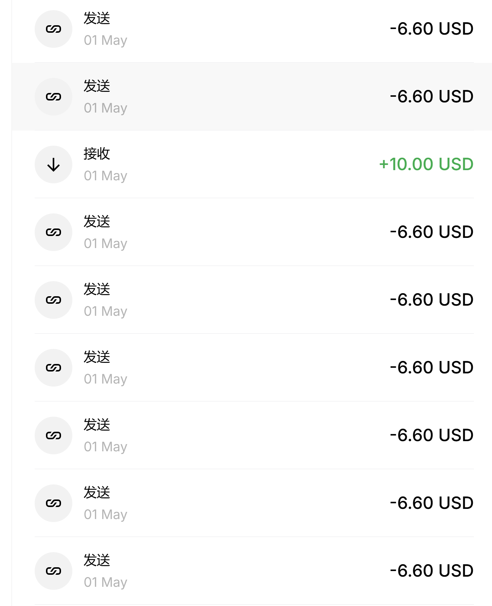

---

*来源: https://linux.do/t/topic/615206.json*

