---

id: 637468

title: "注册美区/土区 Apple ID 方法(避开网页提示此时无法创建你的账户)"

created_at: 2025-05-09T03:33:47.607Z

username: lostsheep

display_username: "lostsheep"

---

# 注册美区/土区 Apple ID 方法(避开网页提示此时无法创建你的账户)

# 2025最新版注册 Appld ID 方法

> 参照现有网上大部分使用的方法，在 [account.apple.com](http://account.apple.com) 上注册，但是一直提示：此时无法创建你的账户，故找到这种新的注册方法

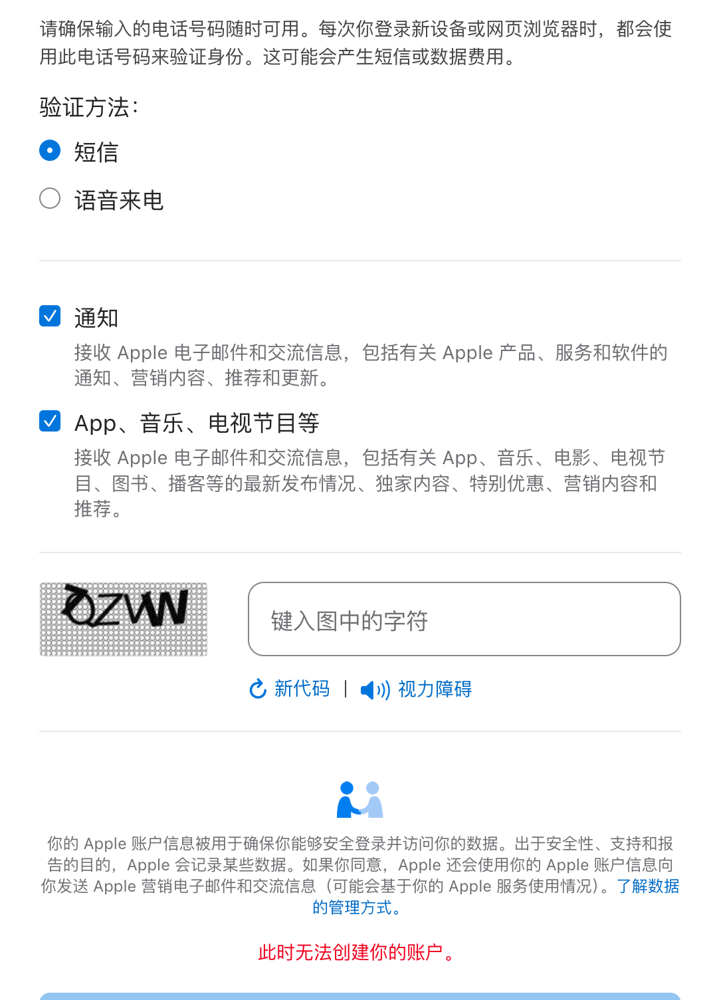

## 1. iphone 设置中查找 App Tab 项

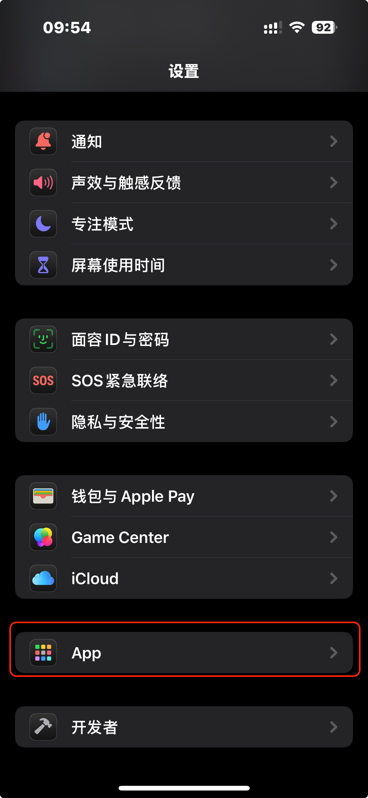

## 2. 点击进入 App，并搜索**邮件**

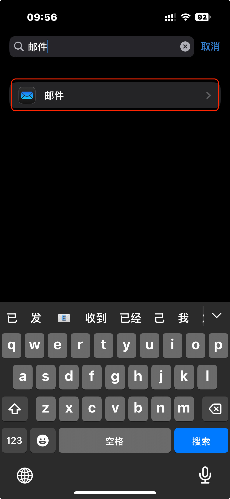

## 3. 点击邮件帐户

## 4. 点击添加帐户

## 5. 选择 iCloud

## 6. 点击创建新 Apple 帐户

## 7. 一直点同意到填写姓名和出生日期

出生日期这里要注意，一定要满18岁，也就是2007年之前，保险点填2000年之前的

## 8. 重点来了！选择使用电话号码还是电子邮箱？

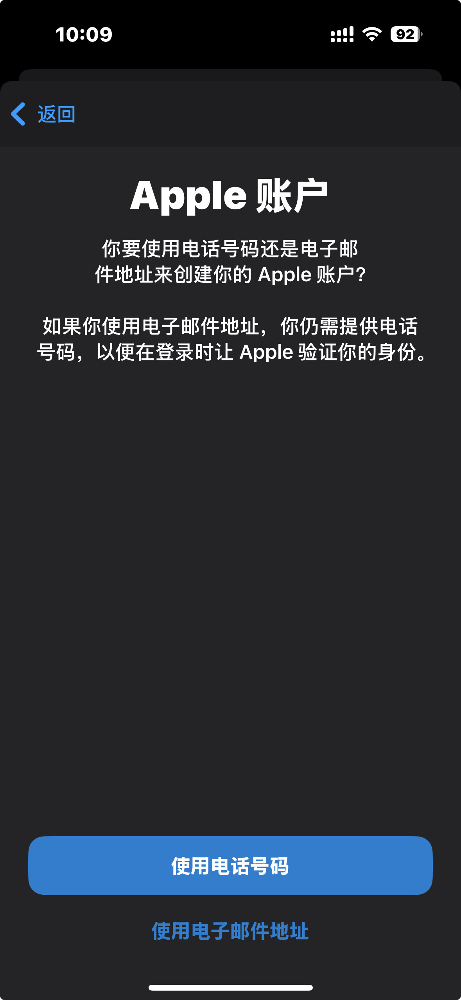

### 8.1 先说电话号码

这个使用的电话号码可以使用国内的电话号码，不影响到后续将帐号信息转为其他区域(美区/土区)

但是这个电话号码不能关联在你其他国区帐号下，有些时候我们用的是双卡，在iphone上设置了蜂窝网络为某一张卡的时候，会莫名其妙就把这张卡的号码关联到这个 apple id 下，需要注意一下，在 [account.apple.com](http://account.apple.com) 登录后可以查看关联的电话号码

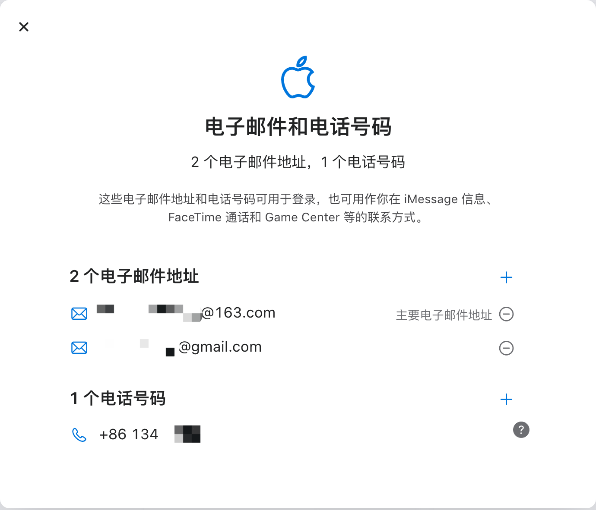

比如我使用这个134的手机号去新注册是不行的

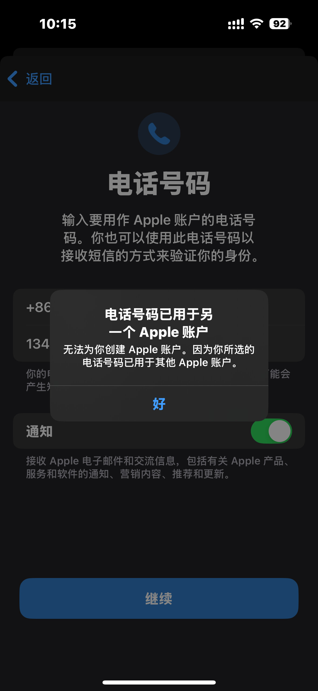

### 8.2 使用电子邮箱

同理使用的电子邮箱也是不能使用已经关联到其他帐户的，最好使用新注册的 proton 邮箱，后面也需要再关联电话号码的，这个电话号码也是需要不能关联到其他的帐户的，所以为什么不直接用手机号码？

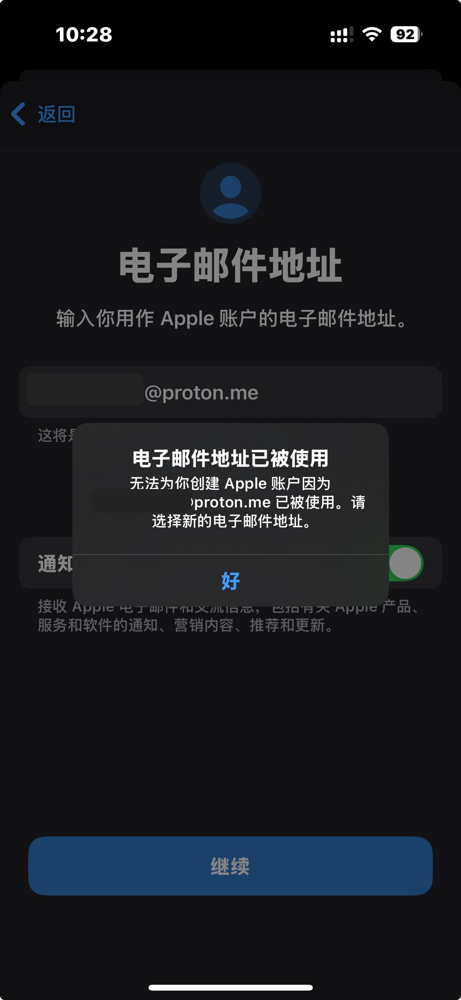

## 9. 后续按照提示的验证即可完成注册帐号，这里省略

## 10. **重点，修改帐号地区！！！**

1. 此时需要使用 vpn 地区可选到美国/土耳其地区的设备，电脑/手机都行，没有的佬友可以看看福利羊毛板块获取一下订阅导入到 **clashX/clashVerge** 等代理软件，并且配置规则中需要添加一条规则域名后缀是 **account.apple.com** 的流量访问走代理出去，嫌麻烦也可以配置全局代理，让所有流量都走代理

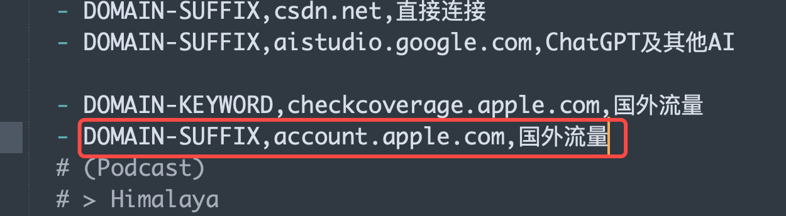

1. 开启浏览器的无痕访问模式，访问 [account.apple.com](http://account.apple.com) 登录你上一步注册的帐号

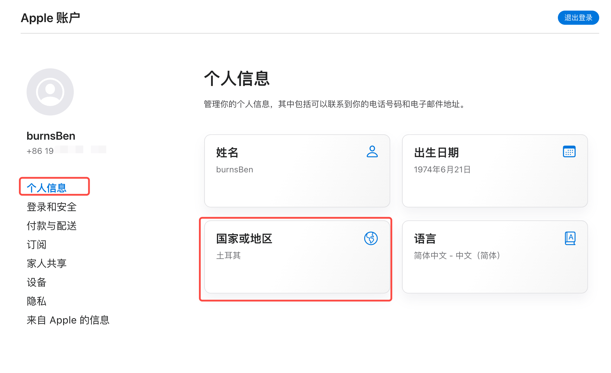

2. 点击国家或地区进行修改，因为我的帐号已经开启了2T的icloud和家庭共享，无法修改地区了，我使用 app store 中的账单地址演示一下

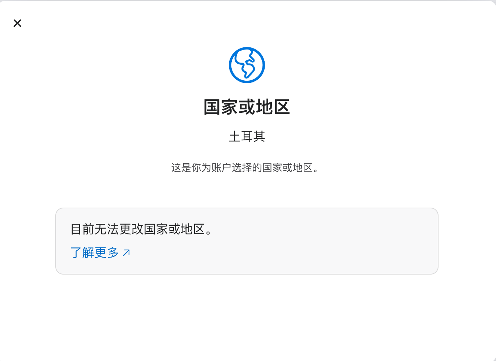

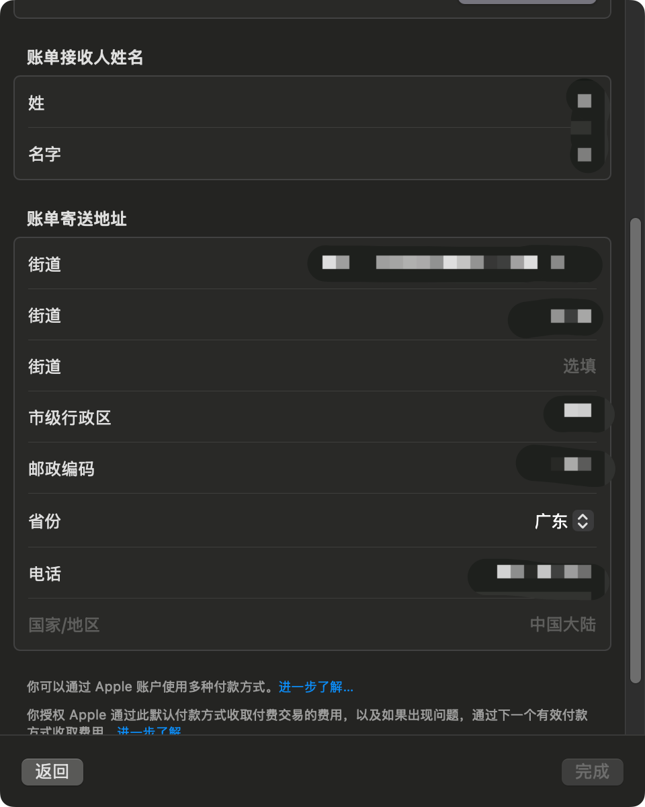

其中要修改的几个点是：1.街道，2.邮政编码，3.省份，4.国家/地区，这里我会使用 [土耳其地址生成器 - 土耳其身份生成器 - 土耳其信用卡生成器](https://www.meiguodizhi.com/tr-address) 地址生成器生成一个土耳其地区的随机地址

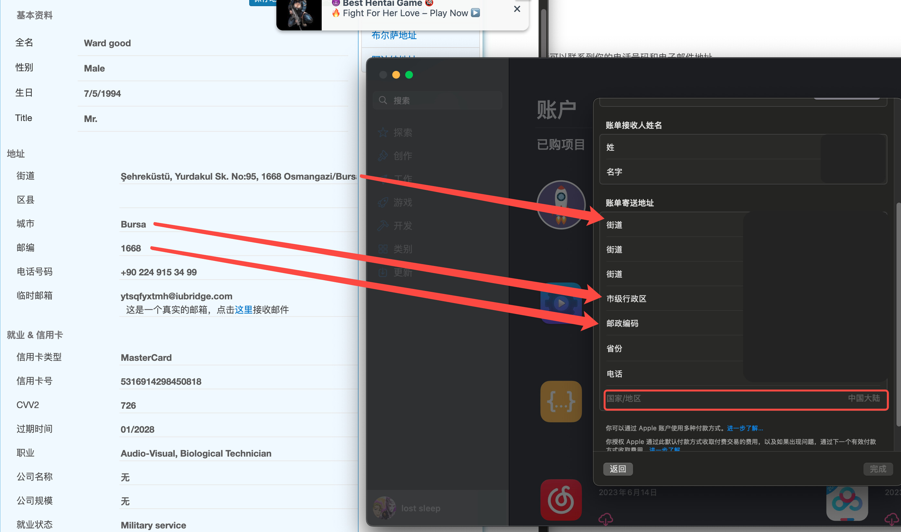

修改完点击保存就没问题了

---

*来源: https://linux.do/t/topic/637468.json*

