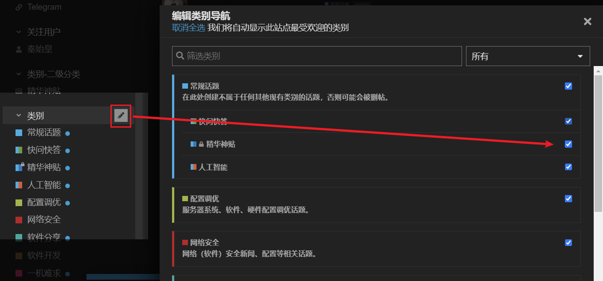
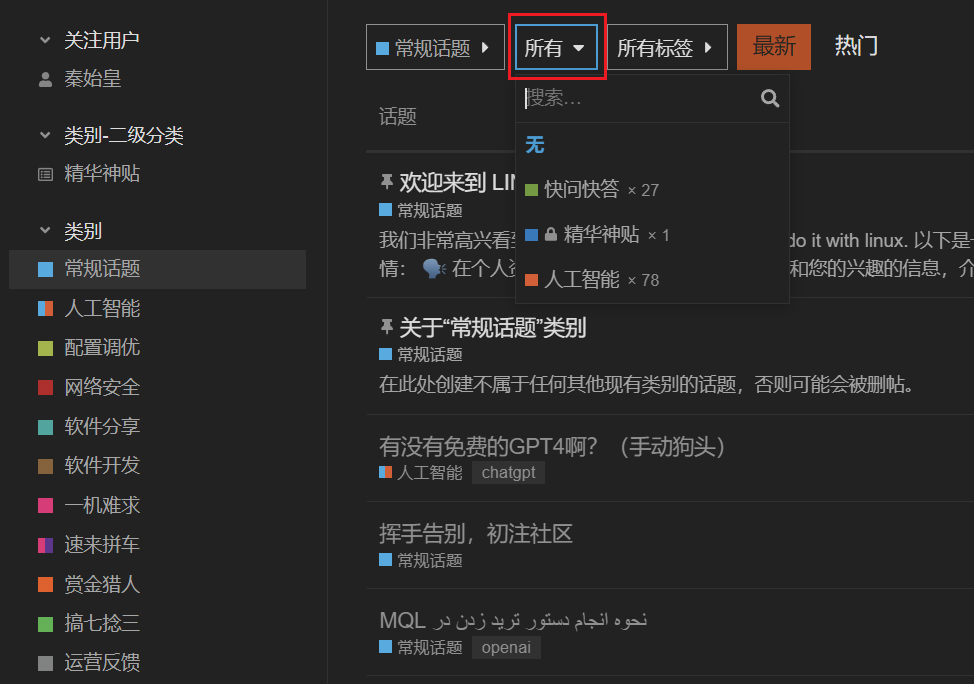
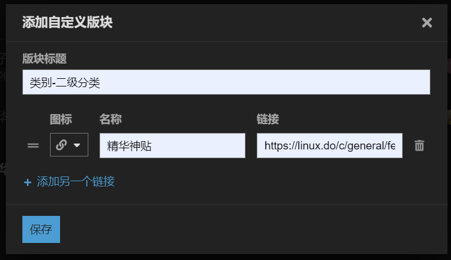
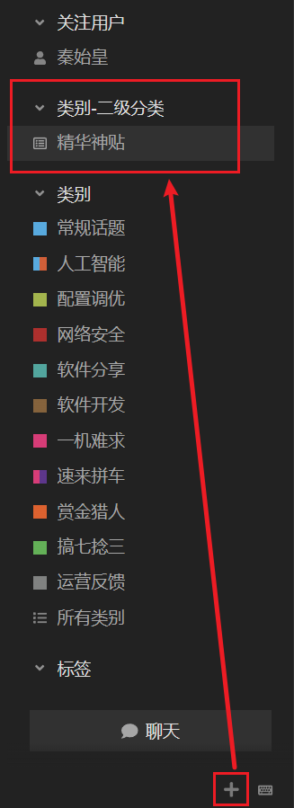

---

id: 6377

title: "基本用户如何找到《精华神贴》版块"

created_at: 2024-01-30T22:26:15.922Z

username: 7xWEcQ

display_username: "7xWEcQ"

---

# 基本用户如何找到《精华神贴》版块

最近有些朋友向小编反映说自己找不到《精华神贴》二级分类，我们知道这个版块集合了精华的神贴，左边导航栏又只显示一级分类，如果找不到入口还是十分麻烦的，那么如何找到这个版块呢？下面小编就给大家分享详细的操作步骤，大家一起来看一看吧。

1. 前提：账号等级需要达到1级（新用户0级 → 基本用户1级），小编只水了几分钟就满足条件了，还是非常简单的。

2. 链接直达法：[https://linux.do/c/general/featured/20](https://linux.do/c/general/featured/20)

3. 筛选导航栏法：鼠标悬浮在导航栏的 `类别` 按钮上，右边就会出现一支笔，点击之后在弹出的对话框中，就可以筛选导航栏菜单啦！

4. 手动进入法：点击导航栏类别下的 `常规话题` 分类，再点击主页面的 `二级分类` 下拉按钮就能找到了。

5. 自定义版块法：点击左下角的 `+` 号按钮，在弹出的对话框中填写标题和链接，左侧导航栏就会出现链接啦！

*此外，这个方法还适用于把其他常用的链接固定在导航栏哦！（比如把秦始皇挂在最上面。）*

---

*来源: https://linux.do/t/topic/6377.json*

