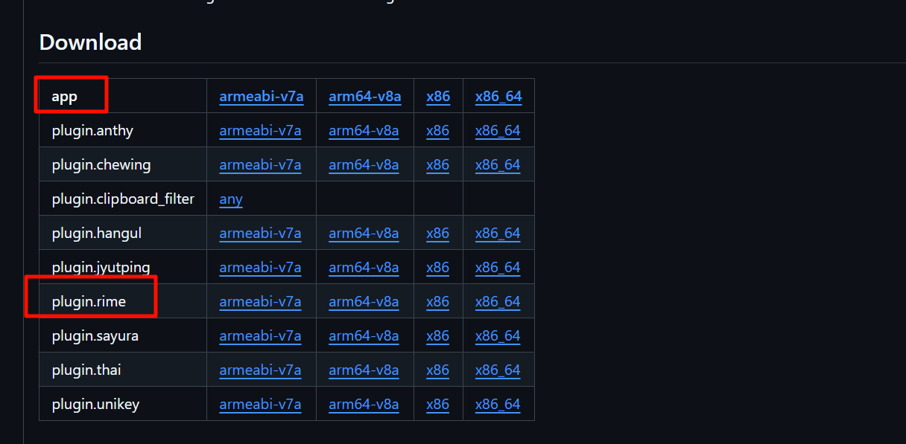
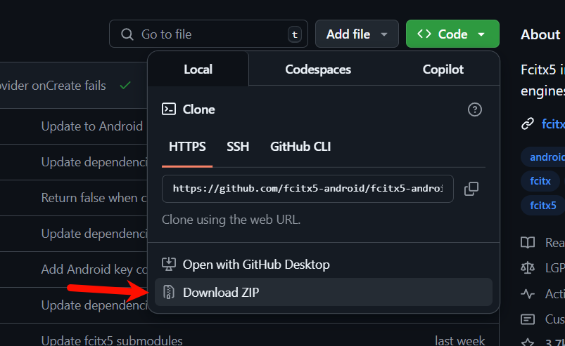
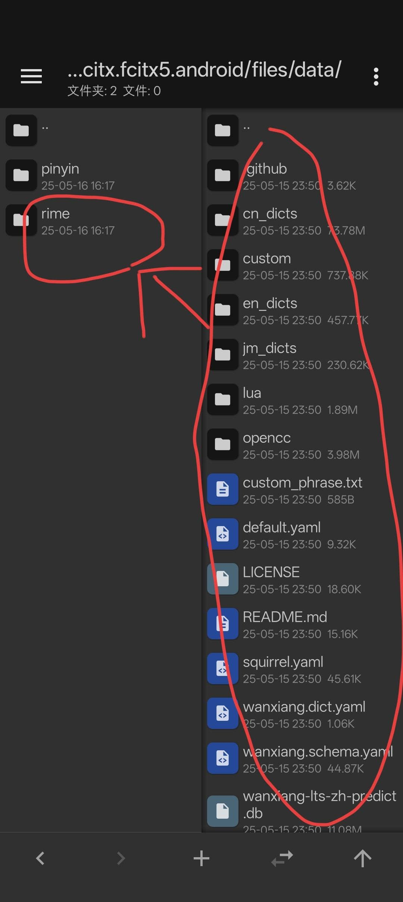
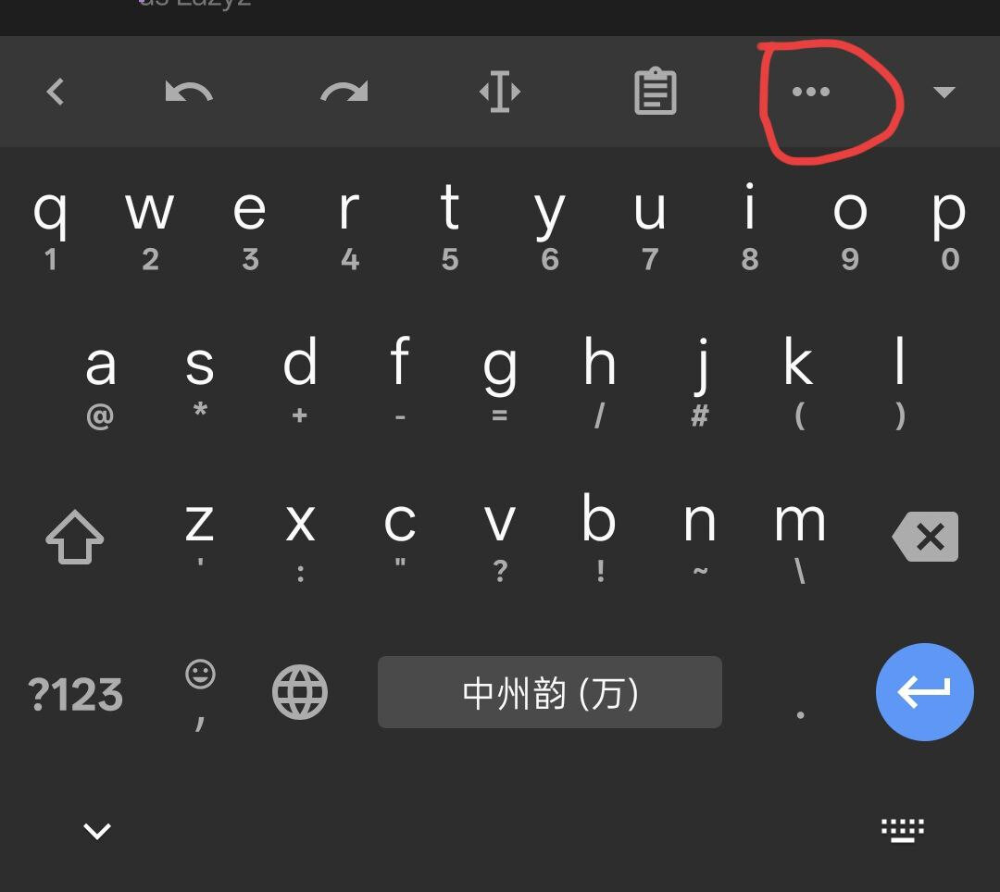
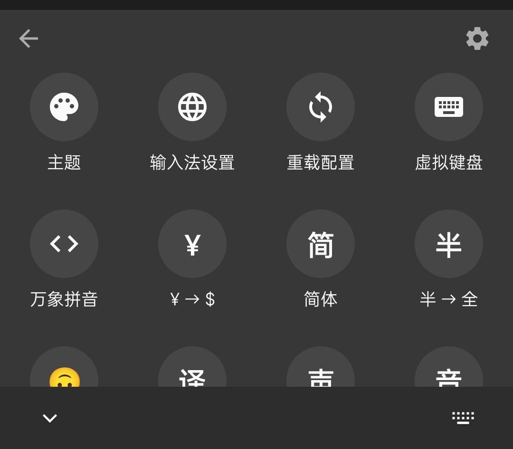
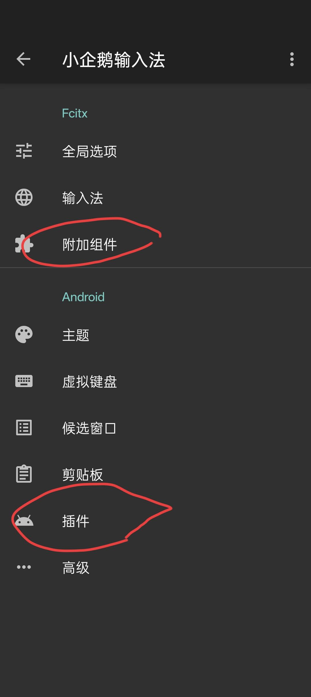

---

id: 654346

title: "Fcitx Android + Rime 导入 “万象拼音” 个人经验"

created_at: 2025-05-16T08:32:18.291Z

username: Graye_Draisey

display_username: "Graye"

---

# Fcitx Android + Rime 导入 “万象拼音” 个人经验

## What?

Fcitx For Android，也就是`小企鹅输入法`，具体是什么参考其它资料，这里不做介绍。

Rime，中州韵引擎，高度可扩展的输入法框架，这里作为插件使用，需要单独安装。

万象拼音，额，具体看官方说明。

- Fcitx Android: [fcitx5-android/fcitx5-android: Fcitx5 input method framework and engines ported to Android](https://github.com/fcitx5-android/fcitx5-android)

- [amzxyz/rime_wanxiang: 万象拼音基础版：带声调的拼音词库，可扩展全拼、双拼、中英混输、语法模型，支持声调辅助筛选。 Q群：11033572](https://github.com/amzxyz/rime_wanxiang)

## How to do?

导入 “万象拼音” 的步骤：

## 纯文字版：

1. 首先下载并安装 `Fcitx Android app` + `plugin.rime`

2. 下载 `万象` 的 github 仓库的 zip 包 `( Github-Code-Download ZIP`)（此包记为：`wanx-zip` 方便下文使用。）

3. 手机上找到 Fcitx Android 的数据目录：`storage/emulated/0/Android/data/org.fcitx.fcitx5.android/files/data/`

（可以使用 `MT管理器` 搜索关键字 `org.fcitx.fcitx5.android` 来找到。）

4. 在 `data/` 创建新文件夹 `rime`，最终是 ‘data/rime’，如果没有的话。

5. 解压上文 `wanx-zip` 的所有内容到 ‘data/rime/’ 文件夹里。

6. 走如下路线：`打开 小企鹅输入法 设置页 -> 插件 -> 重载插件（如果有提示）`，保证看见已加载的 `rime` 插件

7. 走如下路线：`打开 小企鹅输入法 设置页 -> 附加组件 -> 中州韵 -> ⚙️ ` 应该看见加载中提示，等待加载完成

验收结果：首先你应该选用的是 `小企鹅输入法` 吧？

然后随便输入框弹出输入法界面  → 中文输入 → `...`  不出意外就能明显看到新添加的配置项了。

---

## 带图版

导入 “万象拼音” 的步骤：

1. 首先下载并安装 `Fcitx Android` + `plugin.rime`

2. 下载 `万象` 的 github 仓库的 zip 包 `( Github-Code-Download ZIP`)（此包记为：`wanx-zip` 方便下文使用。）

3. 手机上找到 Fcitx Android 的数据目录：`storage/emulated/0/Android/data/org.fcitx.fcitx5.android/files/data/`

（可以使用 `MT管理器` 搜索关键字 `org.fcitx.fcitx5.android` 来找到。）

4. 在 `data/` 创建新文件夹 `rime`，最终是 ‘data/rime’，如果没有的话。

5. 解压上文 `wanx-zip` 的所有内容到 ‘data/rime/’ 文件夹中。(请忽略图中 `pinyin`，这是另一个插件。)

6. 走如下路线：`打开 小企鹅输入法 设置页 -> 插件 -> 重载插件（如果有提示）`，保证看见已加载的 `rime` 插件

7. 走如下路线：`打开 小企鹅输入法 设置页 -> 附加组件 -> 中州韵 -> ⚙️ ` 应该看见加载中提示，等待加载完成

验收结果：首先你应该选用 `小企鹅输入法`。然后随便输入框弹出输入法界面  → 中文输入 → `...`  不出意外就能明显看到新添加的配置项了。

---

*来源: https://linux.do/t/topic/654346.json*

