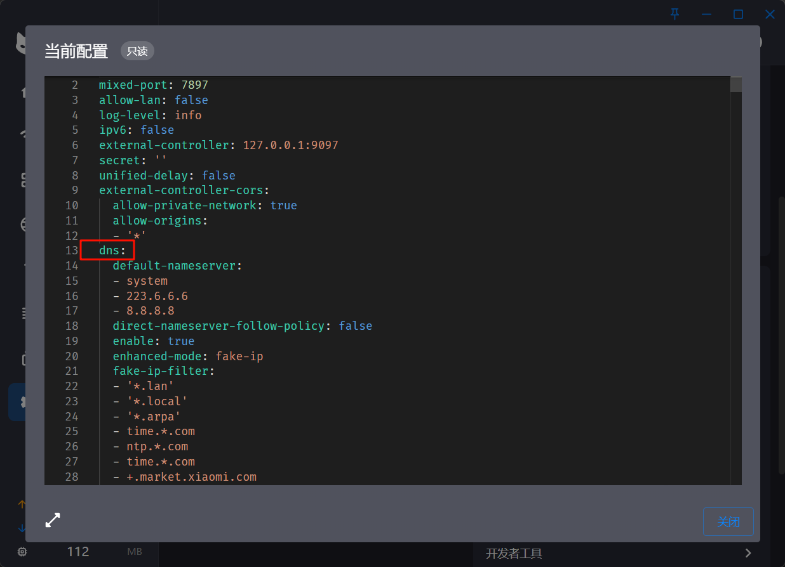
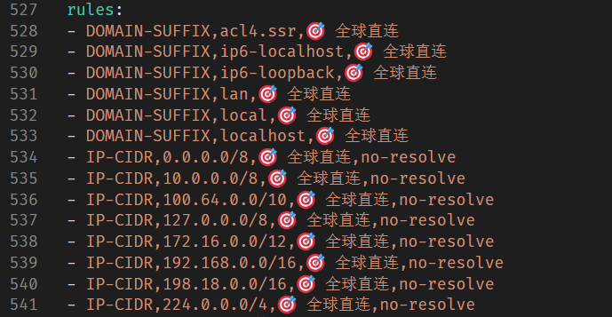
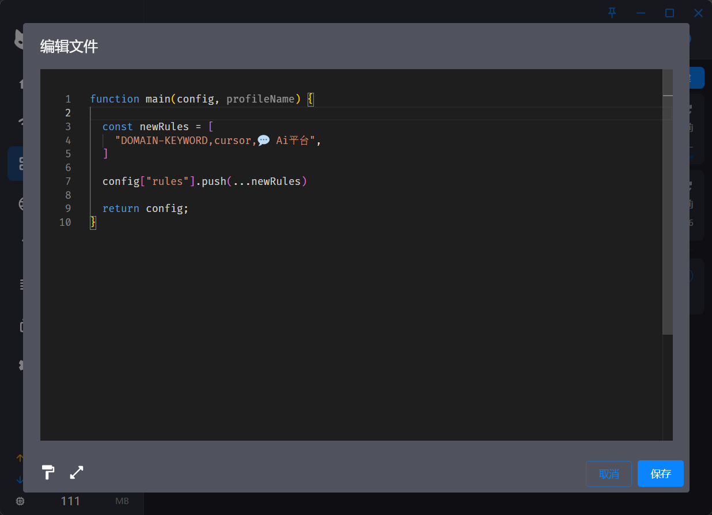
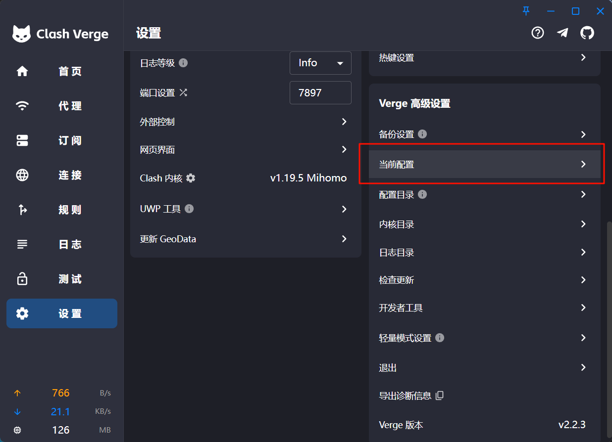
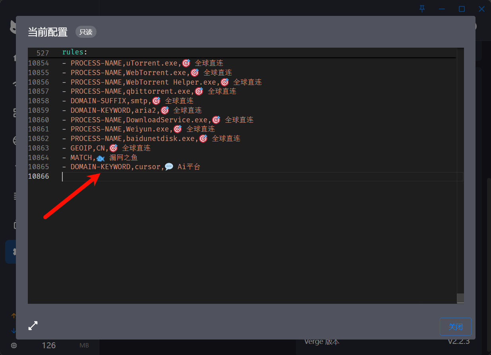

---

id: 654746

title: "Clash Verge Rev 扩展脚本个人经验，指导向，无配置提供。"

created_at: 2025-05-16T11:45:28.783Z

username: Graye_Draisey

display_username: "Graye"

---


# Clash Verge Rev 扩展脚本个人经验，指导向，无配置提供。


熟悉语法之后，自己很容易就编写了。

## 配置文件的字段

要修改配置，首先需要确定你要修改哪部分，比如 “dns”， “proxies”,  “proxy-groups”, “rules” 等等，这些是预制的字段，或者说关键字。

随便打开一个配置文件，用作参考，其中 `绿色` 高亮的是字段。



### 以 `dns` 为例

转换成编程说，`dns` 是一个对象，为什么呢？ 可以看到 “dns” 下面仍有许多关键字，绿色的，比如 `default-nameserver`；

如果是数组，类似 `rules`，直接每一个就是值，如下：



## 现在变成熟悉的 js 编程了

### 修改 `dns` 的 `default-nameserver`

```
  config["dns"]["default-nameserver"] = [
    "223.5.5.5",
    "223.6.6.6",
  ]
```

### 添加 rules

```
  const newRules = [
    "DOMAIN-KEYWORD,cursor,💬 Ai平台",
  ]

  config["rules"].push(...newRules)
```

### 添加到脚本里：



### 验证结果





其它字段的修改也是如此。

以上。


---


*来源: https://linux.do/t/topic/654746.json*

