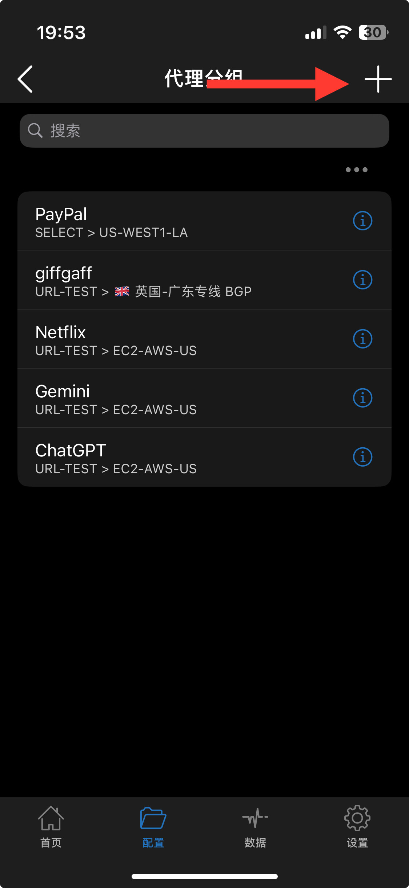
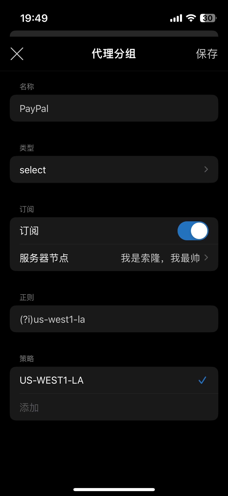
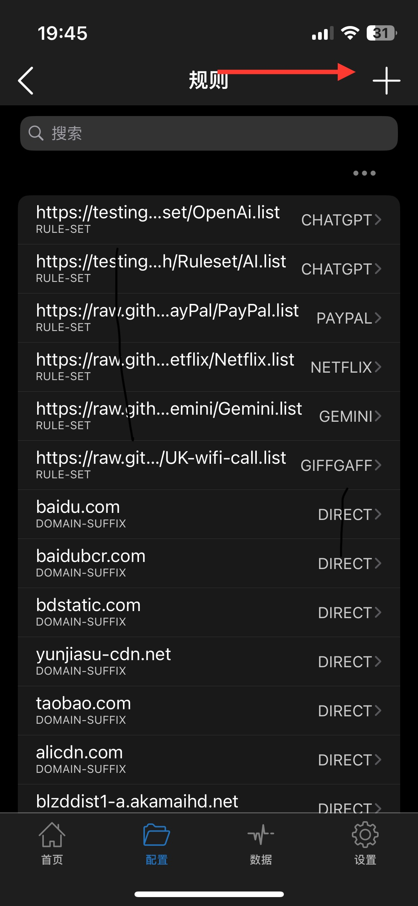
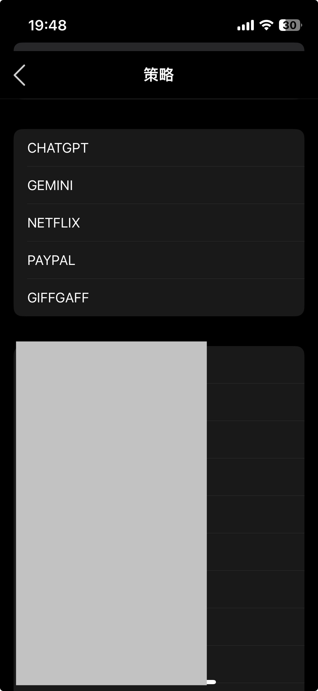

---

id: 658616

title: "小火箭配置按需配置"

created_at: 2025-05-18T12:01:58.482Z

username: skylusheng

display_username: "skylusheng"

---


# 小火箭配置按需配置


```
https://testingcf.jsdelivr.net/gh/ACL4SSR/ACL4SSR@master/Clash/Ruleset/OpenAi.list
https://testingcf.jsdelivr.net/gh/ACL4SSR/ACL4SSR@master/Clash/Ruleset/AI.list
https://raw.githubusercontent.com/blackmatrix7/ios_rule_script/master/rule/Shadowrocket/PayPal/PayPal.list
https://raw.githubusercontent.com/blackmatrix7/ios_rule_script/master/rule/Shadowrocket/Netflix/Netflix.list
https://raw.githubusercontent.com/blackmatrix7/ios_rule_script/master/rule/Shadowrocket/Gemini/Gemini.list
https://raw.githubusercontent.com/iniwex5/tools/refs/heads/main/rules/UK-wifi-call.list
```












### 这么配置完这些app亲测都能用


### 插个GPT花絮

| 类型 | 是否自动 | 选择方式 | 适合场景 |

| --- | --- | --- | --- |

| `select` |  手动 | 用户手动选择 | 手动控制使用哪个节点 |

| `url-test` |  自动 | 延迟最低优先 | 智能选择最快节点 |

| `fallback` |  自动 | 按顺序备用切换 | 容错、稳定性优先 |

| `load-balance` |  自动 | 多节点分发 | 多连接负载均衡 |

| `random` |  自动 | 随机选一个 | 分散访问或对速度要求不高场景 |


---


*来源: https://linux.do/t/topic/658616.json*

