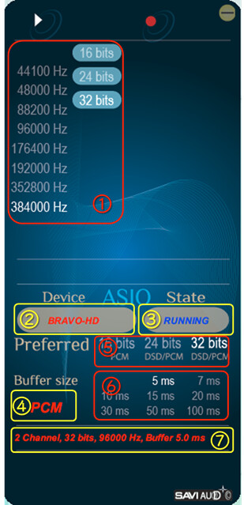
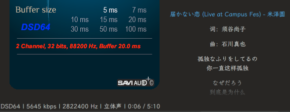
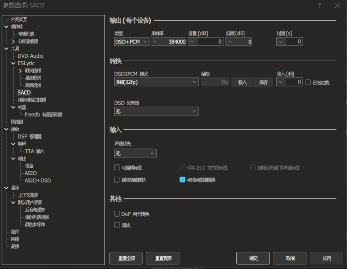
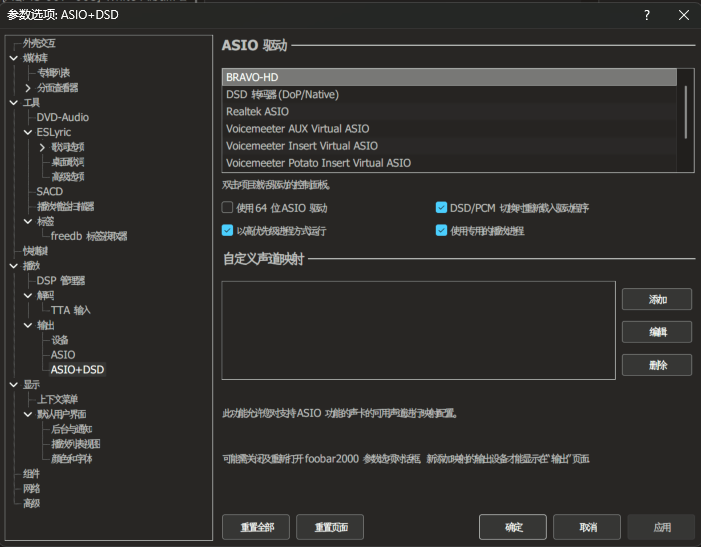

---

id: 658769

title: "[HIRES] BRAVO-HD + Foobar2000 ASIO 简明教程"

created_at: 2025-05-18T13:40:07.925Z

username: Hantong

display_username: "陈寒彤"

---

# [HIRES] BRAVO-HD + Foobar2000 ASIO 简明教程

## 前言

已知 iBasso DC3 Pro 等 “小尾巴” 使用了 Savi 的解决方案, 在安装驱动时会带上一个 BRAVO-HD 的控制软件. 可惜文档不多, 在此简要分享.

## 一图流

红色框为可控制类, 黄色框为状态显示类.

- ① 设置设备解码采样率和位深度, 个人按设备支持的最大值来.

- ② 设备名称显示

- ③ 设备运行状态

正在播放 (如图所示)

未在播放

- ④ 设备解码状态, PCM 或 DSD32 / DSD64, etc

DSD 直通交由小尾巴解码时, 显示 DSD**，如下图

- ⑤ 优先选择的位深度

**请选择设备支持的最大值, 否则使用 foobar2000 播放 DSD 时爆音**

在首次安装或重装驱动后, 会恢复默认, 害得我还以为坏了.

- ⑥ 缓冲长度

随意, 越小越吃 CPU, 不过个人感知不深.

- ⑦ 当前正在播放的音频信息, 由左往右: 声道数, 位深度, 采样率, 实际的缓冲长度

## Foobar2000 设置

选择 `ASIO+DSD:BRAVO-HD` 为输出设备后, 进入参数配置

- SACD → 输出类型调整为 DSD+PCM 以直通 DSD; 采样率设置为设备支持的最大值； 音量设置为 0, 其余默认.

- 输出 → ASIO+DSD

注意: 不要勾选使用 64 位 ASIO 驱动, 可能导致不能播放乃至崩溃等问题.

---

ASIO 模式下, Foobar200 会独占 DAC, 别的软件不会输出声音的哦.

---

*来源: https://linux.do/t/topic/658769.json*

