---

id: 672689

title: ":fire:【原创长文】关于Claude4，你想知道的一切，250529更新Lmarena前端编程评分【长期更新】"

created_at: 2025-05-23T02:06:44.087Z

username: dwqxq1

display_username: "dwqxq1"

---

# :fire:【原创长文】关于Claude4，你想知道的一切，250529更新Lmarena前端编程评分【长期更新】

## Lmarena前端编程评分 250529更 19:09更新

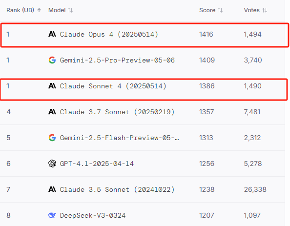

## Aider编程评分 250526 16:30更新

4.0与其他模型比

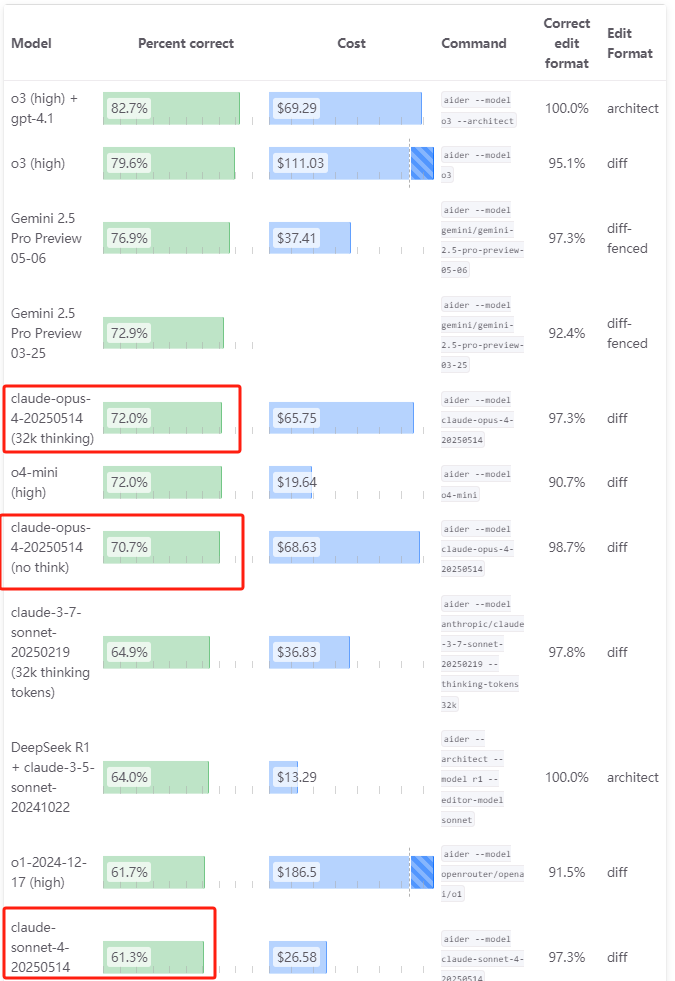

---

4.0与3.7比

sonnet4-no thinking竟然比3.7-no thinking还低4分

sonnet-32k thinking比3.7-32k thinking低4分

来源：[Aider LLM Leaderboards | aider](https://aider.chat/docs/leaderboards)

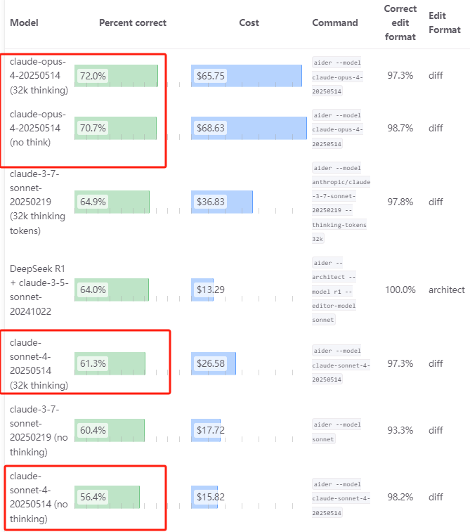

---

### Humanity’s Last Exam评分【长期更新】

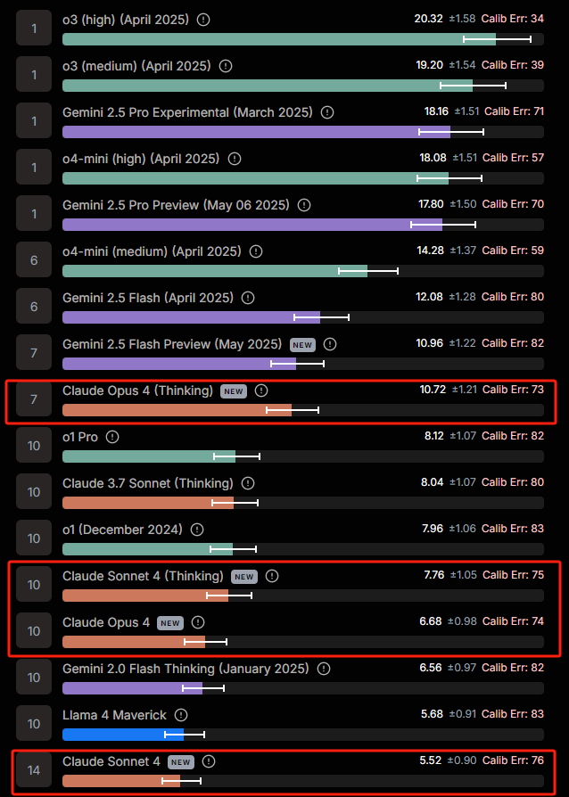

---

# 发布会

5月23日凌晨，claude发布了sonnet 4，opus 4两个版本

官方把名字顺序调整了，以前叫3 opus，3.7 sonnet，现在叫sonnet 4，opus 4

官方稿：[https://www.anthropic.com/news/claude-4](https://www.anthropic.com/news/claude-4)

模型对比：[模型概览 - Claude Docs](https://docs.anthropic.com/zh-CN/docs/about-claude/models/overview)

系统卡片：[https://www-cdn.anthropic.com/6be99a52cb68eb70eb9572b4cafad13df32ed995.pdf](https://www-cdn.anthropic.com/6be99a52cb68eb70eb9572b4cafad13df32ed995.pdf)

官方视频：[https://www.youtube.com/watch?v=oqUclC3gqKs](https://www.youtube.com/watch?v=oqUclC3gqKs)

发布会：[https://www.youtube.com/watch?v=EvtPBaaykdo](https://www.youtube.com/watch?v=EvtPBaaykdo)

# 评测

## 官方自评

[09a6d5aa47c25cb2037efff9f486da4918f77708-3840x23043840×2304 78.2 KB](https://cdn3.ldstatic.com/original/4X/8/e/6/8e62284947a95fbe5686eed03e3dde1a423060cd.webp)

[6246b412f30444ce8e1e5746e226c56a743bd99f-2600x21182600×2118 151 KB](https://cdn3.ldstatic.com/original/4X/f/a/d/fade39d212b1e6af803fca2a67c4e8b7ef670ad4.webp)

根据官方自评的整理

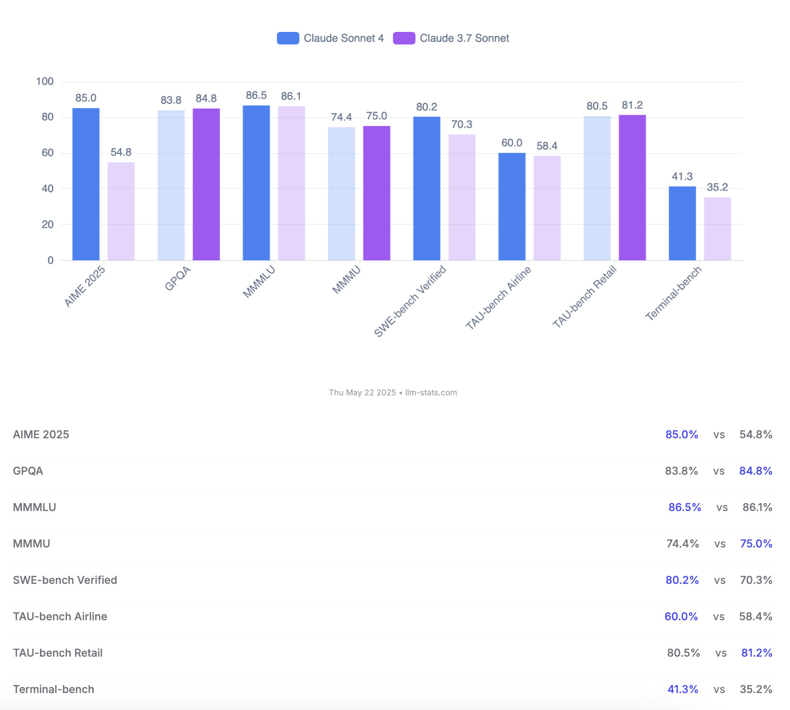

---

## LMArena尚无评分

来源：[https://lmarena.ai](https://lmarena.ai)

---

## LiveBench评分

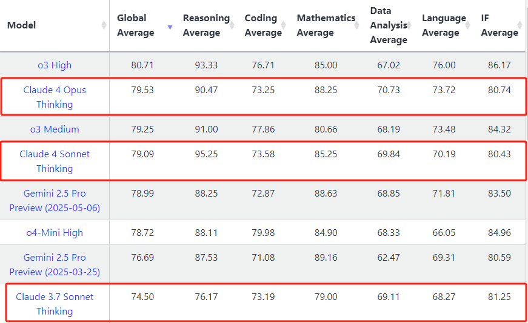

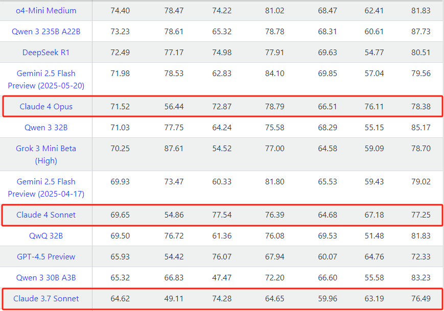

---

## Aider尚无评分

来源：[Aider LLM Leaderboards | aider](https://aider.chat/docs/leaderboards/)

---

## Fiction Bench长上下文评测，尚无评分

来源：[Fiction.live](https://fiction.live/stories/Fiction-liveBench-Feb-21-2025/oQdzQvKHw8JyXbN87)

---

# Chat渠道

## 官方Chat已上线

免费用户可以用sonnet4，不能用opus，不能再用3.7，3.5，haiku

免费版上下文比$20版少很多，只适合提问，不太适合用来写大段代码

$20用户可以用opus，但每五小时限10次，不够用

继承了A社一贯的抠门习惯，opus与sonnet貌似是共用限量，用完10次opus，连sonnet都不能用了

另外就是老毛病，梯子IP被污染的的，容易封号

---

## LMArena Direct Chat已上线（免费）

LMArena里面的模型都是限制上下文和最大输出的

进入网站后顶部选Direct Chat → 搜Claude 4

注意LMArena最近出了新版界面(下面网址)，只有新版的Direct Chat里才有claude4，老版没有

来源：[https://beta.lmarena.ai/](https://beta.lmarena.ai/)

---

## Openrouter Chatroom已上线（耗自己的API余额）

---

## Perplexity已上线

上下文貌似就32k

---

## Poe已上线

opus4=200k上下文，2000积分

---

## Monica已上线

Opus要消耗高级积分，40积分/ktokens

---

## Genspark已上线

---

## Flowith已上线

---

## You未上线

---

# 代码编辑器渠道

## Cursor已上线

付费会员可以用sonnet4，120k上下文，现在新模型，折扣价一周，消耗0.75次（3.7要消耗2次）

opus只能用max模式

试用账号不能用

---

## Github Copilot已上线

Pro会员可以用sonnet4

Pro会员无法使用Claude 4.0 Opus，Pro+才可以

---

## Windsurf尚未接入

就是包月会员没有claude4，但可以通过自备APIKey，自费接入

Windsurf已经被OpenAI三十亿美元收购了

现在貌似是Cluade不给Windsurf首发接入API：[【真正的商战朴实无华】Anthropic拒绝为可能被OAI收购的windsurf提供首发claude4支持](https://linux.do/t/topic/672604)

---

# API 渠道

## 官网API已上线

claude-4-sonnet与3.7一样，上下文200k，最大输出64k，输入$3，输出$15，50tps

claude-4-opus与3-opus一样，输入$15，输出$75，30tps

---

## OpenRouter API已上线

来源：[Claude Sonnet 4 - API, Providers, Stats | OpenRouter](https://openrouter.ai/anthropic/claude-sonnet-4)

来源：[Claude Opus 4 - API, Providers, Stats | OpenRouter](https://openrouter.ai/anthropic/claude-opus-4)

---

## KiloCode送$100，可用sonnet4和opus4

需绑卡扣$10，暂不确定是否返还

来源：[[已结束]号称庆祝Claude 4上市，KiloCode送$100 free tokens](https://linux.do/t/topic/672431)

---

## OAIPro已上线

---

# 个人想法

opus4性能与sonnet4几乎一样，很多方面还不如sonnet4，价格是sonnet5倍，估计没有多少人用，最后很可能成为GPT4.5那样的"吉祥物"

opus可能就是以前压箱底没发布的教师模型3.5opus，没怎么开发就放上来充数

opus貌似唯一优点就是可以做更长时间的agent工作，比如连续推理几个小时

没有haiku 4，感觉haiku一直就没人用，中途还涨价好几倍更没人用，与flash/ds3比完全没有竞争力

claude这种中型AI公司也没有财力人力同时维持三条产品线都处于巅峰状态，opus与haiku已经被逐渐边缘化了

sonnet4，上下文，最大输出，甚至数据训练数据截止日期都与3.7完全一样，性能提升也很有限，远没有3.5 → 3.7的提升大

opus4最大输出只有sonnet的一半，只有32k，怎么看这俩也不像彻底改变构架的下一代模型

sonnet4感觉就是为了应对2.5-pro-0506，和2.5-flash-0520，仓促推出的小升级，我猜测就是内定的3.8一类的强行戴高帽，硬充4.0

opus4我无责任瞎猜其实就是opus3.5的马甲，否则怎么会教师32k输出，蒸馏出64k，性能几乎完全相同的claude4

因为opus3.5的真徒弟其实是sonnet3.5，输出16k

真正的opus4，根据A社的惯例，为了防止竞争对手蒸馏，现阶段根本就不会放出来

最近有一种风气，OpenAI带头的，就是上代教师模型+最新一代蒸馏模型在同一时期发布

例如o1配o3-mini，o3配o4-mini，opus4(我猜其实是opus3.5)配claude4

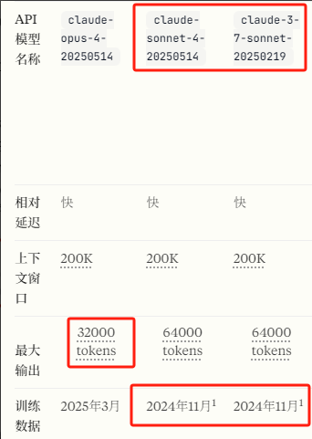

最近Google明显开始发力，而且战略明显针对Claude，证据就是2.5-pro-0506为了冲编程性能抢3.7市场，主动牺牲，其他性能都略微下降了

从结果上看，Gemini在OpenRouter的API调用量，和Cursor的调用量，都是仅次于3.7，而且差距正在迅速缩小，比如在OpenRouter上，本周2.5-pro-0506的调用量已经达到3.7的60%，这比啥评分都有用

下图OpenRouter周调用量

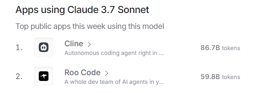

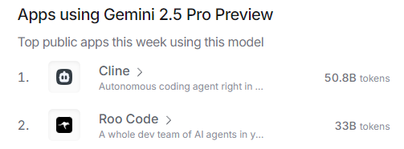

---

下图Cursor官方x

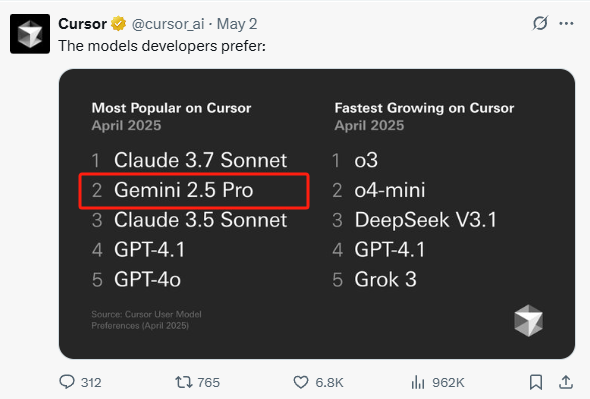

Google知道自己与OpenAI会是"一生的敌人"，ChatGPT已经占领小白用户的心智，对一般小白来说，ChatGPT就等于AI，Google即便性能有略超过ChatGPT，也是短期内无法逆转小白用户心智的，因为早已错过了时机。

Gemini在短期内肯定无法撼动老大OpenAI的情况下，聪明的策略就是一边蚕食老大，一边集中火力，抢老三Claude的地盘

Claude几乎没有小白用户，没有手机用户，没有语音，没有画图，没有视频，没有多模态，没有免费，没有低价，没有大善人，没有开源，没有自产硬件，

编程即是Claude的护城河，又是Claude画地为牢，一旦编程性能被Gemini pro超过，攻破城门，可能就是灭顶之灾，程序员不像小白对性能不敏感，程序员没有忠诚度可言，很现实，谁好用就用谁的，可以大面积倒戈

---

# L站内一些相关帖子汇总

⊚[Claude4个人感觉没有3.7好用](https://linux.do/t/topic/672892)

⊚[Claude注册账号秒被封，还有啥注册的好办法么？](https://linux.do/t/topic/659369)

⊚[【真正的商战朴实无华】Anthropic拒绝为可能被OAI收购的windsurf提供首发claude4支持](https://linux.do/t/topic/672604)

⊚[大事不妙，Claude 4 Sonnet 正在为了美观而美观](https://linux.do/t/topic/672152)

⊚[https://linux.do/t/topic/673889](https://linux.do/t/topic/673889)

⊚[Claude4比3.7思考程度要浅](https://linux.do/t/topic/672836)

⊚[Claude Opus 4 效果不及预期！](https://linux.do/t/topic/672952)

⊚[https://linux.do/t/topic/672226](https://linux.do/t/topic/672226)

⊚[用了claude 4 ，opus怎么比sonnet还拉胯](https://linux.do/t/topic/672304)

⊚[claude4又变强了！](https://linux.do/t/topic/672468)

⊚[是claude-4-sonnet强，还是claude-4-opus更厉害。](https://linux.do/t/topic/673156)

⊚[目前感觉 Claude 4 诚意不足，感觉会被 DeepSeek 干死](https://linux.do/t/topic/673208)

⊚[Claude 4 opus 天气卡片效果测试](https://linux.do/t/topic/672131)

⊚[https://linux.do/t/topic/672217](https://linux.do/t/topic/672217)

⊚[Claude4-sonnet 太强了 （cursor）](https://linux.do/t/topic/672658)

---

# 谢谢阅读，发张梗图，祝各位与Claude4愉快地玩耍

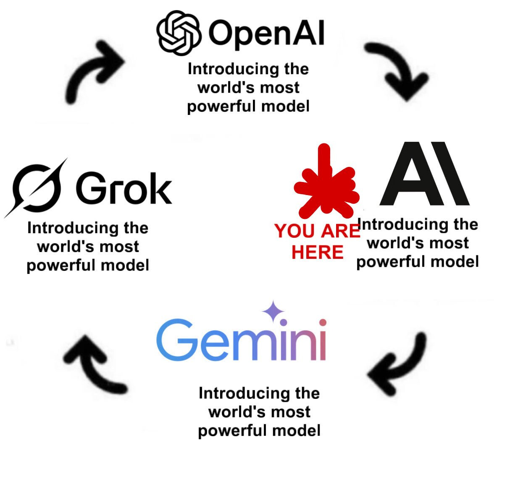

---

*来源: https://linux.do/t/topic/672689.json*

