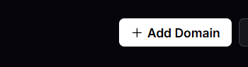
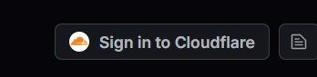

---

id: 675030

title: "建立自己的域名邮箱系统"

created_at: 2025-05-23T17:30:27.830Z

username: obrook

display_username: "思危"

---


# 建立自己的域名邮箱系统


论坛有很详细的教程了，走了一遍，总结下，说下几个小坑

# 优点

- 拥有属于自己的大量邮箱

- 接收邮件

- 发送邮件

- UI登陆和注册界面

- 能够开放给其他用户，并限制用户注册的邮箱个数

- …

# 要求

- 有一个DNS解析了的域名 (绑定了某个服务器的一个域名)

# 原理

基于cloudflare_temp_email


[https://temp-mail-docs.awsl.uk/](https://temp-mail-docs.awsl.uk/)


[https://github.com/dreamhunter2333/cloudflare_temp_email](https://github.com/dreamhunter2333/cloudflare_temp_email)

# 教程

## 接收邮件

非常详细的教程，一步步来，不会出错：

[【教程】小白也能看懂的自建Cloudflare临时邮箱教程（域名邮箱）](https://linux.do/t/topic/316819)

一个小问题是Cloudflare界面有更新， Workers & Pages在如下位置：


如上只能实现收邮件，不能发邮件

# 发送邮件

- 同时都设置，方法2会失效，即使方法1失效了也不会自动切换到方法2；

- 方法2发送邮件，接收邮箱中的邮件，会显示发送的是你的gmail邮箱而不是域名邮箱。

用其中一个就行。

### 方法 1 – resend

[https://resend.com/](https://resend.com/) 注册个账号


1


点击domain


2




3


填写你的域名 [123.com](http://123.com), 选择区域，我选的美国

4


点击如下，自动登陆Cloudflare并添加DNS解析到Cloudflare




5


生成和复制resend API keys


6 添加API keys到Cloudflare


Variables name 填写 `RESEND_TOKEN`

Workers & Pages – xxxmailapi – Settings  – Variables and Secrets --add


done!

### 方法2 – SMTP

**用55楼层的这个方法**，主帖中的方法不对的

[https://linux.do/t/topic/515642/55](https://linux.do/t/topic/515642/55)

**全部引用到如下：**

---

> `SMTP_CONFIG` 这里是设置了一个 SMTP 代理服务，作者大佬直接集成在项目里了，不用我们再专门弄一个 worker 代理，感谢大佬！楼主你主帖里写的是不会生效的  能成功发送是因为这个项目首先调用 resend 发信，你刚好配置了，所以就发送成功了。cf worker 本身不提供 smtp 服务，但是可以代理别人的，比如 Gmail 的。

> Gmail 的 smtp 服务相关文档

>

> [Send email from a printer, scanner, or app - Google Workspace Admin Help](https://support.google.com/a/answer/176600?hl=en)

> 问了 AI，使用 cf worker 代理的话，最好选第二个 Gmail SMTP Server，虽然谷歌推荐第一个 SMTP Relay，但 worker 是动态 IP。Gmail SMTP Server 每天可以发 2000 封邮件，应该相当够用了，我一年都不一定能发 2000 封邮件……

> 具体操作是在后端 worker 添加环境变量 `SMTP_CONFIG` ，值为

```
{
    "你的域名": {
        "host": "smtp.gmail.com",
        "port": 465,
        "secure": true,
        "authType": [
            "plain",
            "login"
        ],
        "credentials": {
            "username": "你的 gmail 邮箱地址",
            "password": "密码"
        }
    }
}
```

> 建议 1: 生成一个 app password，不然就得直接写你的 gmail 密码上去了…… 生成用 [https://myaccount.google.com/apppasswords](https://myaccount.google.com/apppasswords) 这个链接，会得到一个 16 位密码

> 建议 2:`SMTP_CONFIG` 设置为 secret，毕竟包含了你的 gmail 密码

---

在google账号找了半天apppasswords 或者应用专用密码都没找到，直接点击这个链接[https://myaccount.google.com/apppasswords](https://myaccount.google.com/apppasswords) 进入。另外这个密码是16位是， **中间是没有空格的。**

done! 再也不用愁没有邮箱了~


---


*来源: https://linux.do/t/topic/675030.json*

