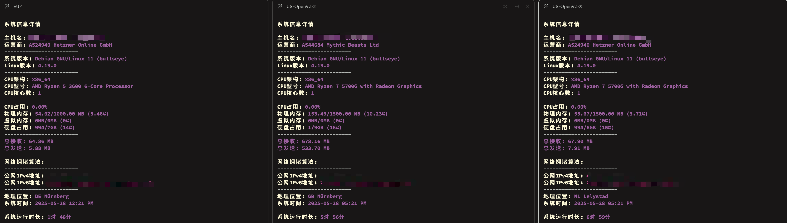
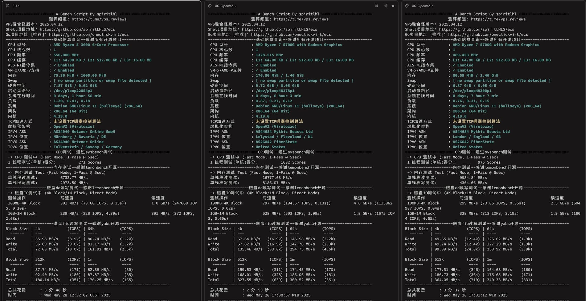
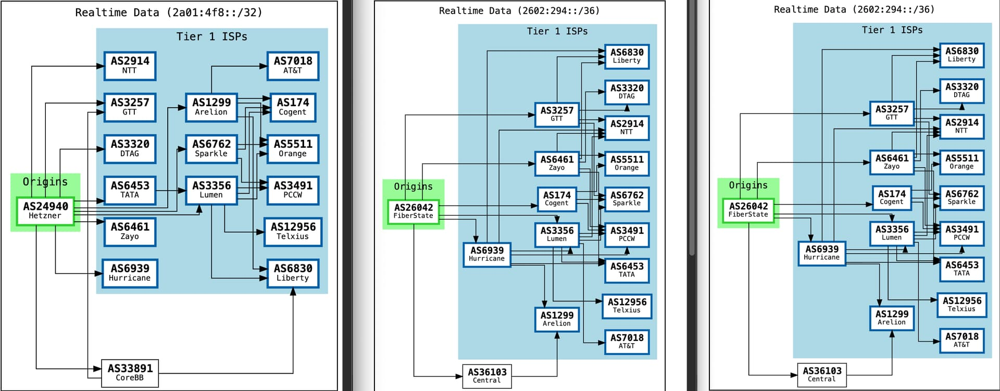
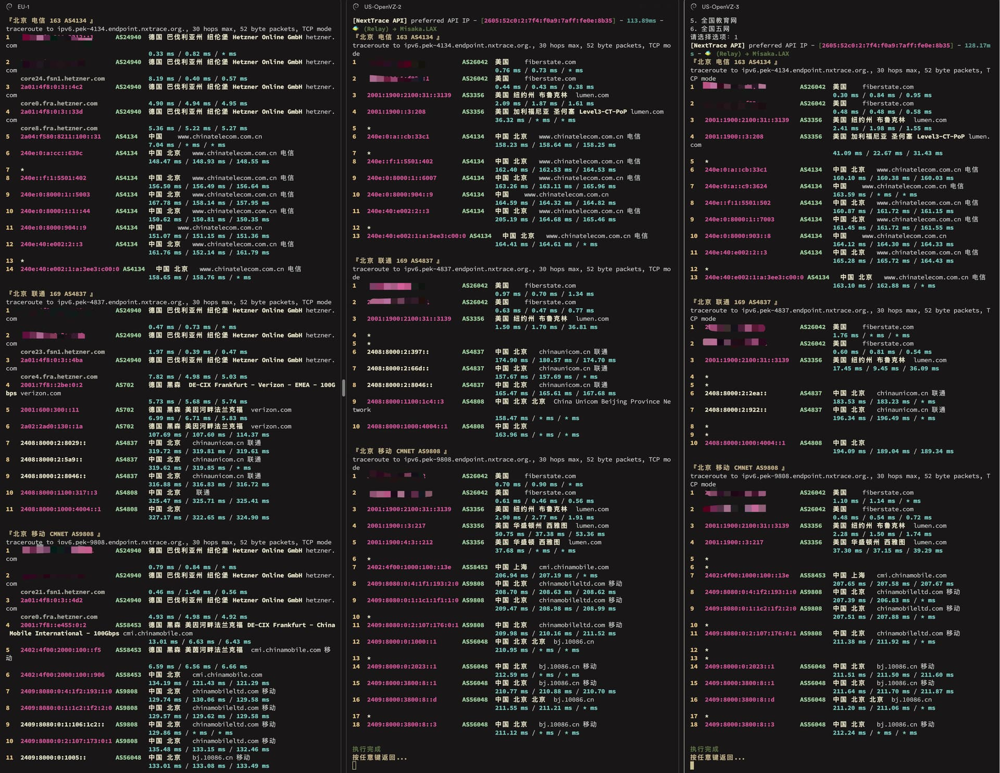
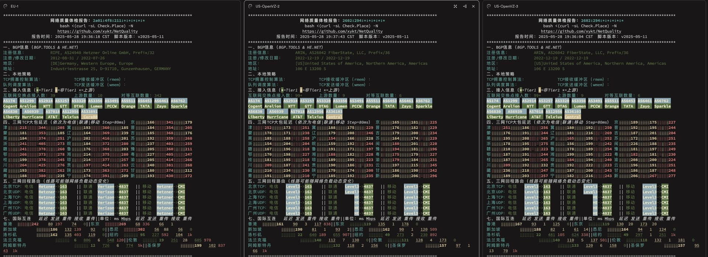
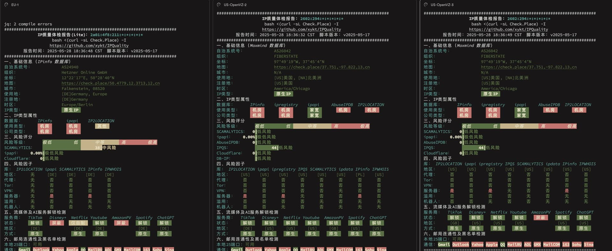
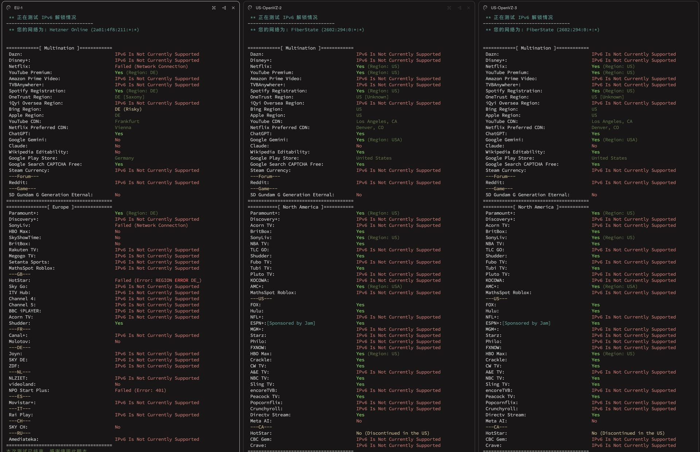
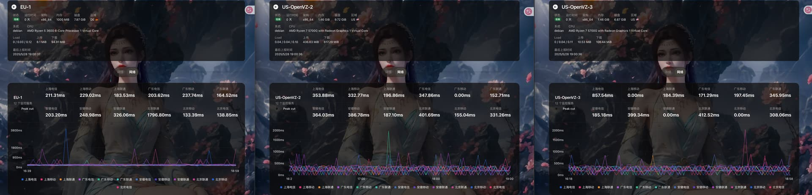

---

id: 685347

title: "HAX小鸡测试记录，还得是US2"

created_at: 2025-05-28T12:04:07.799Z

username: skylusheng

display_username: "skylusheng"

---

# HAX小鸡测试记录，还得是US2

### 小鸡配置

| SKU | CPU | RAM | SSD | Traffic | IP | SP |

| --- | --- | --- | --- | --- | --- | --- |

| EU-1 | 1C | 1G | 8G | ∞/500Mbps | V6 | ∞ |

| US-OpenVZ-2 | 1C | 1.5G | 10G | ∞/1Gbps | V6 | ∞ |

| US-OpenVZ-3 | 1C | 1G | 7G | ∞/500Mbps | V6 | ∞ |

### 系统参数硬件性能

### Connectivity

### 回程路由

### 国内三网延长

### IP质量

### 流媒体解锁

### 心跳线

---

*来源: https://linux.do/t/topic/685347.json*

