---

id: 691678

title: "沃达丰德国esim申请教程"

created_at: 2025-05-31T14:57:32.048Z

username: lynn_Zenn

display_username: "lynn Zenn"

---

# 沃达丰德国esim申请教程

**前置条件**

**护照,支持esim的手机或者写卡的东西**

首先点击[申请地址](https://www.vodafone.de/freikarten/partner/callya/?redo&b_id=1740&void=33333954&c_id=affl_cic_12331%253Afq0_D_nta_sta_per_&aid=202409190954412679548441X124747C1169137404TSkkJ2Jw&affiliate=124747&VFAffID=12331&extProvId=315&extProvApi=129048&extPu=12331&extLi=124747&extPm=124747&extCr=137404#personal-details-1)

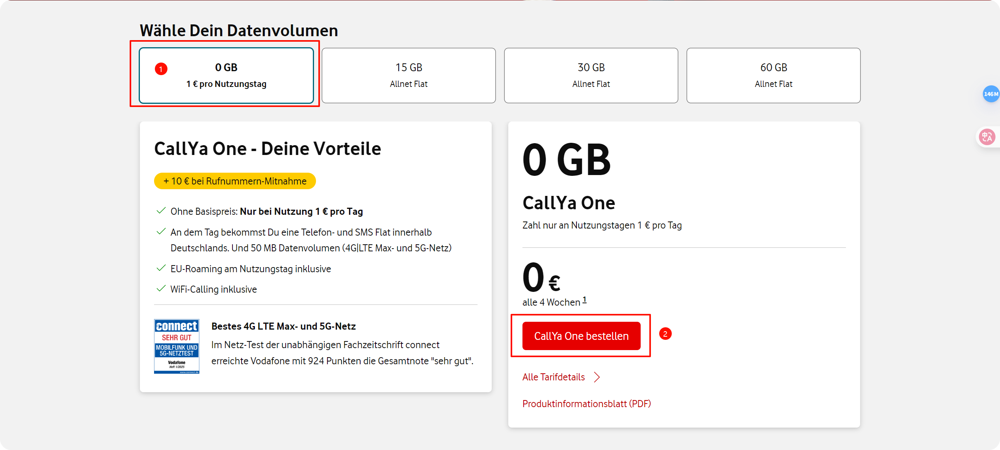

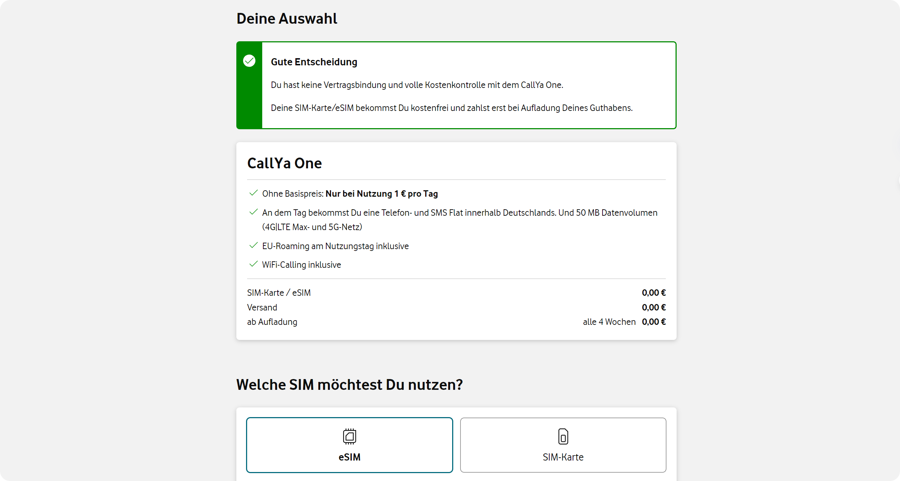

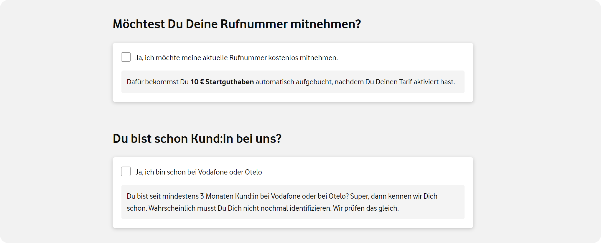

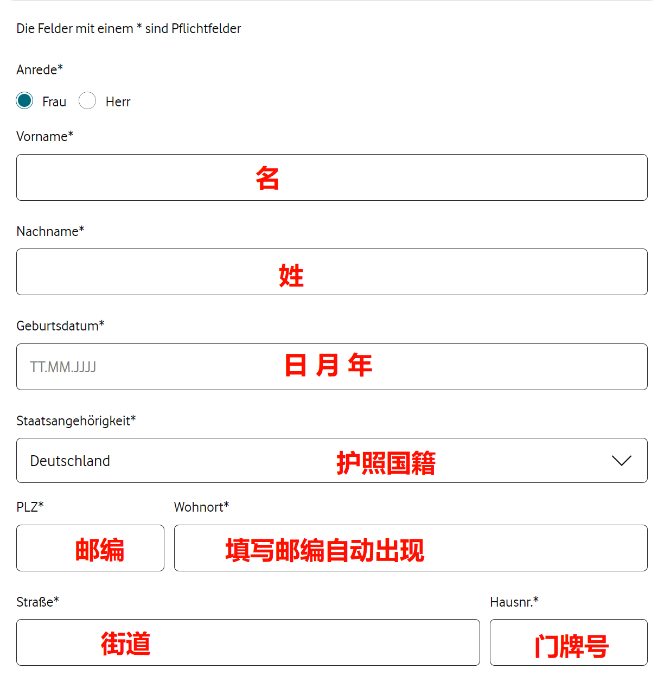

下方填写邮件地址之后 填写验证码

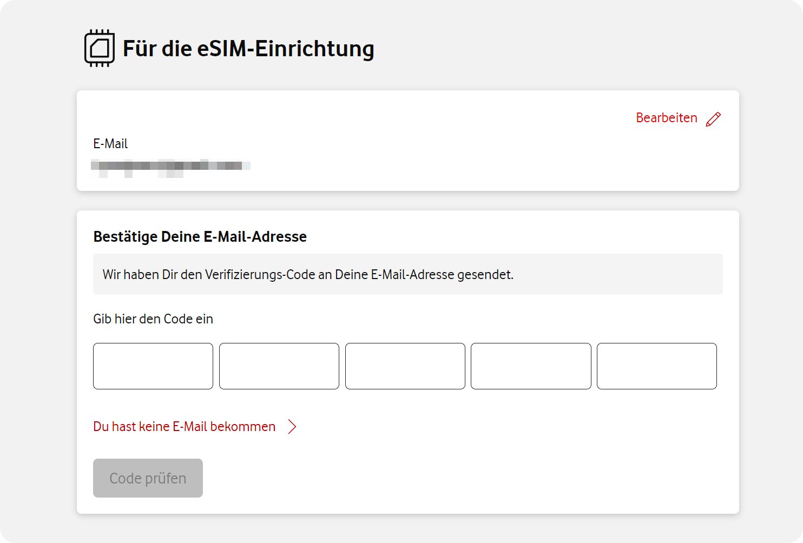

验证码都要等几分钟 不一定那么快

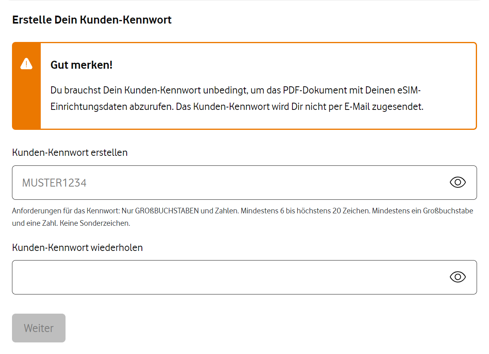

PDF的密码 要大写字母数字  一定要记住 后面PDF要这个密码才可以打开

下一步之后 这是选这个

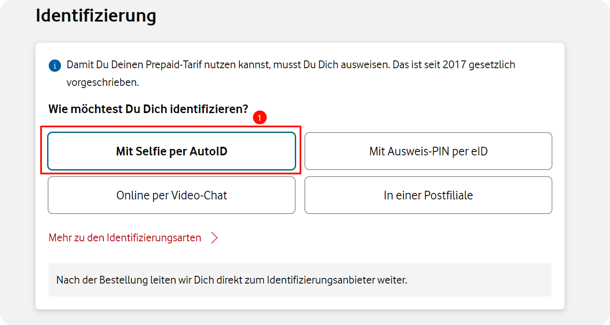

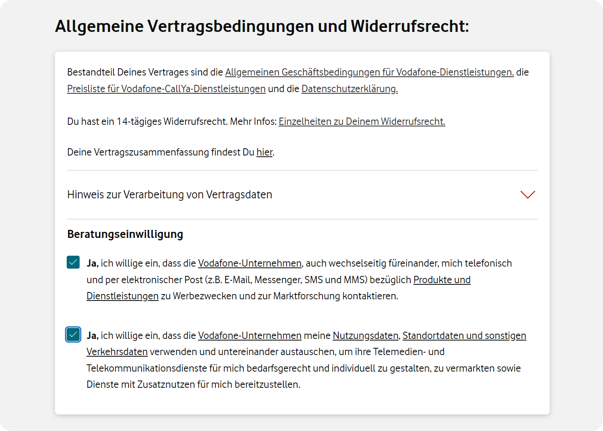

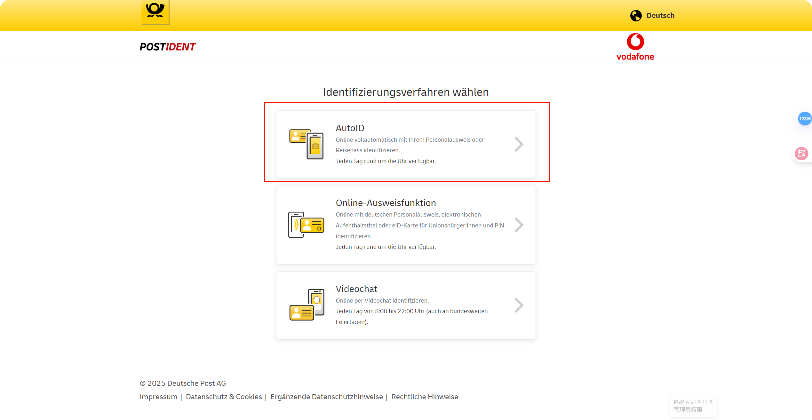

然后下载这个 POSTIDENT APP

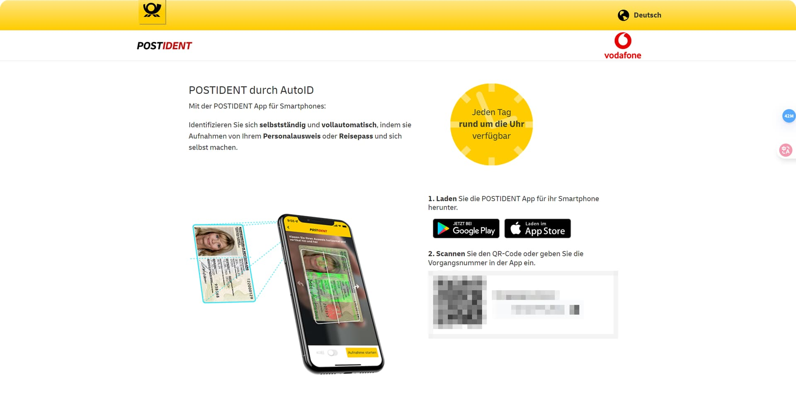

完成之后会有邮件回复 等待即可

之后有邮件确认地址下发 这个时候手机号已经出来了

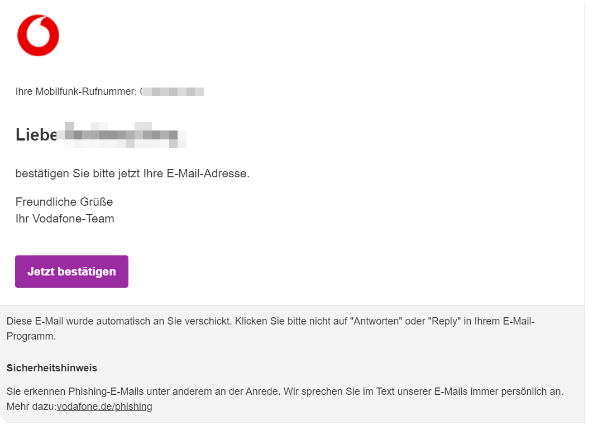

确认完地址 之后等待 下一封有PDF附件的邮件 使用前面设置的密码即可打开PDF

然后通过支持esim的手机扫码 即可完成添加 code也在二维码边上

保号(看博主的,自己的还没试过)

季度保号教程：

N26设置季度自动转账  (0月租90天需要余额变动保号)0.01即可

收款人Name：Vodafone GmbH

收款IBAN:    DE68300700100250800000

BIC：DEUTDEDDXXX

然后备注里写上手机号加0（如01xxxxxxxxx）

PS:

最后选分类 不知道选啥 放到纯水里面先吧

---

*来源: https://linux.do/t/topic/691678.json*

