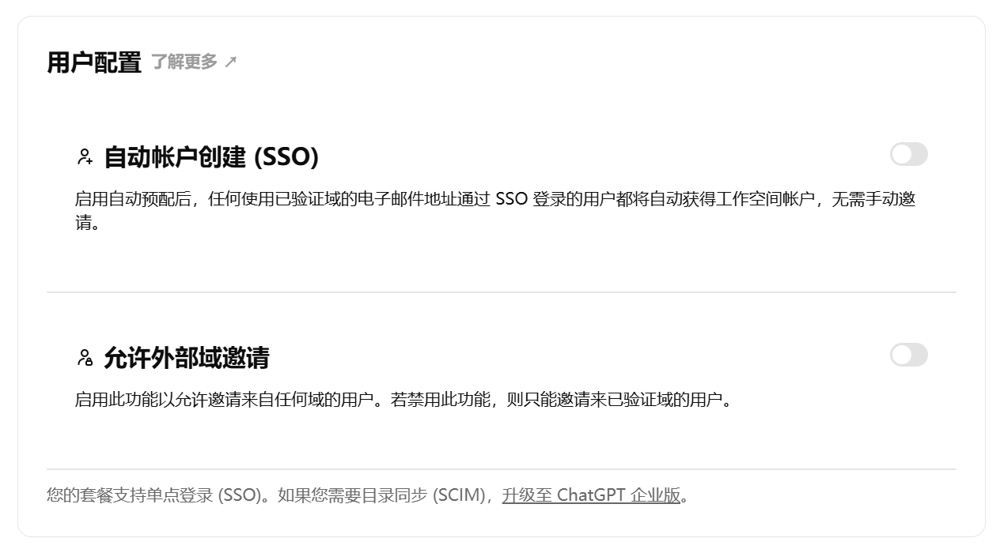

---

id: 703971

title: "ChatGPT Team 教程"

created_at: 2025-06-05T10:49:30.529Z

username: Reno

display_username: "Reno"

---

# ChatGPT Team 教程

## 关闭订阅

管理员登入后，访问 [订单页](https://chatgpt.com/admin/billing)

点击 管理套餐 → 取消订阅，这样就可以避免下个月的30刀账单了

## 认证域

管理员登入后，访问 [认证页面](https://chatgpt.com/admin/identity)

点击添加域，输入自定义域后点击提交复制TXT记录值

前往域名托管商处添加一条TXT记录，名称 `@`，值为复制得到的值

然后关闭 **允许外部域邀请**，这样只有认证的域名才能被邀请，可有效避免200w大军出现

还有其他的，可以直接编辑，欢迎补充

---

*来源: https://linux.do/t/topic/703971.json*

