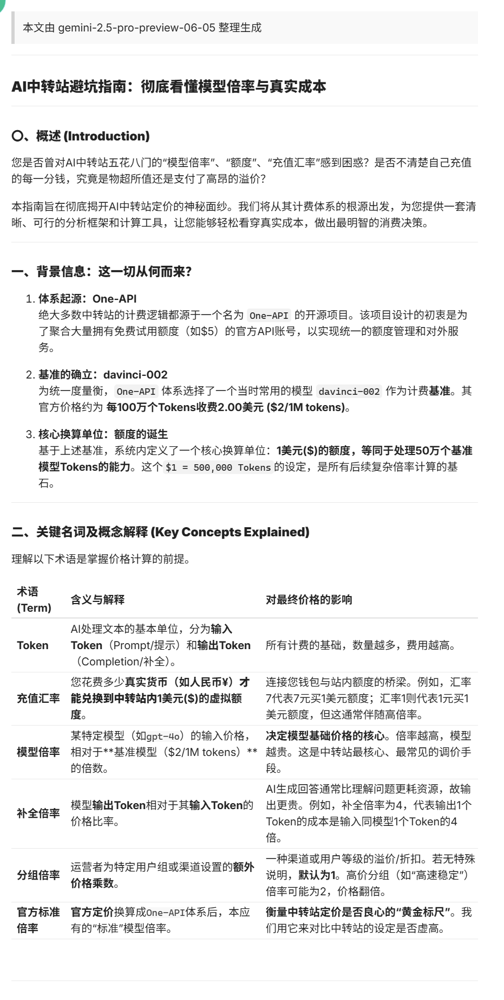
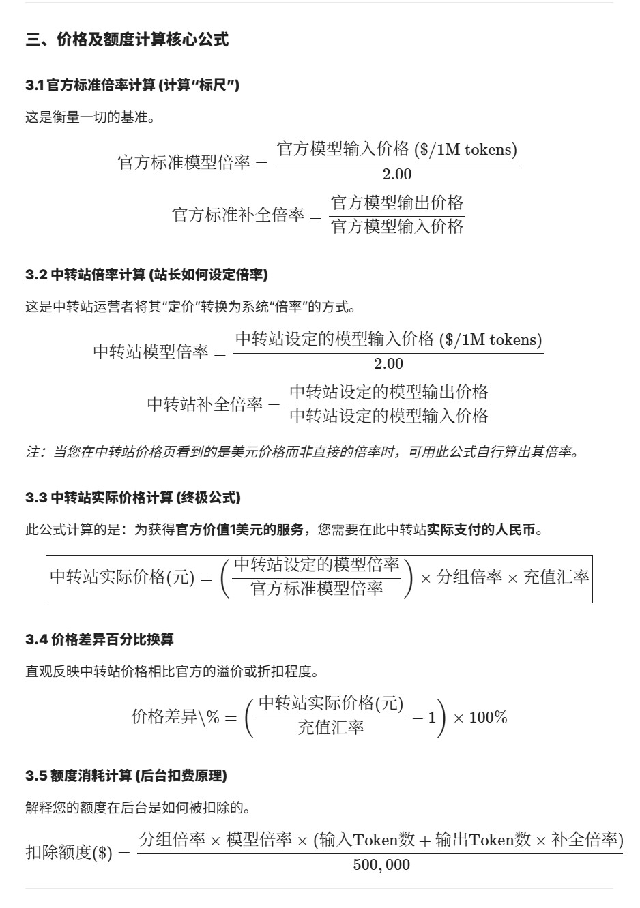
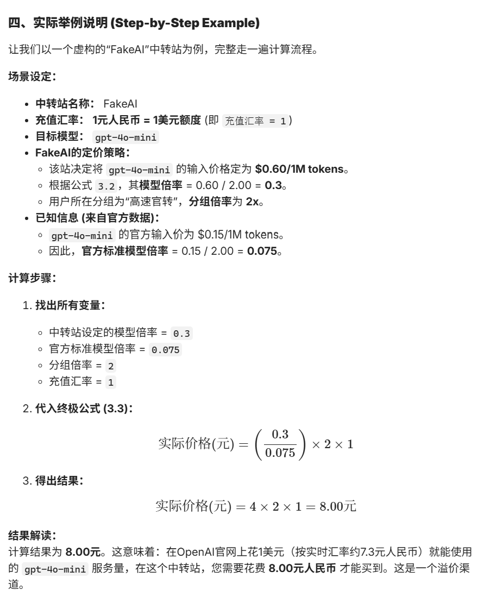
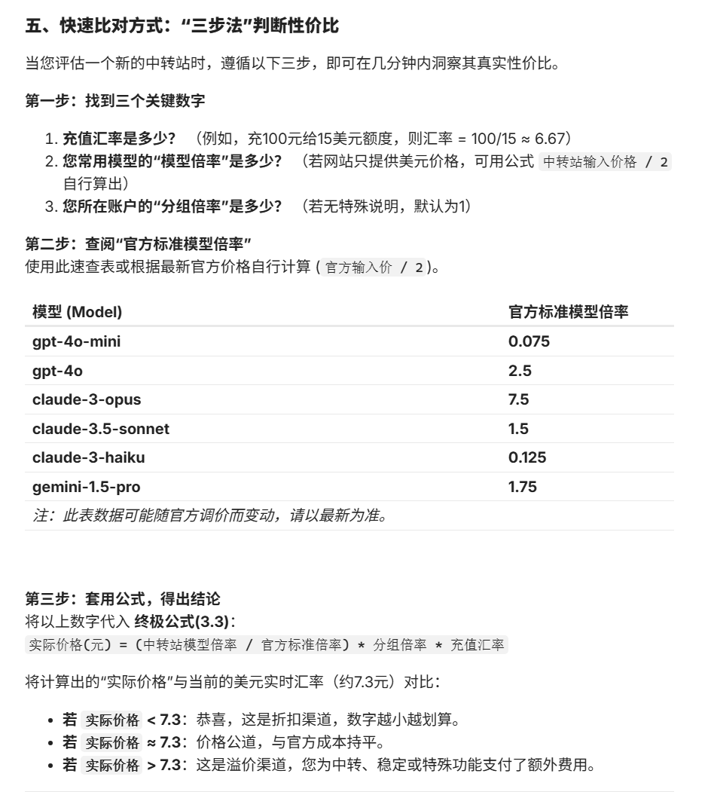
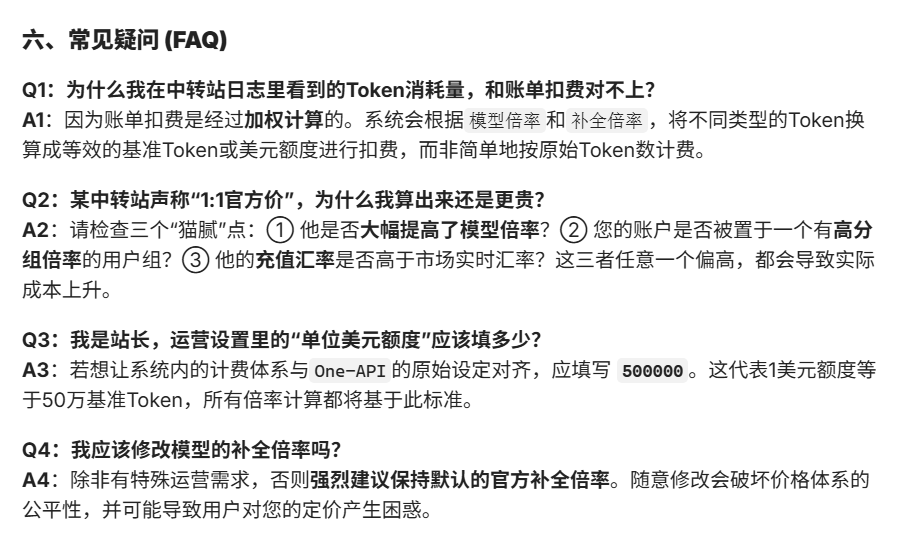
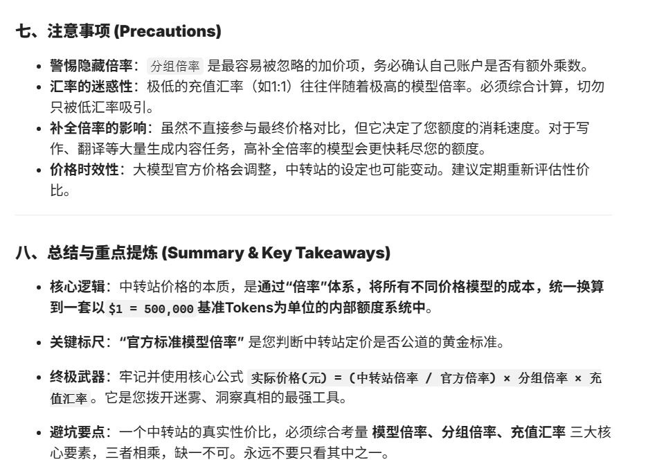

---

id: 707672

title: "AI中转站避坑指南：彻底看懂模型倍率与真实成本"

created_at: 2025-06-07T04:10:13.053Z

username: 37012

display_username: "图"

---

# AI中转站避坑指南：彻底看懂模型倍率与真实成本

核心公式：

\boxed{

\text{中转站实际价格(元)} = \left(\frac{\text{中转站设定的模型倍率}}{\text{官方标准模型倍率}}\right) \times \text{分组倍率} \times \text{充值汇率}

}

将计算出的“实际价格”与当前的美元实时汇率（约7.3元）对比：

- **若 实际价格 < 7.3**：恭喜，这是折扣渠道，数字越小越划算。

- **若 实际价格 ≈ 7.3**：价格公道，与官方成本持平。

- **若 实际价格 > 7.3**：这是溢价渠道，您为中转、稳定或特殊功能支付了额外费用。

大家可以使用下面的工具进行计算

> 承接上文：

>

> 有佬友反馈，想要有个工具可以快速比对中转站与官方的倍率与价格，刚好我也有这样的痛点与需求，遂让gemini-2.5-pro-preview-06-05 生成了一个小工具，分享给大家~

> 需要手动输入 中转站的充值汇率 与 实时的美元汇率，文件中已经预置好了官方的模型倍率（如果需修改或新增 可以直接在页面操作，注意不会保存！！！）

>  ![[image]](https://cdn3.ldstatic.com/original/4X/d/5/4/d543ce6f2f6bcb55e8497df64f276b477c1494d4.png)

> 在步骤三，可以贴入中转站的模型…

---

*来源: https://linux.do/t/topic/707672.json*

