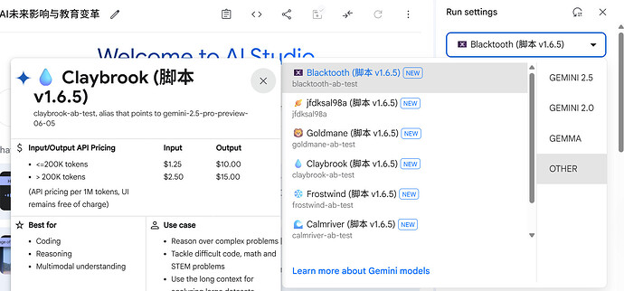

---

id: 709406

title: "【文档共建】AI Studio增强脚本，显示隐藏模型，欢迎佬来修改。目前版本为v1.8.1"

created_at: 2025-06-08T04:24:55.420Z

username: yeahhe

display_username: "Mozi"

---


# 【文档共建】AI Studio增强脚本，显示隐藏模型，欢迎佬来修改。目前版本为v1.8.1




### [Google AI Studio 模型注入器](https://greasyfork.org/zh-CN/scripts/539399-google-ai-studio-%E6%A8%A1%E5%9E%8B%E6%B3%A8%E5%85%A5%E5%99%A8)

向 Google AI Studio 注入自定义模型，支持在模型列表中手动添加ID（无需输入 models/）。拦截 XHR/Fetch 请求。


```
// ==UserScript==
// @name         Google AI Studio 模型注入器
// @namespace    http://tampermonkey.net/
// @version      1.8.1
// @description  向 Google AI Studio 注入自定义模型，支持在模型列表中手动添加ID（无需输入 models/）。拦截 XHR/Fetch 请求。
// @author       Generated by AI / HCPTangHY / Mozi / wisdgod / UserModified / Yefori /lccong
// @match        https://aistudio.google.com/*
// @icon         https://www.google.com/s2/favicons?sz=64&domain=aistudio.google.com
// @grant        none
// @run-at       document-start
// @license      MIT
// ==/UserScript==

(function() {
    'use strict';

    // ==================== 配置管理 ====================
    /**
     * 脚本全局配置
     * @const
     */
    const CONFIG = {
        VERSION: "1.8.1", // 更新版本号
        STORAGE_KEY: 'AI_STUDIO_INJECTOR_CUSTOM_MODELS',
        API: { ANTI_HIJACK_PREFIX: ")]}'\n", TARGET_PATH: '/ListModels', TARGET_HOST: 'alkalimakersuite' },
        MODEL_PREFIX: 'models/',
        FIELD_INDEX: { NAME: 0, DISPLAY_NAME: 3, DESCRIPTION: 4, METHODS: 7 }
    };

    // ==================== 模型定义 ====================

    /**
     * 预设模型列表
     * @const
     */
    const PREDEFINED_MODELS = [
        {
            name: "models/gemini-2.5-pro-preview-05-06",
            displayName: `✨ Gemini 2.5 Pro 05-06 (脚本 v${CONFIG.VERSION})`,
            description: `由脚本 v${CONFIG.VERSION} 预设注入的模型`,
        },
        // --- 新添加的模型结束 ---
         {
            name: "models/gemini-2.5-pro-exp-03-25",
            displayName: `✨ Gemini 2.5 Pro Exp 03-25 (脚本 v${CONFIG.VERSION})`,
            description: `由脚本 v${CONFIG.VERSION} 预设注入的模型`,
        },
        {
            name: "models/gemini-2.5-pro-preview-03-25",
            displayName: `✨ Gemini 2.5 Pro 03-25 (脚本 v${CONFIG.VERSION})`,
            description: `由脚本 v${CONFIG.VERSION} 预设注入的模型`,
        },
    ];

    /**
     * 特殊动作模型：添加自定义模型
     * @const
     */
    const ACTION_ADD_MODEL = {
        name: 'models/---script-action-add-custom---',
        displayName: `➕ 添加自定义模型 (点击此处)`,
        description: '点击此项以手动输入新的模型 ID 并保存。'
    };

    /**
     * 特殊动作模型：清除所有自定义模型
     * @const
     */
    const ACTION_CLEAR_MODELS = {
        name: 'models/---script-action-clear-custom---',
        displayName: `🗑️ 清除手动添加的模型 (点击此处)`,
        description: '点击此项以清除所有您手动添加的模型。'
    };

    // ==================== 日志管理 ====================
    /**
     * 统一的日志管理器
     * @namespace Logger
     */
    const Logger = {
        prefix: `[AI Studio 注入器 v${CONFIG.VERSION}]`,

        /**
         * 输出常规日志
         * @param {...any} args - 日志内容
         */
        log(...args) {
            console.log(this.prefix, ...args);
        },

        /**
         * 输出错误日志
         * @param {...any} args - 错误内容
         */
        error(...args) {
            console.error(this.prefix, ...args);
        },

        /**
         * 输出警告日志
         * @param {...any} args - 警告内容
         */
        warn(...args) {
            console.warn(this.prefix, ...args);
        }
    };

    // ==================== 存储管理 ====================
    /**
     * 本地存储管理器，处理自定义模型的持久化
     * @namespace Storage
     */
    const Storage = {
        /**
         * 从本地存储加载自定义模型列表
         * @returns {Array<Object>} 自定义模型数组，包含name、displayName和description字段
         */
        load() {
            try {
                const data = localStorage.getItem(CONFIG.STORAGE_KEY);
                if (data) {
                    const models = JSON.parse(data);
                    // 自动更新模型的版本标记以匹配当前脚本版本
                    return models.map(model => ({
                        ...model,
                        displayName: model.displayName.replace(/ \(脚本 v[\d.]+\)$/, '') + ` (脚本 v${CONFIG.VERSION})`,
                        description: model.description.replace(/脚本 v[\d.]+/, `脚本 v${CONFIG.VERSION}`)
                    }));
                }
            } catch (e) {
                Logger.error('加载自定义模型时出错:', e);
            }
            return [];
        },

        /**
         * 保存自定义模型列表到本地存储
         * @param {Array<Object>} models - 要保存的模型数组
         * @returns {boolean} 保存是否成功
         */
        save(models) {
            try {
                localStorage.setItem(CONFIG.STORAGE_KEY, JSON.stringify(models));
                return true;
            } catch (e) {
                Logger.error('保存自定义模型时出错:', e);
                return false;
            }
        }
    };

    // ==================== 工具函数 ====================
    /**
     * 通用工具函数集合
     * @namespace Utils
     */
    const Utils = {
        /**
         * 清理模型名称，移除版本标记和emoji前缀
         * @param {string} name - 原始模型名称
         * @returns {string} 清理后的名称
         */
        cleanModelName(name) {
            return String(name)
                .replace(/ \(脚本 v\d+\.\d+(\.\d+)?\)/, '')
                .replace(/^[✨🦁💧❄️🌊🐉🏴‍☠️🤖🪐📚🗣️🖼️🎨🎬⚡💡🌟🚀🔧🔮]\s*/, '') // 增加了新的emoji
                .trim();
        },

        /**
         * 格式化模型显示名称，添加版本标记
         * @param {string} displayName - 原始显示名称
         * @returns {string} 带版本标记的显示名称
         */
        formatDisplayName(displayName) {
            const cleanName = displayName.replace(/ \(脚本 v[\d.]+\)$/, '');
            return `${cleanName} (脚本 v${CONFIG.VERSION})`;
        },

        /**
         * 格式化模型描述，更新版本信息
         * @param {string} description - 原始描述
         * @returns {string} 更新版本后的描述
         */
        formatDescription(description) {
            return description.replace(/脚本 v[\d.]+/, `脚本 v${CONFIG.VERSION}`);
        },

        /**
         * 检查URL是否匹配需要拦截的模型列表API
         * @param {string} url - 要检查的URL
         * @returns {boolean} 是否为目标URL
         */
        isTargetURL(url) {
            return url && typeof url === 'string' &&
                url.includes(CONFIG.API.TARGET_HOST) &&
                url.includes(CONFIG.API.TARGET_PATH);
        },

        /**
         * 验证模型ID是否有效
         * @param {string} id - 模型ID
         * @returns {boolean} ID是否有效
         */
        validateModelId(id) {
            if (!id || typeof id !== 'string') return false;
            const trimmed = id.trim();
            return trimmed.length > 0;
        },

        /**
         * 确保模型ID具有正确的前缀
         * @param {string} id - 原始模型ID
         * @returns {string} 带正确前缀的模型ID
         */
        ensureModelPrefix(id) {
            const trimmed = id.trim();
            return trimmed.startsWith(CONFIG.MODEL_PREFIX) ? trimmed : CONFIG.MODEL_PREFIX + trimmed;
        }
    };

    // ==================== 自定义模型管理 (UI 逻辑) ====================

    /**
     * 通过对话框收集用户输入并创建新的自定义模型
     */
    function promptForNewModel() {
        // 提示用户输入模型ID，会自动添加 'models/' 前缀
        const rawInputId = prompt("【添加自定义模型】\n请输入新的模型ID (例如: my-custom-model):\n(会自动添加 'models/' 前缀)");
        if (!rawInputId) return;

        if (!Utils.validateModelId(rawInputId)) {
            alert("错误：模型ID不能为空。");
            return;
        }

        // 自动添加 'models/' 前缀
        const fullModelId = Utils.ensureModelPrefix(rawInputId);

        // 使用模型ID生成默认显示名称
        const defaultName = fullModelId.split('/').pop();
        const displayNameInput = prompt("请输入该模型的显示名称 (例如: 🤖 我的模型):", `🤖 ${defaultName}`);
        if (!displayNameInput) return;

        const newModel = {
            name: fullModelId,
            displayName: Utils.formatDisplayName(displayNameInput),
            description: `由用户手动添加并通过脚本 v${CONFIG.VERSION} 注入的模型`
        };

        const customModels = Storage.load();
        const allCurrentModels = [...PREDEFINED_MODELS, ...customModels];

        // 检查模型ID是否已存在
        if (allCurrentModels.some(m => m.name === fullModelId)) {
            alert(`错误：模型ID ${fullModelId} 已存在。`);
            return;
        }

        customModels.push(newModel);
        if (Storage.save(customModels)) {
            alert(`模型 ${fullModelId} 添加成功！\n\n页面将自动刷新以应用更改。`);
            window.location.reload();
        } else {
            alert("错误：无法保存模型。");
        }
    }

    /**
     * 清除所有用户自定义的模型（不影响预设模型）
     */
    function clearAllCustomModels() {
        if (confirm("⚠️ 确定要清除所有您手动添加的自定义模型吗？\n\n(脚本预设的模型不会被删除)")) {
            if (Storage.save([])) {
                alert("所有手动添加的自定义模型已清除。页面将自动刷新。");
                window.location.reload();
            } else {
                alert("错误：无法清除模型。");
            }
        }
    }

    /**
     * 设置模型选择器的点击事件拦截器，用于处理动作模型的点击
     */
    function setupModelSelectionInterceptor() {
        document.body.addEventListener('click', (event) => {
            const optionElement = event.target.closest('[role="option"], mat-option');

            if (optionElement && optionElement.textContent) {
                const text = optionElement.textContent;
                let actionTaken = false;

                if (text.includes(ACTION_ADD_MODEL.displayName)) {
                    Logger.log("拦截到 '添加模型' 点击事件。");
                    actionTaken = true;
                    setTimeout(promptForNewModel, 50);
                } else if (text.includes(ACTION_CLEAR_MODELS.displayName)) {
                    Logger.log("拦截到 '清除模型' 点击事件。");
                    actionTaken = true;
                    setTimeout(clearAllCustomModels, 50);
                }

                if (actionTaken) {
                    // 阻止默认行为和事件冒泡
                    event.preventDefault();
                    event.stopPropagation();
                    // 移除焦点以关闭下拉菜单
                    if (document.activeElement) {
                        document.activeElement.blur();
                    }
                }
            }
        }, true); // 在捕获阶段处理事件
        Logger.log('模型选择点击拦截器已设置。');
    }

    // ==================== 初始化 ====================

    const customModels = Storage.load();
    const ALL_MODELS_TO_INJECT = [...PREDEFINED_MODELS, ...customModels];

    Logger.log(`预设模型: ${PREDEFINED_MODELS.length} 个, 用户自定义模型: ${customModels.length} 个`);

    if (document.readyState === 'loading') {
        document.addEventListener('DOMContentLoaded', setupModelSelectionInterceptor);
    } else {
        setupModelSelectionInterceptor();
    }

    // ==================== 数据处理工具函数 ====================

    /**
     * 递归查找响应数据中的模型列表数组。
     * 这个函数现在更具鲁棒性，能够处理更深层次的嵌套，并验证找到的数组是否确实是模型列表。
     * @param {Object} obj - 要搜索的对象
     * @returns {Array|null} 找到的模型数组或null
     */
    function findModelListArray(obj) {
        if (!obj) return null;

        // 使用一个栈来模拟递归，避免深度递归限制
        const stack = [obj];
        const visited = new Set(); // 防止循环引用

        while (stack.length > 0) {
            const current = stack.pop();

            if (visited.has(current)) {
                continue;
            }
            visited.add(current);

            // 检查当前是否为有效的模型数组：
            // 1. 是数组
            // 2. 长度大于0
            // 3. 至少第一个元素是数组，且其0索引是字符串，并以 'models/' 开头
            if (Array.isArray(current) && current.length > 0 &&
                Array.isArray(current[0]) &&
                typeof current[0][CONFIG.FIELD_INDEX.NAME] === 'string' &&
                current[0][CONFIG.FIELD_INDEX.NAME].startsWith(CONFIG.MODEL_PREFIX)
            ) {
                return current;
            }

            // 如果是对象或数组，将其可枚举的属性/元素推入栈中
            if (typeof current === 'object' && current !== null) {
                for (const key in current) {
                    if (Object.prototype.hasOwnProperty.call(current, key) && current[key] !== null) {
                        stack.push(current[key]);
                    }
                }
            }
        }
        return null;
    }

    /**
     * 查找合适的模板模型用于创建新模型条目
     * @param {Array} modelsArray - 模型数组
     * @returns {Array|undefined} 找到的模板模型
     */
    function findTemplateModel(modelsArray) {
        // 优先选择包含 'pro' 的模型作为模板
        return modelsArray.find(m => Array.isArray(m) && m[CONFIG.FIELD_INDEX.NAME] && String(m[CONFIG.FIELD_INDEX.NAME]).includes('pro') && Array.isArray(m[CONFIG.FIELD_INDEX.METHODS])) ||
            // 次选包含 'flash' 的模型
            modelsArray.find(m => Array.isArray(m) && m[CONFIG.FIELD_INDEX.NAME] && String(m[CONFIG.FIELD_INDEX.NAME]).includes('flash') && Array.isArray(m[CONFIG.FIELD_INDEX.METHODS])) ||
            // 最后选择任意有方法列表的模型
            modelsArray.find(m => Array.isArray(m) && m[CONFIG.FIELD_INDEX.NAME] && Array.isArray(m[CONFIG.FIELD_INDEX.METHODS]));
    }

    /**
     * 根据模型名称查找合适的模板模型用于创建新模型条目
     * @param {Array} modelsArray - 模型数组
     * @param {String} modelName - 模板模型名称
     * @returns {Array|undefined} 找到的模板模型
     */
    function findTemplateModelByModelName(modelsArray, modelName) {
        return modelsArray.find(m => Array.isArray(m) && m[CONFIG.FIELD_INDEX.NAME] && String(m[CONFIG.FIELD_INDEX.NAME]) === modelName && Array.isArray(m[CONFIG.FIELD_INDEX.METHODS]));
    }

    /**
     * 更新已存在的模型条目
     * @param {Array} existingModel - 现有模型数组
     * @param {Object} modelToInject - 要注入的模型配置
     * @returns {boolean} 是否成功更新（true表示已更新，无需再注入新条目）
     */
    function updateExistingModel(existingModel, modelToInject) {
        // 如果现有模型不存在，或者其显示名称已经与要注入的模型显示名称完全一致，则无需更新
        if (!existingModel || existingModel[CONFIG.FIELD_INDEX.DISPLAY_NAME] === modelToInject.displayName) {
            return false;
        }

        const baseExistingName = Utils.cleanModelName(existingModel[CONFIG.FIELD_INDEX.DISPLAY_NAME]);
        const baseInjectName = Utils.cleanModelName(modelToInject.displayName);

        // 如果清理后的基础名称相同，说明是同一个模型，只是版本标记或前缀不同，更新版本标记
        if (baseExistingName === baseInjectName) {
            // 基础名称相同，更新版本标记
            existingModel[CONFIG.FIELD_INDEX.DISPLAY_NAME] = modelToInject.displayName;
            return true;
        } else {
            // 如果基础名称不同，且现有模型尚未被标记为“原始”，则标记它
            if (!String(existingModel[CONFIG.FIELD_INDEX.DISPLAY_NAME]).includes("(原始)")) {
                existingModel[CONFIG.FIELD_INDEX.DISPLAY_NAME] += " (原始)";
            }
            return false;
        }
    }

    /**
     * 基于模板创建新的模型条目
     * @param {Array} templateModel - 模板模型
     * @param {Object} modelToInject - 要注入的模型配置
     * @param {string} templateName - 模板模型名称
     * @returns {Array} 新创建的模型条目
     */
    function createNewModel(templateModel, modelToInject, templateName) {
        const newModel = structuredClone(templateModel);
        newModel[CONFIG.FIELD_INDEX.NAME] = modelToInject.name;
        newModel[CONFIG.FIELD_INDEX.DISPLAY_NAME] = modelToInject.displayName;
        newModel[CONFIG.FIELD_INDEX.DESCRIPTION] = `${modelToInject.description} (基于 ${templateName} 结构)`;

        // 确保有方法列表
        if (!Array.isArray(newModel[CONFIG.FIELD_INDEX.METHODS])) {
            newModel[CONFIG.FIELD_INDEX.METHODS] = [
                "generateContent", "countTokens", "createCachedContent", "batchGenerateContent"
            ];
        }
        return newModel;
    }

    // ==================== 核心处理函数 ====================

    /**
     * 处理API响应数据，注入自定义模型
     * @param {Object} jsonData - 原始JSON响应数据
     * @param {string} url - 请求URL
     * @returns {{data: Object, modified: boolean}} 处理结果
     */
    function processJsonData(jsonData, url) {
        let modificationMade = false;
        const modelsArray = findModelListArray(jsonData);

        if (!modelsArray) {
            Logger.warn('未在响应中找到模型列表数组。');
            return { data: jsonData, modified: false };
        }

        const generalTemplateModel = findTemplateModel(modelsArray);
        const generalTemplateName = generalTemplateModel?.[CONFIG.FIELD_INDEX.NAME] || 'unknown_template';

        if (!generalTemplateModel) {
            Logger.warn('未找到合适的模板模型来创建新模型条目。');
            // 即使没有模板模型，也可以尝试注入，但新模型可能无法正常工作
            // 这里我们选择不注入，因为没有可靠的模板
            return { data: jsonData, modified: false };
        }

        // 遍历所有要注入的模型 (预设 + 自定义)，确保它们在列表中
        // 使用 for...of 循环，以便在循环中修改数组时行为可预测
        for (const modelToInject of ALL_MODELS_TO_INJECT) {
            // 查找列表中是否已经存在同名的模型
            const existingModel = modelsArray.find(model =>
                Array.isArray(model) && model[CONFIG.FIELD_INDEX.NAME] === modelToInject.name
            );

            let templateModel = generalTemplateModel;
            let templateName = generalTemplateName;
            // 如果指定了模板模型名称，尝试查找该模板
            if (modelToInject.templateModelName) {
                const specificTemplate = findTemplateModelByModelName(modelsArray, modelToInject.templateModelName);
                if (specificTemplate) {
                    templateModel = specificTemplate;
                    templateName = modelToInject.templateModelName;
                } else {
                    Logger.warn(`未找到指定的模板模型: ${modelToInject.templateModelName}，将使用通用模板。`);
                }
            }

            if (existingModel) {
                // 如果模型已存在，尝试更新其显示名称（例如，更新脚本版本标记）
                const updated = updateExistingModel(existingModel, modelToInject);
                if (updated) {
                    modificationMade = true;
                    Logger.log(`更新了现有模型: ${modelToInject.displayName}`);
                }
            } else {
                // 如果模型不存在，创建新条目并添加到列表开头
                const newModelEntry = createNewModel(templateModel, modelToInject, templateName);
                modelsArray.unshift(newModelEntry); // 添加到列表开头
                modificationMade = true;
                Logger.log(`成功注入新模型: ${modelToInject.displayName} (基于 ${templateName} 结构)`);
            }
        }

        // 注入动作模型（添加和清除按钮）
        // 检查是否已经存在这些动作模型，避免重复注入
        const addActionModelExists = modelsArray.some(m => Array.isArray(m) && m[CONFIG.FIELD_INDEX.NAME] === ACTION_ADD_MODEL.name);
        if (!addActionModelExists) {
            const addActionModel = createNewModel(generalTemplateModel, ACTION_ADD_MODEL, generalTemplateName);
            addActionModel[CONFIG.FIELD_INDEX.METHODS] = []; // 清空方法列表
            modelsArray.unshift(addActionModel);
            modificationMade = true;
            Logger.log('已注入"添加自定义模型"动作条目。');
        }

        if (customModels.length > 0) {
            const clearActionModelExists = modelsArray.some(m => Array.isArray(m) && m[CONFIG.FIELD_INDEX.NAME] === ACTION_CLEAR_MODELS.name);
            if (!clearActionModelExists) {
                const clearActionModel = createNewModel(generalTemplateModel, ACTION_CLEAR_MODELS, generalTemplateName);
                clearActionModel[CONFIG.FIELD_INDEX.METHODS] = [];
                modelsArray.unshift(clearActionModel);
                modificationMade = true;
                Logger.log('已注入"清除手动添加的模型"动作条目。');
            }
        }

        return { data: jsonData, modified: modificationMade };
    }

    /**
     * 修改HTTP响应体，注入自定义模型数据
     * @param {string} originalText - 原始响应文本
     * @param {string} url - 请求URL
     * @returns {string} 修改后的响应文本
     */
    function modifyResponseBody(originalText, url) {
        if (!originalText || typeof originalText !== 'string') return originalText;

        try {
            let textBody = originalText;
            let hasPrefix = false;

            // 处理Google的反劫持前缀
            if (textBody.startsWith(CONFIG.API.ANTI_HIJACK_PREFIX)) {
                textBody = textBody.substring(CONFIG.API.ANTI_HIJACK_PREFIX.length);
                hasPrefix = true;
            }

            if (!textBody.trim()) return originalText; // 如果处理完前缀后为空，则返回原始文本

            const jsonData = JSON.parse(textBody);
            const result = processJsonData(jsonData, url);

            if (result.modified) {
                let newBody = JSON.stringify(result.data);
                if (hasPrefix) newBody = CONFIG.API.ANTI_HIJACK_PREFIX + newBody;
                return newBody;
            }
        } catch (error) {
            Logger.error('处理响应体时出错:', url, error);
        }
        return originalText;
    }

    // ==================== 请求拦截 ====================

    // 拦截 Fetch API
    const originalFetch = window.fetch;
    window.fetch = async function(...args) {
        const url = (args[0] instanceof Request) ? args[0].url : String(args[0]);
        const response = await originalFetch.apply(this, args);

        if (Utils.isTargetURL(url) && response.ok) {
            try {
                const cloneResponse = response.clone();
                const originalText = await cloneResponse.text();
                const newBody = modifyResponseBody(originalText, url);
                if (newBody !== originalText) {
                    return new Response(newBody, {
                        status: response.status,
                        statusText: response.statusText,
                        headers: response.headers
                    });
                }
            } catch (e) {
                Logger.error('[Fetch] 处理错误:', e);
            }
        }
        return response;
    };

    // 拦截 XMLHttpRequest
    const xhrProto = XMLHttpRequest.prototype;
    const originalOpen = xhrProto.open;
    const originalResponseTextDescriptor = Object.getOwnPropertyDescriptor(xhrProto, 'responseText');
    const originalResponseDescriptor = Object.getOwnPropertyDescriptor(xhrProto, 'response');

    /**
     * 重写XHR的open方法以记录请求URL
     */
    xhrProto.open = function(method, url) {
        this._interceptorUrl = url;
        this._isTargetXHR = Utils.isTargetURL(url);
        return originalOpen.apply(this, arguments);
    };

    /**
     * 处理XHR响应，根据需要修改内容
     * @param {XMLHttpRequest} xhr - XHR对象
     * @param {*} originalValue - 原始响应值
     * @param {string} type - 响应类型 ('text' 或 'json')
     * @returns {*} 处理后的响应值
     */
    const handleXHRResponse = (xhr, originalValue, type = 'text') => {
        if (!xhr._isTargetXHR || xhr.readyState !== 4 || xhr.status !== 200) return originalValue;

        const cacheKey = '_modifiedResponseCache_' + type;
        if (xhr[cacheKey] === undefined) {
            const originalText = (type === 'text' || typeof originalValue !== 'object' || originalValue === null)
            ? String(originalValue || '') : JSON.stringify(originalValue);
            xhr[cacheKey] = modifyResponseBody(originalText, xhr._interceptorUrl);
        }

        const cachedResponse = xhr[cacheKey];
        try {
            if (type === 'json' && typeof cachedResponse === 'string') {
                const textToParse = cachedResponse.replace(CONFIG.API.ANTI_HIJACK_PREFIX, '');
                return textToParse ? JSON.parse(textToParse) : null;
            }
        } catch (e) {
            Logger.error('[XHR] 解析 JSON 时出错:', e);
            return originalValue;
        }
        return cachedResponse;
    };

    // 重写responseText属性
    if (originalResponseTextDescriptor?.get) {
        Object.defineProperty(xhrProto, 'responseText', {
            get: function() {
                const originalText = originalResponseTextDescriptor.get.call(this);
                if (this.responseType && this.responseType !== 'text' && this.responseType !== "") return originalText;
                return handleXHRResponse(this, originalText, 'text');
            },
            configurable: true
        });
    }

    // 重写response属性
    if (originalResponseDescriptor?.get) {
        Object.defineProperty(xhrProto, 'response', {
            get: function() {
                const originalResponse = originalResponseDescriptor.get.call(this);
                if (this.responseType === 'json') return handleXHRResponse(this, originalResponse, 'json');
                if (!this.responseType || this.responseType === 'text' || this.responseType === "") {
                    return handleXHRResponse(this, originalResponse, 'text');
                }
                return originalResponse;
            },
            configurable: true
        });
    }

    Logger.log(`脚本 v${CONFIG.VERSION} 已激活。Fetch 和 XHR 拦截已启用。`);
})();
```


---


*来源: https://linux.do/t/topic/709406.json*

