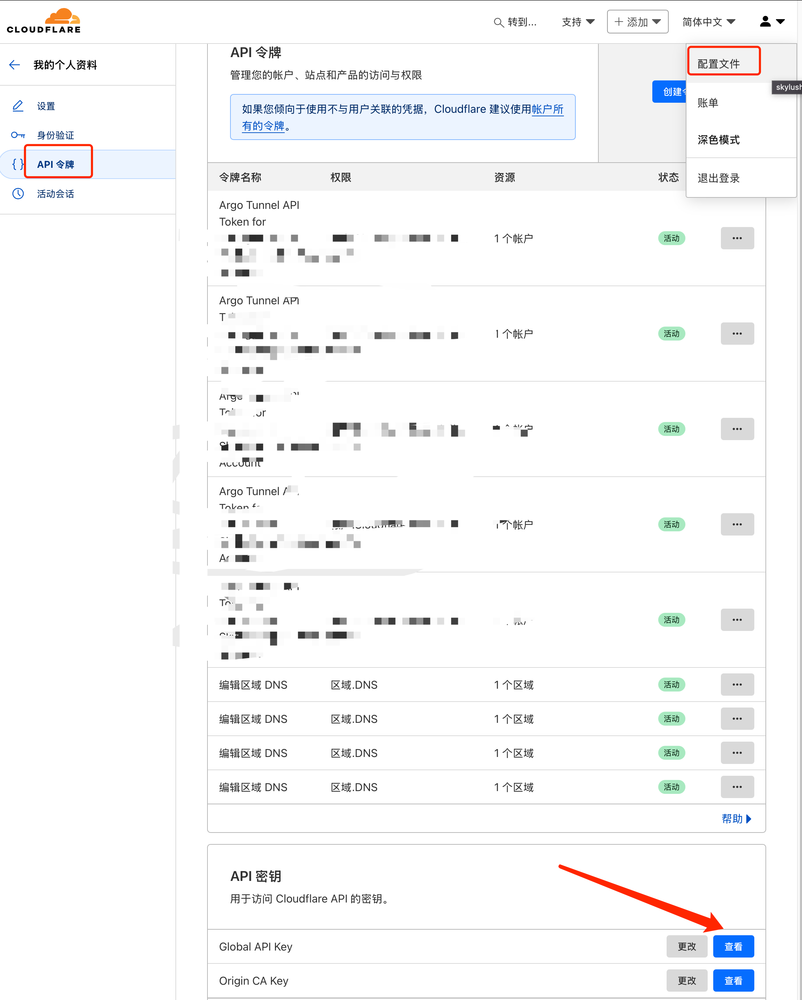
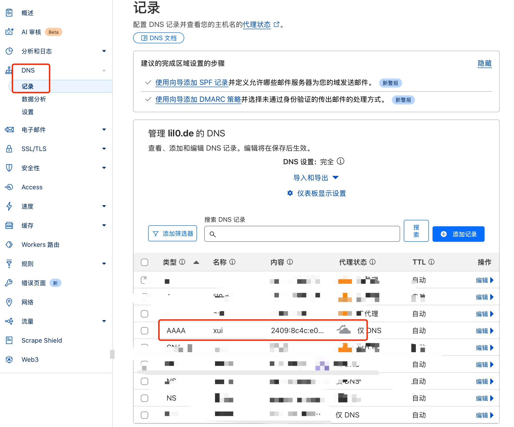
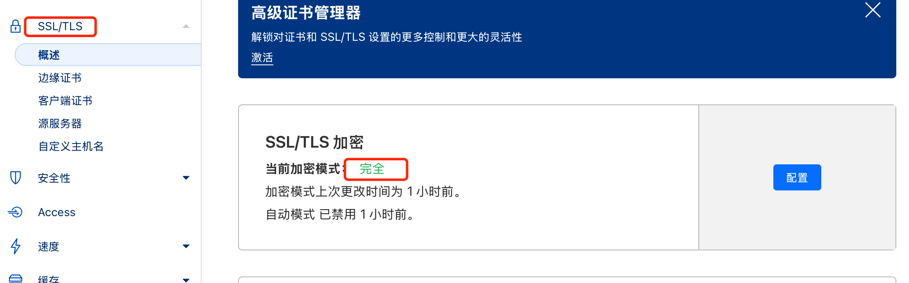
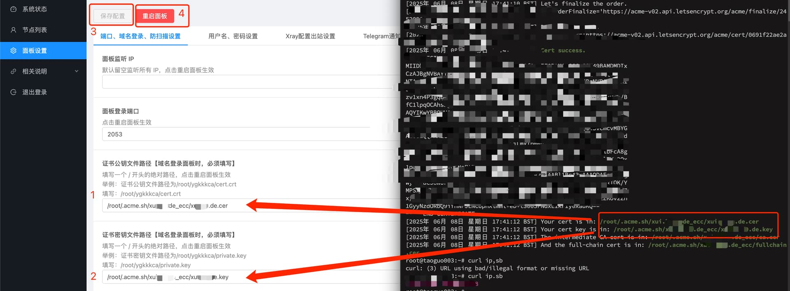
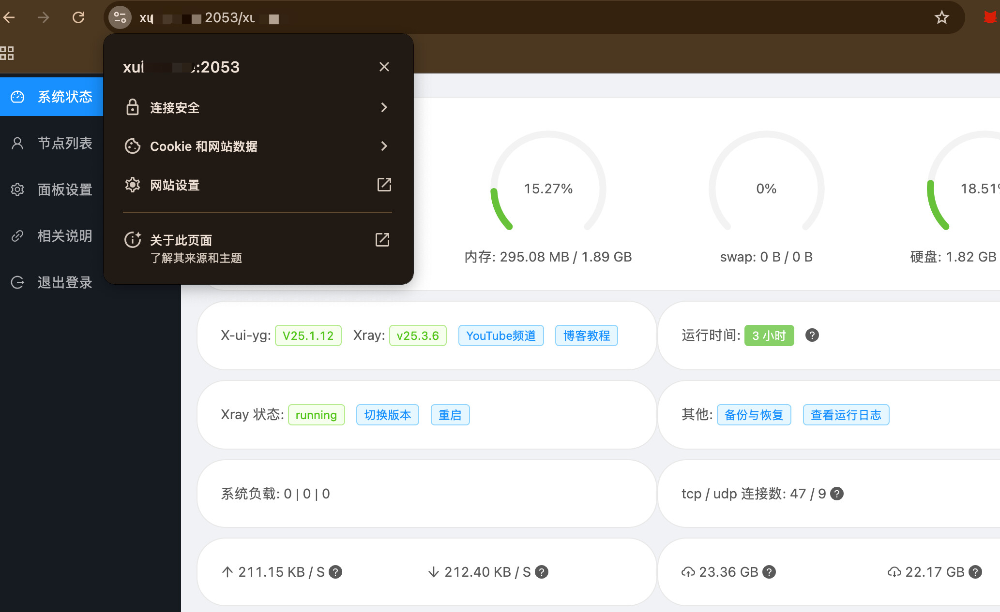

---

id: 710522

title: "配置https访问xui"

created_at: 2025-06-08T17:03:06.607Z

username: nansheng

display_username: "One Piece"

---


# 配置https访问xui


获取cf账户+cf token

```
export CF_Email="abc@abc.com"
export CF_Key="xxxxxabc"
```







```
curl https://github.com/acmesh-official/acme.sh I sh
~/.acme.sh/acme.sh --set-default-ca --server letsencrypt
~/.acme.sh/acme.sh --issue --dns dns_cf -d xxx.de --keylength ec-256
~/.acme.sh/acme.sh --install-cert -d xxxde --ecc \
  --key-file /root/xui.key \
  --fullchain-file /root/xui.crt \
  --reloadcmd "systemctl restart x-ui"
```

还是用IP端口地址访问设置域名访问






---


*来源: https://linux.do/t/topic/710522.json*

