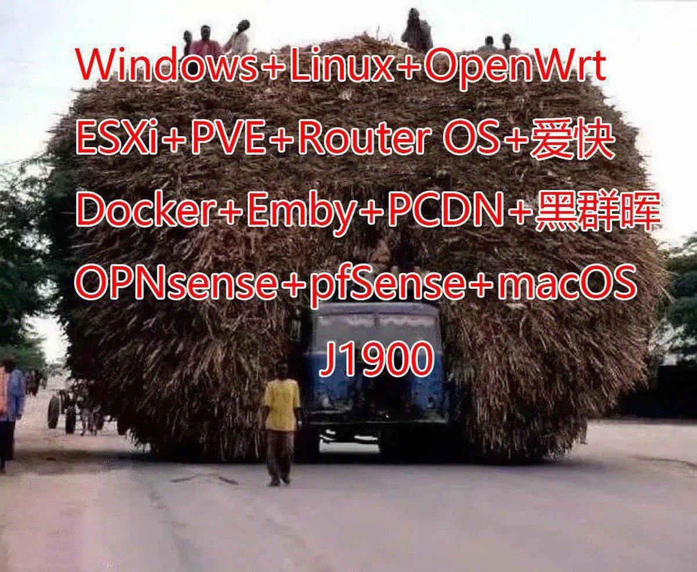
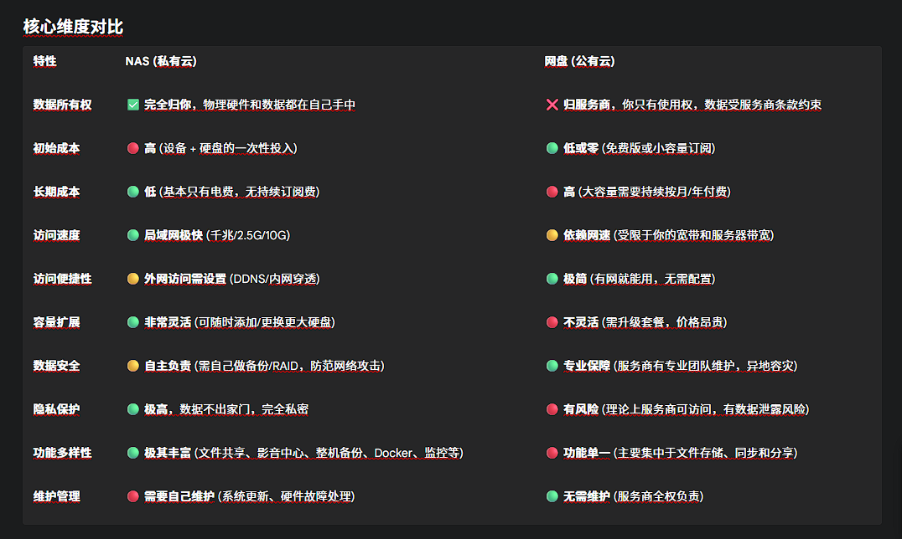

---

id: 711146

title: "你真的需要 nas 吗"

created_at: 2025-06-09T03:05:07.786Z

username: windsong

display_username: "cherry"

---

# 你真的需要 nas 吗

# 你真的需要 nas 吗

叠甲：1. 作者是小白，如果文章出现错误欢迎指正。

1. 本文的讨论范围仅限于个人 / 家庭使用，不包括企业 / 团队协作。

2. 本文更多是对概念的讨论，并不是一篇教程文章。

3. 这是一篇很简陋的文章，希望能和佬友集思广益，一起优化她。未来可能有 v2 v3。

## 网络附属存储（Network Attached Storage，NAS），现在更多指的是家用综合服务器（homelab），不仅要承担本身存储的责任，还要负责各种其他功能，如影视，路由等。

用人话说就是一台有很大硬盘容量的电脑。

## 为什么使用 nas？

1. 媒体库

将媒体文件存储在本地，往往可以避免服务提供者为了节省流量压缩画质（某酷某优某腾某 B），或者是因为审查原因删减内容片段。另外相对多个平台订阅制会员总和，总体费用稍微低一些。

1. 共享

部分用户比较注重隐私，认为使用云服务有泄露的风险（事实证明确实有）。将文件放在本地可以避免这个问题。同时在局域网内，备份速度要远超于任何云服务。（另外还可以存放一些内容，你懂的）通过 nas 可以很轻松的在局域网内共享文件且释放本地空间，且速度和隐私都能得到保证。（如果不小心让别人连到 wifi 那确实很不小心了）

1. 一机多用（容器 or 虚拟机）

进阶玩法，需要性能足够。

1. 装逼。

（这里只是列举了一些常见或入门的使用场景，欢迎大家补充）

### 那么，代价是什么呢

1. 时间 / 金钱

必须 diy（包括旧物利用） 或购买成品，到手后还需要花时间学习和调教，另外电费也是一笔不可忽略的开支。

1. 带宽

文件上传和下载都需要占用带宽，在动辄千兆速率内网环境没啥问题，但到运营商出容易产生瓶颈，影响其他设备网速，需要根据自身环境限速。另外，从外部网络访问在内网的 nas 往往会受到诸多限制，需要有一定的技术水平，且在部分情况下（比如长时间从外部读取 nas 的文件）会触发运营商的风险检测，第一次上门警告，第二次直接拆机封号。（别问我是怎么知道的，都是泪

1. 维护

nas 的软硬件都有可能出现问题，特别是来路不是很明了的二手硬件。看上去零通电的硬盘搞不好在某个机柜上 “锻炼” 了几万或几十万几百万个小时，即使通常这些硬盘的平均无故障时间 (MTBF) 或年化故障率 (AFR, Annualized Failure Rate) 大于使用时间，仍然有概率出现故障，且没有任何来自厂商保障，个人用户要么牺牲大量空间做冗余，要么只能当 “亡命之徒”。

#### 与其他解决方案的比较

---

*来源: https://linux.do/t/topic/711146.json*

