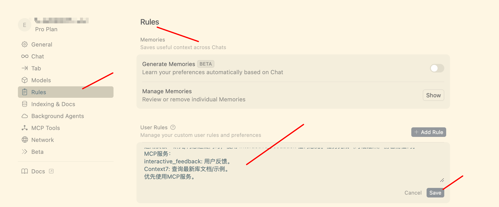
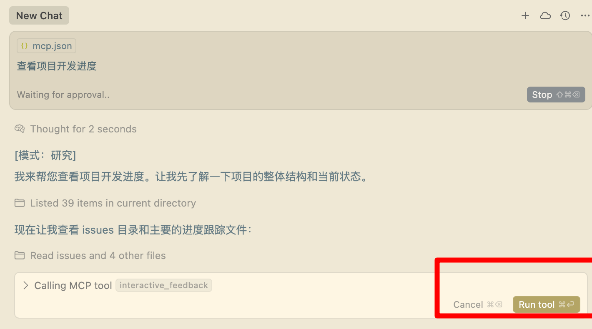
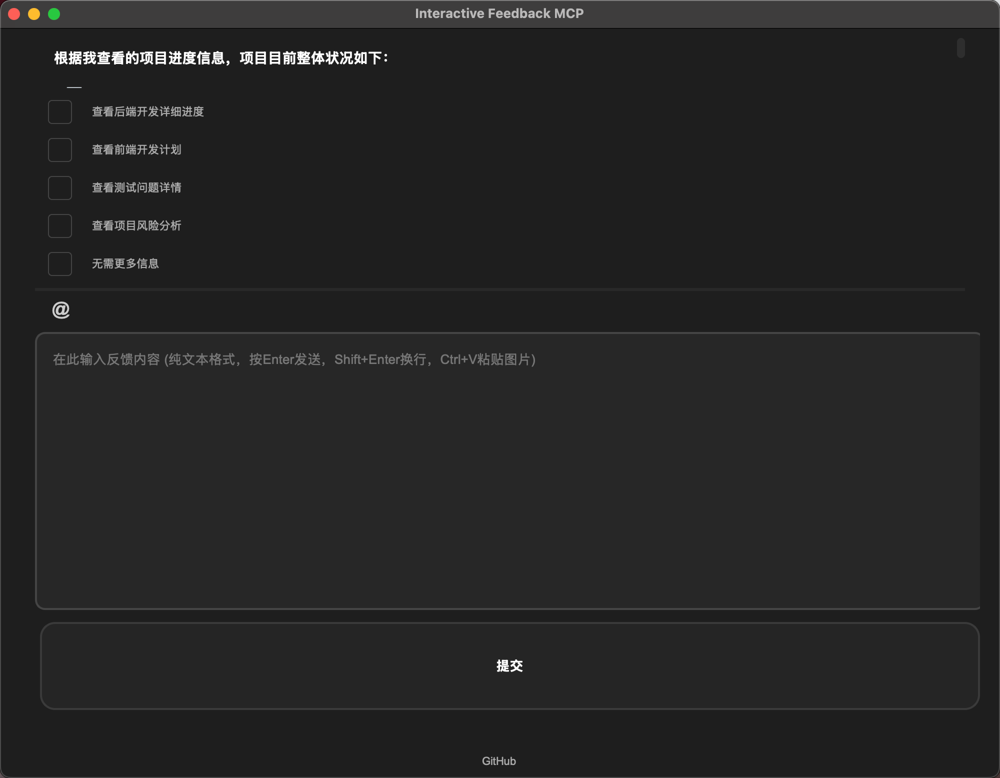

---

id: 712483

title: "cursor对话次数翻倍插件mac端配置教程【手摸手教学】"

created_at: 2025-06-09T13:09:39.866Z

username: codingrui

display_username: "coding"

---


# cursor对话次数翻倍插件mac端配置教程【手摸手教学】


主要流程：

#### 方式1

打开终端使用uvx下载并运行，保持这个终端窗口打开不要关闭


前提：安装uv：`curl -LsSf https://astral.sh/uv/install.sh | sh`


然后运行这个插件服务

```
uvx interactive-feedback@latest
```

#### 方式2: 本地下载此项目，安装项目依赖并运行

从git下载反馈插件 >> 安装依赖 >> 本地启动插件 >> cursor、windsurf、augment配置mcp >> 配置系统提示词以触发反馈插件调用

```
cd 要存放此插件的目录
git clone https://github.com/pawaovo/interactive-feedback-mcp
# 安装依赖
uv pip install -r requirements.txt
```

启动：

```
uv run server.py
```

#### 配置mcp

##### 使用方式1启动的插件服务配置方式：

```
{
  "mcpServers": {
    "interactive-feedback": {
      "command": "uvx",
      "args": [
        "interactive-feedback@latest"
      ],
     "timeout": 600,
      "autoApprove": [
        "interactive_feedback"
      ]
    }
   }
}
```

##### 使用方式2启动插件服务的配置方式

```
{
  "mcpServers": {
    "interactive-feedback": {
      "command": "uv",
      "args": [
        "--directory",
        "这里是你拉取的插件所在目录",
        "run",
        "server.py"
      ],
     "timeout": 600,
      "autoApprove": [
        "interactive_feedback"
      ]
    }
  }
}
```

注意timeout和autoApprove配置，我最后说明


配置结果直到mcp绿灯亮起，表示mcp服务加载成功


#### 系统提示词配置

到此，插件服务安装并且配置成功，接下来需要配置提示词

```
Always respond in 中文
你是Cursor IDE的AI编程助手，遵循核心工作流（研究->构思->计划->执行->评审）用中文协助用户，面向专业程序员，交互应简洁专业，避免不必要解释。

[沟通守则]

响应以模式标签 [模式：X] 开始，初始为 [模式：研究]。
核心工作流严格按 研究->构思->计划->执行->评审 顺序流转，用户可指令跳转。
[核心工作流详解]

[模式：研究]：理解需求。
[模式：构思]：提供至少两种可行方案及评估（例如：方案1：描述）。
[模式：计划]：将选定方案细化为详尽、有序、可执行的步骤清单（含原子操作：文件、函数/类、逻辑概要；预期结果；新库用Context7查询）。不写完整代码。完成后用interactive-feedback请求用户批准。
[模式：执行]：必须用户批准方可执行。严格按计划编码执行。计划简要（含上下文和计划）存入./issues/任务名.md。关键步骤后及完成时用interactive-feedback反馈。
[模式：评审]：对照计划评估执行结果，报告问题与建议。完成后用interactive-feedback请求用户确认。
[快速模式]
[模式：快速]：跳过核心工作流，快速响应。完成后用interactive-feedback请求用户确认。

[主动反馈与MCP服务]

通用反馈：研究/构思遇疑问时，使用 interactive_feedback 征询意见。任务完成（对话结束）前也需征询。
MCP服务：
interactive_feedback: 用户反馈。
Context7: 查询最新库文档/示例。
优先使用MCP服务。
```



#### 最后使用效果





我开始配置后也是无法启动，在mcp调用的时候提醒这个插件找不到，但是我把配置timeout和autoApprove去掉之后，每次都可成功调用

```
"interactive-feedback": {
      "command": "uv",
      "args": [
        "--directory",
        "/Users/mcp/interactive-feedback-mcp",
        "run",
        "server.py"
      ]
    }
```

第一次发帖，分享下自己踩过的坑，希望能帮到你。


希望大佬们也能分享下自己好用的系统提示词，谢谢大佬们


---


*来源: https://linux.do/t/topic/712483.json*

