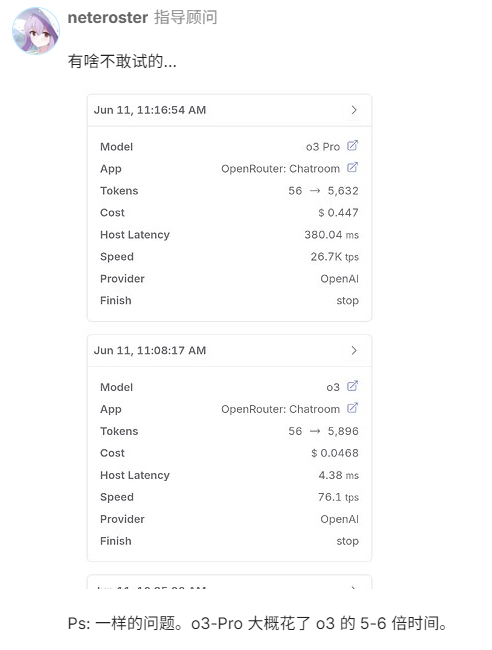
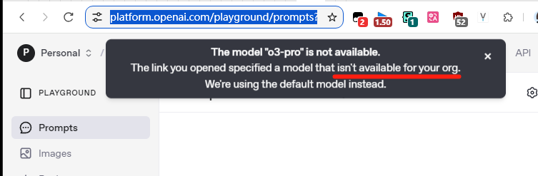
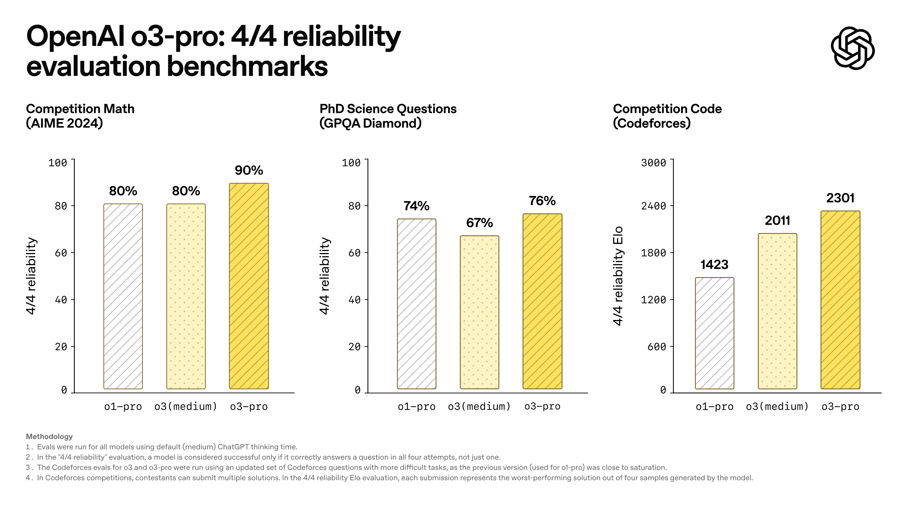
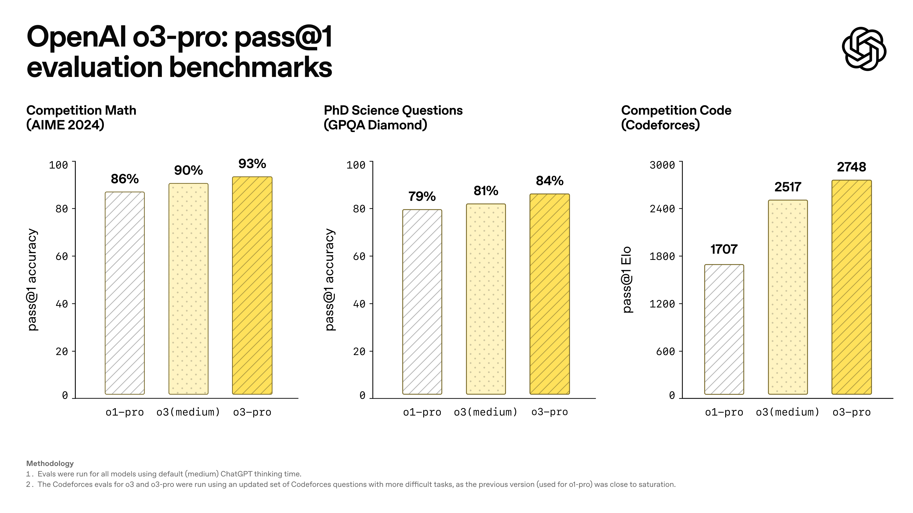
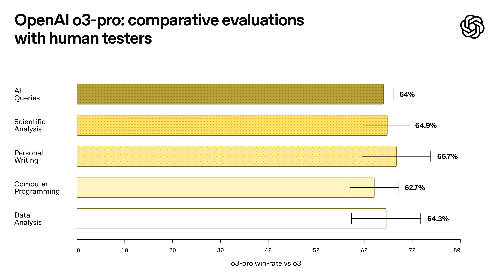
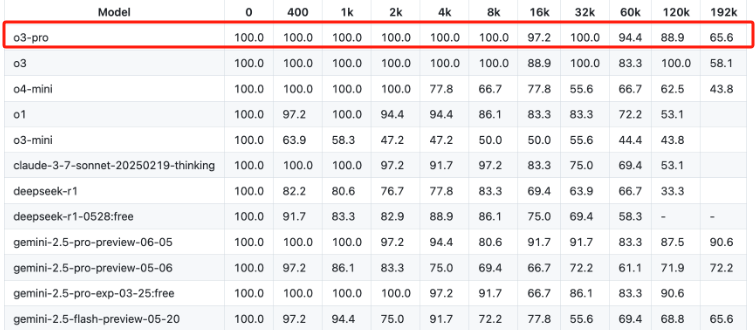
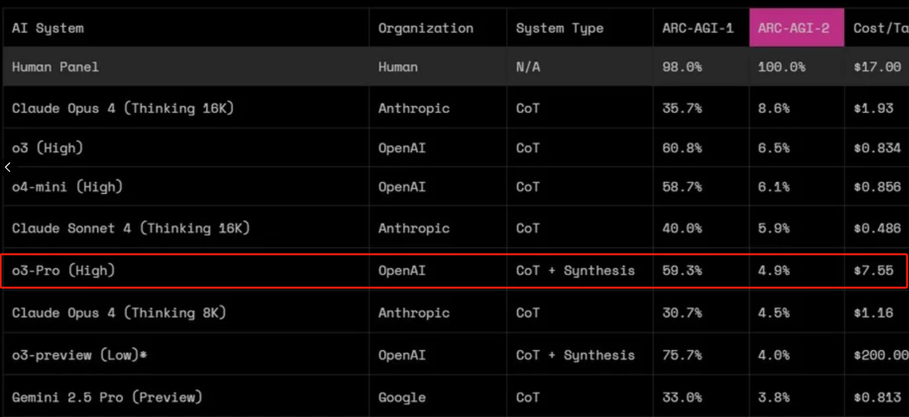
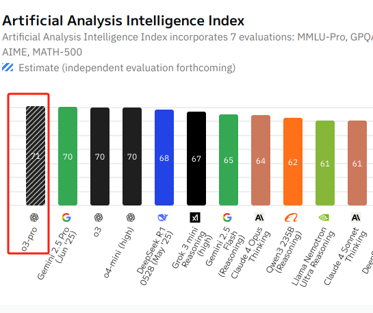
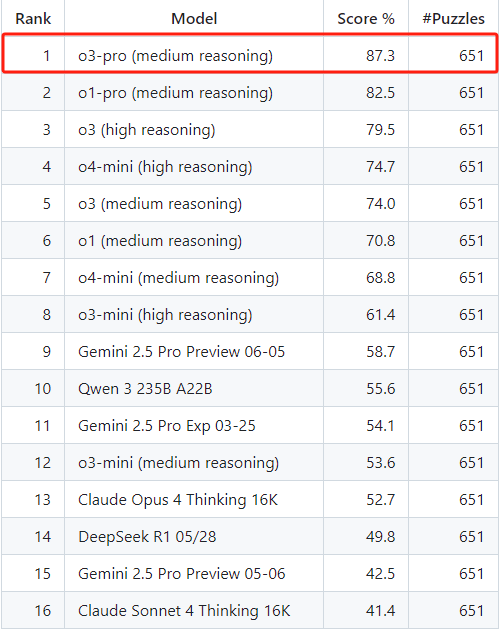
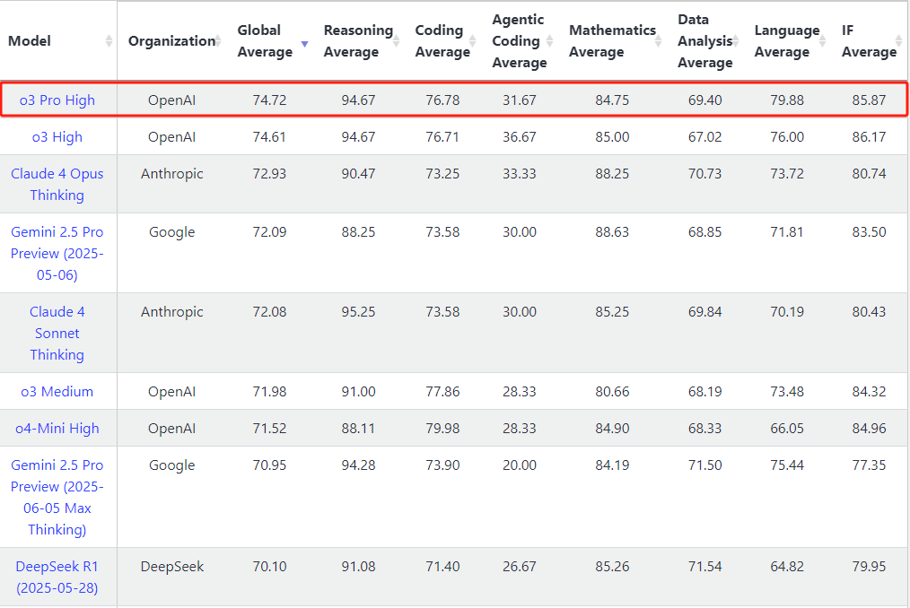

---

id: 716072

title: ":fire:【原创长文】关于O3-pro，你想知道的一切，更新LiveBench评分【长期更新】"

created_at: 2025-06-11T05:51:42.175Z

username: dwqxq1

display_username: "dwqxq1"

---

# :fire:【原创长文】关于O3-pro，你想知道的一切，更新LiveBench评分【长期更新】

## 基本资料

**智商**：之前o3和o1-pro最强，现阶段o3-pro应该智商最高的模型。

但是o3-pro比o3的提升幅度，可能远小于o1-pro比o1的提升幅度

如果与Deep research这种Agent相比，我估计o3 Deep research体现出来的智商应该明显高于o3-pro，因为Deep research总结了大量人类论文，体现出来的智商是论文作者那些博士教授的智商水平，而不仅是大模型的智商

**速度**：大概是最慢的模型，比o1-pro还要慢，思考时间几分钟到20多分钟

佬友测试一样的问题，一样的token数，要用o3的5~6倍时间，10倍的api总价

**训练资料**：截止到240601

**多模态**：支持图片输入，不支持语音/视频输入，不支持原生图片/语音/视频输出，但可以通过API调用生成图片

**价格**：

API输入$20/mt，输出$80/mt

参考o1-pro输出$600/mt

至于为什么o3-pro api比o1-pro大幅降价87%，推测可能是为了应对deep think即将到来的冲击，也说明了原来$600/mt的天价，有多扯淡，完全就是乱定价，为了给了pro会员当托的，显得$200/月不限量很便宜，根本没打算让人用api

o3也同时大幅降价80%，从$40降为$8，比4o的$10还便宜，推测是因为2.5pro/claude都已包含推理模型了，性能也追上来了，并且推理非推理都是统一价格$10/$15，OpenAI再不降价，继续维持推理和非推理两套价格体系，已经没竞争力了

**上下文**：

API上下文200k，总输出（含推理）100k，与o3一样

Chat版，官方说Pro会员所有模型是128k上下文，没有专门说o3-pro的上下文

**实际输出字数**

o3-pro的实际输出字数，明显少于o1-pro，佬友反应是3~5k左右，具体还未测试

o3的输出字数，只有1~2k左右，也明显少于o1

我推测并不是o3模型本身的能力问题，而是OpenAI为了节省成本，在系统提示词里做了人为限制。

参考o3 Deep research平均输出也有十几k，用适当提示词可以稳定输出50k

其他模型实际输出字数可参考我另一篇文章：[【原创长文】不要被官方参数骗了，各大模型实际长文输出能力测试研究【长期更新】](https://linux.do/t/topic/585363)

## Chat渠道

### ChatGPT $200 的Pro会员已上线

包月不限量

### ChatGPT $25 Team会员已上线

Enterprise会员下周上线，Edu会员下周上线

Team限量估计会比较低，具体暂不清楚

Team现在是灰度，有的人有有的人没有，有佬友说，越新的号，收到的越早。

### ChatGPT $20 的Plus会员未上线

估计近期也不会上线，o1-pro就从未下放给Plus会员过

### OpenAI API Playground已上线

需要充值，需要组织身份认证

来源：[https://platform.openai.com/playground/prompts?models=o3-pro](https://platform.openai.com/playground/prompts?models=o3-pro)

### LMArena Driect Chat未上线

估计以后也不会上线，o1-pro就从未上线lmarena

### Poe已上线

来源：[o3-pro - Poe](https://poe.com/o3-pro)

### 逆向Chat渠道已上线

论坛里某专门做ChatGPT Pro会员的金主，已上线，具体自己论坛找。

$20包月用光不浪费=折合¥1/次，买积分折合¥4/次

### OpenRouter Chatroom已上线

但是：OpenAI requires bringing your own API key to use o3-pro over the API

## API渠道

### 官网API已上线

### OpenRouter API已上线

但需要自备OpenAI API

来源：[https://linux.do/t/topic/716038](https://linux.do/t/topic/716038)

### 逆向API渠道，截止250611未上线

## 评分

### 官方自评

来源：[https://platform.openai.com/docs/models/o3-pro](https://platform.openai.com/docs/models/o3-pro)

### FictionBench 上下文评测

来源：[Fiction.live](https://fiction.live/stories/Fiction-liveBench-Feb-21-2025/oQdzQvKHw8JyXbN87)

### ARC-AGI评分

来源：[ARC Prize - Leaderboard](https://arcprize.org/leaderboard)

### Artificial Analysis评分

来源：[https://artificialanalysis.ai/](https://artificialanalysis.ai/)

### Extended NYT Connections谜题评分 250612 13:30更新

来源：[GitHub - lechmazur/nyt-connections: Benchmark that evaluates LLMs using 759 NYT Connections puzzles extended with extra trick words](https://github.com/lechmazur/nyt-connections/)

### LiveBench评分 250612 15:00更新

来源：[https://livebench.ai](https://livebench.ai)

### Aider编程评分，截止250612未上线

来源：[Aider LLM Leaderboards | aider](https://aider.chat/docs/leaderboards/)

### Lmarena评分，截止250612未上线

来源：[LMArena](https://lmarena.ai/?leaderboard)

---

*来源: https://linux.do/t/topic/716072.json*

