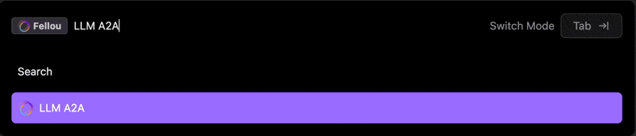

---

id: 727219

title: "Fellou浏览器体验记录"

created_at: 2025-06-16T16:26:36.110Z

username: wren

display_username: "wren"

---

# Fellou浏览器体验记录

*2025.9.18*

一篇关于RSS和fellou的文章：[ Agent浏览器治好了我2年的信息焦虑，Fellou帮我把时间抢回来了](https://mp.weixin.qq.com/s?__biz=Mzg3MTk3NzYzNw==&mid=2247500393&idx=1&sn=88dbd4a05d152e9ad43600239a3944fb&poc_token=HOtpy2ijQeqeIvDj170rNZ265ebrCVys_sR_4yl4)

---

刚才看到一篇文章，也是在讲agentic 浏览器这块贴在这，我是业余的这篇比我科普的好。

[深度拆解：为什么通用 Agent 的下一站是 Agentic Browser？](https://www.bestblogs.dev/article/5f5cd9)

---

上一篇水文写了[Dia浏览器体验](https://linux.do/t/topic/720263)，佬友问我是否可以体验Fellou浏览器。我开始不知道他是什么。 佬友私信给我一个邀请码，我注册了账号，体验了一下，感觉还不错。所以我记录一下体验。

放在文档也希望佬友们能一起体验，编辑、编写自己的体验。

在此感谢 [@lea](/u/lea)  ，谢谢你的邀请码。 

# Fellou是什么， Agentic是什么

[946×600 78.8 KB](https://cdn3.ldstatic.com/original/4X/5/c/0/5c05749f32abc5722d3b77eea4ac5ee17681df70.png)

在看到Fellou的官网，世界首款Agentic浏览器。 这么说我还真不了解什么是**agentic**。

询问llama4 得知：

[954×548 255 KB](https://cdn3.ldstatic.com/original/4X/7/0/a/70aa99f52c1f9ddc1371cbb8b34cb7b764f14879.png)

原来**Agentic**是Fellou浏览器的特色之一，它是一种基于人工智能的浏览器，可以自动识别和处理网页上的各种元素，如文本、图片、视频等，从而提供更加智能和高效的浏览体验。

我感觉可能AI浏览器就像安装了插件，智能识别内容、总结和帮你生成内容。虽然Dia内置了一些功能。但他还没有实现类似Fellou的**Agentic**。

**Agentic**浏览器可以自动识别和处理网页上的各种元素，如文本、图片、视频等，从而提供更加智能和高效的浏览体验。简单理解为，他帮你做了一些事情使你更加方便。

- 例子1:

我让他打开百度地图，然后给我从国贸到团结湖的骑行路线。结果是：

[3824×2474 1.43 MB](https://cdn3.ldstatic.com/original/4X/a/3/b/a3bdfb7ddc1b89f622f038f69ddb230e27522396.jpeg)

[1088×1916 226 KB](https://cdn3.ldstatic.com/original/4X/f/9/6/f9625476cbe7356090f90e4805a3dfa138664d55.jpeg)

这目前Dia是完成不了啊，这就是AI和Agentic的区别之一吧。

- 例子2:

访问论坛时，看到一个提问。 *这时候在底下询问我需要我帮你查找有关的资料吗？ *

点开这个，右侧就开始DeepSearch了。

[712×552 65 KB](https://cdn3.ldstatic.com/original/4X/b/9/1/b915917319a301ab9f75eb31588f4fcd0f203f6f.png)

看这个搜索的内容可不是简单的OP标题，是理解后进行的理解问题再规划查询。

右侧能看到结果：值得注意在最底下有个run，你点击他就开始执行了。

[2678×2474 633 KB](https://cdn3.ldstatic.com/original/4X/4/4/8/448f3682eb0ce087160add297f7d55d40a086fe8.jpeg)

点击run就在浏览器单开一个tab开始执行了。

[406×458 20.7 KB](https://cdn3.ldstatic.com/original/4X/0/e/0/0e04e3511cd76347000c4c82386b8860a7106bea.png)

直到他完成返回结果。

生成搜索结果时的界面：

左侧正在生成一个HTML的报告页面，右侧的对话中进行了报告内容的摘要信息。

[2678×2474 806 KB](https://cdn3.ldstatic.com/original/4X/5/e/3/5e30b46f44c667b3beda8ab3ab8cd4decff52481.jpeg)

最终结果，一个问题让他一搞变成了一大篇。好在能分享  [结果太恐怖点这看](https://chat.fellou.ai/report/7833279e-8ae7-4e69-9500-236044c7f263)

够deep，够search，够cool！

- 例子3:

我还是想对比一下Dia和Fellou的话题总结。 结果好坏老友们自品一下，我个人感觉Fellou比Dia总结的好些。

*Dia内容里还能看到一个神奇的qq新闻地址。*

[2874×2558 1.09 MB](https://cdn3.ldstatic.com/original/4X/c/c/6/cc61841d5a51da556ee1a0d7e10a5bc5115560d4.jpeg)

- 例子4：

类似Dia的水贴回复，我就是举个例子我可没真水啊。

[361×1375 135 KB](https://cdn3.ldstatic.com/original/4X/c/2/d/c2d360052b9d897d4d15322df50f43e849014792.png)

这又体现他Agentic的特性了。他不仅帮你生成了内容，还给你回复了。 自动水贴成功啊。就是慢点，他规划好怎么去做这个事，通过截屏寻找要操作的位置按步骤最后执行成功。  但我改了，他那句不太好，也为了避免老友举报，我编辑人工调整了。

- 类似像YTB视频总结，文章总结等等都OK的。

- 特意录制一个视频体现他Agentic的特性 ，有声音请注意 

录制的内容是你知道一个YTB的用户，你让Fellou 打开YTB并找出他的某一期内容，我这里选择是和roo code有关的最新一期。

 [点击查看Fellou浏览器Agentic特性演示视频](https://watch.wave.video/JgizvBqMzroXHFN1)

通过以上几个例子，我想佬友们会体会到**agentic**是什么感觉。和Dia的区别是什么。

# UI、交互

Dia我很喜欢，他的UI，交互等等。这里页简单对Fellou进行一些观察吧。

打开主界面看起还也是简约的：

[1255×1237 124 KB](https://cdn3.ldstatic.com/original/4X/d/b/6/db6a6527c829a031d67157aa33c8dbfb12d50f78.png)

操作类似的，在中间的input框或地址栏，会弹出来一个黑色input框神奇。

输入可以可以进行对话、访问网站或其他指令。

当使用浏览的起Deep Action是，窗口会像类似苹果那种窗口边框变换**颜色**的效果。见上面链接视频或自行体验哈。

- 输入`/`各种搜索

[839×474 18.7 KB](https://cdn3.ldstatic.com/original/4X/3/9/2/392ffd61fcb8a537e48d8a6608e41520245e079e.png)

- 输入`@` 选择上下文

- 输入`tab` 切换到Fellou搜索

## 设置简洁，支持多Profiles

[750×355 21.5 KB](https://cdn3.ldstatic.com/original/4X/c/6/d/c6dd7357e474ae6626785adb2ebc0f6f5ace64a0.png)

两个码送给想体验的佬：

【UXT3PR】

【39S5O5】

完结

祝好

---

*来源: https://linux.do/t/topic/727219.json*

