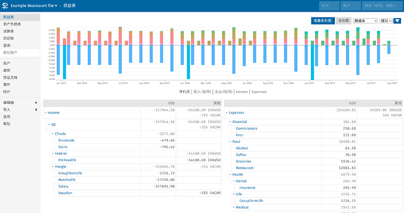
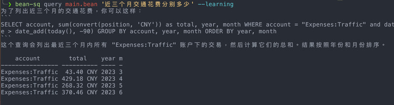
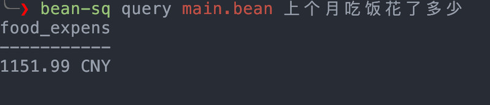
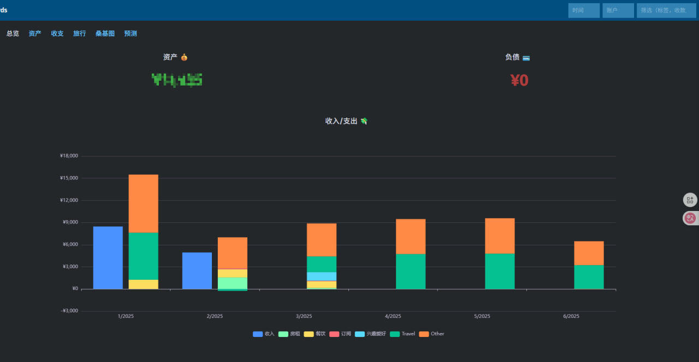
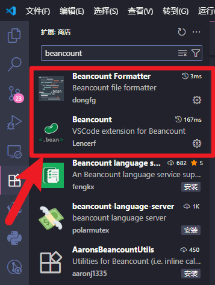
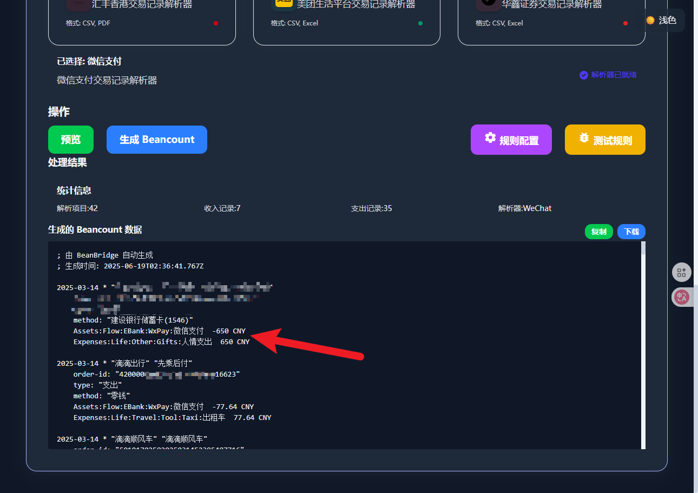

---

id: 734417

title: "「文本记账软件」beancount使用教程及资料分享"

created_at: 2025-06-19T03:10:54.039Z

username: fatsheep

display_username: "fatsheep"

---

# 「文本记账软件」beancount使用教程及资料分享

## 前情提要

[[记账软件分享]复式记账软件推荐-beancount](https://linux.do/t/topic/725012) [

资源荟萃](/c/resource/14)

> 相信很多朋友点进来之前可能对已有的记账软件或多或少有些不满意,又或者是尝试过记账后来又发现不能自动导入,发现记账好累,那么使用benacount就对了

> 参考资料

>

>

> 复式记账是什么

> 一言以蔽之,就是可以  清楚记得账户的流向,我们知道有一个会计恒等式:有借必有贷,借贷必相等

> 什么意思呢,当你在steam上购买了一款游戏,充值了100块钱的时候,你记录这笔交易的方式是这样的:

>

> 2025-02…

跟佬友们讨论了一下发现好多人还是会觉得文本式记账有门槛,有难度,或者说自动导入不方便等等问题,因此我还是决定开一篇帖子教佬友们手把手迁移到beancount,当然我本身也在学习使用这个软件中,这篇文章做抛砖引玉用~

## 资源分享

### 入门级教程

### [记账神器 Beancount 教程 - 少数派](https://sspai.com/post/59777)

开通少数派第一天，分享一篇博客旧文，关于beancount的教程。记了几年账，工具用过随手记、Excel甚至Evernote。通常只记收支，不记收支对应的账户变化。其实知道这种方式很粗浅，容易错记、漏 ...

### [『Beancount指南』复式记账](https://fermi.ink/posts/2023/05/31/01/)

一直都有记账的想法。

我们经常都会有的困惑：感觉没干什么，工资就没了。随着工作年限的增加，愈发觉得对自我财务进行管理非常重要。这既能察觉不必要的花费，又不至于过于紧缩，什么都不敢消费。

### [复式记账工具：Beancount 入门](https://gaoweix.com/beancount-getting-started/)

本文是对复式记账系列文章最后一篇的补充，具体介绍一下 Beancount 的功能和用法。 体验 Beancount 提供了一个在线 demo，可以在线体验一下：  左侧包含了之前文章提到过的损益表、资产负债表等

### 资源类

一些关于beancount的资源

### [Awesome Beancount](https://awesome-beancount.com/)

A curated list of resources for Beancount, an open-source double entry bookkeeping system — ideal for plain text accounting users and Python software developers.

以自然语言查询账本

### [GitHub - fengkx/beancount-smart-query: Query beancount in human language with the help of...](https://github.com/fengkx/beancount-smart-query)

Query beancount in human language with the help of AI

更多样化的fava展示面板

### [GitHub - andreasgerstmayr/fava-dashboards: Custom Dashboards for Beancount in Fava](https://github.com/andreasgerstmayr/fava-dashboards)

Custom Dashboards for Beancount in Fava

一些展示(只需要一个配置文件和一行配置就可以,但是官方没有提供中文版本的配置文件,我用ai修改的会有错误,欢迎佬们在下面展示和分享配置)

欢迎各位补充

## 本地编辑器推荐

关注隐私的佬友可以使用vscode,推荐添加下面两个拓展

一个可以提供beancount文件的格式化和检查,如果有异常的账户直接会标红文件,适用于批量导入,很容易发现出错的地方

另一个是提供拼音输入账本的方式,例如输入Aswx就可以补全成自己的微信账户

下面的几个不推荐安装,有一个安装了之后保存会报错,格式化有一点问题

## 自动化导入程序

先安利一下我前面发现的导入项目,使用golang,支持一些国内银行/平台的账单导入、解析等,我也提了pr改进项目,建议对**隐私安全有一定要求并且有一定代码基础的**佬友选择此方式自动化导入自己的账单

### [GitHub - deb-sig/double-entry-generator: Rule-based double-entry bookkeeping importer (from...](https://github.com/deb-sig/double-entry-generator)

Rule-based double-entry bookkeeping importer (from Alipay/WeChat/Huobi etc. to Beancount/Ledger).

其次就是经过讨论之后我用cursor写的网页版本解析器,全程薅着上面的项目修改,是一个**无后端纯前端**的项目,也就是说所有的账单只在网页上处理,**绝对不会保存在其他地方**配置文件和解析的csv文件以json的方式保存在localStorage,目前配置文件可以删除,后面会做一个清除缓存的按钮,保证不会在本地留下一点痕迹,感兴趣的佬友可以审阅一下代码.项目的优点大概如下:

1. 解析器提供预设配置(实际上这里存在一点问题,下面会说)

### BeanBridge

代码开源地址

### [GitHub - fatsheep2/beanBridge: BeanBridge - 让复式记账更简单！ 🎯](https://github.com/fatsheep2/beanBridge)

BeanBridge - 让复式记账更简单！ 🎯

项目地址(大陆用户可能需要魔法使用,也欢迎佬友进行反代，如果可以的话路过的佬友也可以点一个star)

### [BeanBridge - 智能账单处理工具](https://fatsheep2.github.io/beanBridge/)

BeanBridge 是一个智能的账单处理工具，支持支付宝、微信、银行等多种数据源，一键转换为 Beancount 或 Ledger 格式。

因为是ai写的,可能微信支付宝稍微完善一点,其他的目前还没测试,欢迎佬友们提issue和pr

#### 项目使用说明和一些简单的注意事项

首先点击规则配置

点击需要配置的解析器

点击下面的创建预设配置

从预设配置创建之后会有一个几个全局配置和规则列表,全局配置就是没有规则匹配的时候默认生成的数据,规则就是自定义的一系列规则

注意！！！！！！！！这里创建的预设配置是有问题的,需要完善一下,挨个点开规则,选择交易类型 为 支出,这个地方是因为不选择的话默认是不匹配任何字段的，上面的项目会默认匹配类型为 支出 的项目,然后其他字段应该很明了,修改完之后可以自动保存,点击页面中的调试规则按钮跳转到账单处理页面

上传账本文件(再次提醒!账本文件是非常私密的东西，请确认服务/页面安全的情况下使用),目前写了一些规则自动匹配上传的账本,上传文件这一步就不演示了

下图为自动识别到微信账本了

点击下方的预览就可以看到账本数据预览了,可以判断一下条目数量够不够,不够的话就提issue吧(微信支付宝应该是够数的)

点击旁边的生成beancount之后就生成beancount的账本文件了,查看无误后点击复制或者手动复制就可以把账本复制到本地了

目前还是有一点小问题的,例如这里我已经配置了付款方式为建设银行的时候就设置扣款账户为建设银行卡,但是还是扣的微信的余额,包括还有其他一些小问题,佬友们可以等稍后稳定一些再使用(计算机专业的就别看了,火速上来pr成为贡献者,机不可失时不再来哈哈哈)一般来说规则完善的话就会像下面滴滴打车那条,不需要任何处理就可以直接入账了

本项目支持导入规则和导出规则,但是目前只支持全部规则的导入和导出,不支持单条记录的导入导出。有心得的佬友可以在下面分享一下自己的配置文件

大概就是这样,也欢迎有佬友有新的需要支持的银行或者平台可以在项目里提issue,也可以上传自己脱敏之后的账单作为样本(可以有效避免重复造轮子)

## 为什么要使用这种记账软件

最重要的是 **足够好玩**,例如做一个qq/微信/tg机器人记账，或者直接发给在线的AI一段话,就可以生成格式化的账本语句,又或者可以使用python脚本配合cron直接读取在线服务的每日价格并记入账本,从而知道每个平台股票的每日盈亏等,只要想得到就能做得到(不行就去beancount库提pr)

一方面是可以白嫖,另一方面是开源软件的寿命和生命力足够强,当一个项目使用人数足够多的时候,这个项目就不会停下了,类似alist,虽然已经g了但是代码还在,社区fork之后还会继续往前走,beancount倒了很容易就可以迁移到ledger,同样的账本在自己手里心里也不慌,相反使用闭源软件,如果软件停止了,数据很容易丢失,或者是很难迁移到其他平台,参考阿里云盘,一开始说永久免费结果用户量起来就宣布收费了,

**闭源软件的任何话都是不可信的!**

开源软件，自由软件，甚至包括加密货币都是同一个主题,

希望各位佬友们共勉,为真正的开源出一份力(例如star给作者一点动力)或是提一提pr(我可以用cursor一行代码不写就完成这个项目就证明普通人也是可以贡献代码的)每个人努力一点点,互联网就会更加开放、包容、健康

---

*来源: https://linux.do/t/topic/734417.json*

