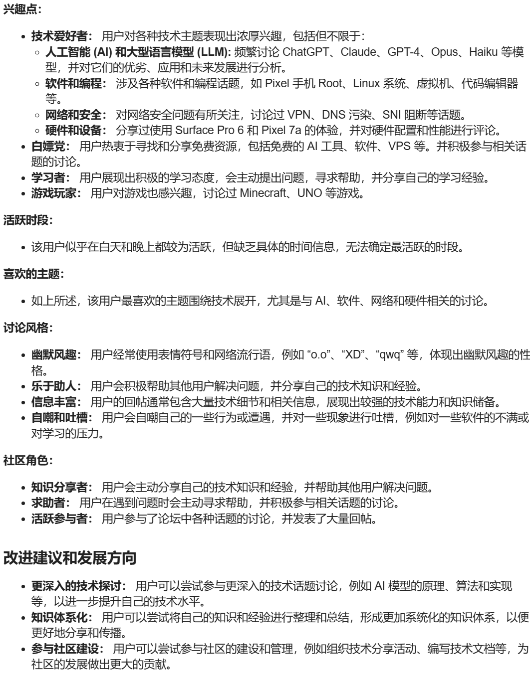

---

id: 75447

title: "【人物专栏】ʚ(•‿•)ɞ⇄(◣_◢) - 数码外传"

created_at: 2024-05-05T13:12:01.497Z

username: Reno

display_username: "Reno"

---

# 【人物专栏】ʚ(•‿•)ɞ⇄(◣_◢) - 数码外传

---

## 本期人物

点击访问人物主页：[桜夢 瑶](https://linux.do/u/PlayMcBKuwu)

 **桜夢 瑶**

> 回首往日，回到最初的起点，回想最初的夢想。

> 我堅信着美好，堅信着明天，堅信着這美好的世間。

## 用户画像

## 分享

- [ChinaGPT-4 | 已测试可使用免费 GPT-4. ](https://linux.do/t/topic/9103)

- [ChinaGPT-4 #2 ](https://linux.do/t/topic/44215)

- [ChinaGPT-4 International Version ](https://linux.do/t/topic/10734)

- [ChinaGPT for You.com 账户分享 ](https://linux.do/t/topic/41957)

- [如何获取一台几乎免费的 VPS + sth. ](https://linux.do/t/topic/34050)

- [一个博客，但是所有人都可以写文章 ](https://linux.do/t/topic/67711)

- [送三级域名，但是逆天域名 + 人工处理](https://linux.do/t/topic/43428)

- [如何获得免费的 OneDrive 1/5T 空间（雾） ](https://linux.do/t/topic/9050)

- [发病 & 免费 GPT-3.5 & Claude 3 Haiku API 发布 ](https://linux.do/t/topic/71011)

- [「トップレベルドメイン」随時無料配布中? ！ ](https://linux.do/t/topic/62987)

- [「卒」Let’s upload it to MelonFun! —— MelonFun! 自建网盘分享 ](https://linux.do/t/topic/54194)

## 搞机

- [Pixel 7a: 从入门到入土 ](https://linux.do/t/topic/14254)

- [Android Root 从入土到诈尸](https://linux.do/t/topic/15233)

- [关于莓子派 5 的折腾体验 ](https://linux.do/t/topic/63105)

- [如何搭建自己的博客与论坛 ](https://linux.do/t/topic/12810)

- [电脑 / 经费爆炸指北 ](https://linux.do/t/topic/36900)

- [Microsoft Copilot Skype 版放开？！ ](https://linux.do/t/topic/40208)

- [我们 Windows 也有自己的类原生 ](https://linux.do/t/topic/49850)

- [正在使用 openFyde 的一人 ](https://linux.do/t/topic/54100)

- [使用朝鲜的 Redstar OS 3.0 桌面版是一种什么体验？ ](https://linux.do/t/topic/22125)

- [兄弟（做的游戏），你（让 CPU 变得）好香 ](https://linux.do/t/topic/60715)

- [Surface Pro 6 与 Pixel 7a 一周使用体验——是真好用，还是智商税？ ](https://linux.do/t/topic/60817)

- [Claude 3 系列还是有点太聪明了 - Sonnet + Opus + Haiku 智商评测 + 免费 Claude 3 API 全家桶 ](https://linux.do/t/topic/67980)

- [[NBO 中文] 難以置信！大中華區的網路如今「備案」竟然被民間攻破並搭建自己的「ICP 備案」站？ ](https://linux.do/t/topic/55405)

## 日常

- [随便记点什么](https://linux.do/t/topic/49855)

## 整活

- [Fishing Rod / 地狱笑话](https://linux.do/t/topic/28073)

- [鲁迅文章二创 ](https://linux.do/t/topic/56290)

- [《甘佬除三害》+《孔乙奇》 ](https://linux.do/t/topic/55264)

- [号商 / API 商家等商贩存活手册 ](https://linux.do/t/topic/75357)

## 中古

- [旧版 Pandora 仓库备份](https://linux.do/t/topic/10038)

- [こしあん堂 / 甲香堂经典 Flash 作品 ](https://linux.do/t/topic/44647)

- [死去的记忆突然开始攻击我——互联网怀旧计划 ](https://linux.do/t/topic/39625)

- [MikuTap - 这不是游戏，而是不被世人关注的音乐家。 ](https://linux.do/t/topic/65045)

- [今年是 2004 年，你的 MSN（Yahoo! Messenger）又响了 ](https://linux.do/t/topic/75292)

## 冰川之下

- [CL / FL](https://linux.do/t/topic/29054)

- [如何挖掘 ETH - 入门篇 ](https://linux.do/t/topic/73651)

## 参考文献

- **秦本纪**

致谢 [King-Huiwen-of-Qin](https://linux.do/u/King-Huiwen-of-Qin) 大哥、 [NullUser](https://linux.do/u/NullUser) 佬、 [delph1s](https://linux.do/u/delph1s) 佬

---

*来源: https://linux.do/t/topic/75447.json*

