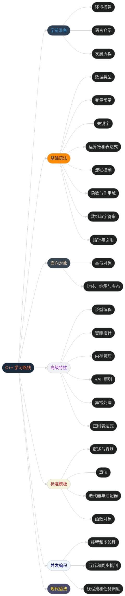

---

id: 756078

title: "C++ 学习路线图"

created_at: 2025-06-29T15:48:19.768Z

username: Styx

display_username: "龙森"

---


# C++ 学习路线图


**为了方便学习我整理了一份 C++ 学习路线图, 这个路线图并不完整也不全面, 希望各位能够在评论区留言指出缺失的地方与学习的顺序与我共建一份完整的路线图**

```
graph LR;
    C++LearningPath([C++ 学习路线])-->Pre-SchoolPreparation([学前准备]);
    C++LearningPath-->BasicSyntax([基础语法]);
    C++LearningPath-->Object-Oriented([面向对象]);
    C++LearningPath-->AdvancedFeatures([高级特性]);
    C++LearningPath-->StandardTemplates([标准模板]);
    C++LearningPath-->ConcurrentProgramming([并发编程]);
    C++LearningPath-->ModernGrammar([现代语法]);

    style C++LearningPath fill:#1A2B3C, stroke-width:1px, color:#FF7F50;
    style Pre-SchoolPreparation fill:#2C3E50, stroke-width:1px, color:#3498DB;
    style BasicSyntax fill:#FF8C00, stroke-width:1px, color:#212529;
    style Object-Oriented fill:#36454F, stroke-width:1px, color:#FFDAB9;
    style AdvancedFeatures fill:#F0F2F5, stroke-width:1px, color:#6A0DAD;
    style StandardTemplates fill:#F5F5DC, stroke-width:1px, color:#E32636;
    style ConcurrentProgramming fill:#F0F8FF, stroke-width:1px, color:#000080;
    style ModernGrammar fill:#4A4A6A, stroke-width:1px, color:#FFD700;

    Pre-SchoolPreparation-->EnvironmentConstruction([环境搭建]);
    Pre-SchoolPreparation-->LanguageIntroduction([语言介绍]);
    Pre-SchoolPreparation-->DevelopmentHistory([发展历程]);

    BasicSyntax-->DataTypes([数据类型]);
    BasicSyntax-->VariableAndConstant([变量常量]);
    BasicSyntax-->Keywords([关键字]);
    BasicSyntax-->OperatorsAndExpressions([运算符和表达式]);
    BasicSyntax-->ProcessControl([流程控制]);
    BasicSyntax-->FunctionsAndScope([函数与作用域]);
    BasicSyntax-->ArraysAndStrings([数组与字符串]);
    BasicSyntax-->PointersAndReferences([指针与引用]);

    Object-Oriented-->ClassesAndObjects([类与对象]);
    Object-Oriented-->EncapsulationInheritanceAndPolymorphism([封装、继承与多态]);

    AdvancedFeatures-->GenericProgramming([泛型编程]);
    AdvancedFeatures-->SmartPointers([智能指针]);
    AdvancedFeatures-->MemoryManagement([内存管理]);
    AdvancedFeatures-->RAIIPrinciple([RAII 原则]);
    AdvancedFeatures-->ExceptionHandling([异常处理]);
    AdvancedFeatures-->RegularExpressions([正则表达式]);

    StandardTemplates-->OverviewAndContainers([概述与容器]);
    StandardTemplates-->Algorithm([算法]);
    StandardTemplates-->IteratorsAndAdapters([迭代器与适配器]);
    StandardTemplates-->FunctionObjects([函数对象]);

    ConcurrentProgramming-->ThreadsAndMultithreading([线程和多线程]);
    ConcurrentProgramming-->MutualExclusionAndSynchronizationMechanisms([互斥和同步机制]);
    ConcurrentProgramming-->ThreadPoolAndTaskScheduling([线程池和任务调度]);
```

如果上方的在线版 Mermaid 图表无法加载各位可以查看下方的图片版



我会收集各位的意见 将其慢慢补充完善 尽可能的精细到每一章节


---


*来源: https://linux.do/t/topic/756078.json*

