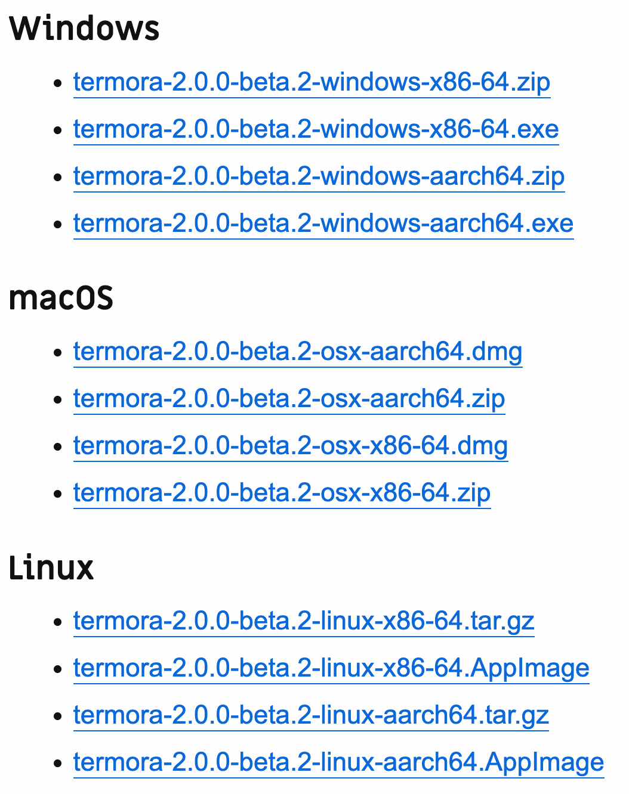
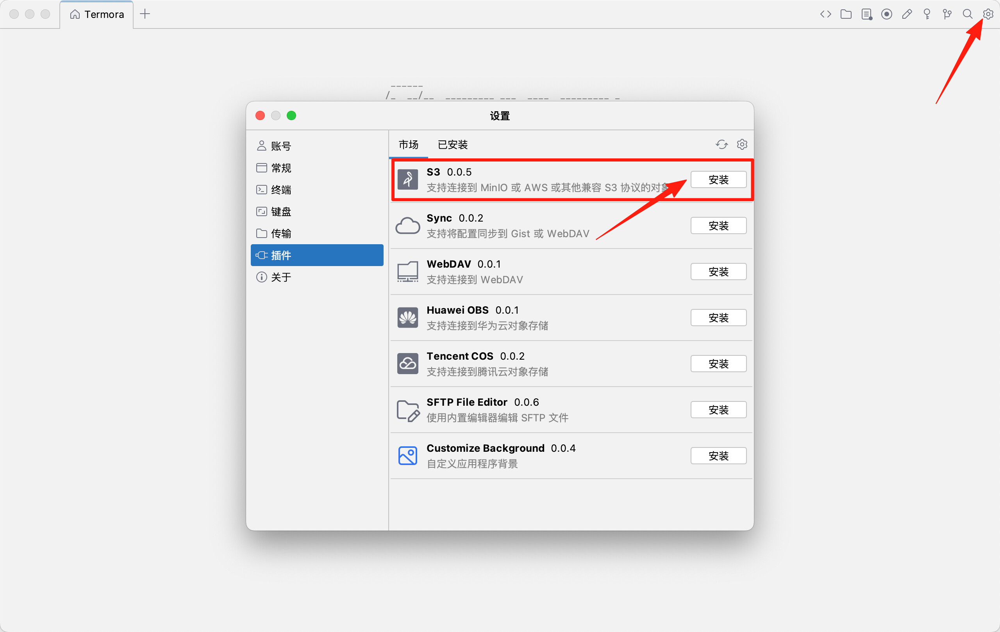
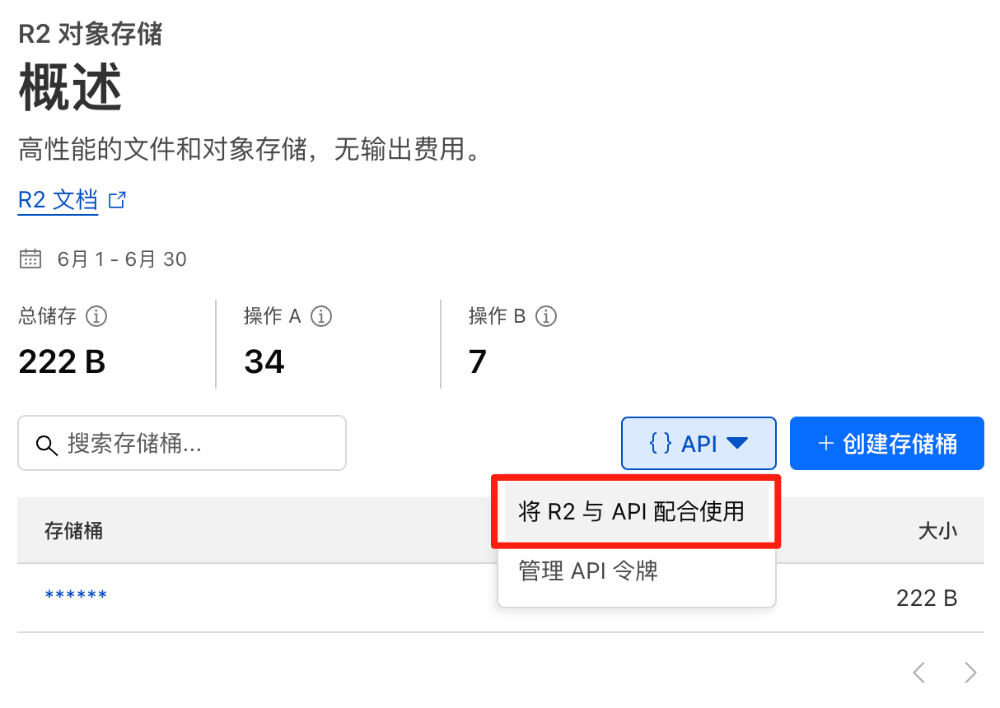
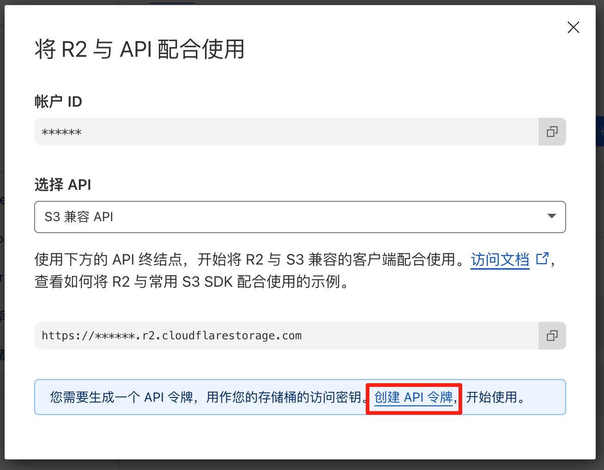
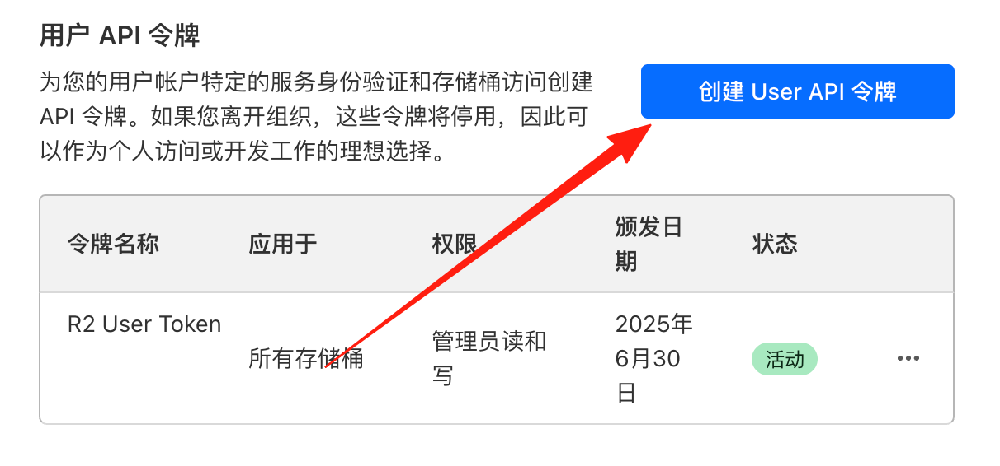
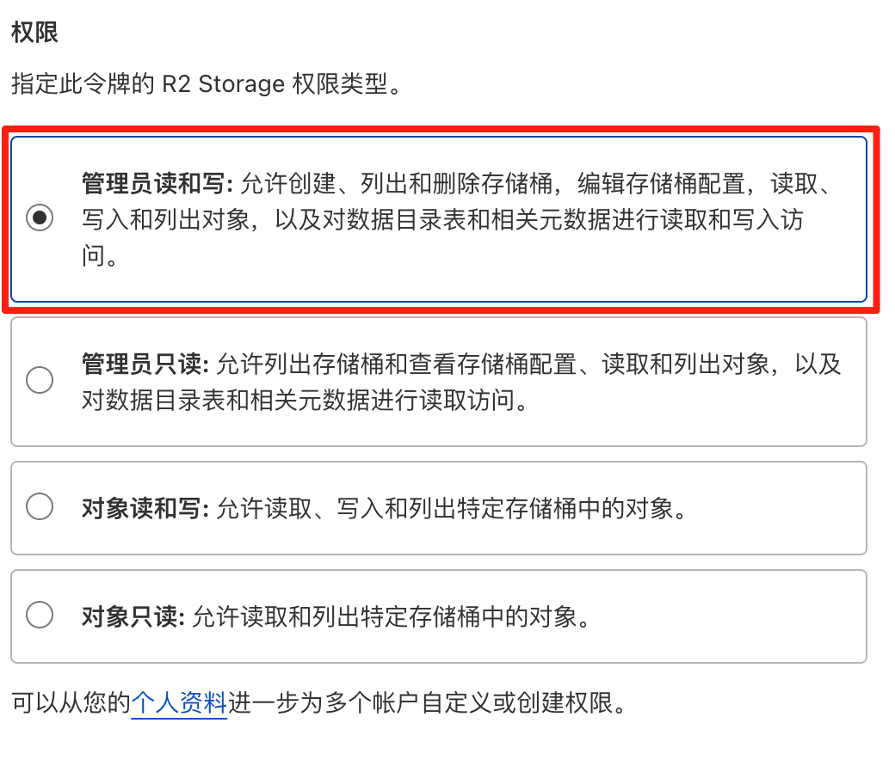
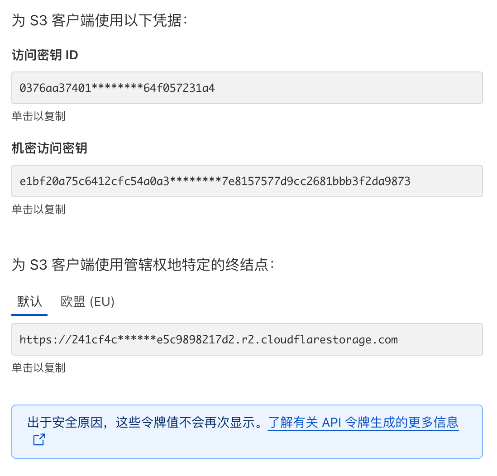
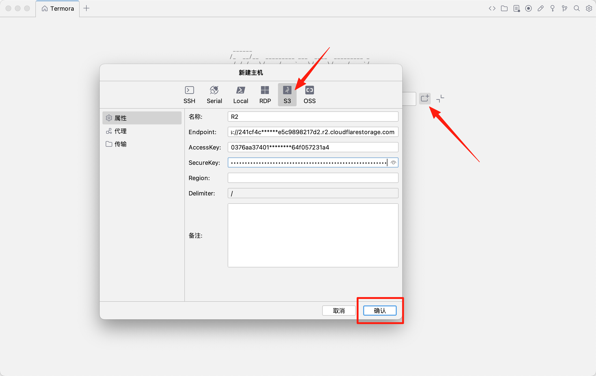
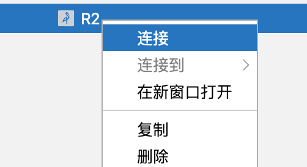
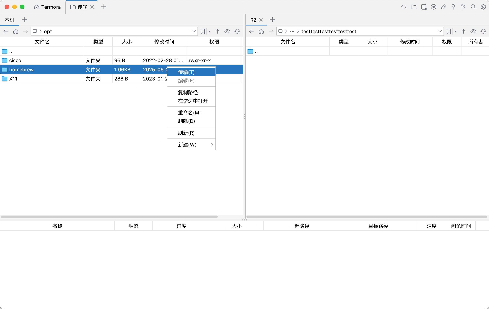

---

id: 757518

title: "使用 Termora 管理 Cloudflare R2 文件"

created_at: 2025-06-30T10:03:11.894Z

username: bzd

display_username: "bzd"

---

# 使用 Termora 管理 Cloudflare R2 文件

## 引言

得益于 Termora 2.x 的插件系统，可以通过 [S3](https://www.termora.cn/plugins/s3/) 插件访问 S3 协议的文件管理

## 下载 Termora

下载最新版 [Termora v2.0.0-beta.2](https://www.termora.cn/downloads/v2.0.0-beta.2/) ，注意区分 `x86` 和 `aarch64`

## 安装 S3 插件

安装成功之后，打开 `设置 - 插件 - 市场 - S3` 安装后重启软件

## 获取 R2 API

打开 [Cloudflare Dash](https://dash.cloudflare.com/)

如果没有令牌，我们需要去创建一个

到此，我们得到了 `访问密钥 ID` `机密访问密钥` `S3地址`

## 配置到 Termora

- Endpoint 对应上面的 `S3地址`

- AccessKey 对应 `访问密钥 ID`

- SecureKeyKey 对应 `机密访问密钥`

## 管理文件

随后，我们就可以对文件进行管理

---

*来源: https://linux.do/t/topic/757518.json*

