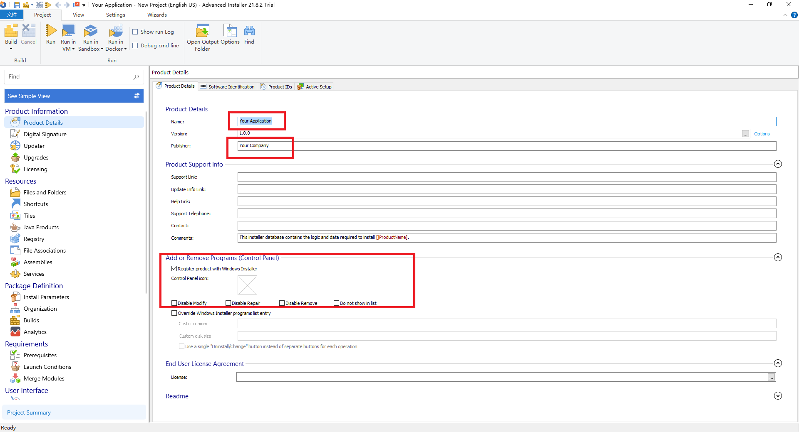
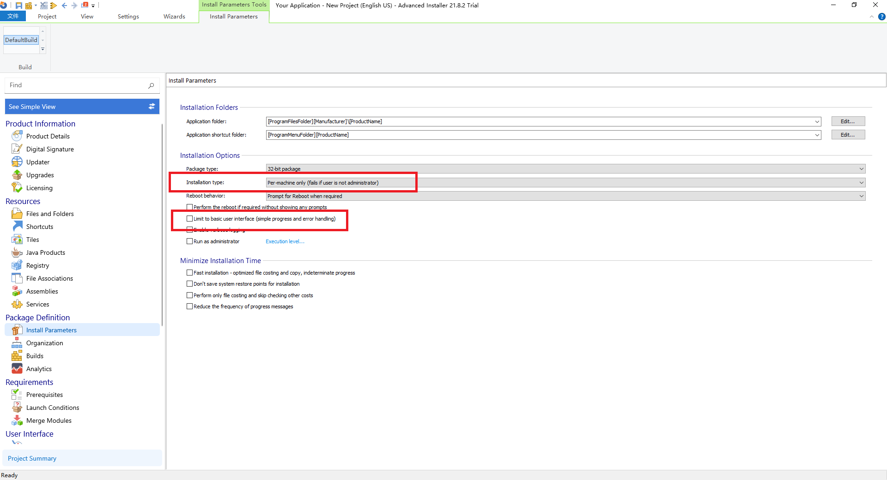
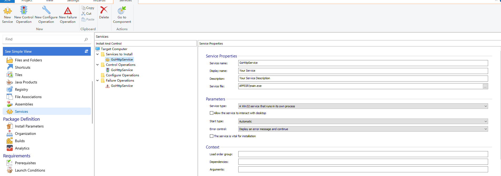
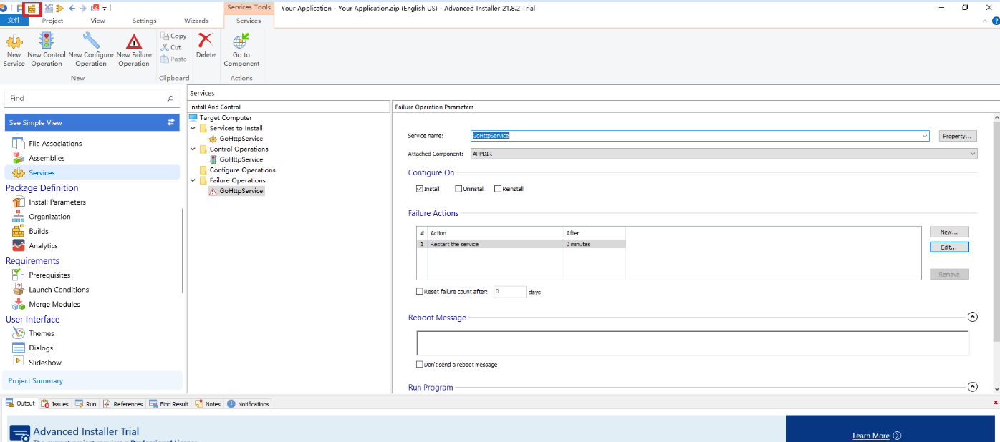

---

id: 773915

title: "windows msi 镜像打包教程"

created_at: 2025-07-08T09:44:44.710Z

username: saixiaoxi

display_username: "saixiaoxi"

---

# windows msi 镜像打包教程

# advanced installer 打包 msi

## 下载安装 advanced installer

- 选为 professional, 新建项目

- 项目细节设置

- 设置安装参数，设置静默安装则无任何安装提示

- 添加打包文件,可以添加要打包的文件或者文件夹

- 注册服务,注意这里的 Service name 需要根据代码内部写的服务名称设置(如下 go 代码中的`serviceName=GoHttpService`)，否则无法成功注册服务， Failure Operation可以设置服务被关闭后的操作（自动重启等）

`package main  import (   "fmt"   "log"   "net/http"    "golang.org/x/sys/windows/svc" )   var serviceName = "GoHttpService"  type myService struct{}  func (m *myService) Execute(args []string, r <-chan svc.ChangeRequest, s chan<- svc.Status) (svcSpecificEC bool, exitCode uint32) {   const cmdsAccepted = svc.AcceptStop | svc.AcceptShutdown   s <- svc.Status{State: svc.StartPending}   go runHttpServer()   s <- svc.Status{State: svc.Running, Accepts: cmdsAccepted}    for {       c := <-r       switch c.Cmd {       case svc.Stop, svc.Shutdown:           log.Println("Service is stopping...")           s <- svc.Status{State: svc.StopPending}           return       default:           continue       }   } }  func runHttpServer() {   http.HandleFunc("/", func(w http.ResponseWriter, r *http.Request) {       fmt.Fprintf(w, "Hello, World!")   })    port := "8082"   log.Printf("Server starting on port %s\n", port)    if err := http.ListenAndServe("0.0.0.0:"+port, nil); err != nil {       log.Fatal("ListenAndServe error: ", err)   } }  func main() {   inService, err := svc.IsWindowsService()   if err != nil {       log.Fatalf("Failed to determine if we are running in service: %v", err)   }   if inService {       run := svc.Run       if err := run(serviceName, &myService{}); err != nil {           log.Fatalf("Failed to run service: %v", err)       }   } else {       runHttpServer()   } } `

- build 即可生成msi文件

---

*来源: https://linux.do/t/topic/773915.json*

