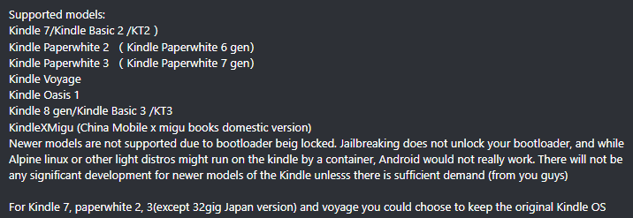

---

id: 785512

title: "Kindle刷安卓相关教程及资源"

created_at: 2025-07-14T09:27:26.202Z

username: bijhla

display_username: "bijhla"

---

# Kindle刷安卓相关教程及资源

# Kindle刷安卓相关教程及资源

> 原文位于我的博客[Kindle刷安卓相关教程及资源](https://bijhla.github.io/2025/07/14/Kindle%E5%88%B7%E5%AE%89%E5%8D%93%E7%9B%B8%E5%85%B3%E6%95%99%E7%A8%8B%E5%8F%8A%E8%B5%84%E6%BA%90/Kindle%E5%88%B7%E5%AE%89%E5%8D%93%E7%9B%B8%E5%85%B3%E6%95%99%E7%A8%8B%E5%8F%8A%E8%B5%84%E6%BA%90/)。

我发现好像写kindle越狱相关内容的好像很多，但是写刷安卓的相关内容的人就要少很多，就想着随便写写。我只进行了kpw3的测试，但从文档来看，应该是通用的。

先放支持的机型：

另外————

**刷机前备份！！！** **刷机前备份！！！** **刷机前备份！！！**

本教程针对windows，如果有错误或者遗漏请大家直接指出。

## 使用体验

刷入安卓后，使用第三方阅读软件（如静读天下、微信读书墨水屏版）的体验不错。但系统的流畅度无法与原生系统相比，打开应用或切换任务时会有明显卡顿。

续航没有仔细测过，感觉下来是不如原系统的。

安卓的版本是4.4，安装软件的限制比较大，我找了一些能用的软件放在文末了。

## 安装教程

### 越狱

这里就不做详细解释了，相关内容数不胜数，可以参考。

[Kindle 通用越狱教程：适用版本小于等于 5.16.2.1.1 固件](https://bookfere.com/post/1075.html)

[Kindle 越狱，Winterbreak，KOReader，你所需要知道的一切](https://linux.do/t/topic/781079)

### 刷机

重点放在这里，我刷机的时候还是有视频教程的，但是现在所有相关的资源和视频基本都被删除了。

我找了好久才在一个国外的论坛（见参考文献/引用）上找到了相关的教程和文件，但是在这个论坛下载文件太慢了，我只下载了[kpw3的相关资源](https://1drv.ms/u/c/ea5df632d76db8d3/EeLaRahvqyBCkbztVz0xiSYBu8NzQWTzmulLRArAEiiRuQ?e=cK0U0F)。

#### 安装fastboot

文件为 `adb-setup`，虽然我也不知道明明是fastboot但是要叫adb，但是文档是这么写的就这么做吧。

#### 将驱动文件拷贝到kindle

将 `uboot`中的 `main-htmlviewer.tar.gz`直接拷贝到kindle根目录，将 `extensions.zip`文件解压缩到 Kindle 的根目录。

弹出kindle（无需拔下 USB），在 Kindle 界面打开 `KUAL` → `FlashAndroid`，然后设备会重启，这时候切勿触碰电源按钮。

#### 安装安卓

运行 `start.exe` 后，会弹出一个命令行窗口。请完全根据命令行窗口中的提示操作，期间屏幕可能会闪烁或重启，请务必保持 USB 连接稳定。

### 救砖

如果你在操作过程中不幸失误，导致kindle变砖，或者说你刷一半不想继续了，请仔细阅读以下内容：

- 如果kindle能被识别：将固件放到kindle根目录，按住电源40s重启kindle。

- 如果kindle不能被识别：在电脑上创建一个名为 `DO_FACTORY_RESTORE` 的**空文件**（注意，要确保文件名完全正确，且没有`.txt`等多余的后缀），在kindle重启之后会有一段窗口期是能连接上电脑的，通过手速或者脚本将这个文件拷贝到kindle的根目录，然后按住电源40s重启kindle，之后的操作就和能被识别的情况相同了。

---

## 参考文献

- [Kindle 通用越狱教程：适用版本小于等于 5.16.2.1.1 固件](https://bookfere.com/post/1075.html)

- [Kindle 越狱，Winterbreak，KOReader，你所需要知道的一切](https://linux.do/t/topic/781079)

- [(guide)Installing android on your (aging) kindle e-reader](https://xdaforums.com/t/guide-installing-android-on-your-aging-kindle-e-reader.4450117/)

- [发挥 Kindle 全部潜能，满足你的个性化需求：Kindle 越狱指南](https://sspai.com/post/40697)

## 相关资源下载

- [kpw3相关文件（onedrive连接）](https://1drv.ms/u/c/ea5df632d76db8d3/EeLaRahvqyBCkbztVz0xiSYBu8NzQWTzmulLRArAEiiRuQ?e=cK0U0F)

- [(guide)Installing android on your (aging) kindle e-reader](https://xdaforums.com/t/guide-installing-android-on-your-aging-kindle-e-reader.4450117/) - 这个论坛下载东西真的比较慢

- [官方固件](https://www.amazon.com/gp/help/customer/display.html?nodeId=GKMQC26VQQMM8XSW)

- [书伴维护的固件](https://bookfere.com/update)

- [可用软件（google drive）（安卓4.4的常用阅读及工具软件）](https://drive.google.com/file/d/14zgKaRCc8yH_ZCS60EDN7BNI8Pf2qieg/view?usp=sharing)

---

*来源: https://linux.do/t/topic/785512.json*

