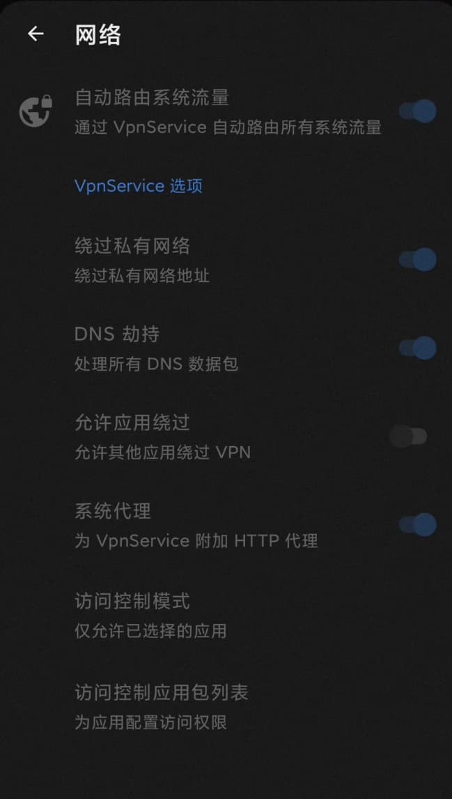
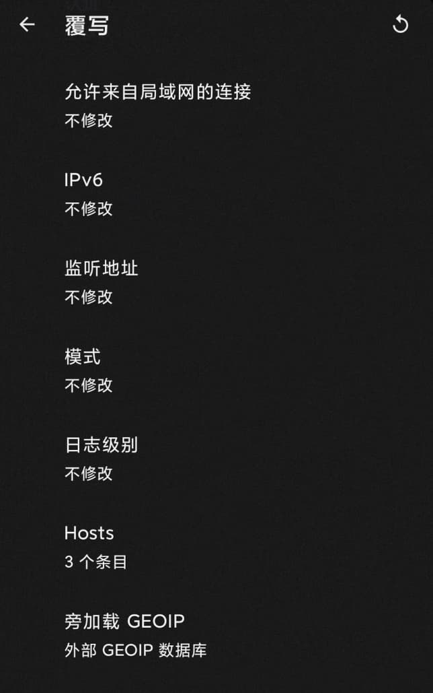
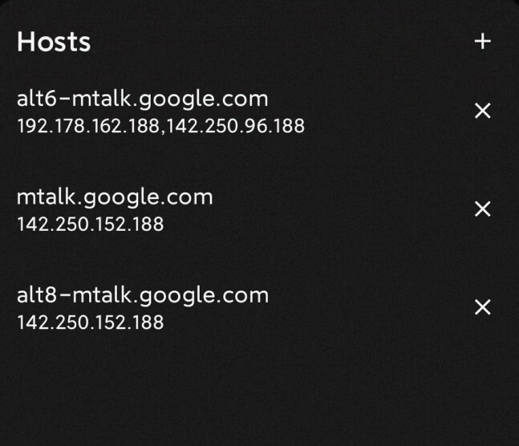
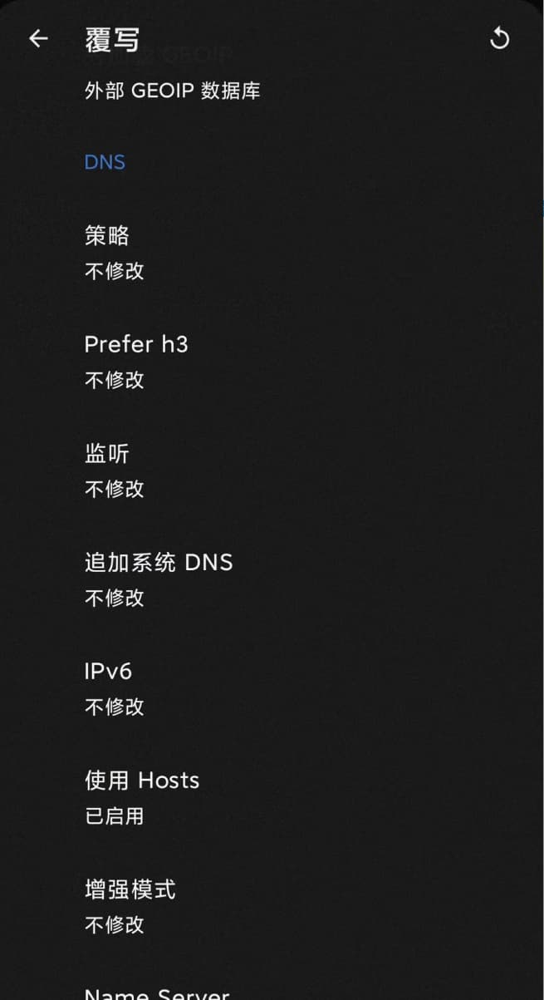
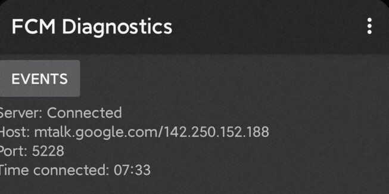

---

id: 801828

title: "在小米手机上通过clash meta for android 以及gboard来维持FCM相对可用的方法"

created_at: 2025-07-19T15:27:30.513Z

username: goodchuai

display_username: "Sir. That Way"

---

# 在小米手机上通过clash meta for android 以及gboard来维持FCM相对可用的方法

基本设置：

1. 通过ping测试工具找到可以ping通的mtalk ip地址，mtalk或者alt相关的域名的ip地址均可

2. 在clash meta for android中禁止应用绕过。设置-》网络-》允许其他应用绕过反选

3. 将刚才找到的ip地址填进clash meta for android的hosts配置中。设置-》覆写-》Hosts。下图为示例，请根据个人自身情况填写相应ip地址  

4. 在clash meta for android中启用hosts。设置-》覆写-》使用hosts，选择启用

5. 使用带有FCM相关规则的规则集，如 [GitHub - ACL4SSR/ACL4SSR at master](https://github.com/ACL4SSR/ACL4SSR/tree/master)

6. 将FCM相关规则设置为直连，即不使用代理

7. 查看fcm状态。如下图，连接可以成功，使用的也是我在hosts中添加的ip，虽然实际上他是alt8的ip

一些注释：

1. 为什么用gboard。 根据坊间传闻，小米给gboard留了后门，才能在息屏之后对fcm相关进程进行保活。这一点和我观测到的情况相符合。

2. 为什么fcm相关规则需要直连。 基于机场的不同，有可能对长连接的支持不一样，故其实并不需要使用代理。又及泛着这个ip是能ping通的，所以使用直连也就够了

3. 其他clash相关app是否可行。 没有测试过，但是我相信是可以的，基本都是基于clash的内核。

4. 本人今天才比较好地实现fcm保活和连接通畅，不代表之后很长一段时间都可以达到今天看到的效果。

---

*来源: https://linux.do/t/topic/801828.json*

