---

id: 803265

title: "《 Claude Code 终极版 FAQ 指南 》"

created_at: 2025-07-20T13:50:54.962Z

username: Haleclipse

display_username: "哈雷彗星"

---


# 《 Claude Code 终极版 FAQ 指南 》


** -- 施工中 -- **

** 即将重写 **

> ***“我当 工有所偿 学有所用，无人欺我无依傍”*

# 安装部分

> 部分软件包存在 个人偏好

>

>  如你明白其作用和意义 按需选择

>

>  如不明白 请悉数按序执行安装

>

>  目的是正确 方便 快乐 的使用

> <<< 准备工作 从富强软件中获得其提供的Proxy端口 >>>

> `$env:HTTP_PROXY="http://127.0.0.1:Port"; $env:HTTPS_PROXY="http://127.0.0.1:Port"`

> <<< Powershell中执行以上命令后被富强软件正确代理 >>>

> **以保证 诸多软件包的安装拉取正常进行**

# Windows

### 1. [Windows Terminal](https://apps.microsoft.com/detail/9N0DX20HK701?hl=zh-cn&gl=CN&ocid=pdpshare)

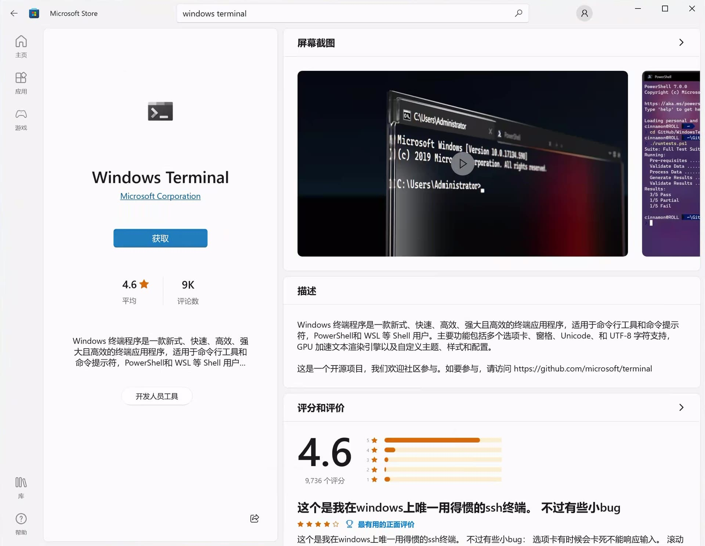

安装好后 设定默认打开 系统内置Powershell并且给予默认为管理员权限

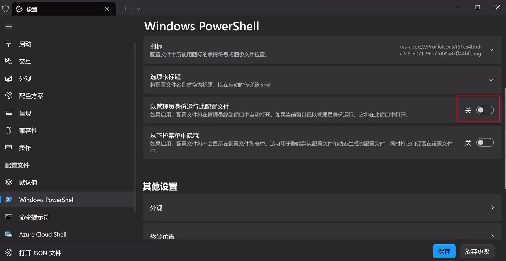

后续右键能够直接在所处文件夹内打开对应的终端Shell


### 2. WinGet

```
$progressPreference = 'silentlyContinue'
Install-PackageProvider -Name NuGet -Force | Out-Null
Install-Module -Name Microsoft.WinGet.Client -Force -Repository PSGallery | Out-Null
Write-Host "Using Repair-WinGetPackageManager cmdlet to bootstrap WinGet..."
Repair-WinGetPackageManager -AllUsers
```

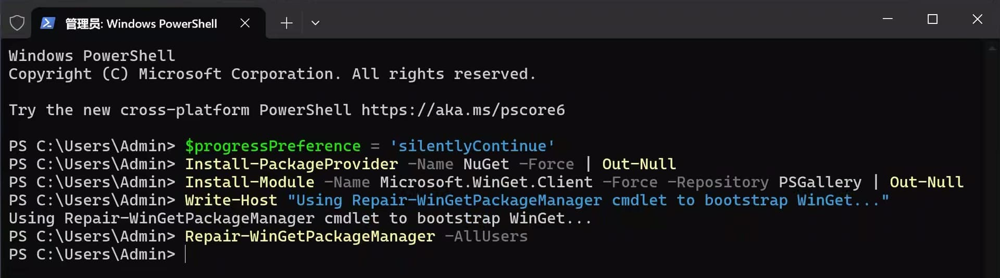

### 3. PowerShell 7

```
winget install Microsoft.PowerShell
```

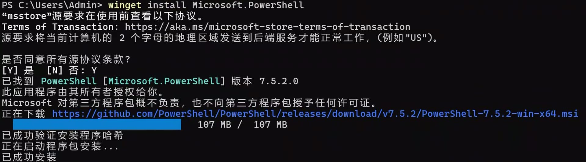

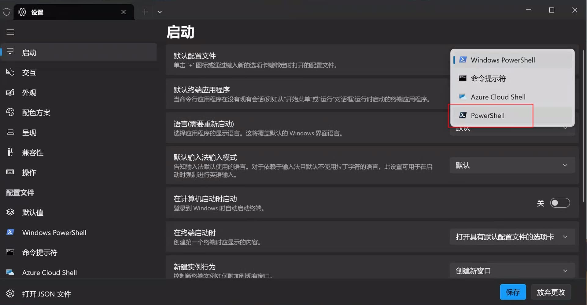


### 4. Notepad 4

```
winget install zufuliu.notepad4
```

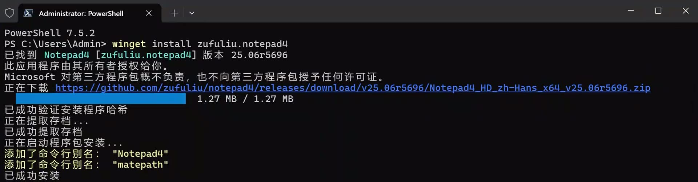

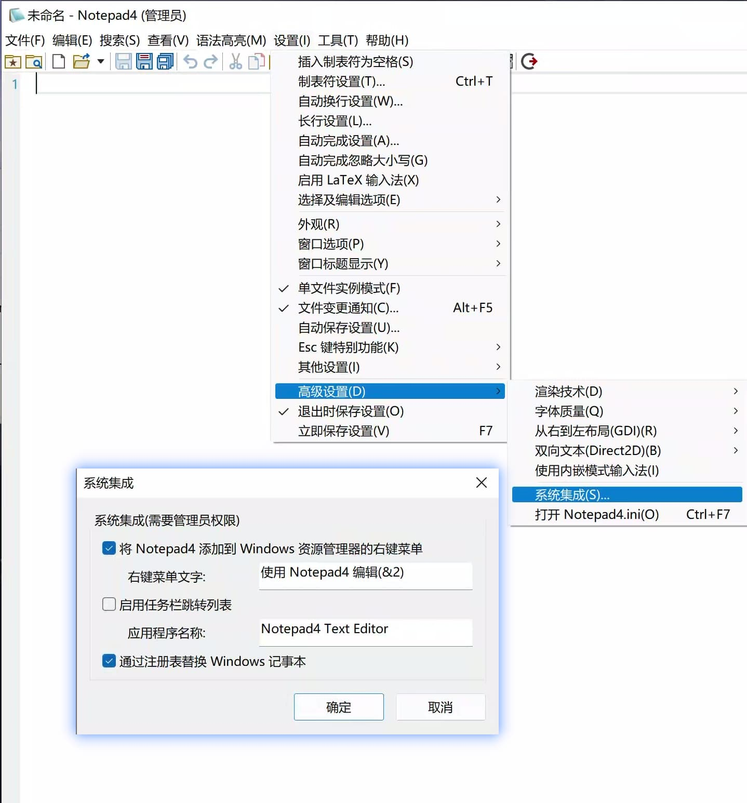

### 5. Git for Windows

```
winget install --id Git.Git -e --source winget
```

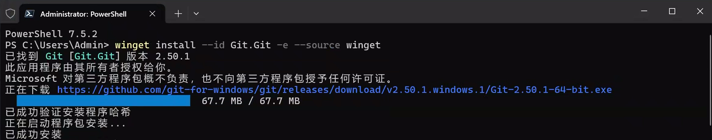

### 6. fnm

```
winget install Schniz.fnm
```

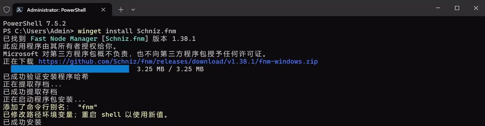

```
fnm install lts/krypton
```

```
fnm use lts/krypton
```

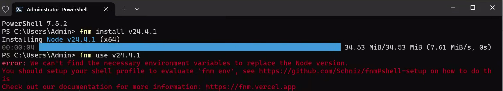

```
notepad $profile
```

没有已有`PROFILE`的情况下会提示不存在

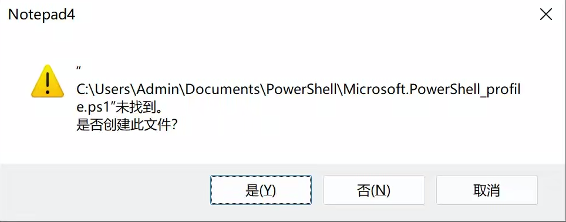

```
New-Item –Path $Profile –Type File –Force
```

完成后再次使用命令 `notepad $profile` 打开

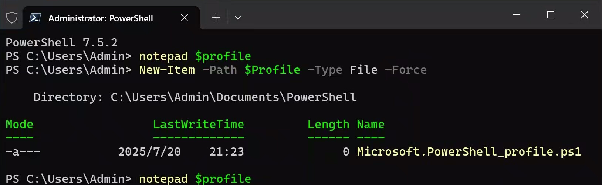

```
fnm env --use-on-cd --shell powershell | Out-String | Invoke-Expression
```

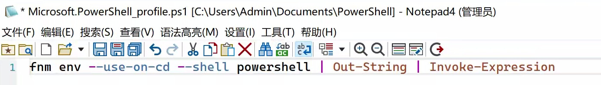

后同样关闭全部窗口 重新打开一个终端Shell

- 使用刚才安装的版本

```
fnm use lts/krypton
```

成功应用默认 Node 版本

- 设定 npm 镜像源

```
npm config set registry https://registry.npmmirror.com
```

- 全局安装 Claude Code

```
npm install -g @anthropic-ai/claude-code@2.1.112
```

或者 继续最新版

```
npm install -g @cometix/claude-code
```

[毁了 全都毁了](https://linux.do/t/topic/1993426)


[简简单单救赎一下](https://linux.do/t/topic/2019138)

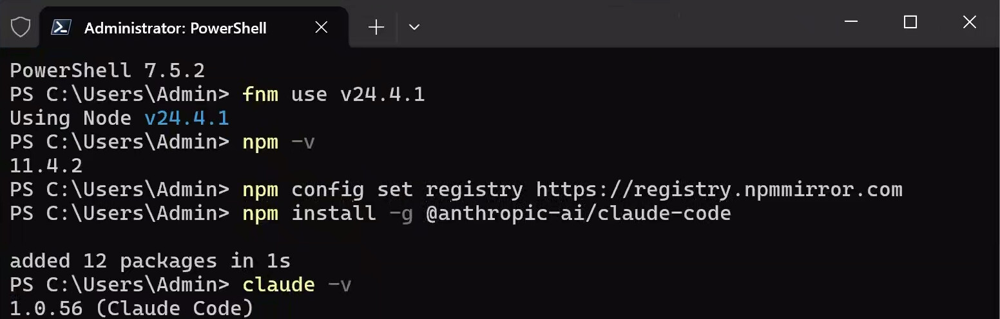

### （可选设定）美化相关

- 包含中文的等宽字体


[开发了一年多，开源等宽字体 Maple Mono 发布 v7.0 正式版](https://linux.do/t/topic/496409)


[MapleMonoNormal-NF-CN.zip](https://github.com/subframe7536/maple-font/releases/download/v7.9/MapleMonoNormal-NF-CN.zip)


打开powershell 修改默认字体为 `Maple Mono Normal NF CN`


点击顶部下拉箭头 → 设置

配置文件项中的Powershell → 其他设置中的外观项 → 字体选择

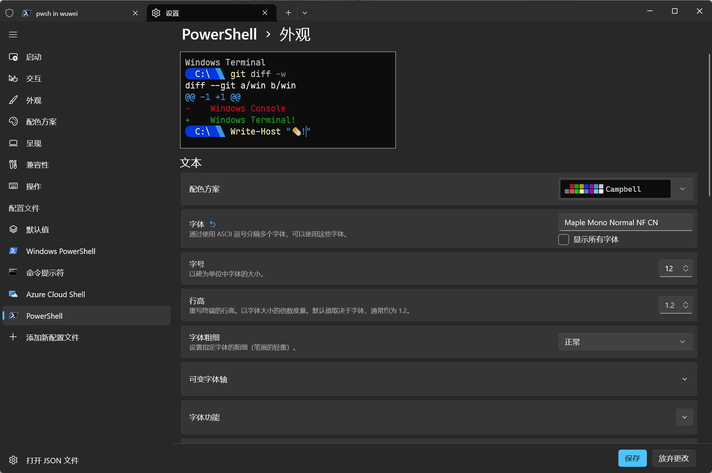

- Oh My Posh

```
winget install JanDeDobbeleer.OhMyPosh --source winget --scope user --force
```

同样打开 `PROFILE` 新增激活 OhMyPosh

```
notepad $profile
```

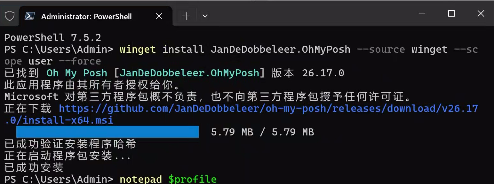

```
oh-my-posh init pwsh --eval | Invoke-Expression
```

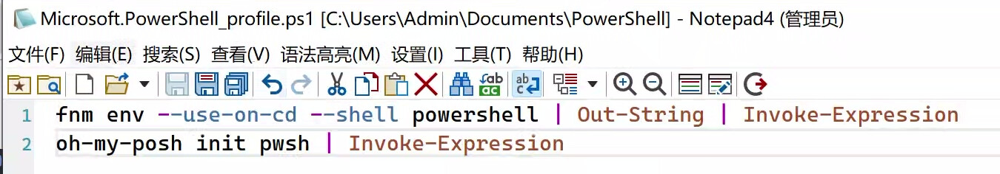

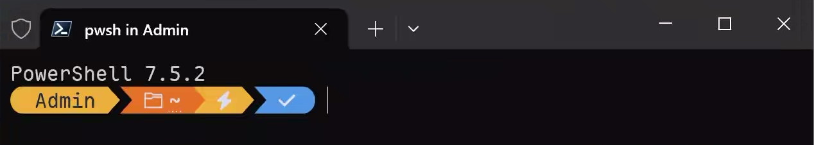

**主题样式很多  任君挑选** [Themes | Oh My Posh](https://ohmyposh.dev/docs/themes)

- [Claude Code StatusLine | 小工具 大用处！| 超绝更新自定义](https://linux.do/t/topic/859699)

---

# FAQ

- Q: Windows Plan Mode 切换问题

A: [Windows下claude code如何切换到plan模式？ - #4，来自 Haleclipse](https://linux.do/t/topic/794815/4)


仅在 Node v24.2.0 / v22.17.0 以上Shift+Tab正确工作

其中 在不支持的Node版本上自动回退绑定到 Alt+M

2.0.31 使用bun构建的CC 全端统一为 Shift+Tab，因其不存在node的这个问题


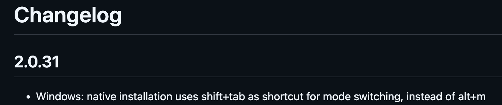

- Q: Windows 图片粘贴方法

A: [win下 claude code 怎么上传图片。 - #28，来自 Haleclipse](https://linux.do/t/topic/796754/28)


macOS 1.0.61 增加了 ⌘ + V 的图片粘贴支持

原强制为 Ctrl + V 现粘贴体验更加一致

Windows 1.0.93 增加了 Alt + V 的图片粘贴支持，原只能接收图片文件而不是剪贴板中的图片数据

- Q: macOS下 iTerm2 下换行绑定 工作正常，但VSCode类内嵌终端 该功能多出一个  `\`  ？

A: 因为历史问题兼容性 目前给到的 `keybindings.json` 绑定内容为 **"\\\r\n"**

初看似乎没有问题，但其会在换行后多输出一个 `\`

我们将其改为 `"\u001B\u000A"` 即可和 ⌥Option+Enter 行为一致

- Q: Windows 触发错误异常弹出 `Error: cannot open _claude_fs_right:`

A: 暂时卸载VSCode的VSIX扩展程序 其在编辑之时会将目标文件路径传递给VSCode进行协同，目前路径转换存在问题 待修复「并且关闭IDE Auto Connect 功能」


此问题可能已在历史版本中修正，按照如上的安装方式 在Powershell下运行，一并解决了 链接IDE的找不到的问题

1.0.65 已修正链接IDE稳定性问题


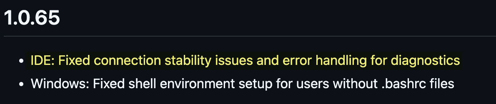

- Q: Windows下MCP Server (Stdio) 全部无法使用？

A： 改成 `command: "cmd"` 后接 `arg : ["/c","npx"]`


原理：[关于Windows原生运行claude code的问题 - #4，来自 Haleclipse](https://linux.do/t/topic/784087/4)

样例：[Claude Code 原生 Windows 的 MCP 错误处理](https://linux.do/t/topic/782073)

`claude mcp add --transport sse context7 https://mcp.context7.com/sse --header "CONTEXT7_API_KEY: YOUR_API_KEY"`

- Q: 红色 Offline 字样是做什么用的？遥测相关会不会用于检测封号？

A: Offline 只是用作真 连接状态检测 详见


[windows claude code显示offline，但是不影响使用。 - #10，来自 Haleclipse](https://linux.do/t/topic/807647/10)

遥测信息仅元数据 封号不相关： [windows claude code显示offline，但是不影响使用。 - #7，来自 Haleclipse](https://linux.do/t/topic/807647/7)

- Q: 官网 / 中转站 / CCR类自定义重定向API接入，在设定上有何区别

A:


官网：设定 `HTTP_PROXY` / `HTTPS_PROXY` 环境变量正常登录即可


[有使用Claude code的大佬吗，一直报403 - #9，来自 Haleclipse](https://linux.do/t/topic/702742/9)

[使用claude code 提示offline - #12，来自 Haleclipse](https://linux.do/t/topic/784593/12)


中转站：如无魔改 使用其提供的api端点地址和key设定即可


`ANTHROPIC_BASE_URL` (需是 Anthropic 形式接口)

`ANTHROPIC_API_KEY` (只有标准 Anthropic 填写此项)

`ANTHROPIC_AUTH_TOKEN` (有极高概率是此项)


二选一而非可以共存


案例：接入月之暗面K2 (标准 Anthropic 形式接口)


`"ANTHROPIC_BASE_URL": "https://api.moonshot.cn/anthropic"`

`"ANTHROPIC_API_KEY":"你的Key"`


案例：Aηyrouter (NewAPI 转换得来)


`"ANTHROPIC_BASE_URL": "https://aηyrouter.top"`

`"ANTHROPIC_AUTH_TOKEN": "sk-xxxxxx"`


自定义 Anthropic 兼容接口接入：


同中转站 但KEY处可置空 按照Proxy提供者的要求处理


案例：接入 [Qwen Coder](https://linux.do/t/topic/803265/111)


CCR 接入GLM-4.5支持触发思考应如何配置？


[GLM4.5如何在claude code里开启思考？ - #27，来自 Haleclipse](https://linux.do/t/topic/838507/27)


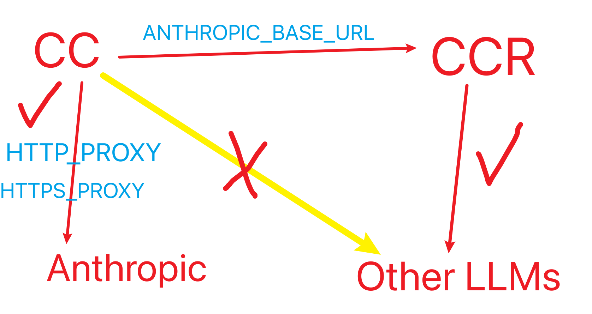


**以上内容均只需在 ~/.claude/settings.json 中的 env 节点下编辑 全篇无须操作系统的环境变量，以及折腾代理软件的诸如 TUN 系统代理等内容 ，来支持CC的使用**


**并且需要注意ANTHROPIC_API_KEY的优先级要高于官网登录态，只要存在该env，CC将不会使用官网登录态的服务**


所以最简单的接入点切换方法暂时就是 copy几份不同的`~/.claude/settings.json`文件 然后手动进行替换,后续会将这部分功能傻瓜化到GUI中 `Claudiatron`，以方便快速切换和设定这些内容


v1.0.61 已经添加 `--settings` 参数，能够便捷化指定加载不同的`settings.json`配置 详细介绍移步 [Any牌路由器使用清障！](https://linux.do/t/topic/1779614)


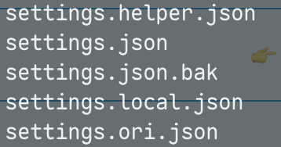


目前在设置中开启 `Verbose Output` 恢复原有 详情输出 且添加了 上下文窗口实际值显示


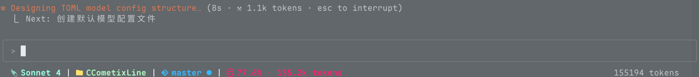

---

鉴于没有推进SubAgent的内容，这里给到一个集合网站给予参考

- [http://subagents.cc](http://subagents.cc)


---


*来源: https://linux.do/t/topic/803265.json*

