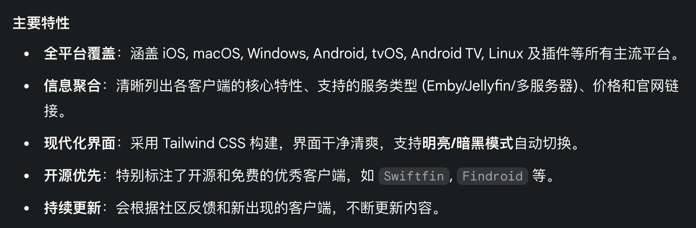

---

id: 812252

title: "Emby & Jellyfin 全平台客户端选择指南 (Web版)"

created_at: 2025-07-24T03:35:59.000Z

username: yangzhazha

display_username: "杨渣渣"

---


# Emby & Jellyfin 全平台客户端选择指南 (Web版)


#### web访问 & 地址

- **在线体验地址：** [ [Emby & Jellyfin 客户端选择指南](https://yzz2023.github.io/emby-jellyfin-guide/) ]

- **GitHub地址：** [ [GitHub - Yzz2023/emby-jellyfin-guide: Emby & Jellyfin 客户端选择指南 · GitHub](https://github.com/Yzz2023/emby-jellyfin-guide/) ]

欢迎大家补充，我会及时更新

- [感谢@sususu](https://linux.do/t/topic/761895)佬的想法以及指导


* 非常感谢L站让我接触并学习到了这么多有趣的知识。作为一个小白，从一个想法到最终实现并部署上线，整个过程充满了惊喜和成就感。


* 同时也感谢 **Gemini** 在编码过程中的全程协助。

**2026-09-14 更新**

距离上次更新已经好久没动了，快一年了。本来以为这个帖子会一直躺平，但时不时还是能看到佬友的点赞，想着不能辜负这点热度，就把它重新捡起来了。

**感谢站里提供公益服务的各位佬友——没有大家的分享，这个指南也走不到今天。**

内容难免有过时的时候，欢迎在评论区指出，看到就会增加。


特别感谢 AI在本次更新中的全程协助，从信息搜集到代码修改基本一把梭，确实省事。

这个指南只是一个开始。每个人的使用习惯和需求都不同，**欢迎大家在评论区分享和推荐自己正在使用的客户端** ，附上简单的使用体验。希望这个帖子能汇集更多佬友的智慧，为后来入坑的佬友们提供更有价值的参考。

#### 主要特性（AI总结）



#### 明亮/暗黑模式切换按钮的图标bug样式css修复

```
#theme-toggle-button svg { width: 16px; height: 16px; transition: opacity 0.3s ease, transform 0.3s ease; }
#theme-toggle-light-icon { color: #F59E0B; opacity: 0; transform: scale(0); display: none; }
html:not(.dark) #theme-toggle-light-icon { opacity: 1; transform: scale(1); display: flex;}
#theme-toggle-dark-icon { color: #4F4F4F; opacity: 0; transform: scale(0);display: none; }
.dark #theme-toggle-dark-icon { opacity: 1; transform: scale(1); display: flex;}
```

**

# 郑重承诺不含 **aff**，各位佬放心食用。

---

1.2


## 更新内容


* **1.新增搜索功能**：在导航栏中加入了一个搜索框，佬友们可以直接输入软件名称来快速筛选和定位。


* **2.更新“小幻影视”信息**：明确了早鸟价（¥27）的优惠时段截止至2025年9月5日，并标示了原价（¥45）。


* **3.更新“Terminus Player”**：已将其地址修改为新的发布页，并更新价格为免费。


* **4.添加 VidHub 到 tvOS**：现在 tvOS 分类下也会显示 VidHub。


* **5.核对所有链接**：已检查并确认所有软件的链接均为有效地址。


* **6.更新 EplayerX 价格**：价格已修改为22元。

---

1.3


**本次更新内容**

1.**新增 Cinemore** ：支持苹果全平台（iOS/macOS/tvOS）。


2.**新增 Ghosten-Player** ：完全开源的安卓（手机/电视）播放器，未来计划支持桌面平台。


3.**新增 Prismo** ：支持 HDR 和杜比视界。


4.**新增 zFuse** ：为 iOS 和 macOS 用户提供了一个极具性价比的选择。（一元）


5.**新增 delfin**


6.**功能更新** ：`DS Cloud` 现已更新为同时支持 Emby 与 Jellyfin。


7.**价格与描述更新** ：


* `Lenna` ：作者承诺“永久免费”


* `Terminus Player` ：更新了链接和价格，并优化了描述。

---

## 1.4

新增客户端 补了一批这一年冒出来的新软件，同时把官方基准也补齐了：

- Moonfin：2025 年底新出的跨平台客户端，最大亮点是同一套 App 能同时连 Jellyfin 和 Emby，覆盖手机 / 电脑 / 电视（Tizen 目前还是实验态）

- Fladder：Flutter 跨平台 Jellyfin 前端

- Streamyfin：移动端 Jellyfin 客户端，下载和 Chromecast 标为实验功能

- Jellyflix：跨平台 Jellyfin 视频客户端，支持转码后离线下载

- iPlay：开源播放器，同时支持 Emby / Jellyfin

- FluentFin：Windows 原生（WinUI）Jellyfin 客户端

- Jellyfin for iOS / Android：官方手机客户端，之前只有第三方没有基准，这次补上

- Jellyfin MPV Shim / JellyCon：官方投放接收端、Kodi 轻量插件（和「Jellyfin for Kodi」完整同步区分开）

**信息修正**

- **网易爆米花**：官网现已支持 Jellyfin，由「仅 Emby」改为 Emby & Jellyfin 双支持；删掉了「被多数服务器屏蔽」说法

- **Swiftfin**：明确其定位是 iOS / tvOS 原生客户端，从 macOS 分类移出

- **Findroid**：补上关键限制——只直接播放、不转码，Android TV 仍在计划中

**价格调整**

- 过期早鸟价、「永久免费」、「¥1」、测试名额等，统一改为「查看当前商店页」，不再给可能误导的报价

**删除**

- 移除 **Cinemore**（经核验信息无法确认，不再保留,）

---


---


*来源: https://linux.do/t/topic/812252.json*

