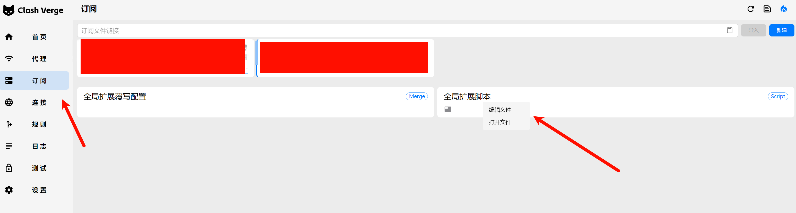

---

id: 814995

title: "极简脚本覆写clash rule从而使用最基本的链式代理"

created_at: 2025-07-25T03:42:25.102Z

username: goodchuai

display_username: "Sir. That Way"

---


# 极简脚本覆写clash rule从而使用最基本的链式代理


这几天拿到了猫佬 [@STALK](/u/stalk) 的家宽节点，研究了一下怎么使用脚本做到最基本的链式代理，抛砖引玉一下。

以下以clash verge 为例：

1. 在订阅中选择全局扩展脚本，编辑文件




2. 粘贴以下脚本

```
// Define main function (script entry)
// https://mihomo.party/docs/guide/override/javascript
function main(config) {
  const name = "all"
  const allProxies = config.proxies.map( x => x.name)
  config["proxy-groups"].push({
    name: name,
    type: "select",
    proxies: allProxies
  })

  config.proxies.push({
    name: "maomao",
    server: "ip",
    port: 11111,
    username: "username",
    password: "password",
    type: "socks5",
    "dialer-proxy": name,
    udp: true
  })
  config["proxy-groups"].push({
    name: "socks5",
    type: "select",
    proxies: [
      "maomao",
    ]
  })
  config["proxy-groups"].forEach(g => {
    if (g.name.endsWith("节点选择")) {
      g.proxies.push("socks5")
    }
  })
  return config;

}
```

鉴于上一个版本不够普适，稍作了一下修改，新版的代码是创建一个全新的proxy group`all`,然后将所有机场节点加进去，再创建一个proxy group `socks5`,这个group里面使用的是落地节点。用户根据自身机场规则跟该`if (g.name.endsWith("节点选择")) {`内容，将名称改为机场选择节点的组名即可。使用的方法就是先在`all`中选择机场节点，然后在`socks5`中选择落地节点，再在`节点选择`中选择`socks5`

```
// Define main function (script entry)
// https://mihomo.party/docs/guide/override/javascript
function main(config) {
  const name = config["proxy-groups"].filter(x => {
    return x.name.indexOf("手动")!== -1
  })[0].name
  console.log(name)
  config.proxies.push({
    name: "jiedian",
    server: "1",
    port: ,
    username: "",
    password: "",
    type: "socks5",
    "dialer-proxy": name,
    udp: true
  })
  config["proxy-groups"].push({
    name: "socks5",
    type: "select",
    proxies: [
      "jiedian",
    ]
  })
  config["proxy-groups"].forEach(g => {
    if (g.name.endsWith("节点选择")) {
      g.proxies.push("socks5")
    }
  })
  return config;
}
```

然后保存就可以了。


4. 节点选择。通过脚本，我们创建了一个socks5(至少按照上面的代码，我们创建的叫socks5)的proxy group并且添加进了`节点选择`，于是我们在`节点选择`中选择socks5这个分组，再在socks5分组中选择你想要的家宽节点，然后在`手动选择`中选择你想要通过哪个机场节点连接落地节点。具体分组名称请根据你的机场规则自行调整。

代码的逻辑基本就是找到手动选择这一个proxy group，然后创建需要使用链式代理的节点（家宽），并在`dialer-proxy`中使用这个手动选择的节点，然后给家宽节点创建一个proxy group并且放到节点选择当中。原理非常简单，也只是很基本的实现。需要注意的一个点是，需要开启udp，不然部分网站（比如claude）没法成功使用。

致谢：


[https://linux.do/t/topic/688105](https://linux.do/t/topic/688105)

[dialer-proxy 实现链式代理（最简配置、订阅转换和全局覆写](https://linux.do/t/topic/710530) [


开发调优](/c/develop/4)

> 通常情况下 落地节点我们无法直接连接 机场节点又容易被滥用

> 因此 我们需要 链式代理

> 指定 落地节点 通过 dialer-proxy 建立连接 是比较优雅的方式

>

>

> 创建本主题前 我参与了相关问题的讨论

> 创建本主题时 我又发现不少佬友都曾被这个问题困扰

>

>  ![[image]](https://cdn3.ldstatic.com/original/4X/7/6/f/76f7c6d8abf45c258828d75604f55d1eb4a31dee.png)

>

> 这里不多赘述 直接祭出一个最简化版 dialer-proxy 链式代理配置：

> proxies:

>

>   -

>  …


---


*来源: https://linux.do/t/topic/814995.json*

