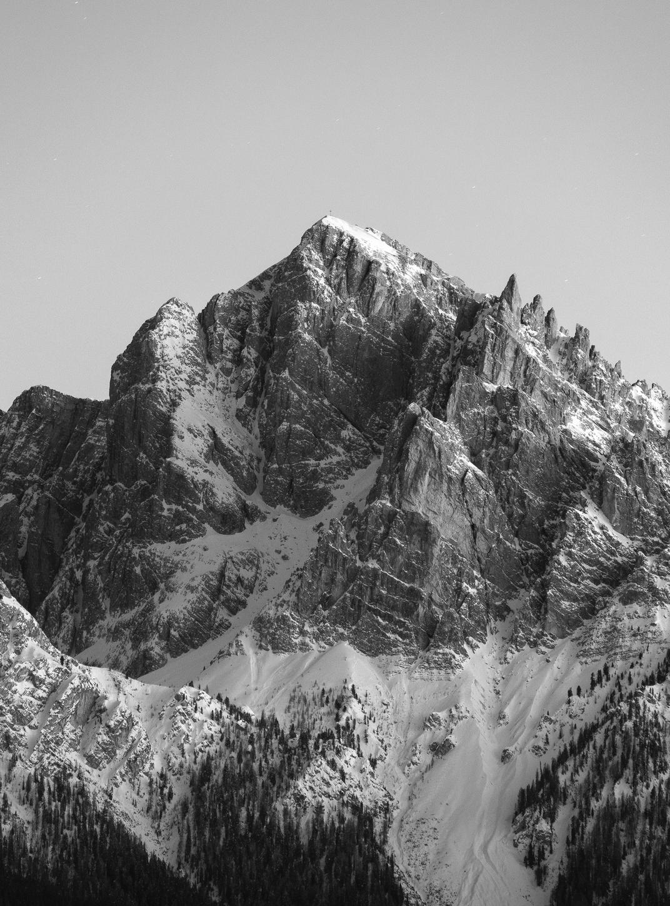
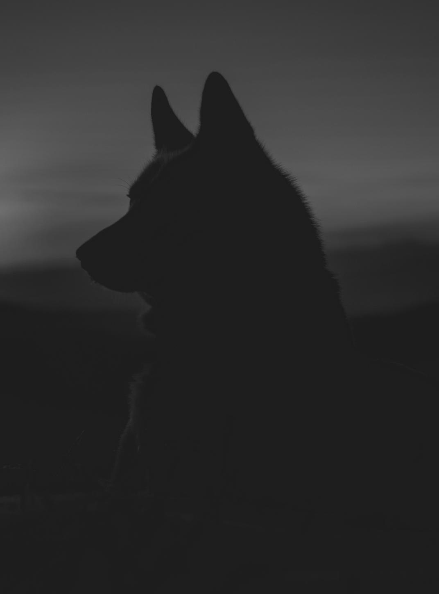
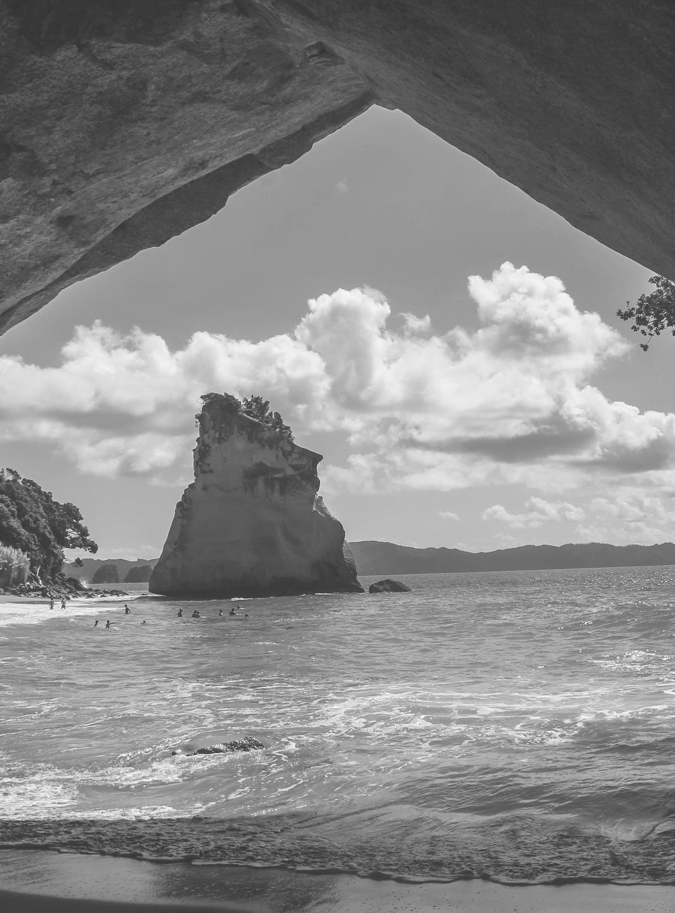

---

id: 834473

title: "[Make Kindle Great Again] Kindle屏保制作工具 [附赠KW4 屏保 1000张]"

created_at: 2025-08-01T04:26:09.043Z

username: xiebaiyuan

display_username: "汉武帝（的大熊猫）"

---


# [Make Kindle Great Again] Kindle屏保制作工具 [附赠KW4 屏保 1000张]


## 为什么要做这个工具？

平时喜欢在设备上放一些自己喜欢的图片作为壁纸。


但问题是，搜来搜去也没几张图啊.


恰好我有一堆搜集来的电脑壁纸. 搞个工具吧..

## 工具功能介绍

这个工具的主要功能有：

1. **自动灰度转换**：将彩色图像自动转换为灰度图像，适配 Kindle 的显示特性。

2. **智能裁剪**：根据目标设备的屏幕比例智能裁剪图像中心部分，避免简单拉伸造成的图像变形。

3. **多设备支持**：支持所有主流 Kindle 型号，包括基础款 Kindle、Paperwhite 系列、Oasis 系列以及 Kindle Scribe。

4. **交互式操作**：通过简单的交互式界面，可以指定输入目录、选择设备型号和输出目录。

5. **不修改原图**：处理过程中不会修改原始图像，不用担心原始文件的安全。

## 使用方法

工具的使用非常简单：

1. 克隆仓库 [AFF](/tag/AFF)：

`git clone https://github.com/xiebaiyuan/Make-Kindle-Great-Again.git  cd Make-Kindle-Great-Again `

2. 安装依赖（推荐使用自动安装）：

`./setup_kindle_converter.sh `

3. 运行工具：

`./run_kindle_converter.sh `

工具会交互式地询问输入目录、Kindle 型号和输出目录

对于熟悉命令行的用户，也可以直接使用参数：

```
# 指定输入目录、设备型号和输出目录
./run_kindle_converter.sh /path/to/images -m scribe -o /path/to/output
```

## 实际效果展示

为了让你们更好地了解工具的效果，我在仓库中添加了一些演示图片。这些图片都是通过本工具处理的，可以看到处理后的图像在保持主要内容的同时，完美适配了设备屏幕比例。









## 项目开源

这个项目是完全开源的，采用 MIT 许可证，代码托管在 GitHub 上。


欢迎大家提交 Issue 和 Pull Request 来改进这个工具。

如果你觉得这个工具对你有帮助，也欢迎给我一个 star！

GitHub 仓库地址 [AFF](/tag/AFF) ：[GitHub - xiebaiyuan/Make-Kindle-Great-Again: kindle screen saver bgs tools](https://github.com/xiebaiyuan/Make-Kindle-Great-Again.git)

## 分享我制作一些屏保

我是kw4 因此:


链接：[https://pan.quark.cn/s/ff23b2d8fe14](https://pan.quark.cn/s/ff23b2d8fe14)


提取码：RF54

百度网盘：KindleBG


链接: [百度网盘 请输入提取码](https://pan.baidu.com/s/16iqTUi9p3aj3LXVzgW3stA?pwd=5j8q) 提取码: 5j8q


---


*来源: https://linux.do/t/topic/834473.json*

