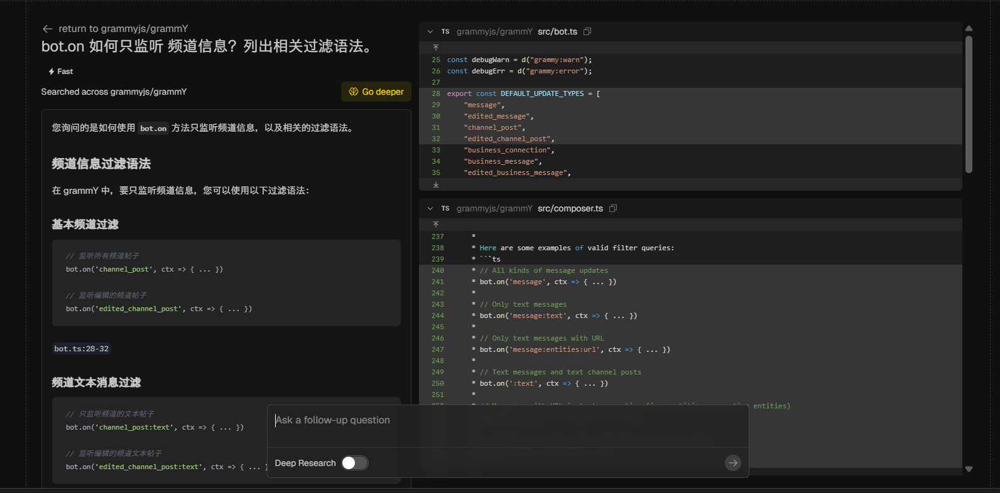

---

id: 838526

title: "Telegram Bot 开发入门"

created_at: 2025-08-03T06:26:59.236Z

username: Graye_Draisey

display_username: "Graye"

---

# Telegram Bot 开发入门

# Telegram Bot 开发入门

## 简单介绍功能

完整内容，请查阅：[Telegram Bot Features](https://core.telegram.org/bots/features)

## 主要开发依赖

- Bun: [Welcome to Bun - Bun](https://bun.sh/docs)

运行环境，方便直接运行 .ts 文件。有替代品，此处不多说。

- grammY：[Overview | grammY](https://grammy.dev/guide/)

一个用于创建 Telegram 机器人的框架。它可用于 TypeScript 和 JavaScript，并可在 Node.js、Deno 以及浏览器中运行。

## 入门：以一个简单的实例开始

1. 在 Telegram 上创建 Bot

访问 [@BotFather](https://t.me/BotFather)，创建你的 Bot，并复制 bot token

2. 创建文件：bot.ts

写入内容：

`import { Bot } from "grammy";  // 创建 Bot 实例 const bot = new Bot("bot-token"); // <-- 放入你的 bot token  // 监听任意消息，并回复 bot.on("message", (ctx) => ctx.reply("Got another message!"));  // 启动 Bot bot.start({   onStart: (ctx) => {     console.log("Bot started", ctx);   }, });  `

3. 运行文件

执行下面命令，运行前面创建的 .ts 文件

`bun run --watch bot.ts`

4. 测试

在 Telegram 上打开你的 Bot， 开启私聊，随意发送消息，观察，Bot 应该会回复。

## 进阶：自定义你的 Bot

- 过滤消息类型

比如，你只想要监听并处理图片消息，可以写：

`bot.on("message:photo"); // 过滤器：只监听图片消息`

更多过滤语法，参考 [Filter Queries and bot.on() | grammY](https://grammy.dev/guide/filter-queries#regular-queries)

- 注册斜杠命令

`await bot.api.setMyCommands([   { command: "start", description: "Start the bot" },   { command: "help", description: "Show help text" },   { command: "settings", description: "Open settings" }, ]); `

监听并处理命令

`  bot.command("start", async (ctx) => {     // 自定义处理     const item = ctx.match;  // 通过 ctx.match 获取尾随参数, 比如 "/start game" 的 “game”   }); `

- 更多内容，参见相关文档

## 工具：询问 DeepWiki 获取你想要的方法

- [grammyjs/grammY | DeepWiki](https://deepwiki.com/grammyjs/grammY)

## 附录

- Telegram Bot 官方文档：[Bots: An introduction for developers](https://core.telegram.org/bots)

---

*来源: https://linux.do/t/topic/838526.json*

