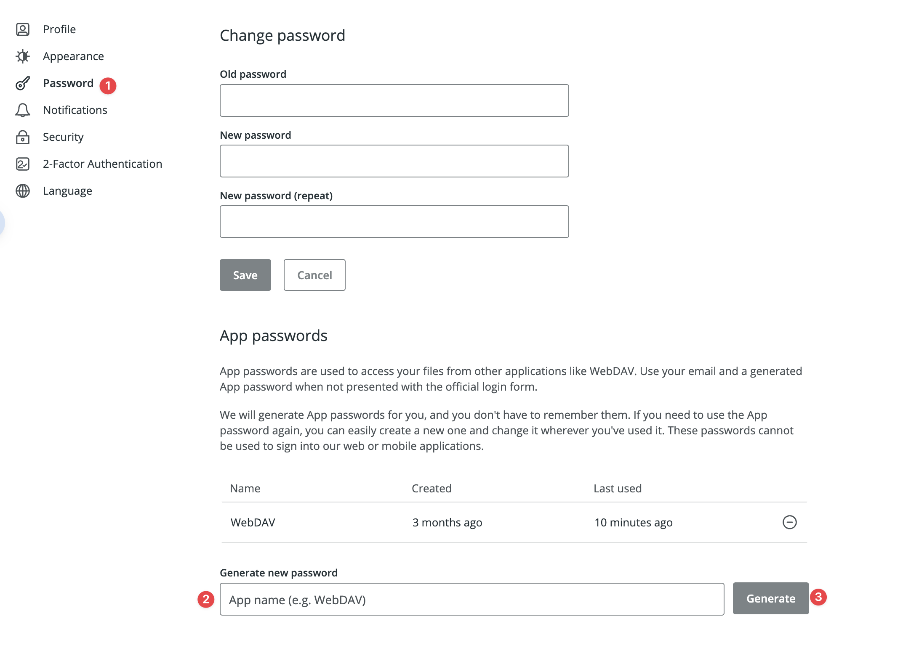
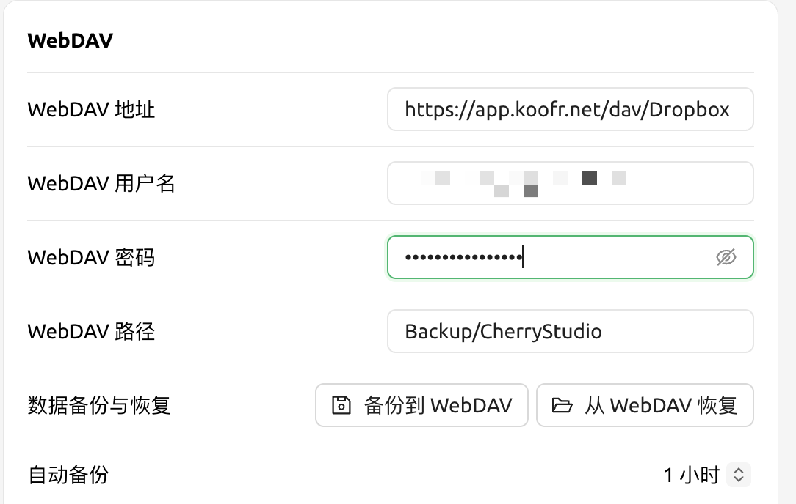
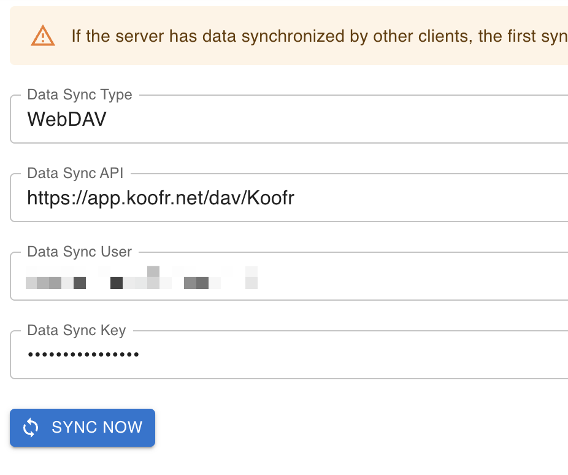
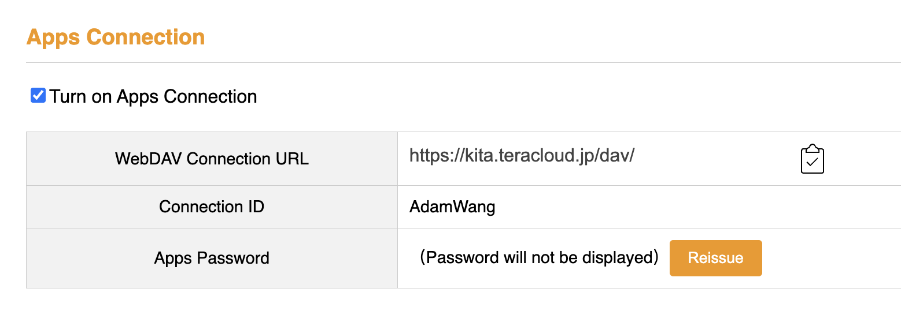
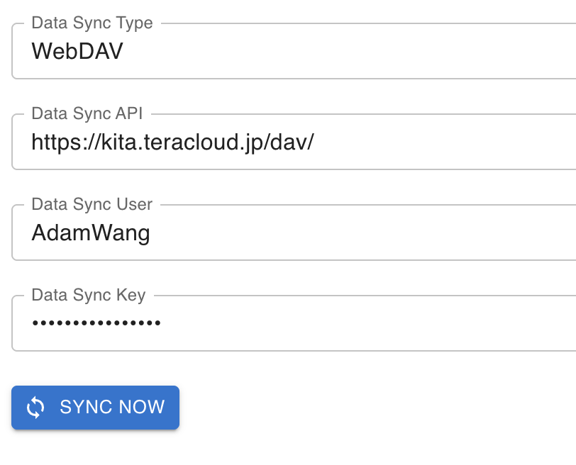

---

id: 854248

title: "【工具分享】两款支持 Web DAV 的网盘"

created_at: 2025-08-09T10:37:36.404Z

username: adamwang

display_username: "Adam"

---


# 【工具分享】两款支持 Web DAV 的网盘


# Koofr - [https://koofr.eu/](https://koofr.eu/)

Koofr 是一家来自塞尔维亚的公司，免费账户提供 10G 的空间存储本身就支持 WebDAV，且支持挂载 Dropbox、Google Drive、One Drive 等云盘，作为身处欧盟的公司个人觉得对于用户隐私的保护相对来说还是好一些的，所以也是我目前主要在用的一个 WebDAV 服务。

## Koofr 官方 WebDAV 流程

1. 注册 [Koofr.net](https://koofr.eu/) 账号

2. 去设置页生成应用密码，之后会作为 WebDAV 服务的密码：[Koofr](https://app.koofr.net/app/admin/preferences/password)




## Koofr 挂载 Dropbox 流程

1. 注册 [Koofr.net](https://koofr.eu/) 账号

2. 点击左侧菜单中的 Dropbox 并授权登录

3. 生成一个新的应用密码，这个之后会作为 WebDAV 的密码

4. 等待 Dropbox 同步完成，完成体现在 Koofr首页会出现 Dropbox 的文件内容。

## 配置 WebDAV

### WebDAV URL

- [https://app.koofr.net/dav/Koofr](https://app.koofr.net/dav/Koofr) 官方 WebDAV URL

- [https://app.koofr.net/dav/Dropbox](https://app.koofr.net/dav/Dropbox)  挂载 Dropbox WebDAV URL

```
url: https://app.koofr.net/dav/Dropbox  // 这里以挂载 Dropbox 举例
user: <koofr_useremail> // koofr 的邮箱
password: <koofr_password> // 上面生成的应用密码
```

### Cherry Studio 中备份的示例：

- Cherry Studio 中可以指定 WebDAV 的路径，这里按照自己喜好设置成对应路径就可以了，不会影响数据的备份。




### Kiss Translator 中备份的示例：

因为 Kiss Translator 中无法指定备份路径，所以这里我试用了 Koofr 官网的服务而没有使用 Dropbox



# InfiniCloud

InfiniCloud 是一家日本的公司原来叫作 Tera Cloud，很久之前参加了一些活动我的账号容量是 35G 的，但是不太清楚新注册的账号容量是多少了，需要大家自己试一下。

## 流程

1. 注册账号 [https://infini-cloud.net/](https://infini-cloud.net/)

2. 账号注册好之后可以去设置页生成一个应用密码


[https://infini-cloud.net/en/modules/mypage/usage/](https://infini-cloud.net/en/modules/mypage/usage/)




- URL：[https://domi.teracloud.jp/dav/](https://domi.teracloud.jp/dav/)

- user_name: 设置页的用户名

- password: 生成的应用密码

Kiss Translator 备份示例：



希望对大家有所帮助 


---


*来源: https://linux.do/t/topic/854248.json*

