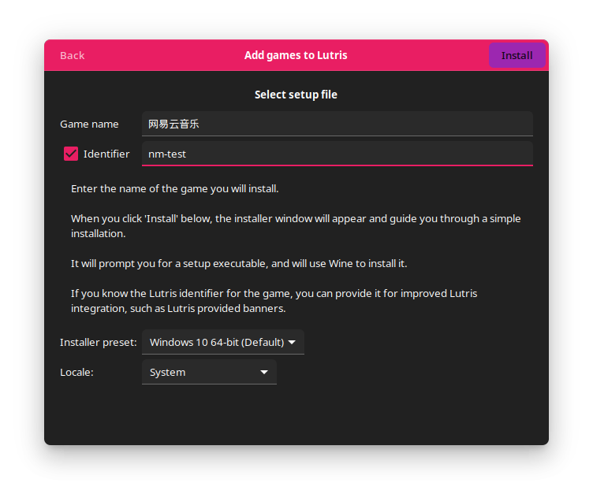
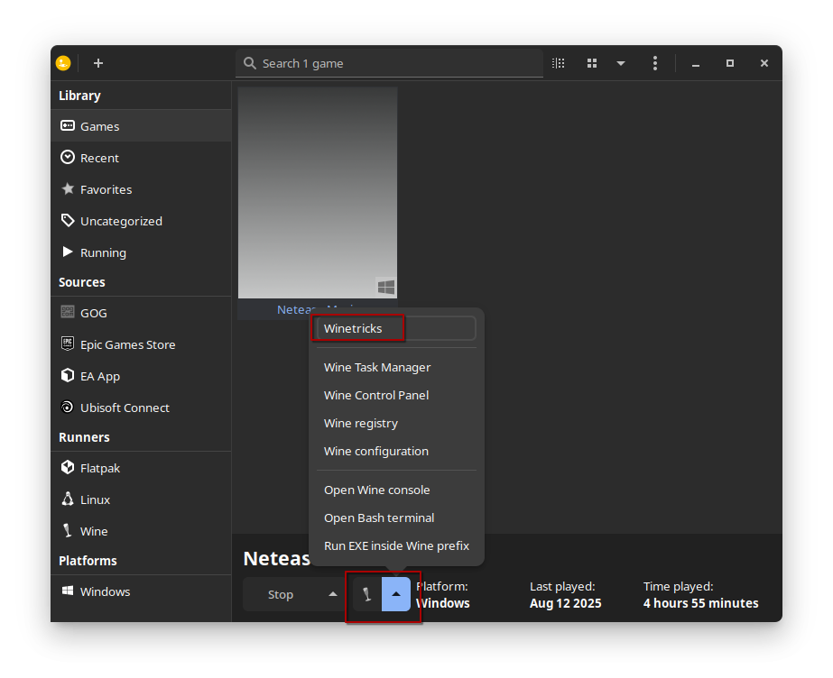

---

id: 861831

title: "教程：在 linux 上安装 Windows 网易云音乐"

created_at: 2025-08-12T11:29:49.431Z

username: littleblack_lb

display_username: "littleblack LB"

---


# 教程：在 linux 上安装 Windows 网易云音乐


教程：在 linux 上安装 Windows 网易云音乐

## 背景

在很久以前网易云 linux 版本就被官方悄悄弃用了, 并且目前为止由于 API 的更新, 它完全无法使用了. 为了解决在 linux 上用网易云的问题, 我诉诸过第三方开发者的网易云播放器, 但要不然是功能不完善, 要不然就是稳定性不高. 我便打算通过 wine 来运行 Windows 版本的网易云音乐.

## 前情摘要

后面的教程是通过 Lutris —— Windows 游戏管理器来运行网易云音乐的.

之前我是直接创建一个32位 prefix 来运行网易云的, 但由于最近滚动更新 wine 版本到了 10.18 后, wine 似乎废弃了32位环境, 导致：

```
wine: WINEARCH is set to 'win32' but this is not supported in wow64 mode.
```

而网易云在64位环境下会崩溃, 所以我只好另求办法, 便在这个[帖子](https://bbs.archlinux.org/viewtopic.php?id=306356)下找到了 Lutris 来解决.

## 使用体验

wine 的版本更新导致老办法在不回退的情况下被弃用对我来说是焉知非福, 因为 Lutris 能更好的利用显卡来处理网易云的图形任务, 同时解决了之前方案中的窗口控件（最大化, 最小化）问题. 因此目前而言和 Windows 平台上的体验毫无差别.


## 教程部分

### 安装 Lutris

前往 [Download Lutris](https://lutris.net/downloads) 寻找符合自己操作系统的安装步骤.

如 Arch Linux: `sudo pacman -S lutris`

## 下载网易云 Windows 版的安装包

[网易云音乐](https://music.163.com/#/download)


### [网易云音乐](https://music.163.com/#/download)

网易云音乐是一款专注于发现与分享的音乐产品，依托专业音乐人、DJ、好友推荐及社交功能，为用户打造全新的音乐生活。

## 操作 Lutris

虽然 Lutris 主要是给游戏服务的, 但也可以优秀地运行一般应用程序（降维打击）

1. 点开左上角的 + 号

2. 选择 `Install a Windows game from an executable`


1. Game name 可以填**网易云音乐**, Installer preset 选 **Windows 10 64-bit**



1. 下一步点 Install, 选择安装目录(就是最终 wine prefix 的位置)

2. 下一步选择刚刚下载的网易云安装包

3. 立即安装即可. 安装完成后点立即体验, 如果没有报错则可以退出软件了.


1. 右键 Lutris 中网易云音乐选项卡, 选择 Configure → Game options → Executable 右边三个点, 然后定位到`./drive_c/Program Files (x86)/Netease/CloudMusic/cloudmusic.exe`, 最后 Save , 测试运行

## 解决歌词乱码问题


**默认**

> winetricks 可以在这里运行:

> 


---


*来源: https://linux.do/t/topic/861831.json*

