---

id: 875029

title: "macOS 上的性能测试方式指引"

created_at: 2025-08-15T08:58:36.073Z

username: lostsheep

display_username: "lostsheep"

---


# macOS 上的性能测试方式指引


# macOS 上的性能测试方式指引

> 本文档用于记录在 macOS (白果/黑果均可) 的性能测试方式，旨在帮你了解自己的 mac 设备的性能水平，类似 windows 平台图吧工具箱

## CPU

### Geekbench(version: 6)

1. 下载方式-官网：[Download Geekbench 6](https://www.geekbench.com/download/)

2. 选择 CPU，点击 `Run CPU Benchmark`

3. 运行完成后会将结果上传到 [https://browser.geekbench.com/](https://browser.geekbench.com/) ， 在这里也可以搜索和查看同型号设备的分数

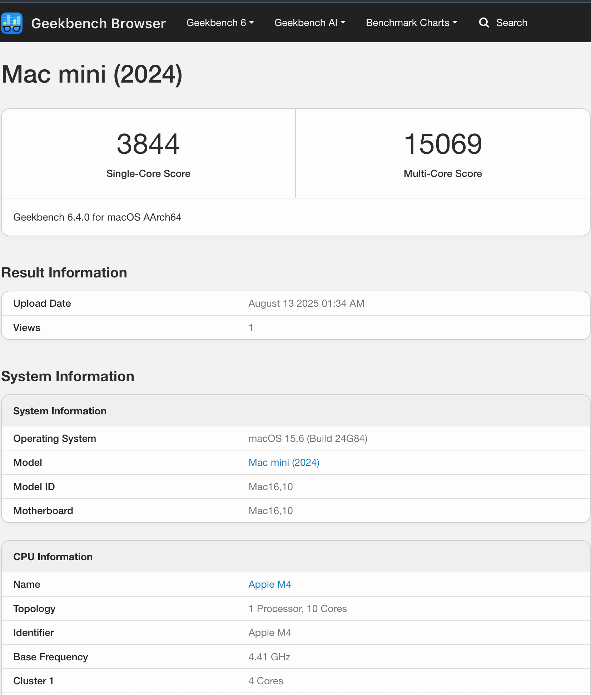

### Cinebench(version: r23)

1. 下载方式：`AppStore` 搜索 Cinebench 下载

2. 点击 CPU(Single Core) 跑单核测试，点击 CPU(Multi Core) 跑多核测试

3. Minimum Test Duration 里面有一个 Custom 选项，在 Preferences 中可以设置自定义跑测试的时长

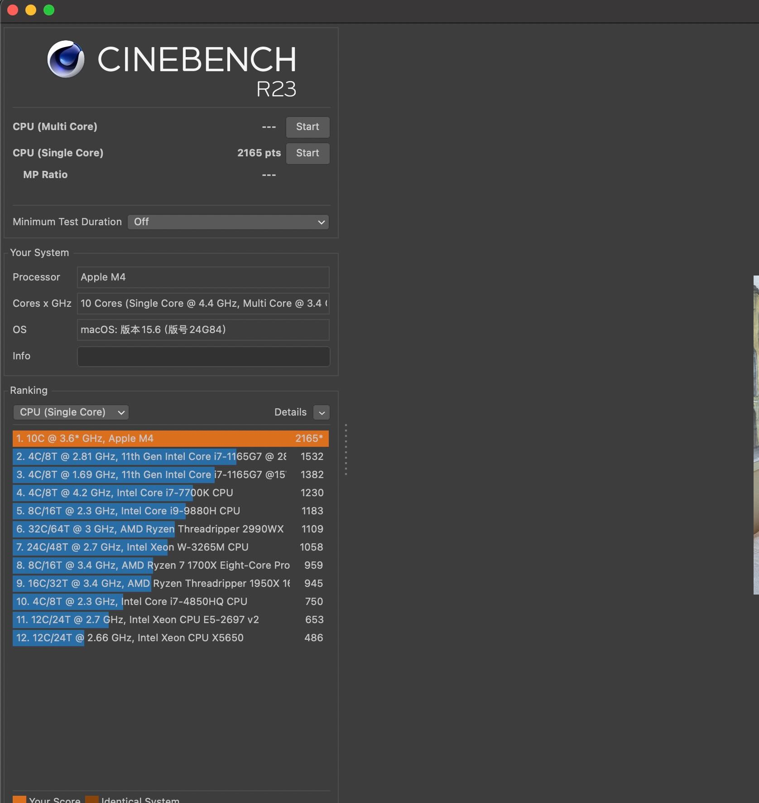

### CPU 功耗释放测试(可选)

> 由于 macOS 系统没有类似 `Prime95` 或 `AIDA64` 的 FPU Stress 之类的烤机测试，随便写了一个基于命令行测试的工具

1. 打开 `Terminal` 终端

2. 输入：`yes > /dev/null &`

3. yes 是一个命令行程序，旨在快速通过提示来确认操作。它字面意思就是对你指向的任何东西反复说 yes，用一个线程尽可能多地占用 CPU，所以你把它指向 /dev/null，它只是吸收输入而不做任何事情，你使用 & 将其置于后台，这样你就可以输入另一个命令

这里基于 mac mini m4 基础款有 4P+6E 10核心设计，我选择输入了10次 `yes > /dev/null &` 将 CPU 跑满

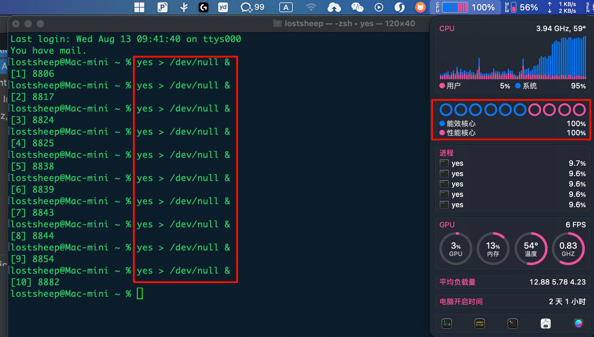

1. 查看一下功耗，这里 CPU 全核跑满大概稳定在 3.95Ghz 的情况下需要 6 瓦，但性能释放完全应该是在 20 瓦出头的

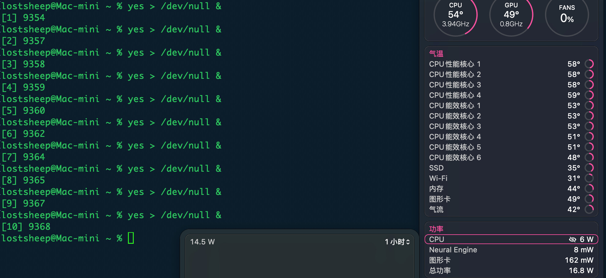

1. 结束测试进程输入：`killall yes`

#### 功耗测试备选方案

也可以直接使用 Cinebench 跑多核测试查看功耗

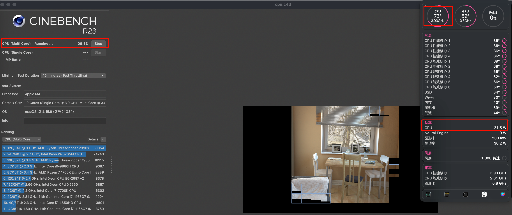

### 代码编译性能(可选)

> 使用 maven 3.6.x + zulu arm jdk1.8 编译一个 apache commons-lang 项目

1. 使用 git clone 获取 [GitHub - gradle/performance-comparisons: A set of synthetic projects used to benchmark Gradle against other build tools](https://github.com/gradle/performance-comparisons.git) 项目源码，`git clone https://github.com/gradle/performance-comparisons.git`

或直接下载 [https://github.com/gradle/performance-comparisons/archive/refs/heads/commons-lang.zip](https://github.com/gradle/performance-comparisons/archive/refs/heads/commons-lang.zip) 源码压缩包

2. 进入 `Terminal` 终端操作

```
# 替换为自己的文件路径
cd /path/to/performance-comparisons-commons-lang
# maven clean compile 先进行一次依赖 jar 包下载
mvn clean compile
# maven clean 清理掉编译好的 class 文件
mvn clean
# maven compile 重新进行一次编译查看耗时
mvn compile
```

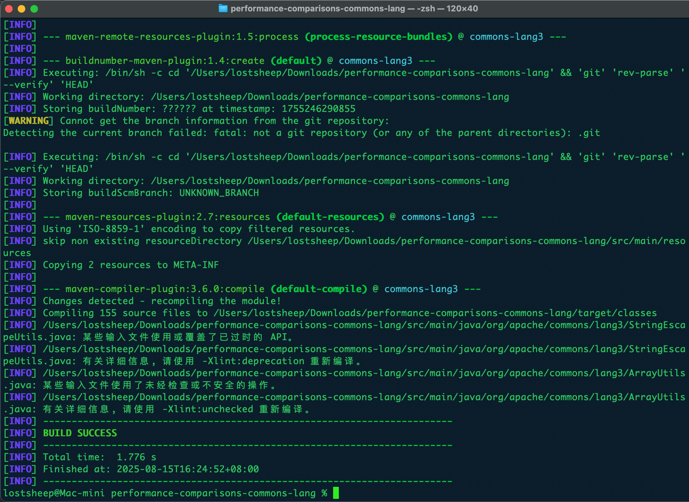

## GPU

### Geekbench(version: 6)

- 下载方式-官网：[Download Geekbench 6](https://www.geekbench.com/download/)

- 优势：跨平台，metal/OpenCL 图形引擎测试，可对比数据

> macOS 下一般使用 metal 引擎，基本只需要测试 metal 性能

> 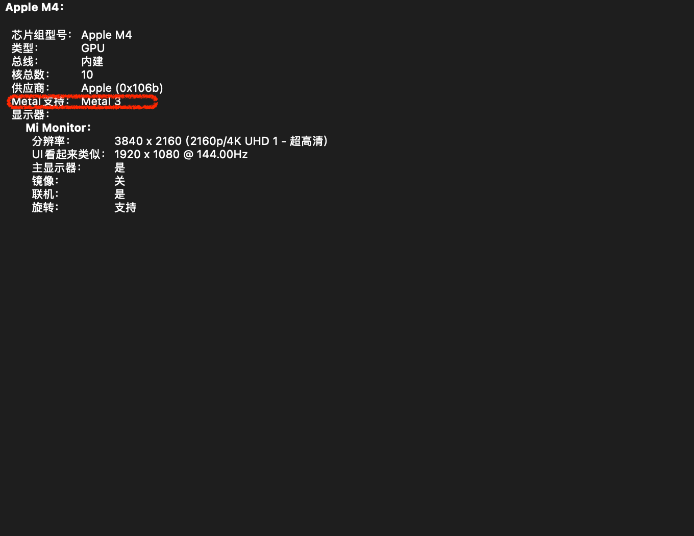

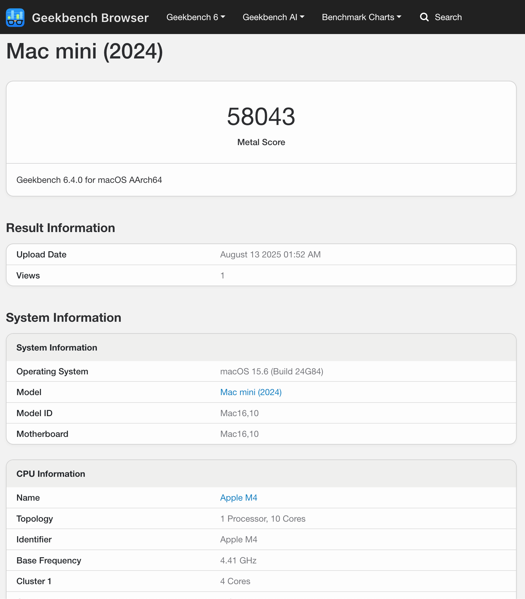

### Xcode

1. 使用 `Instruments`

// TODO 待补充

### DaVinci Resolve

> 使用 [DaVinci Resolve 20](https://www.blackmagicdesign.com/cn/products/davinciresolve) 对其官网提供的 [摄影机原始文件](https://downloads.blackmagicdesign.com/products/blackmagicursaminipro12k/raw/A002_05241705_C012.braw.zip) 进行一个导出进行测试

>

> [其他摄影机原始文件下载](https://www.blackmagicdesign.com/cn/products/blackmagicraw#downloads)

1. 直接将原始文件 **A002_05241705_C012.braw** 拖入 DaVinci Resolve

2. 点击`剪辑`拖动视频到 Timeline

3. 点击`交付`，配置`渲染设置`，选择 `Apple Prores 422 HQ` 类型，其他不调整

4. 点击`添加到渲染队列`

5. 点击`渲染所有`

6. 查看导出时间

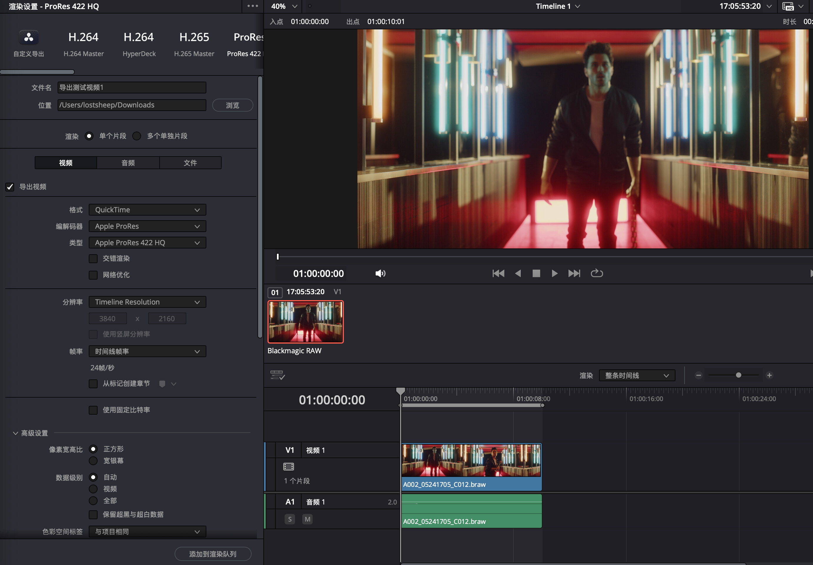

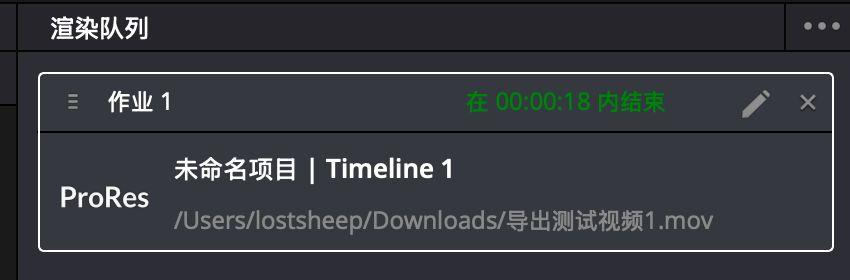

### 3D Mark(可选)

> 这里的 3D Mark 是为 iPad 设计的，只不过 M 系列芯片可以使用，跑分仅供参考

1. 下载：Apple Store 搜索 3DMark，下载评分 4.1 的那个

2. 打开应用

3. 可选测试：Steel Nomad Light，Wild Life Extreme


### GPU 功耗释放测试(可选)

> macOS 上没有类似 FurMark 之类的烤机软件，但是有 [GPUTest](https://www.geeks3d.com/gputest/download/)

1. 下载：官网：[GpuTest - Downloads (Windows, Linux, OSX)](https://www.geeks3d.com/gputest/download/)

2. 解压下载文件并获得：`GpuTest_OSX_x64_0.7.0`

3. 打开 `Terminal` 终端，执行以下命令

```
cd /path/to/GpuTest_OSX_x64_0.7.0
## 测试启动命令
open 'GpuTest.app' --args '/test=fur /width=1280 /height=720 /msaa=4 /benchmark /benchmark_duration_ms=60000'
```

1. 查看功耗释放

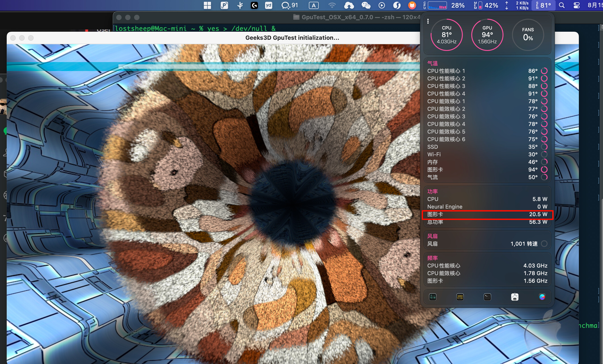

## CPU & GPU 双烤功耗测试(谨慎)

**直接同时开启 CineBench 的多核跑分和 GPUTest 的 fur 测试即可**，双烤有风险，操作需谨慎，这里为避免误导，不提供操作流程和截图

## 内存

> // TODO 暂没有找到合适的测试方式，但 macOS M 系列芯片使用同一内存封装，与传统内存颗粒相比暂没有测试的必要

## 硬盘

> 硬盘主要检测使用寿命/写入量/读写速度

### SSDReporter

1. 下载：官网：[Mac SSDReporter - check & monitor your SSD / Flash Storage health](https://www.corecode.io/ssdreporter/)

2. 直接点击打开

3. 查看硬盘寿命

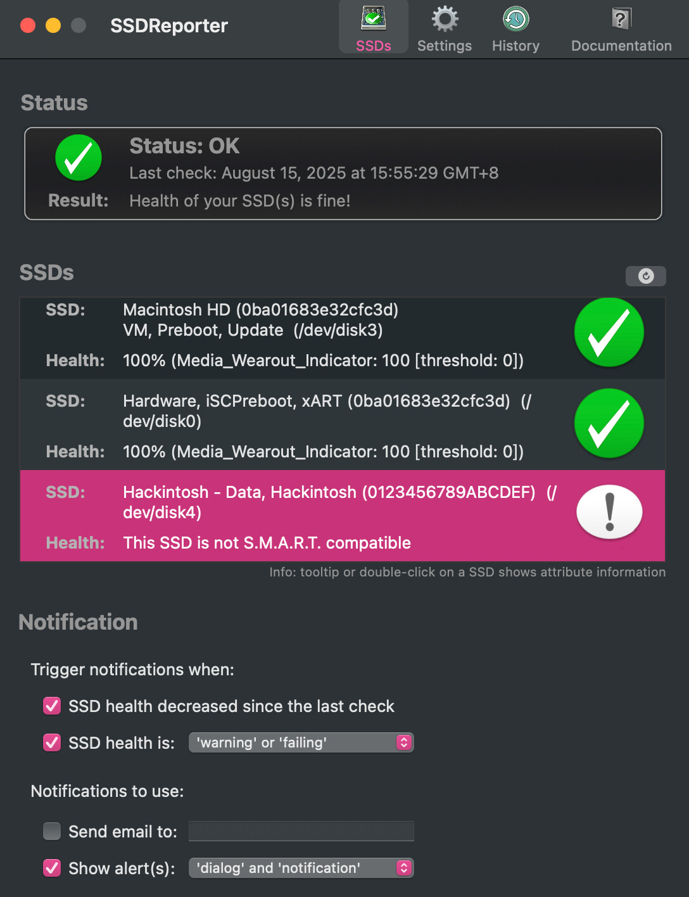

### Sensei

> 此软件收费，只能找下学习版了，有检测写入量等信息，比较完善

1. 下载：官网：[Sensei — Mac Performance Monitor & Cleaner | Cindori](https://cindori.com/sensei)

2. 打开应用

3. 点击存储器

4. 选择右侧`健康状况`

5. 查看读/写入量

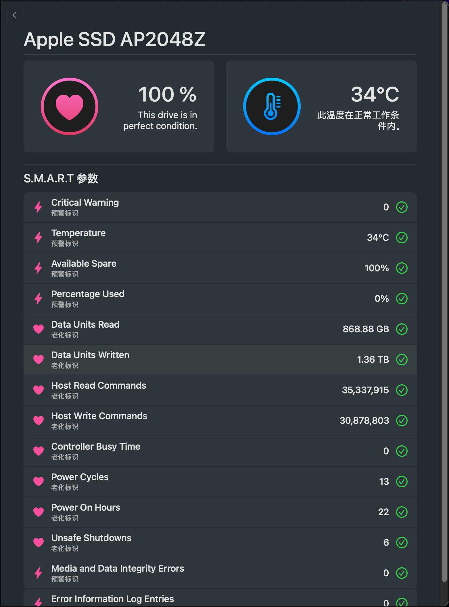

### Black Magic Disk Speed Test

1. 下载：App Store 搜索 Black Magic Disk Speed Test，下载 4.4 评分的那个

2. 打开应用

3. 点击，点击 Select Traget Drive，选到自己的用户目录

4. 点击 `SPEED TEST START`

5. 观察读写速度

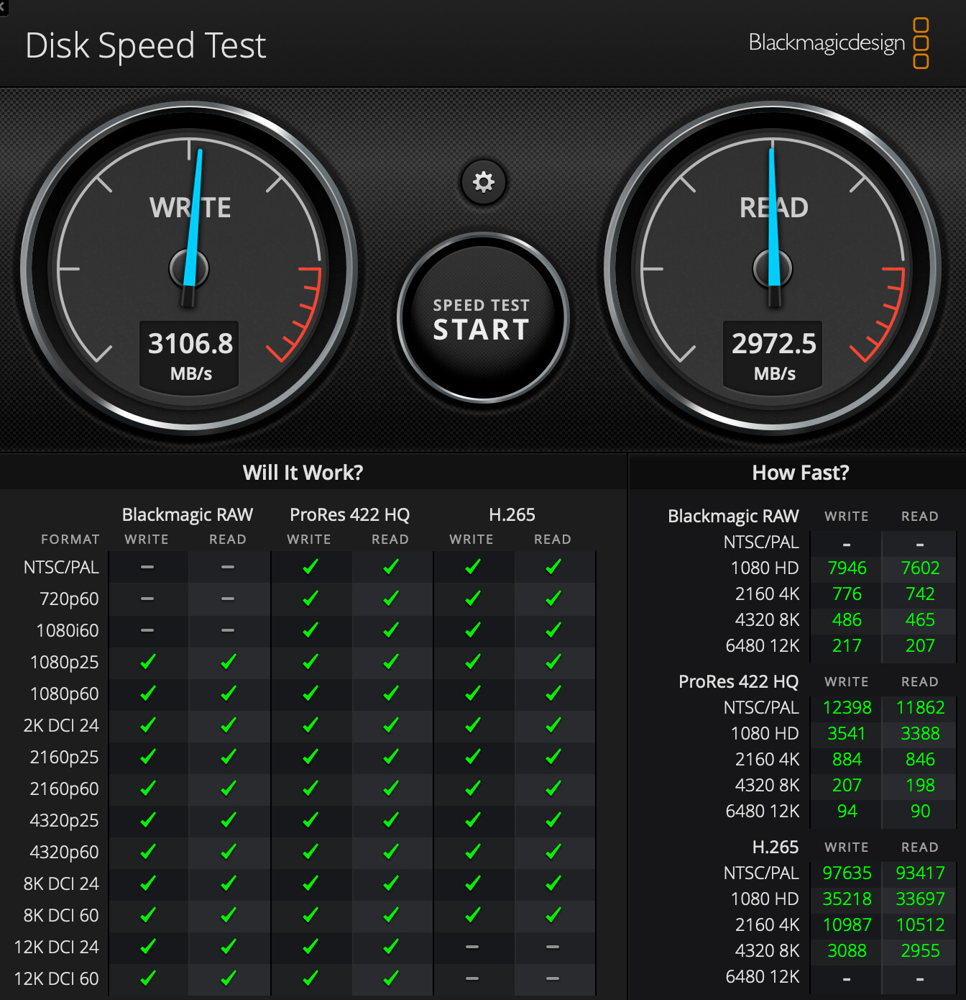

## 探索

本文受启发于：[17 Best Mac Benchmark Apps to Measure CPU, GPU, & More](https://www.geeksmint.com/benchmark-apps-to-measure-mac-performance/) ， 文中还有更多的性能测试如 PC Mark 10 等，请根据个人的使用场景进行测试


---


*来源: https://linux.do/t/topic/875029.json*

