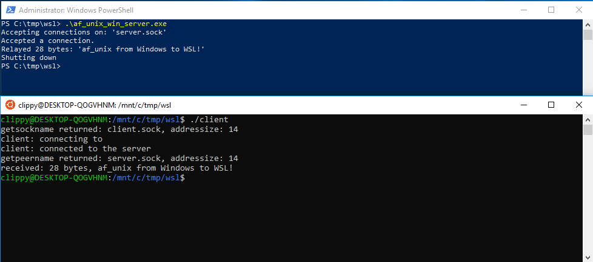

---

id: 876127

title: "windows的unix特性 『共建』"

created_at: 2025-08-16T01:16:45.855Z

username: stevessr

display_username: "🐟"

---

# windows的unix特性 『共建』

# unix socket

### [AF_UNIX comes to Windows](https://devblogs.microsoft.com/commandline/af_unix-comes-to-windows/)

Introduction:  Beginning in Insider Build 17063, you’ll be able to use the unix socket (AF_UNIX) address family on Windows to communicate between Win32 processes. Unix sockets allow inter-process communication (IPC) between processes on the same...

**例子：**

### [Windows/WSL Interop with AF_UNIX](https://devblogs.microsoft.com/commandline/windowswsl-interop-with-af_unix/)

Starting in Windows Insider build 17093, a WSL application can communicate with a Windows application over Unix sockets. Back in December, we blogged about bringing AF_UNIX to Windows. Now, we’re building on that functionality. Consider a requirement...

---

*来源: https://linux.do/t/topic/876127.json*

