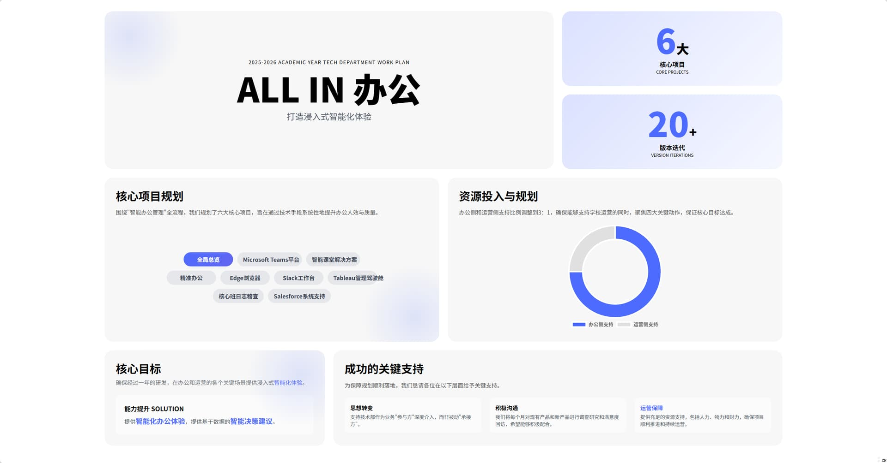
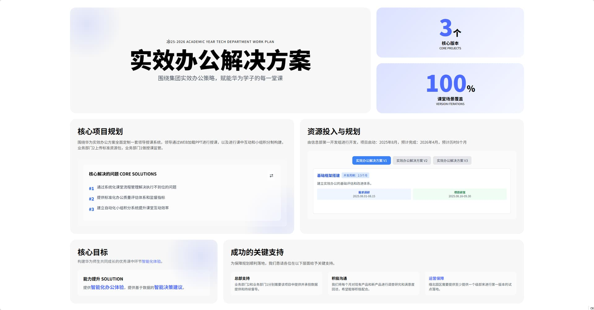

---

id: 878712

title: "分享一个苹果发布会形式的HTML PPT模板? 用来做研发工作汇报"

created_at: 2025-08-17T10:59:06.035Z

username: Madlifer

display_username: "Madlifer"

---

# 分享一个苹果发布会形式的HTML PPT模板? 用来做研发工作汇报

昨天用AI搞了一天，今天汇报完，效果还不错，所以分享给各位佬友当成汇报模板。

基本上都做了敏感信息的脱敏处理，可以查看部署在EdgeOne Pages上的演示网页。

[2025-2026年技术部工作规划](https://showcase.produck.cn/huibao.html)

擦，忘了放代码地址了。

[madlifer/BentoGrid-Html-Slide: A Bento Grid Style Slide template.](https://github.com/madlifer/BentoGrid-Html-Slide)

---

*来源: https://linux.do/t/topic/878712.json*

