---

id: 895802

title: "Spring 调试新姿势：一眼看清运行时，用 Spring Debugger 少踩 90% 坑"

created_at: 2025-08-24T16:48:16.649Z

username: BNTang

display_username: "程序员NEO"

---


# Spring 调试新姿势：一眼看清运行时，用 Spring Debugger 少踩 90% 坑


当你的 Spring 项目出现「本地复现不了」「配置生效顺序不明」「事务状态难判断」「Bean 注入链条太长」时，传统断点只让你盯着一片树叶。

IntelliJ IDEA Ultimate 的 Spring Debugger 能把整片「森林」摊开：哪个 Bean 被实例化、配置最终值是什么、数据库连接与事务此刻处于什么状态，你都能在 IDE 里一眼看清。

它把运行时细节可视化，帮助你更快定位问题、验证应用状态，进而写出更稳定、可维护的代码。可以把它理解为你 Spring 应用的运行时“X 光机”。

---

## Spring Debugger 到底是啥？

这是 IntelliJ IDEA Ultimate（2025.2+）提供的针对 Spring 的调试增强能力。只要进入 Debug，会在编辑器、Debugger 工具窗口与项目视图中「活体显示」Spring 运行时信息：`ApplicationContext`、配置属性、数据源、事务、Bean 状态等。

你会收获：

- 更快定位：可视化直达问题根因，少走弯路。

- 更准验证：运行时即看即得，配置值与 Bean 状态当场确认。

- 更稳交付：减少盲试错，提升代码与配置的可维护性。

> 注意：需要 IntelliJ IDEA Ultimate；社区版不支持。

---

## 怎么启用（两步搞定）

1. `Ctrl` + `Alt` + `S` 打开设置 → 插件（Plugins）→ 搜索并安装「Spring Debugger」。若提示，重启 IDE。

2. 用 Debug 模式运行你的 Spring 应用，即可体验所有能力。

---

## 能力一：配置“最终值”回显与来源追踪（搞清楚到底哪个值生效）

痛点：`.properties`/`.yml` 多来源、占位符与覆盖链一长串，最后谁生效？

Spring Debugger 会在编辑器相应行显示运行时的「最终值」，并支持跳转查看“谁覆盖了谁”。

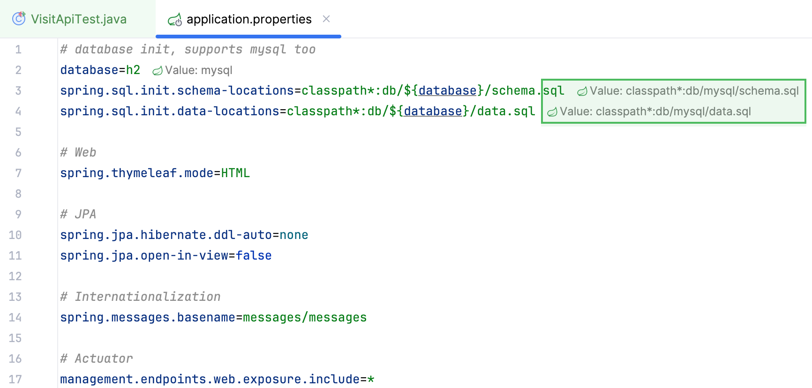

图：编辑器内直接显示属性的最终运行时值

你可以这样试：

在 `application.properties`：

```
my.test.value=from-properties
```

在 `application-dev.properties`：

```
my.test.value=from-dev
```

以 Debug 启动并激活 `dev`：`--spring.profiles.active=dev`（也可在 `application.properties` 中指定）。

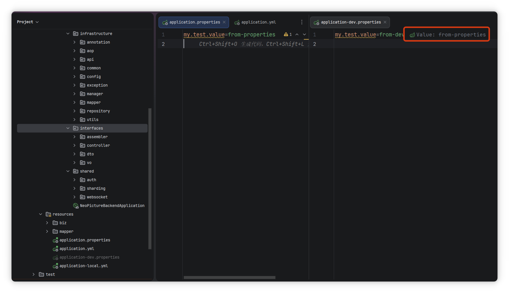

图：同一属性在不同配置源下的最终值对比

更妙的是，若代码里在运行时更新了配置值（比如 `Environment`/`ConfigurablePropertyResolver` 相关逻辑），最新值也会直接显示，并且可以一键跳转到“覆盖它”的那段代码位置。


图：从最终值快速导航到覆盖来源

---

## 能力二：Bean 一览无余（谁加载了、谁没加载、谁是 Mock）

在调试模式下运行应用时，Project 工具窗口会按 Spring 视角标注每个 Bean 的运行时状态，加载与否一目了然：

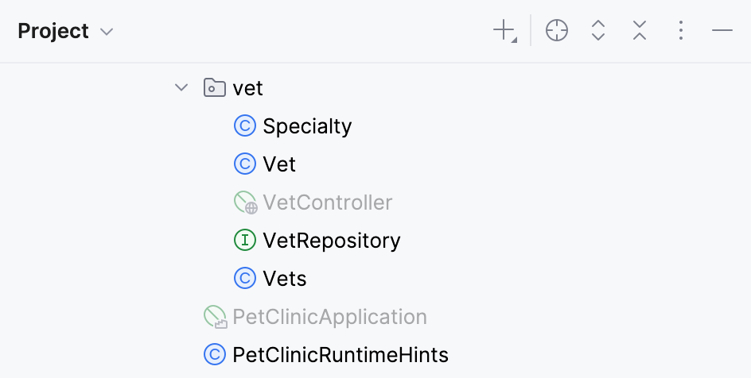

图标颜色含义：

- 绿色（green）— 已加载

- 透明（transparent）— 未加载

- 黄色（yellow）— Mock（模拟）

常见 Bean 类型（不同类型会用不同图标标识，便于快速分辨）：

### 1. `@Component` / `@Bean`

- 自动发现的组件以及通过 `@Bean` 方法定义的 Bean。

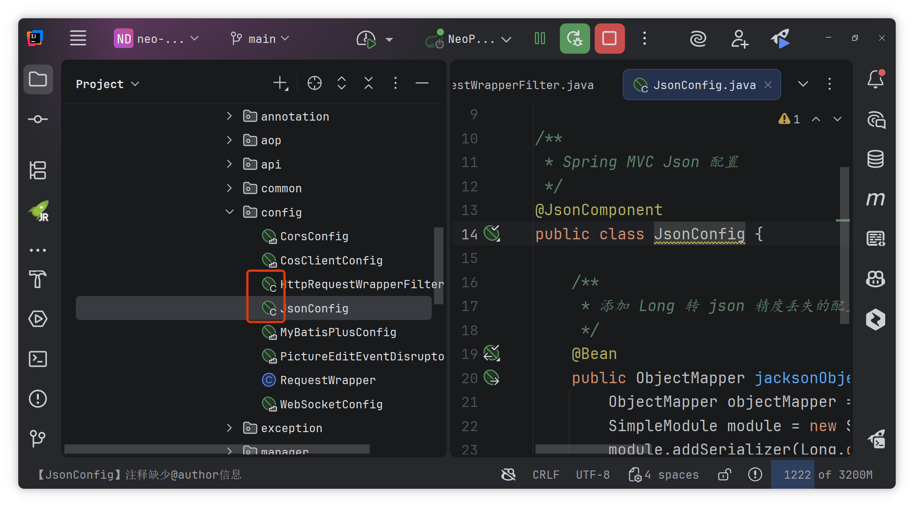

### 2. `@Configuration`

- 配置类 Bean（`@Configuration` 或隐式包含该注解的类）。

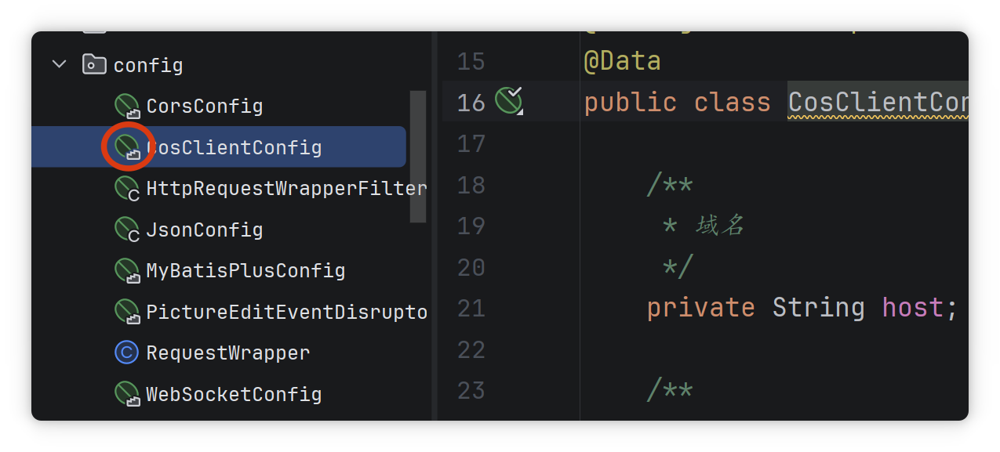

### 3. `@Repository`

- 存储库 Bean（`@Repository` 或实现 `org.springframework.data.repository.Repository`）。

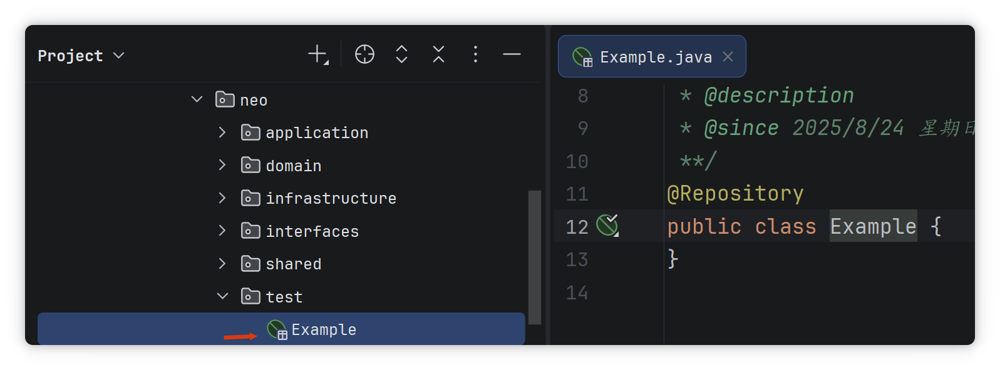

### 4. `@Controller`

- 控制器（`@Controller` / `@RestController`）。

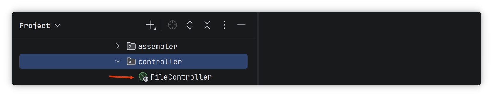

### 5. 隐式 Bean（implicit beans）

- Spring 自带且非显式定义的基础服务类 Bean。

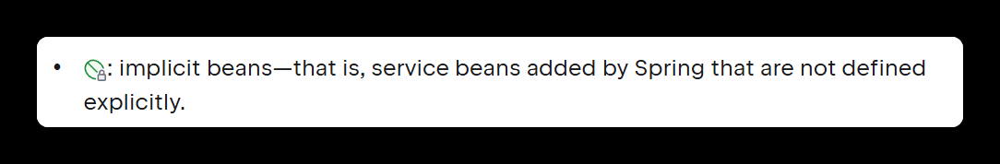

### 6. 抽象 XML Bean

- 在 XML 中使用 `abstract="true"` 定义的抽象 Bean。

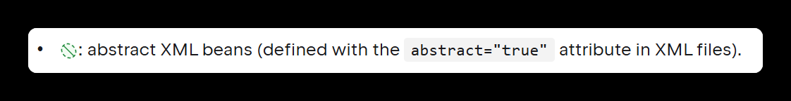

### 7. 基础设施 Bean（infrastructure beans）

- 与配置/基础设施支持相关的 XML Bean，如 `ViewResolver` 或 `context:component-scan` 相关。

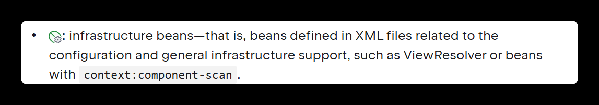

### 8. 原型作用域 Bean

- 在 XML 中 `scope="prototype"` 定义的原型 Bean。

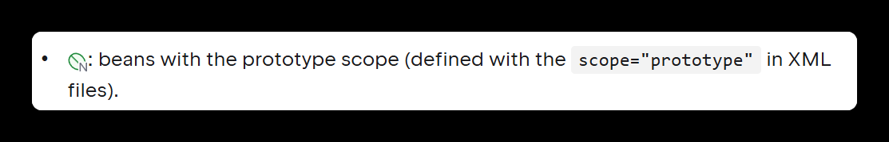

### 9. 其他 XML 定义的 Bean

- 除以上类别外的 XML Bean。


实战价值：快速确认某个 Bean 是否被容器加载、是否被 Mock 替代、是否被排除，从而定位“为什么没生效”。

---

## 能力三：数据库连接自动发现（不配数据源也能看）

调试模式下，IDE 会在数据库工具窗口自动展示应用当前使用的数据库连接。适用于：

- 你还没在 IDE 里配置数据源

- 多数据源/微服务场景

- 通过 Docker Compose 启动的业务流程

启动前：

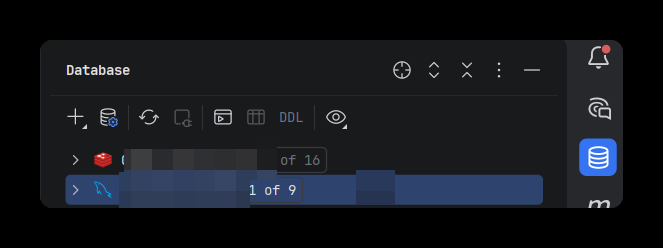

启动后：

- 用 Debug 运行 Spring 应用

- 打开数据库工具窗口

- 点击刷新

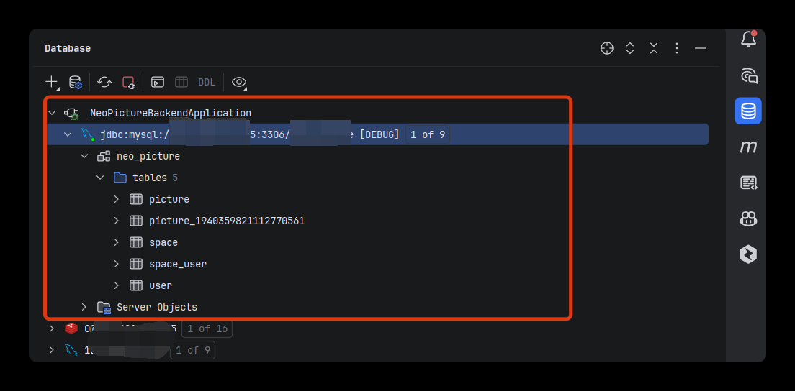

在发现出的数据库上，你可以查看表、直接执行 SQL、浏览 schema，和普通数据源的体验一致。

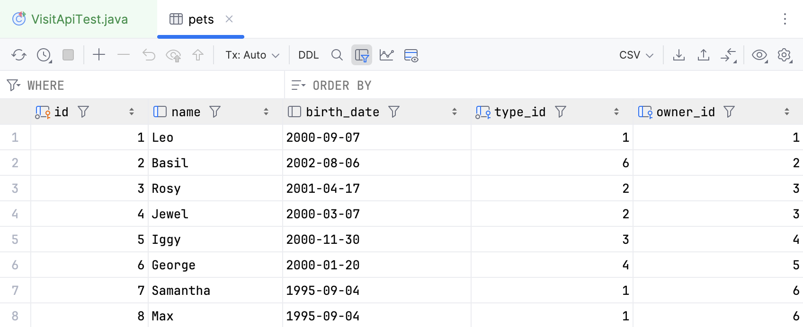

---

## 能力四：在 Debugger 表达式里直接用 Spring 上下文（随取随用）

调试时，无论当前栈帧里有没有，你都可以在“计算表达式/监视”中访问 Spring 的属性与任意 Bean，直接调用其方法来取数、做假设验证。

### 1）从编辑器直接计算或添加监视

- 按住 `Alt`，用鼠标点击要计算的表达式

- 或选择表达式后使用 `Ctrl` + `Alt` + `F8` 打开“计算表达式”

- 支持代码补全，避免拼写错误，写得更快

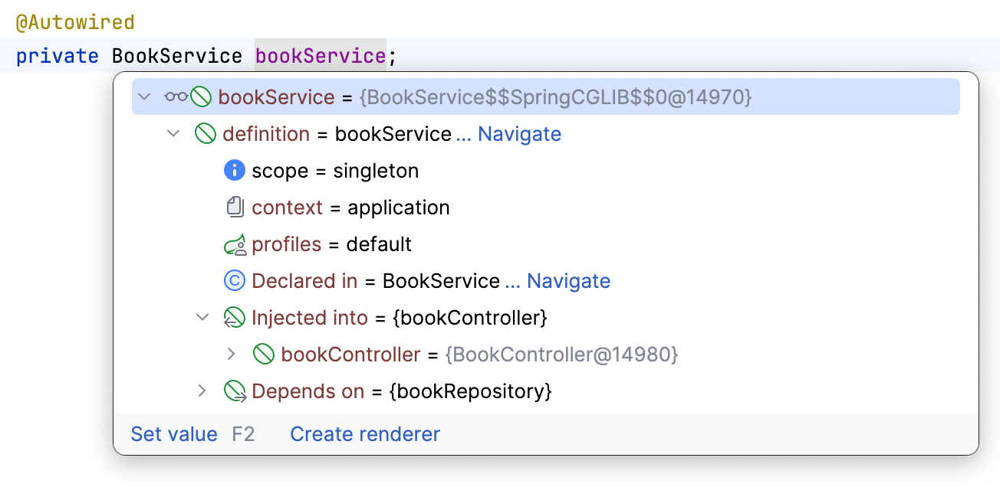

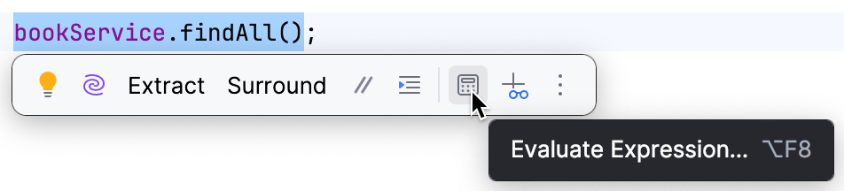

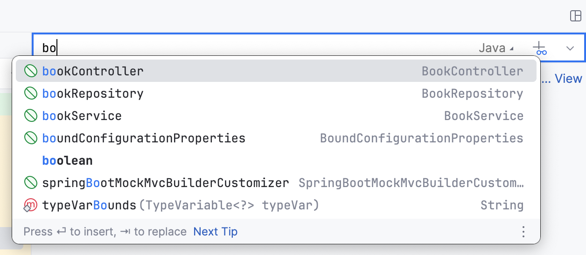

### 2）在变量页签里评估任意表达式

- 在 Variables 的“评估表达式”输入框中输入，回车即可

- 可将结果加入“监视”，后续持续观察

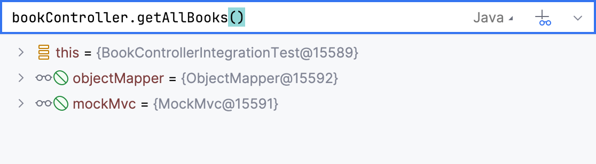

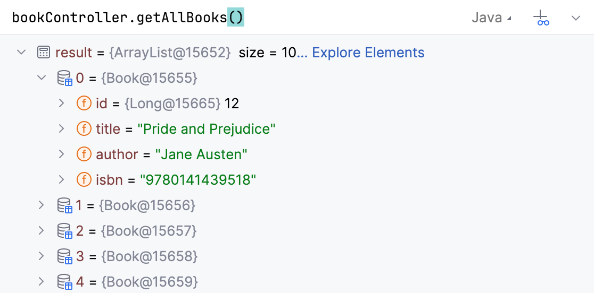

为了更方便查看集合/大对象，可以使用“探索元素”在独立对话框分页浏览与筛选；若结果是 JSON/XML 字符串，还能按结构化文档方式折叠/导航。

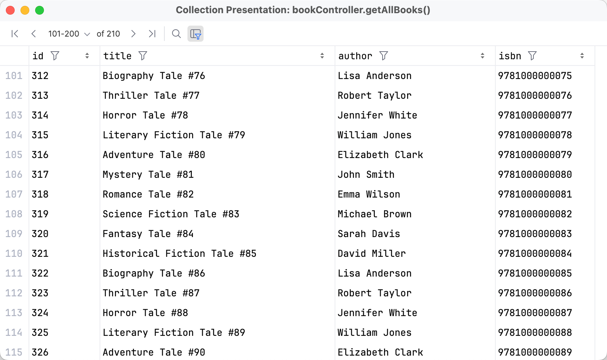

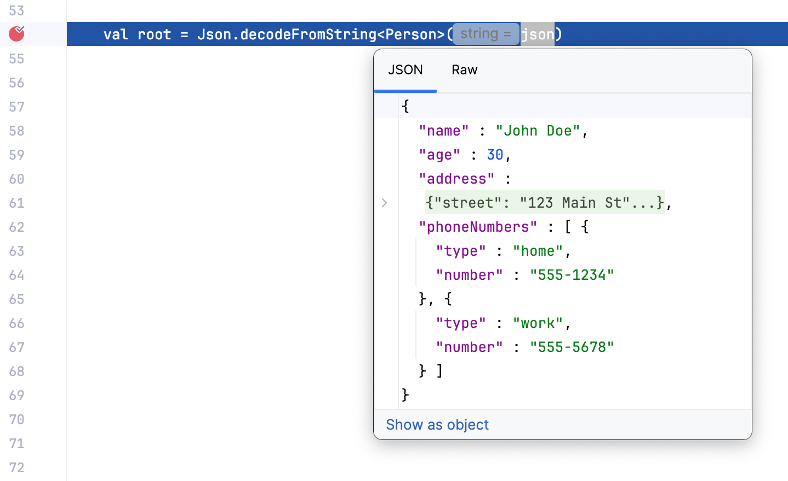

### 3）直接评估 Spring 属性

- 在表达式输入框右侧选择「Spring Properties」

- 输入属性名并回车即可查看值与来源详情

- 也可以把该属性加入“监视”

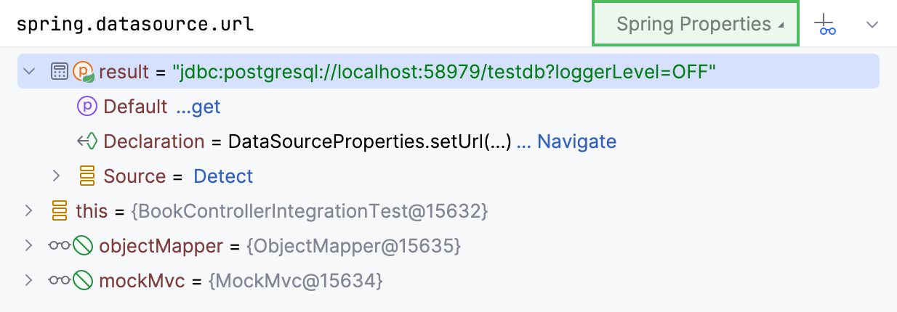

### 4）把表达式用到断点里（条件与临时日志）

- 右键断点，给“条件”填写表达式，仅在满足时才挂起

- 或者在“更多”里使用“评估并日志”，打印表达式结果但不打断程序（可取消“挂起”）

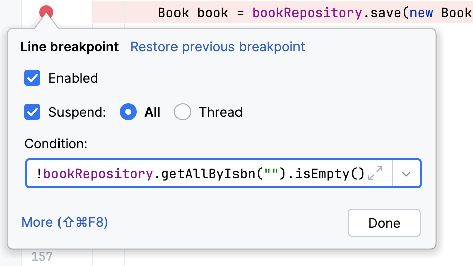

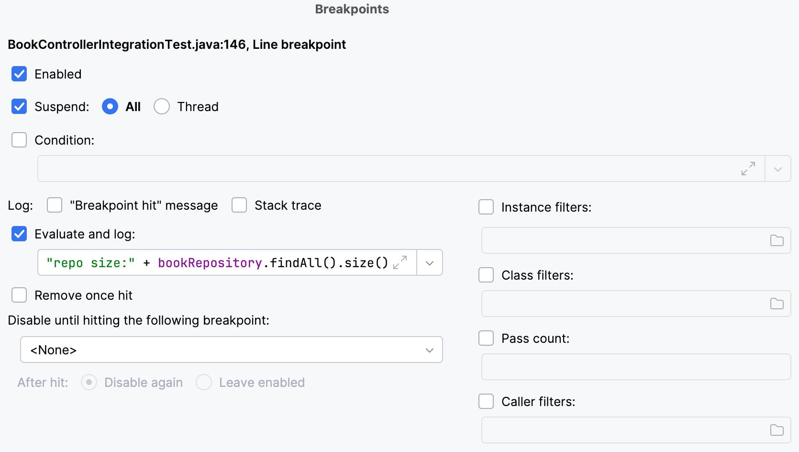

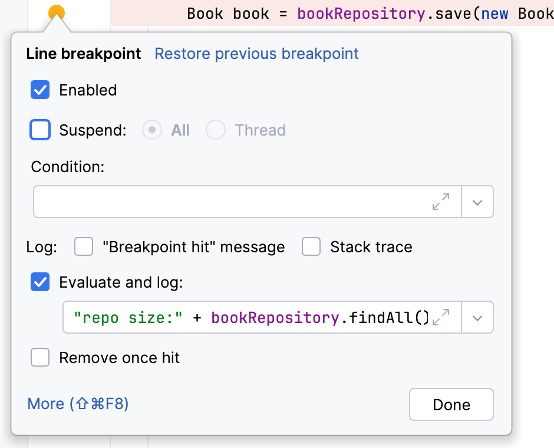

---

## 能力五：把事务与实体状态“摊开”给你看

当你调试的代码运行在 JPA 事务里，Debugger 会显示会话上下文，包括：隔离级别、传播行为、缓存内容等。你还能直接看到 JPA 实体此刻到底是 managed 还是 detached。

### 怎么看事务详情

- 在事务里的执行行挂起应用

- 打开“调试”工具窗口 → 切到“变量”页签 → 展开“事务”节点

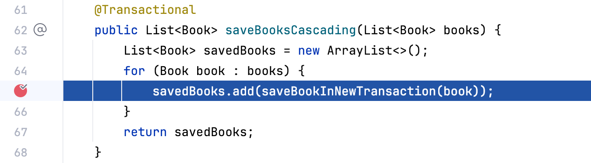


还可以一键导航到“事务是从哪里开始的”。

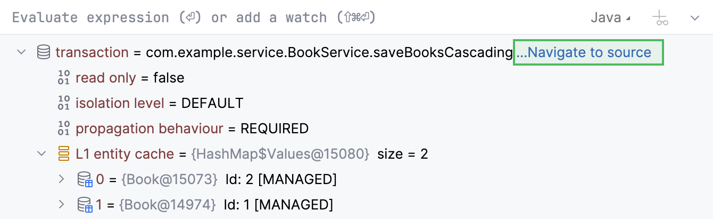

对于事务中的 JPA 实体，会在“变量”页签与代码引用位置展示它们的当前状态，排查“为啥更新没刷新/为啥变成了游离态”这类问题非常直观。

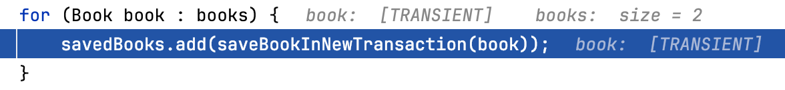

---

## 需要时，也能一键禁用

如果某个 Run/Debug 配置不想启用 Spring Debugger：

- 打开对应 Run/Debug 配置 → 点击「修改选项」→ 勾选「禁用 Spring Debugger」。

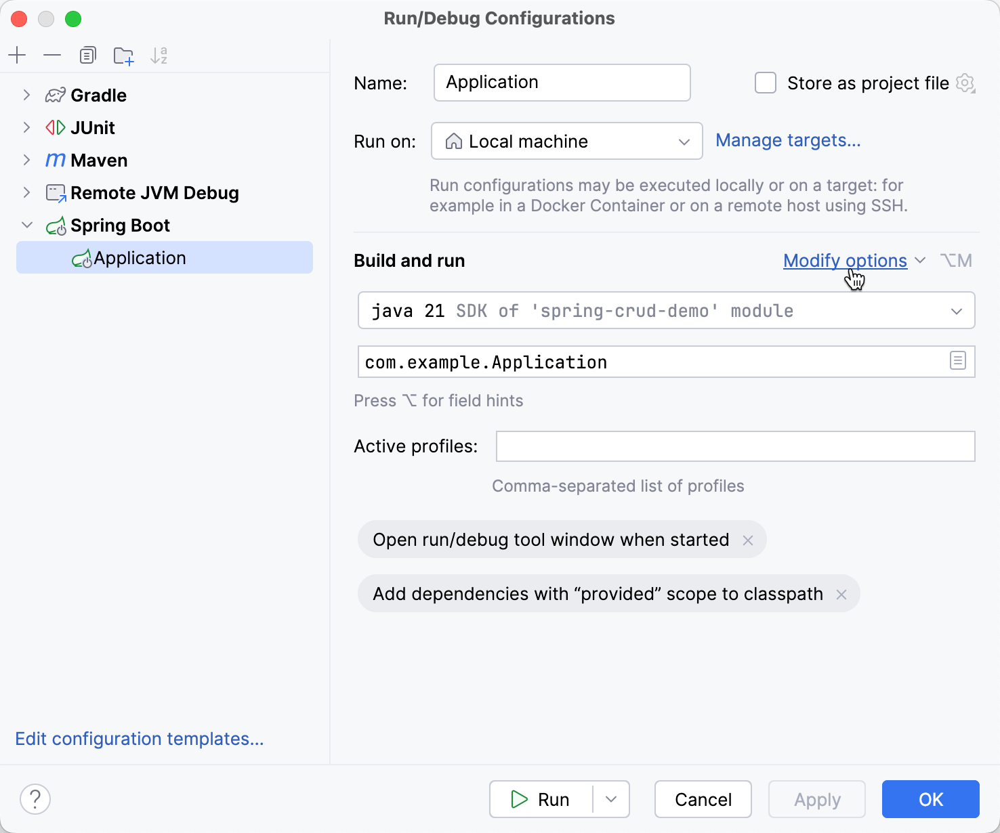

---

## 什么时候特别有用？

- 配置值“说一套、跑一套”，需要快速确认最终值与来源

- Bean 链条复杂，不确定到底加载了谁/被谁替换了谁

- 多数据源或微服务场景，想直接看到实时连接并执行验证 SQL

- 复杂断点逻辑，想临时打印/条件暂停而不改业务代码

- 事务边界模糊，JPA 实体状态难断

---

## 小结与行动

- 这是一套“在运行时看清一切”的调试新姿势：配置、Bean、数据库、表达式、事务，一个窗口看全局。

- 今天就装上，用 Debug 打开你的项目，先挑一个最近卡住的小问题试试手：比如检查一个配置是否真生效，或看某个 Bean 到底有没有被加载。

- 如果这篇文章对你有用，转给同事一起少踩坑；也欢迎留言说说你在项目里遇到的“看不清”的调试难题，我们一起把坑填平。


---


*来源: https://linux.do/t/topic/895802.json*

