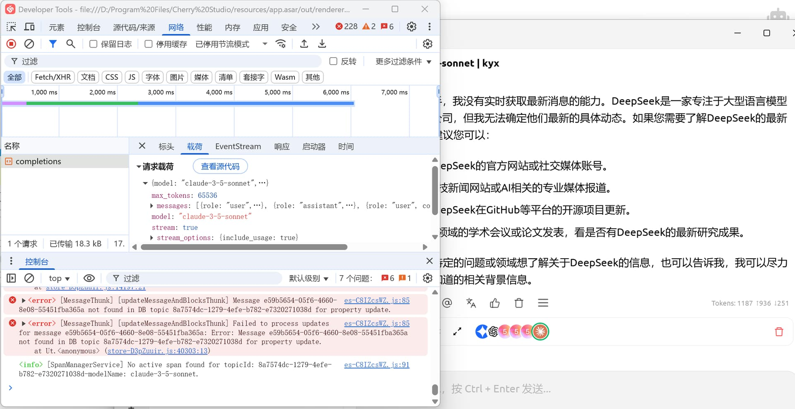
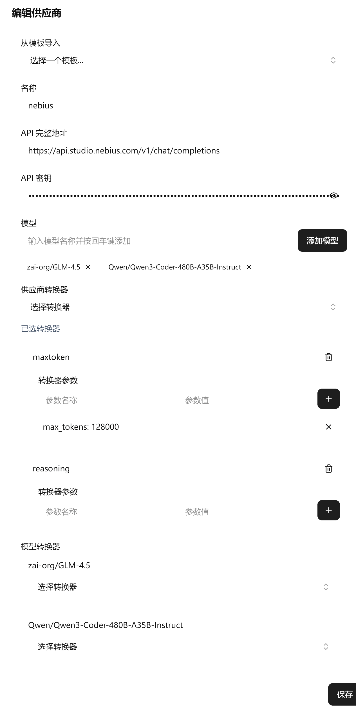
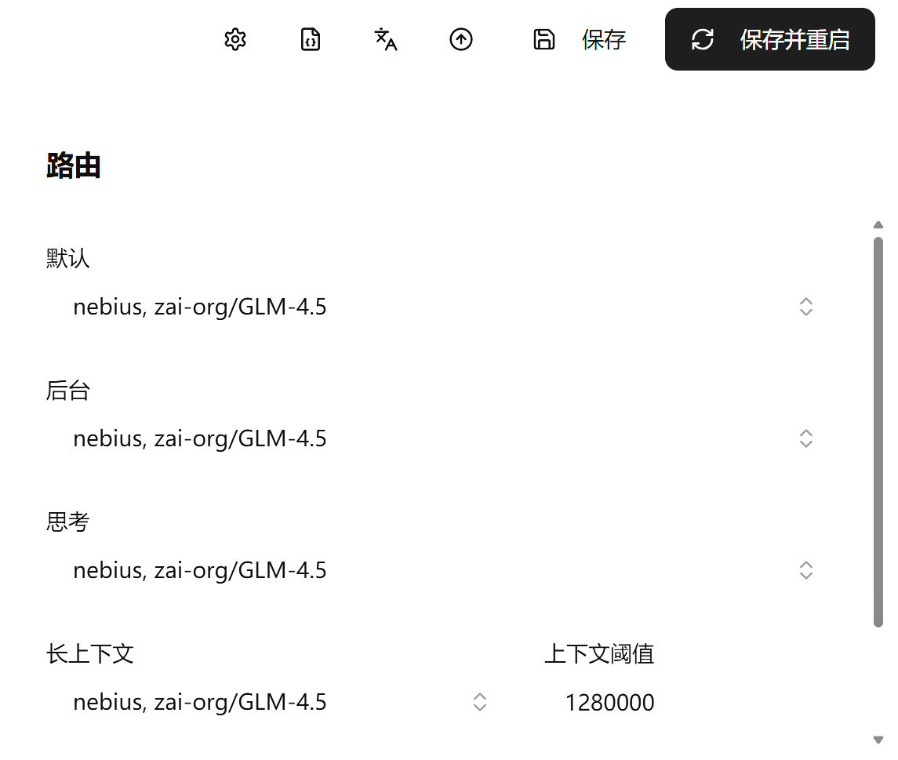
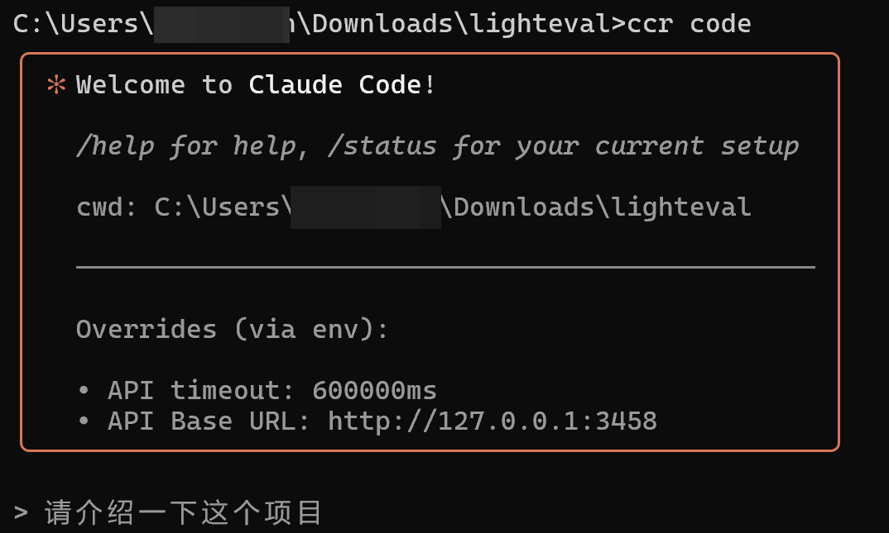

---

id: 922940

title: "【编程CLI接入各种服务商合集】Claude Code, Gemini CLI, CodeX CLI, CCR的使用心得"

created_at: 2025-09-01T10:08:34.962Z

username: steven1

display_username: "steven1"

---


# 【编程CLI接入各种服务商合集】Claude Code, Gemini CLI, CodeX CLI, CCR的使用心得


## 前言

最近一直在论坛中寻找有关接入各种服务商的帖子，想着能把自己从各处搜集的API充分利用起来，但是苦于没有一个统一的配置文档，于是便想做这么一件事，把御三家的编程CLI统一在一份文档中，方便自己以及别的佬友少踩坑。同时也欢迎佬友们在评论区补充你的独特用法！

我的文档只考虑**Linux和Windows**两种情况，Mac和WSL可以在文档的基础上进行小修改。

## 零：使用编程工具前，最好了解下调用API的基本用法

最好的入门当然是Cherry Studio（可以Ctrl+Shift+I，找到网络，了解请求和响应的构造），OpenWebUI之类的图形化配置方式，方便你对于编程CLI可能报错的地方有个基础的了解。



你应该了解的知识：

- 了解v1/chat/completions, v1/responses, v1/messages, v1beta的区别（识别下哪个是OpenAI的，Claude的，Gemini的请求base url）

- 了解HTTP错误的状态码（4xx 客户端，5xx 服务端）

- 了解多模态的概念（哪些模型支持图片输入、支持推理输出、支持内置联网、支持工具调用等），其中工具调用是编程CLI严重依赖的能力

- 了解常见的请求参数（temperature、top_p、max_tokens、max_completion_tokens、stream、reasoning_effort）

## 壹：Claude Code和Claude Code Router

Claude Code（简称CC）是Claude官方的编程CLI，支持v1/messages类型的原生Claude格式，现阶段很多中转商（如InstCopilot）都支持了这种转换，基本使用方法（我比较喜欢局部的配置方法，用户全局可以写在~/.claude/settings.json里面，Windows就替换成C:\Users\用户名\.claude/settings.json）：

.claude/settings.local.json:

```
{
  "env": {
    "ANTHROPIC_AUTH_TOKEN": "粘贴为Claude Code专用分组令牌key",
    "ANTHROPIC_BASE_URL": "https://粘贴为你的API服务商",
    "CLAUDE_CODE_MAX_OUTPUT_TOKENS": "32000",
    "CLAUDE_CODE_DISABLE_NONESSENTIAL_TRAFFIC": "1",
    "API_TIMEOUT_MS": "600000",
    "BASH_DEFAULT_TIMEOUT_MS": "600000",
    "BASH_MAX_TIMEOUT_MS": "600000",
    "MCP_TIMEOUT": "30000",
    "MCP_TOOL_TIMEOUT": "600000",
    "CLAUDE_API_TIMEOUT": "600000"
  },
  "permissions": {
    "allow": [],
    "deny": []
  }
}
```

哦，差点忘说了，你需要先有[node](https://nodejs.org/zh-cn/download/)，然后（顺便把CCR也装了吧，我想你会用到的）：

```
npm install -g @anthropic-ai/claude-code
npm install -g @musistudio/claude-code-router
```

配置好环境和配置文件之后，`claude`命令启动！下面来讲下CCR：

---

Claude Code Router（简称CCR）从名字就可以看出来，是CC的一个便捷的路由工具（[文档地址](https://github.com/musistudio/claude-code-router/blob/main/README_zh.md)），它可以把不是Claude格式（v1/messages）如OpenAI格式或Gemini格式的接口转换成CC可以使用的格式，相当于请求的劫持（hijacking），具体的原理可以查看文档，进阶的用法也可以查看文档，我只是想说一下作为一个用户怎么便捷的使用。

node安装完CCR之后，我们先使用`ccr ui`命令启动可视化配置页面，它会生成一个最小可编辑的配置文件给我们（~/.claude-code-router/config.json，Windows同理），如果你是用远程ssh的话，搭配下端口转发就可以啦~

CCR的配置都是加多错多，大家尽量使用最小可行配置就可以，文档有更多的示例：

- 对于OpenAI格式：配置如图（一般来说，需要设置max_tokens就加下，也可以不加，reasoning也是根据情况），如果你的服务商不支持缓存参数，加个cleancache就可以了：




- 对于原生Claude格式，那就只选Anthropic转换器就可以啦

- Gemini格式我没在CC中试过，在Gemini CLI我想表现更好呢~

保存之后，右边有一栏可以选择模型，一般来说，后台可以选择一个便宜点的模型（我这里用的Nebius反正也是不要钱的啦 ）



保存并重启就可以了，输入`ccr code`开始起飞！这块更多的可以参考[公益站接入CCR](https://linux.do/t/topic/920586)

需要小小提醒的是，`ccr code`之后那个浏览器还在打开的页面就失效了（不能保存配置的），需要重新运行`ccr ui`命令才可以修改，否则就白改了！

 还有一点，你需要把刚刚CC的配置文件改成别的名字（如.settings.local.json.1），否则官方的配置文件优先级高于CCR，看到这个页面就算成功一半了，还有一半是调用API和工具也要成功（最好先在cherry studio中测试一下，不然命令行来回切换可烦死（瘫））



其他就靠你自己尝试了，和API服务商调用工具的能力、是否被截断有关了，我尝试过的模型有Deepseek-3.1-thinking，GLM-4.5，Qwen-3-Coder-480B写代码都还可以（尽量找个便宜的，tokens消耗也还是挺快），避坑GPT-OSS和GPT-5模型在CCR中使用（可以在下文介绍的CodeX中使用），费用还是有些富哥的（因为CC的官方提示词可太多了，输入费用不菲），而且响应很慢，调用工具很拉跨。

## 贰：Gemini CLI

Gemini CLI（简称GC），官方提供了三种登陆方式，但作为究极白嫖党，肯定选择API key的登陆方式了 

首先node全局安装：

```
npm install -g @google/gemini-cli
```

Linux可以通过设置环境变量（或者写入~/.bashrc持久化）来使用：

```
export GEMINI_MODEL="gemini-2.5-pro"
export GOOGLE_GEMINI_BASE_URL="https://你的服务商地址/v1"
export GEMINI_API_KEY="你的API KEY"
```

Windows自己查一下吧，我不太记得了~（留坑）

 敲黑板了！这里base url的情况就有些复杂了，还记得我们前面说的吗v1beta是Gemini的非标准路由，所以这里怎么填就要看服务商的支持程度了，有家公益站比较好，原生支持gemini，/v1都不需要填；有些要加v1，或许还要配合下面这种方式使用；aiwave是需要加/claude或者/gemini来支持原生的，这里就不一一列举了。（还记得我们说过的测试方法吗？**Cherry Studio设置Gemini格式进行测试，能够加载出模型大概率是可以用的**）

> [Gemini v1 路由转 v1beta 路由 cfWorkers 部署 - #6，来自 zyy](https://linux.do/t/topic/291789/6)

填好之后，输入`gemini`启动就可以了！

我在这里想提一个偏门一些的问题，如果你用的公益站没有`gemini-2.5-flash`模型，该怎么办？当然可以不用管了，最好的方式还是在.gemini/settings.json写入：

```
{
  "skipNextSpeakerCheck": true
}
```

跳过background检查是GC较新版本的功能，请注意更新！

### 叁：Codex CLI

Codex CLI是OpenAI开发的一个编程工具，但体验确实是有点烂，配置文件是通过toml的方式配置的，有理由怀疑是否是Rust写的 

首先node全局安装：

```
npm install -g @openai/codex
```

然后配置~/.codex/config.toml：

```
model_provider = "gue"
model = "gpt-5"
model_reasoning_effort = "high"
disable_response_storage = true

[model_providers.prism]
name = "prism"
base_url = "https://prism.com/v1"
env_key = "prism"

[model_providers.gue]
name = "gue"
base_url = "http://gue.com/v1"
env_key = "gue"

[model_providers.inst]
name = "inst"
base_url = "https://test.com/v1"
env_key = "inst"
wire_api = "responses"
```

注：这里的wire_api仅支持v1/responses接口，如果你的api只能用v1/chat/completions，就不用写，但会等的比较久一些，responses接口会有思考链

我比较推荐上述的这种配置方法，因为可以很方便的对不同的供应商进行切换，只需要改model_provider就可以，除此之外还没完，大家可以猜猜api key在哪里写呢？当然是

```
export gue="api-key"
```

或者写入~/.bashrc了！至于更方便的方法，希望佬友们可以集思广益一下，非常感谢[简单教程](https://linux.do/t/topic/912805)的启发，同时大家也可以参考[教程](https://yomotherboard.com/how-to-running-codex-cli-on-windows-with-azure-openai/)做进一步的配置。

最后输入`codex`启动！

 如果出现了类似于stream option: error sending request for url，可以检查一下自己代理的问题，比方说

```
printenv | grep http
```

如果有设置http_proxy（或者大写的HTTP_PROXY）之类的话，需要检查代理或者是`unset http_proxy https_proxy HTTP_PROXY HTTPS_PROXY`。

## 肆：小彩蛋（CC和GC联动）

非常推荐大家去使用mcp去丰富枯燥的CLI生活哈！

- [gemini-mcp-tool](https://github.com/jamubc/gemini-mcp-tool)

- [context7 mcp](https://github.com/upstash/context7)

- [Claude Code StatusLine](https://linux.do/t/topic/859699)


---


*来源: https://linux.do/t/topic/922940.json*

