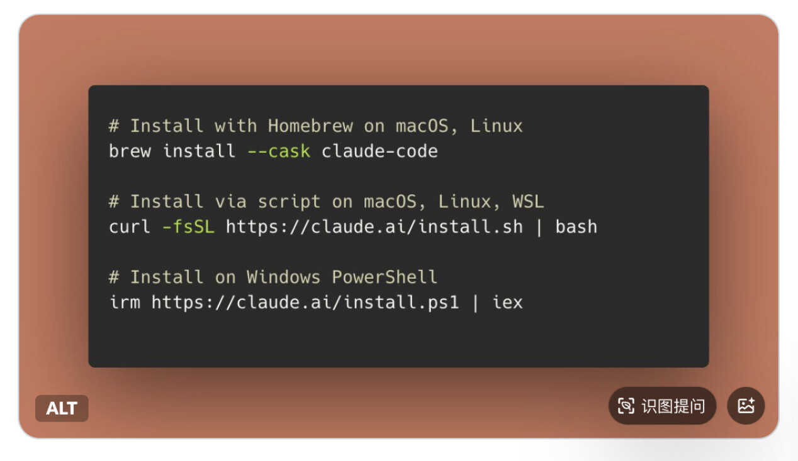

---

id: 926375

title: "Claude code 一点记录"

created_at: 2025-09-03T02:04:09.073Z

username: doubao

display_username: "豆包"

---


# Claude code 一点记录


看相关claude code记录内内容学习，上面杂乱记录些感想或知识点。 资源部分收集不错的内容。

# 11.04 开源配置CC项目

[Claude Code Templates](https://docs.aitmpl.com/docs/intro) 是一个开源 CLI 工具，用于配置 Claude Code 项目并提供专门的组件来增强您的 AI 驱动开发工作流程。

# 安装(官方有了建议)



# **Claude code 学习笔记**

claude code 工具支持 output styles, subagents,command . 这好像是不同层级或者领域的概念.

- command像是一个简写的指令,减少输入的频繁性.

- output styles是直接对主干进行了设置,类似最高级层级system设定,比如回复的语言、语气、目的、也可以调用subagent. 相比command更高层级.

- subagents更像是一个独立的worker或者角色. 他和主干的关系像是成员, 主干如果是队长,subagent像是队员. 优势独立性、针对性、不影响主干context.


对话中引用

command引用

output styles设置后引用,比如每次回复都是用xyz agent.

## memory

### 私有项目内存

*已经废弃了 ./CLAUDE.local.md 的项目私有内存文件。*

将这个文件放在自己的用户目录下~/.claude/project-xxx.md 。 然后再将这个文件通过`@`标识项目的内存进行加载。

*注意引入文件不要通过@xxx.md 和 @xxx.md 。 这种文件避免歧义会被pass 。*

```
 Individual Preferences

- @~/.claude/project-xxx.md
```

#### 最佳实践

- “使用2空间缩进”比“正确格式代码”要好。

- 使用结构来组织：将每个单独的内存格式化为标志性标题下的子弹点和组相关的记忆。

- 定期审查：随着项目的发展，更新记忆力，以确保Claude始终使用最新的信息和上下文。

memory 记录常用配置或指令

为了简便自己常使用的对话，创建command。

1. 创建command 在项目创建commands 文件夹。

2. 每个命令在目录下创建一个md文件。

3. 文件名称第一行是命令，内容进行描述。

Claude Code 只有一个主线程。它会周期性地使用几种不同类型的提示词，比如总结 git 历史、将消息历史压缩成一条消息，或者搞出一些有趣的用户体验元素。维护一个扁平的消息列表。

如果有一个或多个复杂任务，主智能体就会创建自己的克隆体。这种“最多一个分支”的设计与待办事项列表相结合，确保了智能体既能将问题分解为子问题，又能始终关注最终的预期结果。

ANTHROPIC团队表示，你在 Claude.md 文件中将工作流程、工具和期望文档化得越好，Claude Code 的表现就越出色。当你拥有现成的设计模式时，这使得 Claude Code 在设置新数据管道等常规任务上表现卓越。

**处理敏感数据时使用 MCP 服务器而非命令行界面**

他们建议使用 MCP 服务器而不是 BigQuery 命令行界面，以便更好地控制 Claude Code 的访问权限，尤其是在处理需要日志记录或存在潜在隐私问题的敏感数据时。

## 自动编辑模式

自动编辑会列出来计划和修改代码。

## plan 模式

设计方案,需要思考时加入 think等关键词。

# 资料

## **入门：**

**视频：**

- [Claude Code 入门保姆级教程！从安装到使用全流程讲解](https://www.youtube.com/watch?v=NGAHdg2vGEo)

- [Claude Code必备实用技巧合集：狂飙模式、文件引用、图片插入、MCP全局安装、模型切换全流程](https://www.youtube.com/watch?v=DLUHm38Prbk)

- [新手Claude Code入门实战: 开发一个超赚钱的AI编程文档工具](https://www.youtube.com/watch?v=nVI-3nSFxzs)

**文章:**

- [Claude Code是什么？如何使用Claude Code｜Claude Code使用教程与完整指南 - 阿小信的博客](https://blog.axiaoxin.com/post/claude-code-full-guide/)

- [Claude Code: Best practices for agentic coding](https://www.anthropic.com/engineering/claude-code-best-practices)

- 官方教程: [https://anthropic.skilljar.com/](https://anthropic.skilljar.com/)

## **进阶：**

**视频:**

- [code with claude](https://www.youtube.com/playlist?list=PLf2m23nhTg1P5BsOHUOXyQz5RhfUSSVUi)

- [Claude Code 入門：Windows, Mac 安裝、 AI 專案初始化模板、Gemini CLI適用、九大必學技巧、並列執行加速器](https://www.youtube.com/watch?v=8Q1bRZaHH24&t=136s)

- [Claude Code: From Beginner to Expert in 19 Minutes](https://www.youtube.com/watch?v=zW28e7LGPRQ))

- [别人还在入门，你已经精通！Claude Code进阶必备14招](https://www.youtube.com/watch?v=yEmFNDwJ3Ls)

- [Claude Code的超能力解锁！一文看懂MCP是如何让AI无所不能的](https://www.youtube.com/watch?v=77eHQujKf9c))

- [0基础学Claude Code项目存档+回退+对话恢复，操作不怕错，完整教学超简单](https://www.youtube.com/watch?v=8T4q479xDWU)

- [Claude Code + Cursor 实战：破解加密Cookie并采集数据](https://www.youtube.com/watch?v=jlLQutfKsyk&t=94s)

- [用最少 token 做最多事：Agent tools 设计指南](https://www.youtube.com/watch?v=Z-Qb3W2fFo0)

- [逆向CLaude,获取更多技巧](https://youtu.be/i0P56Pm1Q3U?si=3tSb1tAT4iWQCrg7)

**文章：**

- [克劳德代码开发命令套件](https://claude.ai/public/artifacts/e2725e41-cca5-48e5-9c15-6eab92012e75)

- [Claude Code Sub-Agents：从手工作坊到自动化工厂](https://mp.weixin.qq.com/s/bV5Cp3Ai0Q32L_M1m887Lg)

- 原文 [Claude Code 究竟牛在哪里？](https://worksonmymachine.substack.com/p/nobody-knows-how-to-build-with-ai?utm_medium=email&action=share)


译文 [ Claude Code 究竟牛在哪里？（以及如何在你的 AI 智能体中复刻它的魔法！）](https://baoyu.io/translations/decoding-claude-code)

# 接入配置

- 方式一：

```
export ANTHROPIC_BASE_URL=xxx
export ANTHROPIC_AUTH_TOKEN=xxx
```

- 方式二：

```
"env": {

  "ANTHROPIC_BASE_URL": "",

  "ANTHROPIC_AUTH_TOKEN": ""

}
```

- 方式三：


使用 [claude code router](https://github.com/musistudio/claude-code-router) 接入可以支持OpenAI类型API，Gemini等功能。

# **sub agents**

sub agents 可以减少主contex 的长度，通过sub agent模式建立agent去实现动作，将最后得到的信息给到主 context中。减少主context中的脏上下文占用。

## 文档：

- [Create custom subagents - Claude Code Docs](https://docs.anthropic.com/en/docs/claude-code/sub-agents#key-benefits)

## 视频：

- [Master Claude Code Sub‑Agents in 10 Minutes](https://www.youtube.com/watch?v=mEt-i8FunG8)

- [Claude Code 逆向下集，Sub Agent 等多种技巧解密](https://youtu.be/TfD1azzrCp8?si=WRYLDxzFUcPTiTh6)

- [Build an AI Army With Claude Code’s New Sub-Agents](https://www.youtube.com/watch?v=9i3ic1sVhlI)

- I was using sub-agents wrong… Here is my way after 20+ hrs

## 资源：

- [Claude Code Agents](https://subagents.cc/browse)

- [https://www.buildwithclaude.com/](https://www.buildwithclaude.com/)

- [https://github.com/Toskysun/sub-agents](https://github.com/Toskysun/sub-agents)

- [https://github.com/SuperClaude-Org/SuperClaude_Framework/blob/master/SuperClaude/Core/PERSONAS.md](https://github.com/SuperClaude-Org/SuperClaude_Framework/blob/master/SuperClaude/Core/PERSONAS.md)

- [GitHub - zhsama/claude-sub-agent: AI-driven development workflow system built on Claude Code Sub-Agents. · GitHub](https://github.com/zhsama/claude-sub-agent)

- [如何好好利用Claude Code，这是我的三个见解👇](https://linux.do/t/topic/816113)

---

佬友分享：

> 在佬友的基础上推荐自认为受益的：

>

> 这篇文章总结的不错：详细介绍了 [Git Worktree 和 CC 的结合](https://www.python88.com/topic/185828)；并行开发和回滚代码很方便；

> 另外吴恩达老师的claude的课程，由浅入深，而且课程也不长，也很推荐： [吴恩达同步最新AI课，第86讲：Claude Code-高智能的编程助手-A Highly Agentic Coding Assistant_哔哩哔哩_bilibili](https://www.bilibili.com/video/BV1k1bBzTEF5?vd_source=fabaa6d7797f3722ecb57a313189fb48&spm_id_from=333.788.videopod.sections)

> 官方文档：内置AI问答，使用AI配置自己的Claude,会**事半功倍**；AI内嵌在官方文档的搜索框中；

# skills *新功能*

## 文档

- [官方文档 skills](https://docs.claude.com/zh-CN/docs/claude-code/skills)

## 视频

- [Claude 的这项新功能将使您的工作效率提高 10 倍](https://www.youtube.com/watch?v=KhkIsNDYbcI)

- [How Claude Solved AI’s Biggest Problem](https://youtu.be/Z9glbip8pZc?si=3gGS2eMCDKeDPmwU)

- [Stop Using MCP… Use NEW Claude Skills Instead](https://youtu.be/M8yaR-wNGj0?si=3QnmjLNcL3uYhv-g)

- [Claude Skills：被 90% 的人低估的自动化超能力 | 三周深度实测 | 回到](https://youtu.be/ZzPoWrlzE1w?si=WcpqdwEcCmykzD1W)

大致看了一遍，简单理解"即用工作流功能"，即插即用的workflow,小型工具或工作流的感觉。也有不污染主context的作用。

他是一个"文件夹"，里面包含了提示内容的MD文件。skills 渐进式加载，需要才会调用某个技能。 先加载介绍，所以介绍太雷同容易让她混淆。

**结构**

```
pdf-processing/
├── SKILL.md
├── FORMS.md
├── REFERENCE.md
└── scripts/
    ├── fill_form.py
    └── validate.py
```

至少有个SKILL.md ，此文件支持配置工具权限。`allowed-tools: Read, Grep, Glob`

存放位置：

**个人 Skills**：~/.claude/skills/skill-name/SKILL.md

**项目** **Skills** ：.claude/skills/skill-name/SKILL.md


---


*来源: https://linux.do/t/topic/926375.json*

