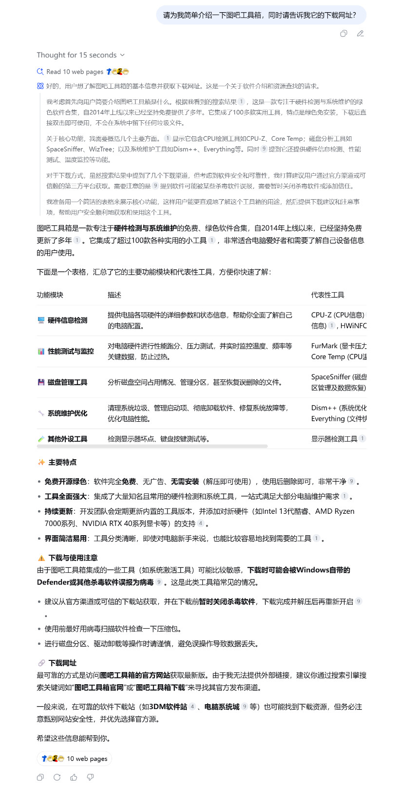
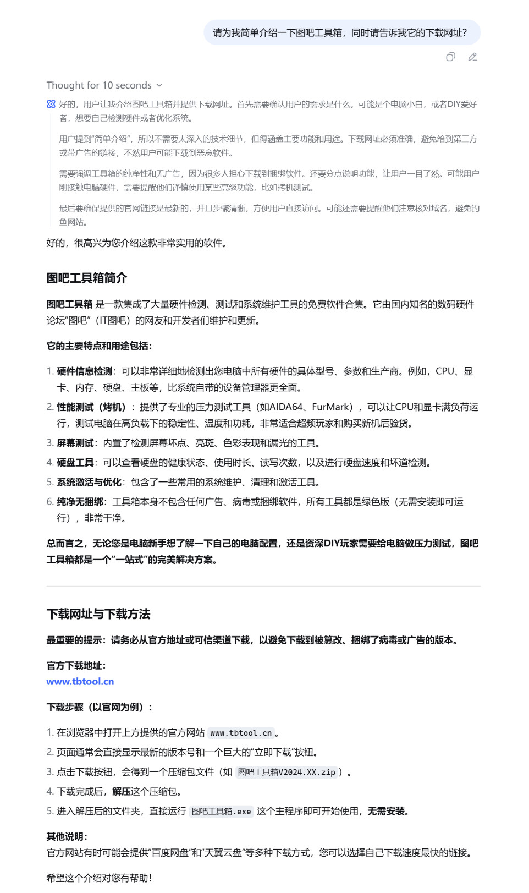
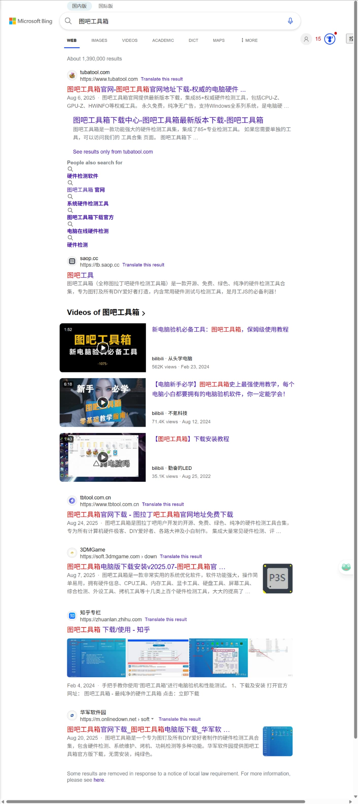
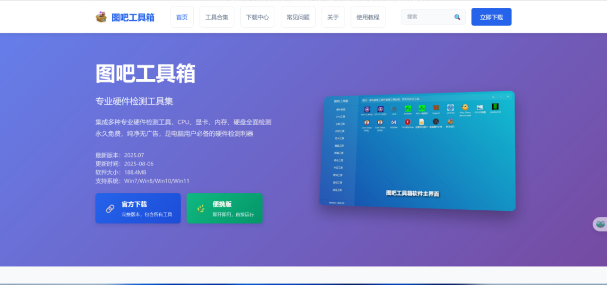
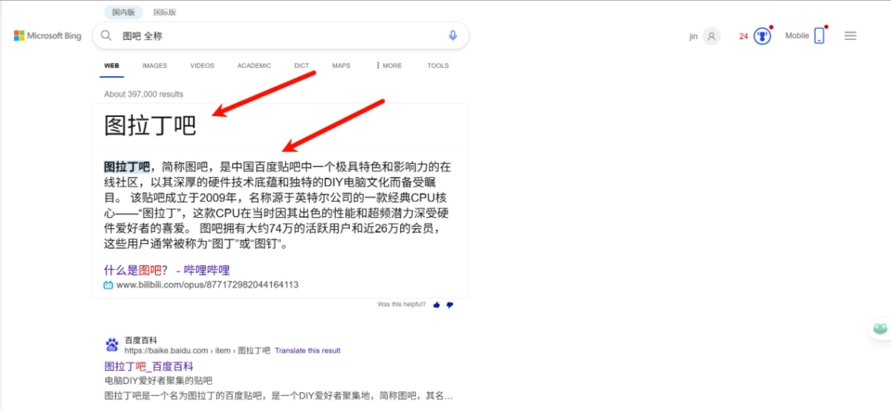
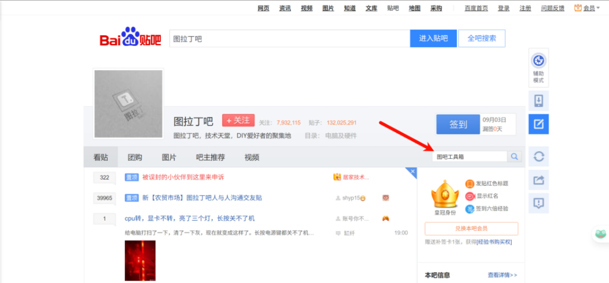
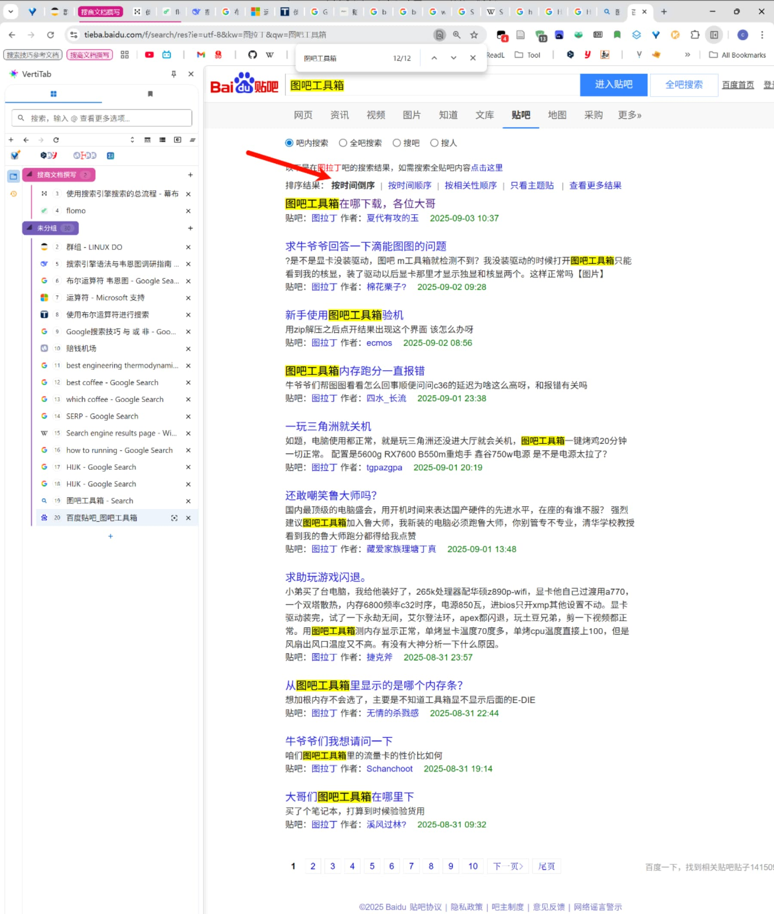
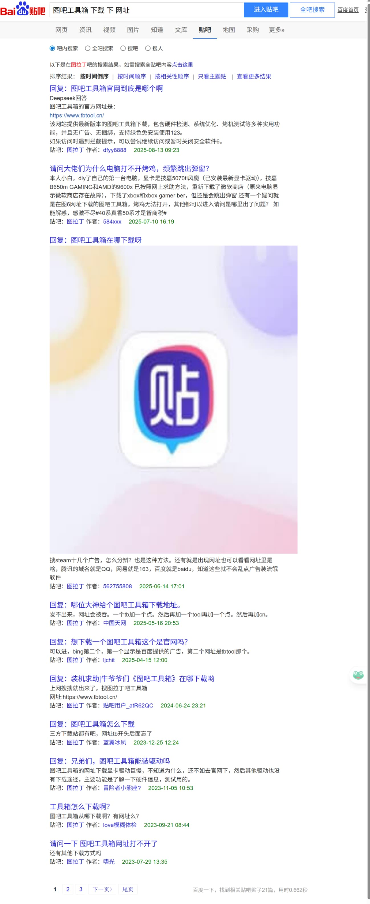
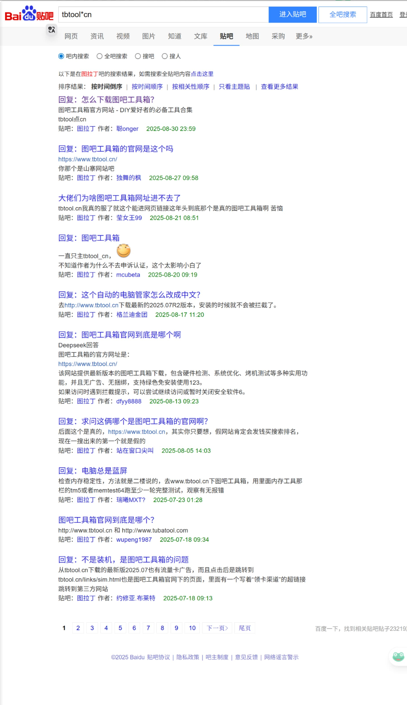
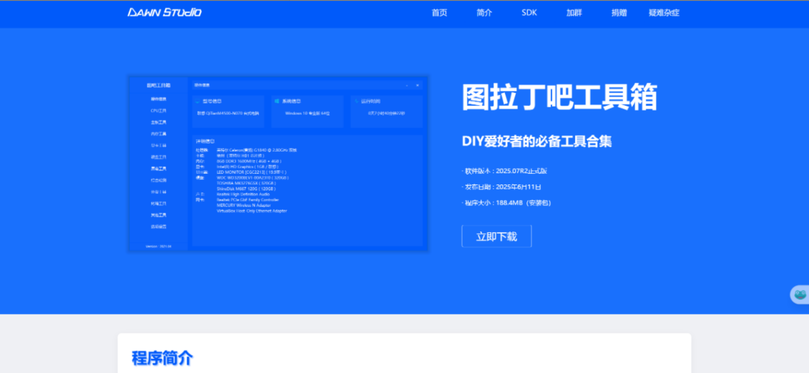

---

id: 927933

title: "[新手教程]授人以渔：别让AI喂给你“二手信息”，手把手教你如何找到真正的官网，学会溯源信息"

created_at: 2025-09-03T12:46:03.994Z

username: fengyzu

display_username: "风语者"

---

# [新手教程]授人以渔：别让AI喂给你“二手信息”，手把手教你如何找到真正的官网，学会溯源信息

# 请注意：本帖无意展示和讨论国内搜索引擎的问题，核心是为了通过这个问题展示如何追溯以及如何搜索的思路

事件的起因是：今天给同学安装图吧工具箱，结果发现了疑似盗版的网站，为了图方便，我·直接询问 DeepSeek 联网以及不联网两种情况，但是结果差强人意。这种二手回答让我很不满意，只能作为参考。

由于我有记录的习惯，同时最近正在总结如何使用搜索功能，提高搜商的教程，因此特意将过程记录下来，给各位佬进行分享。

各位佬可以将这个作为提高搜索能力的一个小小案例，如果后续大家想看的话，我还可以分享一下如何搜索的技能

# 图吧工具箱案例 追溯第一手信源

图吧工具箱是用来检测电脑的常用工具，但是目前如果是**不使用科学上网工具**的情况下进行搜索，会进入到盗版网站。所以以这个为案例，来尝试说明如何溯源以及如何搜索。

我们按照大多数人的思路，直接搜索“图吧工具箱”，然后按照绝大多数人的习惯，优先选择第一个网页 [第一个网址](https://www.tubatool.com/)

然后我发现可能存在问题：网页有一种莫名奇妙的熟悉感？逛 L 站逛的多了，这个网页感觉是使用 claude code 进行前端页面设计开发出来的。同时这个网页的下载选项竟然是使用夸克网盘下载？如果我是一个图吧大佬，作为对于计算机硬件了如指掌的大佬，我开发的目的是希望让大多数人获得专业工具，是闲的没事，使用这种不方便的下载链接增加下载难度？很可疑，于是我决定追溯第一手信源。（佬可以根据网页链接自行前往查看）

假设是一个新手小白，没有科学上网工具，对于背景所知甚少，但是拥有熟练的搜索技能，他会如何调查图吧工具箱的正版来源？

首先拆分关键词：图吧+工具箱。图吧明显是一个简称，那么图吧的全称是？这关乎我们向上溯源

那就搜一下吧，很明显，搜索结果给出了两个重要信息：图拉丁吧是全称，是百度贴吧的一个贴吧

于是我们可以向上追溯，如果不做这一步，我们很可能会到图吧，大耳朵图图吧等其他贴吧，而不是图拉丁吧。紧接着，我们在贴吧内部搜索图吧工具箱这个关键词进行试探

当**按照时间顺序进行排序**的时候（注意：并不是按照相关性排序！请各位佬想想为什么？）通过 ctrl + F 搜索发现：我们的搜索结果很差，并没有和图吧工具箱下载有关的太多信息，只有最后一条与之相关

这告诉了我们两个重要信息：

第一，图吧工具箱是图吧的主要使用工具，也就是说，如果我们在这里搜索到了大量相同的下载网址，那么这个网址很大程度上是正确的

第二，图吧工具箱是图吧的常用工具，我们必须优化关键词来获得更有效的信息！（现在可以回答为什么不是按照相关性排序了，很简单，**我们需要判断是否需要优化关键词，按时间排序可以体现我们的关键词是否有效，效果如何？有效结果占我们一页中的多少？**）

根据第一条和最后一条

“图吧工具箱在哪下载，各位大哥” 和 ”大哥们图吧工具箱在哪里下？“

我们不妨可以这样调整关键词：

我尝试了几次，首先是图吧工具箱 下；然后是图吧工具箱 下载；将两个加起来；以及最后决定的关键词：图吧工具箱 下 下载 官网。考虑到图片过长，只显示最后的优化关键词搜索结果，可以发现：一共10个结果，其中有7个和我们想知道的有关

现在查看相关结果（由于百度贴吧的相关性排序机制有些让我迷惑，所以我没有使用相关性排序，而是使用按时间排序逐个查看），发现网址[https://www.tbtool.cn/](https://www.tbtool.cn/) 频繁出现

根据我们之前的推断：（请查看前面第一个重要信息）如果大量相同网址如果被搜索到，那么它的正确性很高。因此加上通配符（考虑到贴吧可能会不允许搜链接，吧友可能会将 dot 变成其他符号）进行搜索 tbtool*cn，发现基本所有都是这个链接，这个网页链接，也和 DeepSeek 中第二个回答（关闭搜索）给出的链接一致，至此，可以盖棺定论：我们的链接是有效的！

于是粘贴，访问，成功找到官网！

L 站本身有很多优秀的搜索教程，例如：[https://linux.do/t/topic/52570](https://linux.do/t/topic/52570) ，但是的大多都是隔靴搔痒，让人感觉差一点，正好最近正在整理搜索经验，如果点赞较多，我愿意9月4号之后抽出玩丝之歌的时间码字

这篇文章仅仅只做抛砖引玉，还请各位大佬轻喷……毕竟，我只是一个一顿能吃三碗饭的大学牲

厚娜娜~

---

*来源: https://linux.do/t/topic/927933.json*

