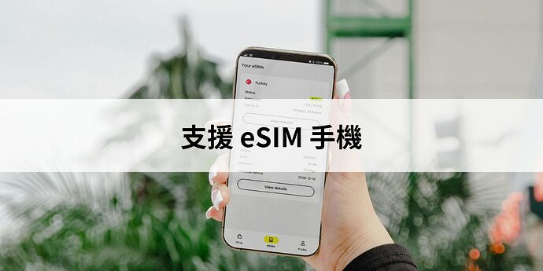
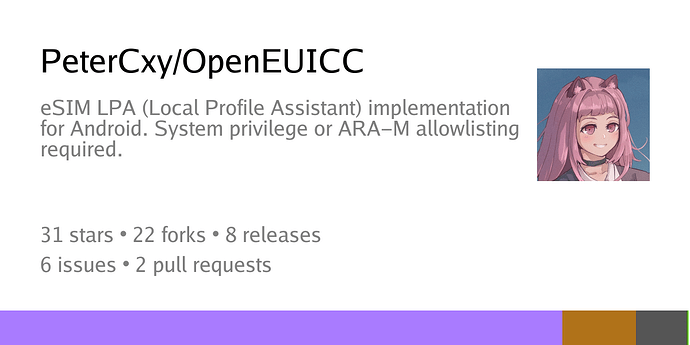
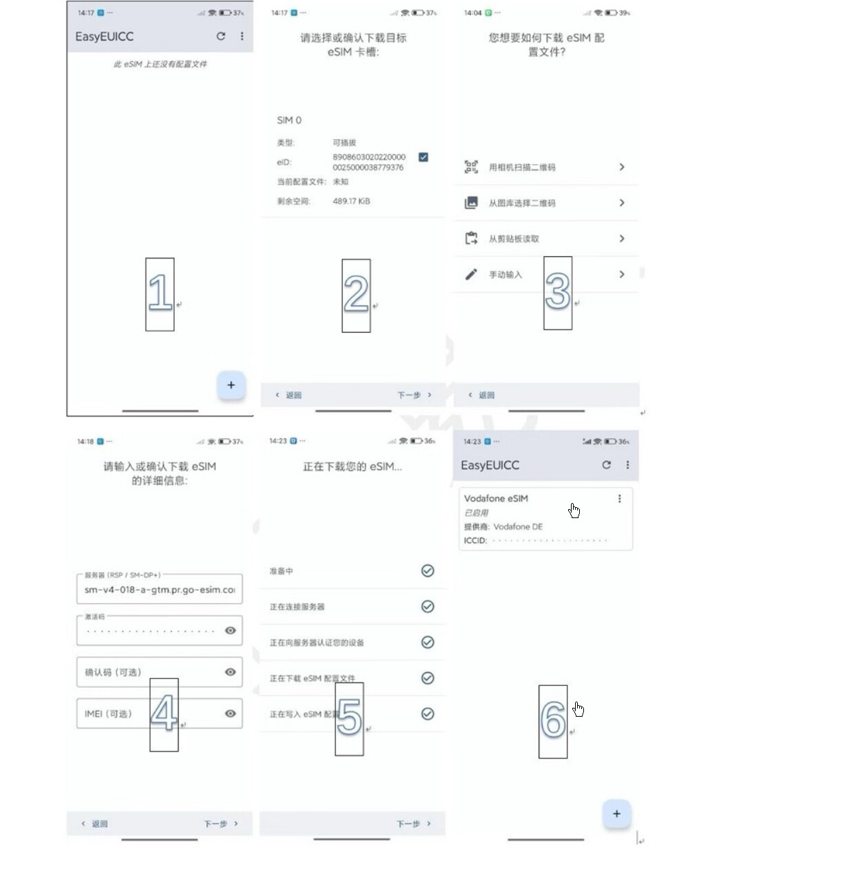

---

id: 930435

title: "盘点国内非esim手机如何esim（编辑中）"

created_at: 2025-09-04T13:51:02.971Z

username: red_Jerry

display_username: "爱冒泡的小郎君"

---

# 盘点国内非esim手机如何esim（编辑中）

主要是介绍目前的解决路线。首先，使用esim是为了满足以下

需求：U卡接码，注册纸飞机，谷歌voice,虚拟号码平台接不了码，需要你长期持有，用于验证，比如雪崩卡，经常掉登录。

**路线类型**：

# 氪金流

- 二手市场淘支持esim功能的海外手机设备，这里不做推荐

# 技术流

- 前提手机里预埋了eUICC（硬件），之后还需要自己刷LPA 组件（注意：没经验，不建议，多位佬友反馈变成砖），目前国内，小米，一加等机型，解锁BL难度，小米很难，且不是所有机型支持，有机型限制。

# 卡槽流

- 无品牌，淘宝，拼多多，白卡，

- 有品牌，estk，9esim，[Esim.me](http://Esim.me)，[Estk.me](http://Estk.me)，Xesim，5ber（关门）

# 平替流

- goole voice,textnow

# 网关流

- SMSEagle、Yeastar 这类“硬件 SMS 网关”，原生支持“SMS→Email 转发”：收到短信后，自动转成邮件发到你设定的邮箱。

### [2026 最新完整支援eSIM手機型號清單｜6 月 更新](https://esim.holafly.com/zh/esim-guides/esim-phones/#%E6%94%AF%E6%8F%B4-eSIM-%E7%9A%84%E8%98%8B%E6%9E%9C%E8%A3%9D%E7%BD%AE%E5%88%97%E8%A1%A8)

我擁有支援 eSIM 手機嗎？請查看這份我們每個月更新的 eSIM 相容性指南，以確認你的手機是否支援 eSIM 技術。包含 iPhone、Samsung 三星、Google Pixel、Oppo、Sony、Motorola、小米等手機。

*小白卡*需要下载的软件

### [OpenEUICC](https://gitea.angry.im/PeterCxy/OpenEUICC/releases)

eSIM LPA (Local Profile Assistant) implementation for Android. System privilege or ARA-M allowlisting required.

操作流程：

---

*来源: https://linux.do/t/topic/930435.json*

