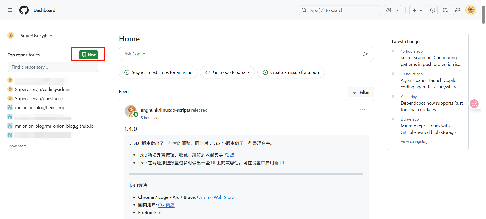
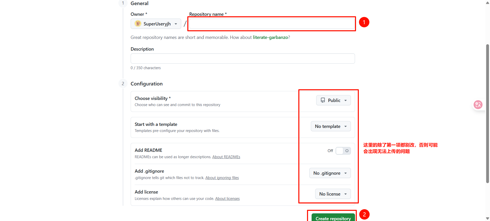
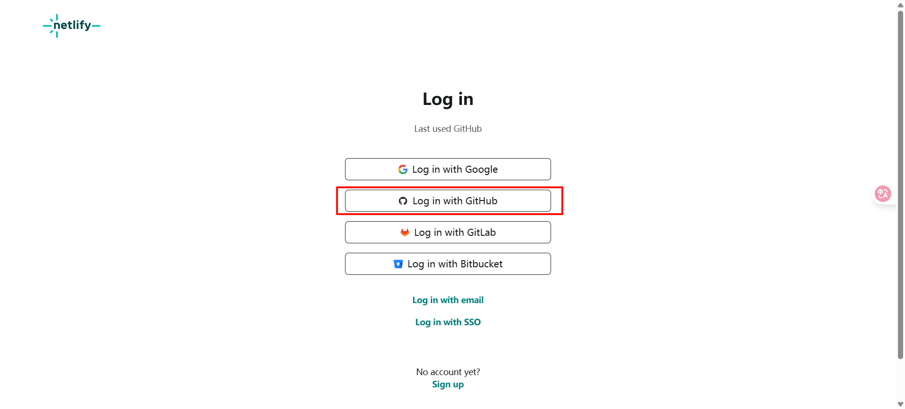
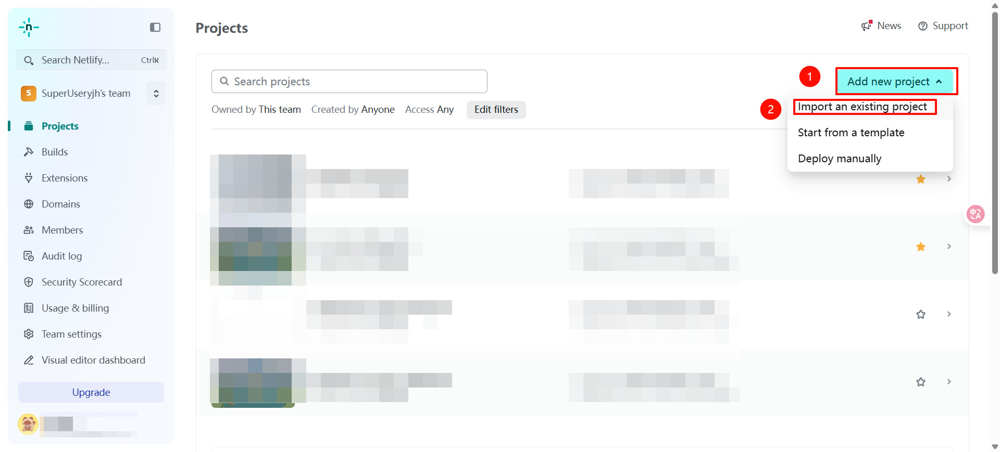
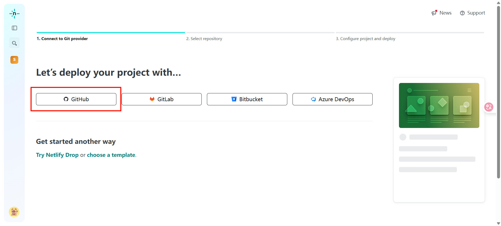
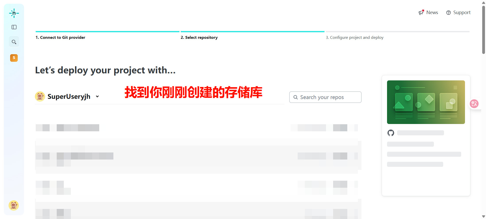
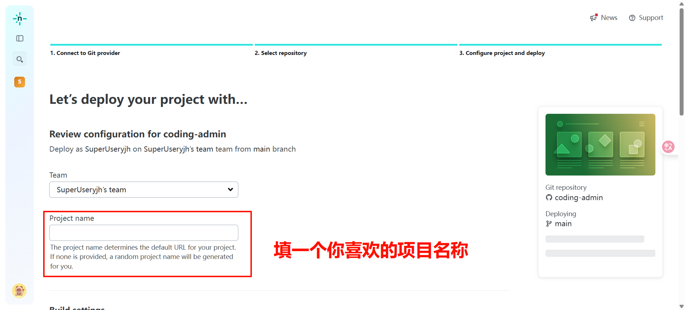
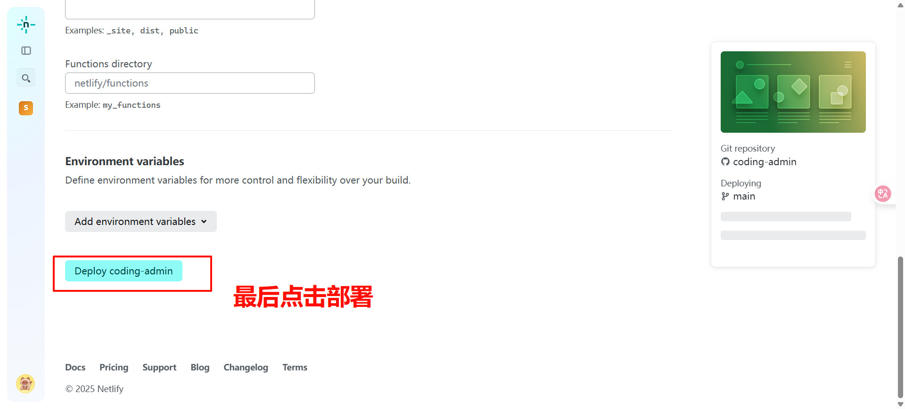
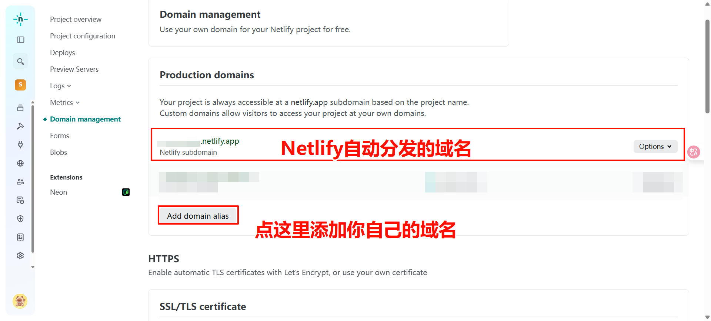

---

id: 943559

title: "How 2 构建你自己的网站 | 萌新建站指南 0x01"

created_at: 2025-09-10T13:09:51.908Z

username: Mr_Onion

display_username: "YaoOnion"

---


# How 2 构建你自己的网站 | 萌新建站指南 0x01


## 0x00 前言

此处的“网站”指**通过第三方服务构建的**能通过域名访问的静态网站，与通过服务器搭建的网页**存在区别**

其实这个系列最早是作为水的帖子出现的

[How2给你的博客站加一点文章暨Hexo常见命令 | 博客站完全（存疑）指北 0x02](https://linux.do/t/topic/657592) [


文档共建](/c/wiki/42)

> 从 [https://linux.do/t/topic/647970/1](https://linux.do/t/topic/647970/1) 继续讨论

> 0x00 前言（同上一帖）

>

> 0x02 答疑

>

> Netlify绑定域名

>

>

>

> 有的兄弟，有的，就在这个网址（别忘了把”你的项目名称“改了，不然一会又要来问）

> https://app.netlify.com/projects/你的项目名称/domain-management

>  ![[image]](https://cdn3.ldstatic.com/original/4X/3/c/d/3cd51e8fb517be8fdee8ba0ed2a2f440d9707f97.png)

>

>

> 暂时没了，等…

本文同步发布于[洛谷](https://www.luogu.com.cn/article/wtpovi6m)

## 0x01 环境准备

**请注意，部分服务处于国外，善用科学工具**

开始之前，请确认你是Windows系统（别的可能水土不服会有问题），有这么几个东西要准备：

1. git，[官网下载地址](https://git-scm.com/downloads/win)

2. GitHub账号（实在没有的，自己 [github.com](http://github.com) 用邮箱注册一个）

一个纯HTML网页格式大概是下面这个样子的：

```
/   根目录
|
|- index.html
|
|- folder
|  |
|  |- index.html
|  |
|  |- tmp.html
|
|- tmp.html
```

那么访问网站时的对应格式大概就是这么个样子（[假设域名为example.com](http://xn--example-e73km6m9wlm1k120n.com)）：

```
example.com            -> /index.html
example.com/tmp        -> /tmp.html
example.com/folder     -> /folder/index.html
example.com/folder/tmp -> /folder/tmp.html
```

那么知道了这一点，我们就可以开始着手编写网页了

## 0x02 编写网页

其实这一步你交给AI就行了（手动狗头）

参阅：[HTML（超文本标记语言） | Mozilla 开发者指南](https://developer.mozilla.org/zh-CN/docs/Web/HTML)

### 0x02.01 配置SSH密钥

在Git Bash执行如下命令：

```
ssh-keygen -t rsa -C "邮件地址"
```

> 注意，”邮件地址“需要替换成你自己的Github绑定邮箱，保留引号

> 在执行了第二行的内容后，点三下换行（Enter）

在文件资源管理器中打开`C:\Users\你的用户名\.ssh`，复制`id_rsa.pub`中的所有内容

访问[GitHubSSH密钥配置界面](https://github.com/settings/ssh/new)

密钥选择框不切换，最上方的输入框随便填，最下面的输入框黏贴你在`id_rsa.pub`中复制的内容

最后点击绿色按钮，完成SSH公钥的配置

在Git Bash中执行以下内容，如果没有报错则说明配置成功

```
ssh -T git@github.com
```

随后配置你的Git Bash，执行以下内容：

```
git config --global user.name "你的Github用户名"
git config --global user.email "你的Github邮箱"
```

将以上两行内容中被双引号包裹的内容替换为你自己的信息，保留双引号

### 0x02.02 上传





然后你会得到一个形似 `git@github.com:你的Github用户名/存储库名称.git` 的远程仓库链接

你可以在本地编写完代码后通过以下方式提交

```
# git init（这行代码只需要运行一次）
git add .
git commit -m "你的提交消息"
git branch -M main
git remote add origin git@github.com:你的Github用户名/存储库名称.git
git push -u --force origin main
git remote remove origin
```

### 0x02.03 部署

[Netlify官网](https://app.netlify.com/)













如果没有问题的话，你可以从 `https://app.netlify.com/projects/你的项目名称/domain-management` 看到用于访问的域名



## 0x03 后记

其实没啥好说的，有后端的网站后面再说

给个赞吧


---


*来源: https://linux.do/t/topic/943559.json*

