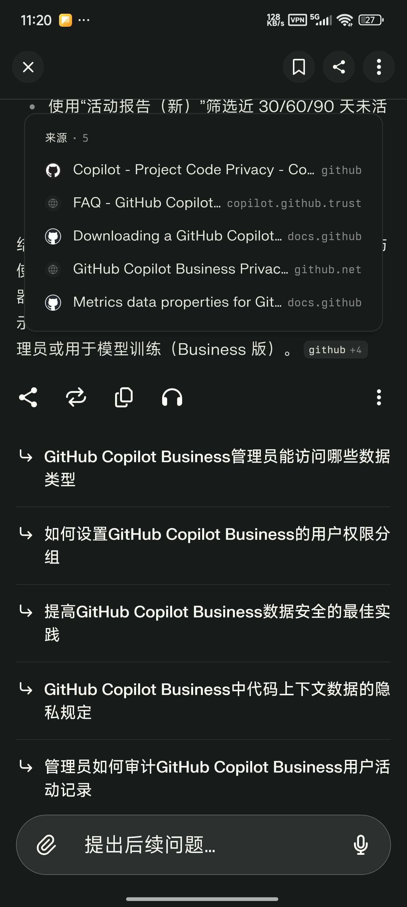

---

id: 949306

title: "perplexity.ai Pro账户防降智最佳实践"

created_at: 2025-09-11T03:52:17.054Z

username: imaxwel

display_username: "Imaxwel"

---

# perplexity.ai Pro账户防降智最佳实践

tl;dr;

perplexity.ai Pro账户用它家的Mac/Windows桌面端Comet浏览器走美国机房乃至家宽节点，模型至少选GPT5 thinking效果防降智最有保障。

前情提要

[perplexity.ai 现在连pro都降智降得没边了吗？](https://linux.do/t/topic/943678) [

搞七捻三](/c/gossip/11)

> 感觉不管哪个模型，搜索和深度研究现在都很傻的样子，匆匆几笔就结束了，跟Gemini和chatGPT的深度研究完全是云泥之别。用的日本亚马逊的梯子，难不成跟梯子还有关系？

>  ![[mmexport1757513508887]](https://cdn3.ldstatic.com/original/4X/9/0/7/907ffae83a1286d93a57aa187bcf147bc8202fd7.jpeg)

> ![[mmexport1757513503722]](https://cdn3.ldstatic.com/original/4X/f/0/4/f042bdd0b04f22ea9e9baf8819b6858b7bfd93b0.jpeg)

明明perplexity.ai一年的Pro最近被我用出了弱智的感觉，不甘心 。。。

经过佬友 [@Leon01](/u/leon01)  点拨，发现可能跟IP有关系，参考对比实验的1屏和2屏输出的证据 [perplexity.ai 现在连pro都降智降得没边了吗？ - #23，来自 imaxwel](https://linux.do/t/topic/943678/23)

然后今天想到会不会 perplexity.ai 现在也做浏览器的，Chrome和它家是竞争关系了，会不会comet上面好一点，于是用Pro账号登录了Comet浏览器，搜索选择了GPT5 thinking，用类似的问题一测，不测不知道，一测吓一跳！ 

几乎类似的问题，

1. Pro账户perplexity.ai移动端App走亚马逊日本节点，移动端只有一屏的输出；

2. Pro账户用perplexity.ai移动端App走美国racknerd节点，移动端有两屏的输出；

3. Pro账户用perplexity.ai自家的桌面端Comet浏览器走美国racknerd节点，输出的内容在移动端查看有三到四屏的输出！

所以总结现在perplexity.ai不降智的最佳实践是——

perplexity.ai Pro账户用它家的Comet浏览器Mac/Windows桌面端走美国机房乃至家宽节点模型至少GPT5 thinking效果最佳。

---

*来源: https://linux.do/t/topic/949306.json*

