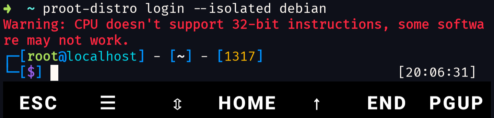
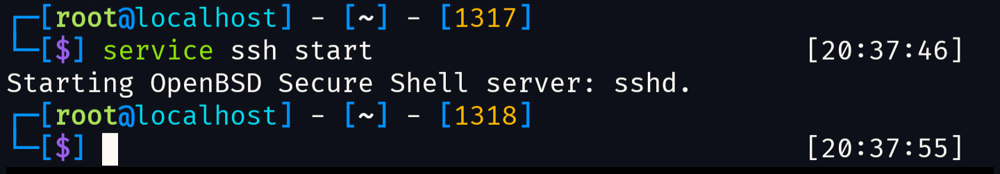
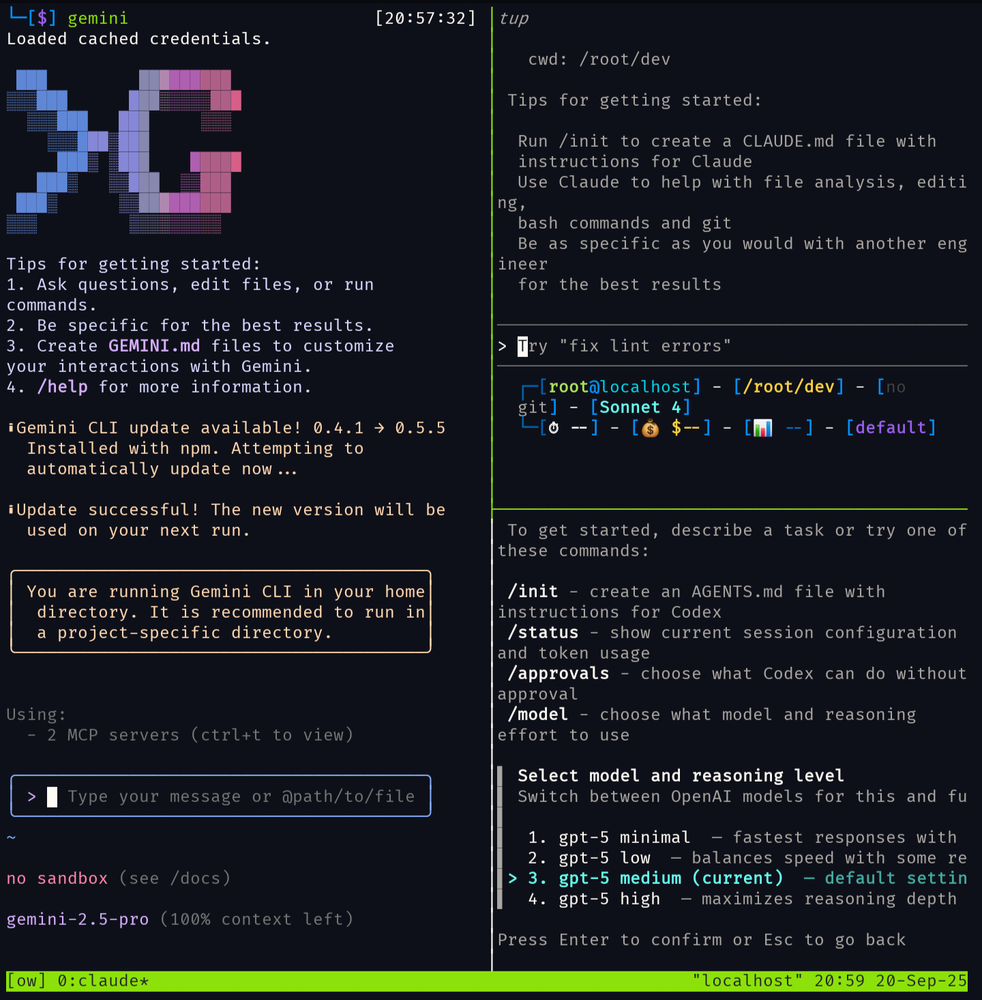
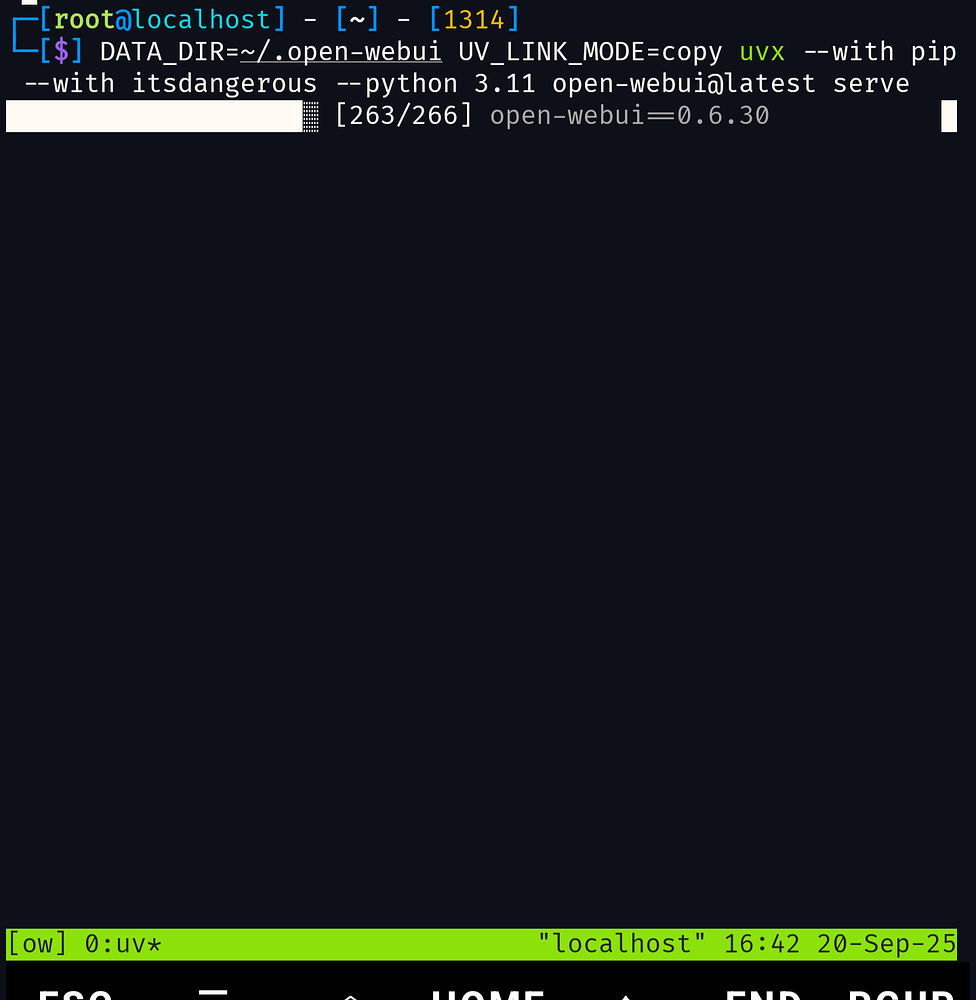
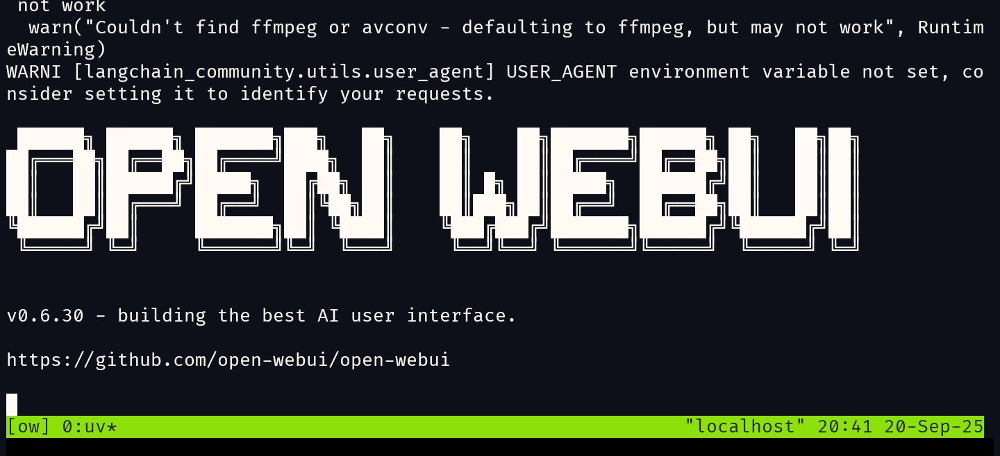
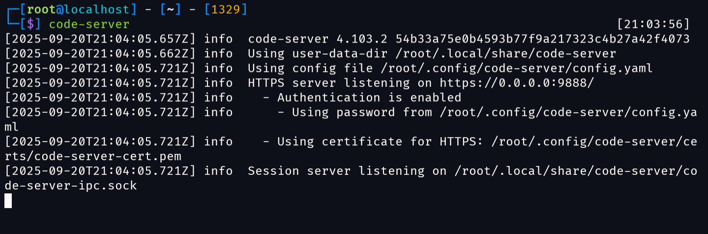
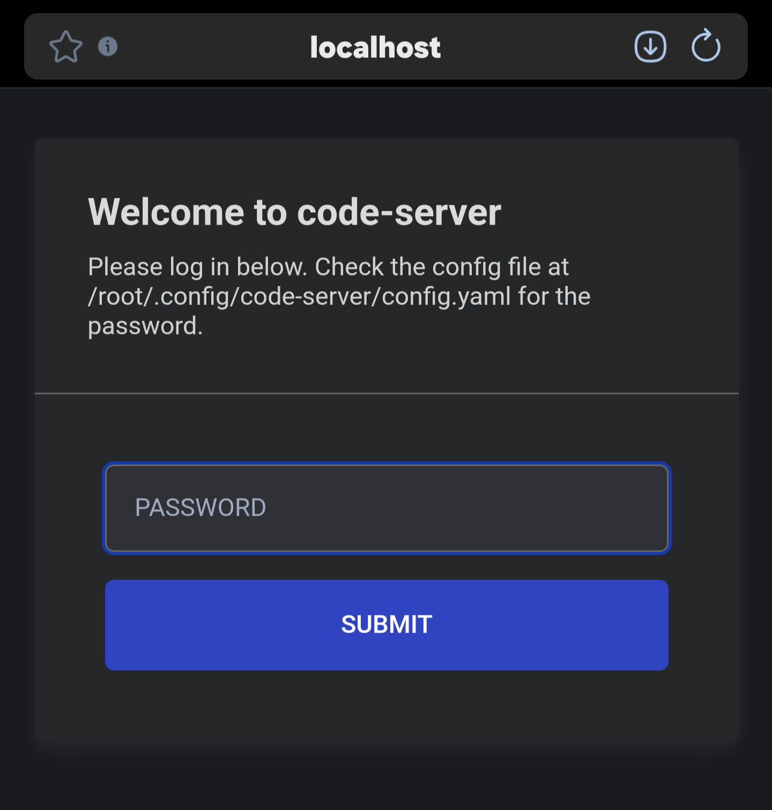

---

id: 971888

title: "安卓手机如何优雅使用linux的各种开发/AI工具（除了docker）"

created_at: 2025-09-20T20:21:23.578Z

username: arxiv

display_username: "還sんì吥懂"

---


# 安卓手机如何优雅使用linux的各种开发/AI工具（除了docker）


> [!NOTE] 09/12/26 找个机会施工一下

>

> 原始内容有些已经是时代的眼泪了，会清一些，折叠一些


## 重要的放最前面

### Codex Cli


### CC

CC在proot里面正常用。termux下面会遇到问题，主要是几个`.so`文件的缺失（termux下面有了codex可以直接让gpt去打补丁 

## 我不听我不听！没有Docker不开心

### `android-docker-cli`

感谢楼下佬友提醒 → 潭里佬友构造了一个很赞的工具，可以实现大部分docker兼容的接口

> 有佬友写了一个运行docker的工具 

>

>

> 最近看着家里换下来的旧安卓手机，想想陪我这么多年了，买了也舍不得，一直带着套套，很新的一样，加上家里有动态ip，搞了一个免root的docker镜像运行功能，让它焕发第二春grinning_face_with_smiling_eyes， 已经兼容ocker命令啦 项目地址 [jinhan1414/android-docker-cli: Run Docker images on Android…](https://github.com/jinhan1414/android-docker-cli)

> [!note]强行Docker

>

> 没有docker不开心星人只能更折腾一些了十分优雅

如果你有PC，内核开源，可以解Bootloader锁(buff叠满)

那需要娴熟掌握安卓内核的打包调试技巧, 熟练`make menuconfig`。 = =好像每个机型都不太一样呢

[This tutorial shows how to run docker natively on Android, without VMs and chroot. · GitHub](https://gist.github.com/FreddieOliveira/efe850df7ff3951cb62d74bd770dce27)

### 如果现在的机型是安卓16并且厂商已经支持（无比幸运）

**安卓16** 部分机型也可以在开发者选项里面开出来`Linux Terminal` (笔者在pixel 8上测试了一下，确实可以用docker，但是这个子系统不支持蜂窝联网，而且杀后台比较严重，用了三天，系统被弄炸了三次，暂时弃坑)

### 不行我们QEMU（实在很闲）

`QEMU`曲线救国一下下

甩两个仓库让AI帮忙参谋吧

### [GitHub - cyberkernelofficial/docker-in-termux: This repository contains instructions on how to...](https://github.com/cyberkernelofficial/docker-in-termux)

This repository contains instructions on how to install Docker in Termux, without root.

### [GitHub - egandro/docker-qemu-arm](https://github.com/egandro/docker-qemu-arm)

通过在 GitHub 上创建帐户来为 egandro/docker-qemu-arm 开发做出贡献。

> [!info]免责声明

>


## 安装

整个安装的过程是比较简单的，需要注意的是，需要选择在F-Droid上打包好的版本，Google Play Store上的版本比较老，会遇到各种问题。

### [Termux | F-Droid - 自由来源的 Android 应用存储库](https://f-droid.org/en/packages/com.termux/)

带有软件包的终端模拟器

同时最好也安装下面这个包，里面带了[nerdfonts](https://www.nerdfonts.com/)，有效避免默认字体崩掉

### [Termux:Styling | F-Droid - 自由来源的 Android 应用存储库](https://f-droid.org/en/packages/com.termux.styling/)

自定义 Termux 终端

新手用户可以参考termux的wiki（也可以咨询AI，亲测Grok, GPTClaude, Gemini均可解决遇到的大部分基本问题）

### [Termux Wiki](https://wiki.termux.com/wiki)

## Termux里套娃`Debian`

> 其实在Termux里面已经可以安装node环境，配置python了。由于Termux自身限制，需要本地跑`OpenWebUI`，用`uv`，则会力不从心。于是我们选择套娃，按照下面的方法，安装` proot-distro`

### [PRoot - Termux Wiki](https://wiki.termux.com/wiki/PRoot)

其实也就是这几行了

- `pkg install proot-distro`

- 用`debian`比较多，就 `proot-distro install debian`

### 一个小小的坑

在`termux`下进入这个`proot-distro`也很方便按照官方提供的教程就是`proot-distro login debian`

> [!warning]注意 `--isolated`

>

> 这里有一个坑，实际运行的时候，**为了避免termux环境变量的namespace和debian的出现冲突**，需要运行 `proot-distro login --isolated debian`



截图参考，这台机器是骁龙8 elite处理器，所以是没有32位支持的，不过好在基本上所有arm64的debian包都可以支持

然后就可以用熟悉的 `apt` 大杀四方了 （看上面截图也可以推断出楼主已经安装了`oh-my-zsh` [https://ohmyz.sh/](https://ohmyz.sh/)）由于`oh-my-zsh`的前置条件是`git`, `curl`/`wget`还有`zsh`，所以这些包也都是能用`apt`顺利安装使用的。

### 安装并使用SSH

```
apt update && apt install openssh-server
passwd  # Set root password
service ssh start
```



这样就不需要在手机上打字了（**记得配置一下ssh相关的文件，譬如端口，还有root登陆啥的**）

> ![!example]举一些 

>

> 下面是一些比较有趣的玩法

## `NVM`, `Node Version Manager`

### [GitHub - nvm-sh/nvm: Node Version Manager - POSIX-compliant bash script...](https://github.com/nvm-sh/nvm)

Node Version Manager - POSIX-compliant bash script to manage multiple active node.js versions. $nvm: 3ArcxqLtXMmBnWbbtfwQgVL3MNnDsggzgGDtXMnjpump

完美支持，各个node版本可以丝滑切换(测试下来对于arm64的支持很不错，没有遇到过需要现场编译的情况，都是下载编译好的node安装)

于是乎，什么 `npm`， `pnpm`， `yarn` 都可以使用, `bun`还没有试，感觉问题不大

【补充】： 酒馆在Termux下面装了nodejs就可以`./start.sh`用了。

### 各种Cli

都装了npm了，各种cli岂不是信手拈来，可以丝滑安装的cli包括但不限于 Gemini， CC， Codex，CursorCli

遇事不决量子力学我选择使用`tmux`



## `uv`

如果没记错是可以直接安装的，如果遇到问题需要根据错误提示apt装一下rust相关的包（是的，proot里面rustup这种指令也都可以顺利执行）

[Installation | uv](https://docs.astral.sh/uv/getting-started/installation/#standalone-installer)

### `OpenWebUI`

装了UV，那OpenWebUI 轻轻松松 （不过指令有点麻烦 = =，还好有grok4，最后无痛解决）

`DATA_DIR=~/.open-webui UV_LINK_MODE=copy uvx --with pip --with itsdangerous --python 3.11 open-webui@latest serve`





wifi下别的设备访问手机的 ip `192.168.X.X` 就可以访问OUI啦

## `code-server`

[Install code-server: OS Instructions for VS Code | code-server Docs](https://coder.com/docs/code-server/install#installsh)

可以直接安装的，手机在哪开发环境在哪 。安装之后甚至可以直接使用`cline`





wifi电脑设备访问手机的 ip `192.168.X.X` 就可以优雅开发啦 

## Cloudflare tunnels

猝不及防，没想到按照上面linux的安装方法，连`cloudflared`都能安装，直接可以通过zero trust application，把debian里面的端口对接到自己的域名上。

[Downloads · Cloudflare One docs](https://developers.cloudflare.com/cloudflare-one/connections/connect-networks/downloads/)


---


*来源: https://linux.do/t/topic/971888.json*

