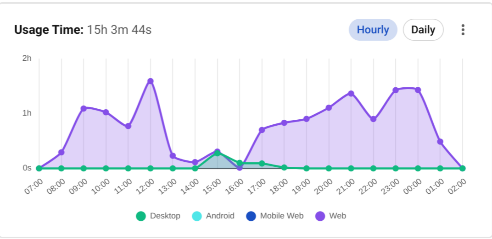

---

id: 973395

title: "steve用的arch linux软件"

created_at: 2025-09-21T16:21:58.087Z

username: stevessr

display_username: "🐟"

---

# steve用的arch linux软件

# 系统

> [!abstract]+ archboot

>

> [!caution]+ [官方网站](https://archboot.com/)

>

> 这里我们选择 archboot

>

> [https://archboot.com/](https://archboot.com/)

>

> 可以在官方网站获得更多信息

>

> 已经要年底了，其资金筹集好像进度还没有过半……

>

>

> [!note]+ 简介

>

> **Archboot** 是最先进的模块化 [Arch Linux](https://archlinux.org/) 启动/安装映像创建实用程序，用于为 **UKI/CD/USB/PXE** 生成**可复制** 的可启动介质，专为**安装** 或**救援** 作而设计。** 额外的 ISO** 和 **UKI** 侧重于**小巧、快速** 和 **（电源）用户友好** 。

>

> ）复制自官网（

>

>

> [!faq]+ 特性

>

> 在 arch 的滚动之外加上了默认配置的安全启动

>

> 进入 UEFI 即可 enroll hash（虽然第一次可以 enroll key ）

>

> 类似于 ventoy 的初始化安全启动流程很舒服

# 引导

> [!note]- [GNU/GRUB](https://www.gnu.org/software/grub/)

>

> [GNU GRUB - GNU Project - Free Software Foundation (FSF)](https://www.gnu.org/software/grub/)

>

> archboot默认使用的，该grub的默认配置使得你修改大部分教程中对应grub配置文件时，不会对archboot的起作用

> [!attention]- [systemd-boot](https://systemd.io/BOOT/)

>

> 不推荐

>

> 太丑了，并且 systemd 正在接管一切

>

> [archboot使用systemd boot + secure boot](https://linux.do/t/topic/836340)

# 软件

## 桌面

### [KDE](https://kde.org/zh-cn/)（ wayland ）

> [!abstract]- [kde](https://wiki.archlinux.org/title/KDE)

>

> qt 桌面，占用可能有点多

>

> 配合 kde material design 以获得 md3 大色块体验

>

> 从 kde6 开始，默认不安装 x11

### hyprland

> [!attention]-  [hyprland](https://wiki.archlinuxcn.org/wiki/Hyprland)

>

> 分割单位为屏幕独立的工作区

>

> 是很多人入坑的平铺桌面管理器

> [!cite]- end-4的配置

>

> [GitHub - end-4/dots-hyprland: Usability-first dotfiles · GitHub](https://github.com/end-4/dots-hyprland)

>

> 好吧现在是自己 end 4 自己的 quickshell，注意可能与其他的冲突

### 日常 [niri](https://github.com/YaLTeR/niri)

> [!success]- 超棒的无限平铺画布

>

> [Niri - ArchWiki](https://wiki.archlinux.org/title/Niri)

>

> [GitHub - niri-wm/niri: A scrollable-tiling Wayland compositor. · GitHub](https://github.com/YaLTeR/niri)

>

> 该作者也做paper vm（是gnome的平铺脚本）

>

> niri有预览功能

> [!cite]- DankMaterialShell 状态栏

>

> 使用 dms 作为状态栏

>

> （ 可能占用内存有点多 ）

>

> [GitHub - AvengeMedia/DankMaterialShell: Desktop shell for wayland compositors built with Quickshell & GO, optimized for niri, hyprland, sway, MangoWC, labwc, and MiracleWM. · GitHub](https://github.com/AvengeMedia/DankMaterialShell)

>

> 兼顾一定的管理和启动能力

>

> 疑似和end-4的管理冲突

> [!info]- 日常

> 键位

> 以 **mod 键** 驱动的窗口管理

>

> [niri纯水+1](https://linux.do/t/topic/861559)

> 关于x11兼容性

> [Xwayland · niri-wm/niri Wiki · GitHub](https://github.com/YaLTeR/niri/wiki/Xwayland)

### [waydroid](https://aur.archlinux.org/packages/waydroid)

> [!quote]- 小问题

>

> x86(-64) 里外不是人，兼容不好用

>

> 网络问题让人头大（大战docker千百遍）

>

> [Waydroid - ArchWiki](https://wiki.archlinux.org/title/Waydroid)

>

> [WayDroid · GitHub](https://github.com/waydroid)

>

> Xdroid 完全不干活（限制linux内核版本）

### 会话管理器

> [!info]-  [SDDM](https://wiki.archlinux.org/title/SDDM):kde 默认

>

> 但是我的触摸键盘没弄好……

>

> [SDDM - ArchWiki](https://wiki.archlinux.org/title/SDDM)

> [!info]+ [greetd](https://git.sr.ht/~kennylevinsen/greetd): DMS shell 推荐的

>

> 现在用这个了，不过注意主页不登录没法重启

>

> 有 WM 紫砂重启机制，这个很好，Codex经常跑测试干飞我 RAM

## 娱乐

### [steam](https://wiki.archlinux.org/title/Steam)

> [!caution]- 关于安装

>

> 需要开启 multilib ，故没有安装

>

> proton兼容性请查看检查官方网站

>

> [https://www.protondb.com/](https://www.protondb.com/)

### 视频

> [!done]- 哔哩哔哩 + YouTube （web）

>

> 如果你执意要使用桌面软件

>

> [AUR (en) - bilibili-bin](https://aur.archlinux.org/packages/bilibili-bin)

>

> [AUR (en) - youtube](https://aur.archlinux.org/packages/youtube)

### 音乐

> [!tip]- [spotify](https://spotify.com)

>

> [AUR (en) - spotify](https://aur.archlinux.org/packages/spotify)

>

> 网页版本跳广告也很方便

>

> 打补丁可以看

>

> [https://linux.do/t/topic/437721?u=stevessr](https://linux.do/t/topic/437721)

> [!tip]- VLC

>

> 开发包

>

> [AUR (en) - vlc-git](https://aur.archlinux.org/packages/vlc-git)

>

> 官方包

>

> [Arch Linux - vlc 3.0.22-1 (x86_64)](https://archlinux.org/packages/extra/x86_64/vlc/)

>

> 注：KDE似乎绑定了vlc,如果你安装了KDE,请勿尝试安装vlc-git,不然你会变得不幸

### 录屏

> [!info]- [OBS](https://obsproject.com/zh-cn)

>

> [Open Broadcaster Software | OBS](https://obsproject.com/zh-cn)

>

> 注意，对于niri来说可能需要额外安装gnome的xdg

### 输入法

> [!abstract]- fcitx5

>

> [Fcitx5](https://wiki.archlinuxcn.org/wiki/Fcitx5)

>

> [GitHub - Mintimate/oh-my-rime: The Simple Config Template Of Rime By Mintimate. · GitHub](https://github.com/Mintimate/oh-my-rime)

>

> 对于chromium系的应用，需要配置环境变量以支持fctix5输入，详情参见fcitx5的官网

### 远程

> [!info]- 远程桌面/异地组网

>

> [https://parsec.app/](https://parsec.app/)

>

> [https://my.zerotier.com/](https://my.zerotier.com/)

### 社交媒体

qq & wechat基本手机……（输入法不好用）

> [!warning]- niri上的小问题

>

> 最近几乎用不了输入法了?不过现在看起来是好的

>

> 还有就是通过xwayland兼容层(腾讯你在干什么)

telegram 看看始皇说什么

> [!note] 始皇的频道在论坛底部有链接

elementX / nheko / fluffychat 联系导师

> [!check]- 端到端加密

>

> 你值得拥有（需要手动开启）

>

> [Matrix.org - End-to-End Encryption implementation guide](https://matrix.org/docs/matrix-concepts/end-to-end-encryption/)

### office

> [!info]- onlyoffice

>

> [AUR (en) - onlyoffice](https://aur.archlinux.org/packages/onlyoffice)

>

> [ONLYOFFICE - 企业在线办公应用软件 | ONLYOFFICE](https://www.onlyoffice.com/zh/)

>

> 可以部署到服务器，提供网页服务

> [!info]- Libre Office

>

> [安全检查](https://wiki.archlinuxcn.org/zh-cn/LibreOffice)

>

> 额，也许看起来还行

## 开发

> [!example]- 程序

> IDE

> Jet brains

> editor

> zed

>

> vscode

>

> nano/nvim

> shell

> fish shell

> terminal emulator

> kitty

## ai

> [!example]- 长期吃灰

>

> lobechat

>

> 好重啊

>

> comfyui

>

> 打不过

>

> lm studio

>

> ccr

>

> cherry studio

>

> gemini cli

>

> qwen code

>

> openclaw

>

> openwebui

> [!check]+ 活跃使用

>

> Claude code

>

> Codex

>

> Antigravity

>

> rtk

>

> alma

>

> Astrbot

## 使用监测

> [!danger]- stayfree

>

> [https://stayfreeapps.com/](https://stayfreeapps.com/)

>

> 请务必设计为开机启动

>

> 界面会显示为以下这种统计图片

>

> 

>

> 用了好久了

## web

### edge

> [!abstract]- 特性

>

> 全平台同步

>

> drop （注：移动到更多工具）

>

> 没有侧边栏

### chromium

> [!abstract]- for playwright

## 管理器

> [!info]+ 管理软件等

> 包管理器

> pacman

> 配置了镜像仓库

>

> [Archlinuxcn | 镜像站使用帮助 | 清华大学开源软件镜像站 | Tsinghua Open Source Mirror](https://mirrors.tuna.tsinghua.edu.cn/help/archlinuxcn/)

>

> cn用户推荐， 内置了很多常用软件

>

> [Arch4edu | 镜像站使用帮助 | 清华大学开源软件镜像站 | Tsinghua Open Source Mirror](https://mirrors.tuna.tsinghua.edu.cn/help/arch4edu/)

>

> 软件开发必备，例如 Android Studio 可以从这里下载

> yay

> [GitHub - Jguer/yay: Yet another Yogurt - An AUR Helper written in Go · GitHub](https://github.com/Jguer/yay)

> paru

> [GitHub - Morganamilo/paru: Feature packed AUR helper · GitHub](https://github.com/Morganamilo/paru)

>

> 默认会让你看 PKGBUILD 文件  (包构建配置文件)

>

> [!note] 需要注意的是，yay和paru的功能极其相似

>

> flatpak

> KDE 主推的打包方式

>

> [https://flatpak.org/](https://flatpak.org/)

>

> 但是好慢了

>

> 不建议通过flatpak安装obs

> nix

> 声明式包管理器

>

> [https://nixos.org/](https://nixos.org/)

>

> 包很多，比 arch 官方 还多

>

> 但是 unstable 的包可能更新不够快

>

> 目前不是主力（但是装到另外一个 U 盘了)

## 编程语言的

> [!example]+ 基本是通过 AUR 管理的

> pnpm

> 快就完事了，不过似乎迁移到 rust 的进度几乎不动了

> yarn

> 某个项目指定，最新版已经锈化了

> bun

> Anthropic 的 性奴

> deno

> 之前的遗留产物

> uv

> Astral 的产物，现在是 openai的了

> vite-plus

> VoidZero 家的， rust 必吃

>

> [Getting Started | The Unified Toolchain for the Web](https://viteplus.dev/guide/)

## 笔记

> [!note]+ 我的笔记软件们

>

> [!check]- [obsidian](https://obsidian.md/)

>

> 经典的笔记软件

>

> 本人使用 remotely sync 进行同步

>

> 虽然基本在吃灰

>

>

> [!info]- [hugo](https://gohugo.io/)

>

> 部署为静态博客

>

> 需要手写  metadata

>

> 很懒，几乎没有用了

> 主题

> 使用 MeiK2333 的 Github Theme 主题， 模仿 Github 页面

>

> [GitHub - MeiK2333/github-style · GitHub](https://github.com/MeiK2333/github-style)

>

>

> [!todo]- project-graph

>

> 几乎很少使用了，只有要画流程图的时候才拉出来

>

> 话说有 llm+ 的功能，但是不能作为 mcp 提供服务好像

>

> 终于支持自定义 llm api 了，但是应该还是不支持 reponse api

>

> 似乎ai没有控制画布的功能……

>

> [GitHub - graphif/project-graph: A node-based visual tool for organizing thoughts and notes in a non-linear way. · GitHub](https://github.com/graphif/project-graph)

# 困局

> [!bug]- 硬件厂商问题

> 一个月内

> 被宿舍校园网做局（ wifi )

> 三个月以上

> 被英伟达做局，不常见分辨率的屏幕无法正常驱动（ 新版驱动问题, EDID 本身正常 ） 590修好了

> 致命问题

> 无法调节亮度导致的过曝炸掉 重装好了

---

*来源: https://linux.do/t/topic/973395.json*

