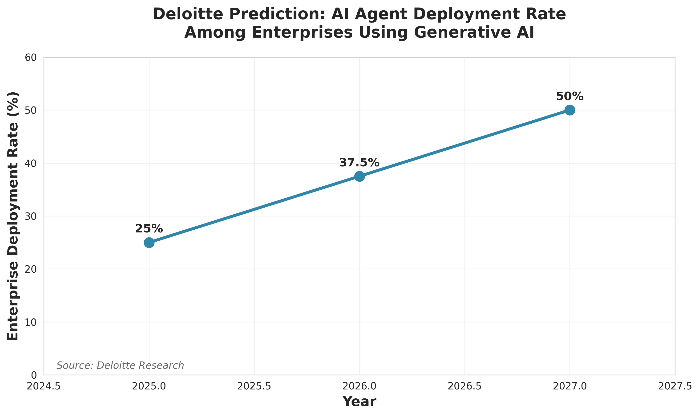
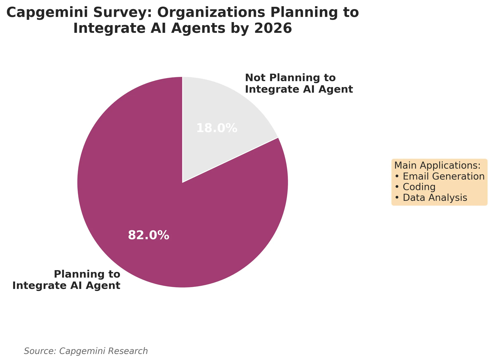
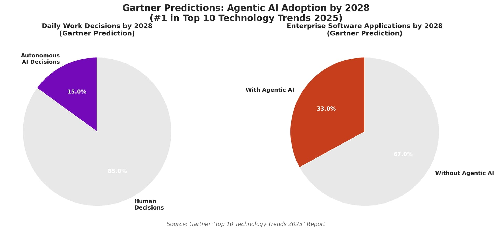
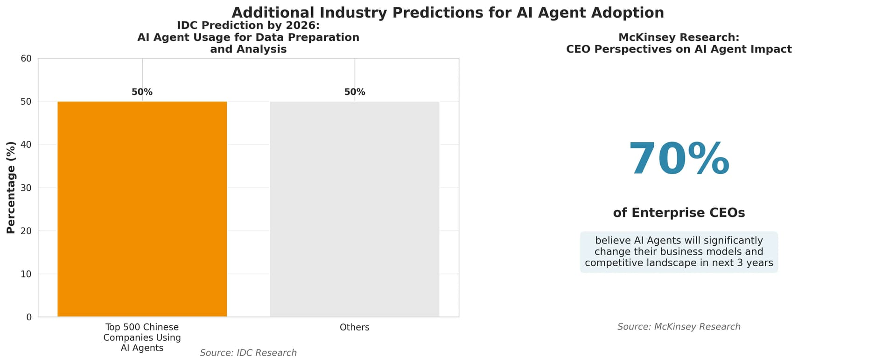
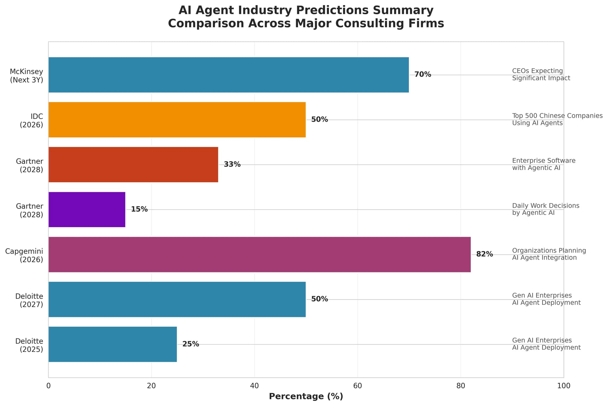
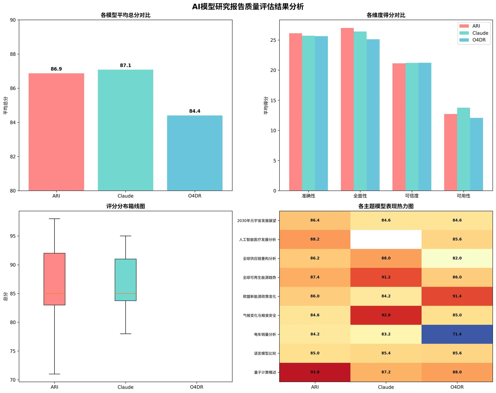
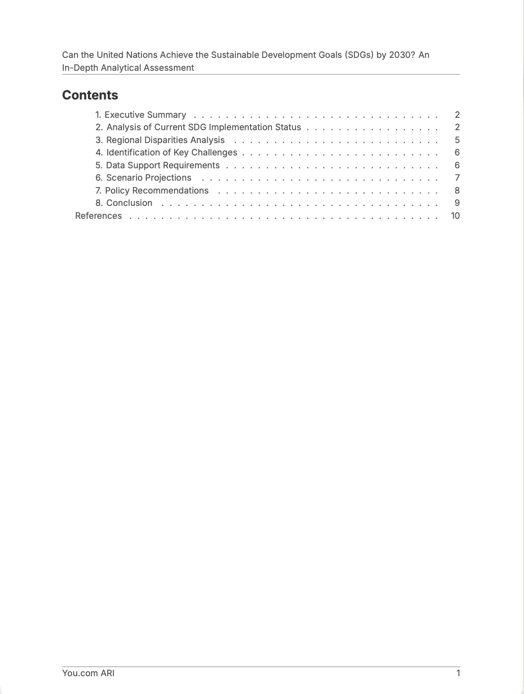
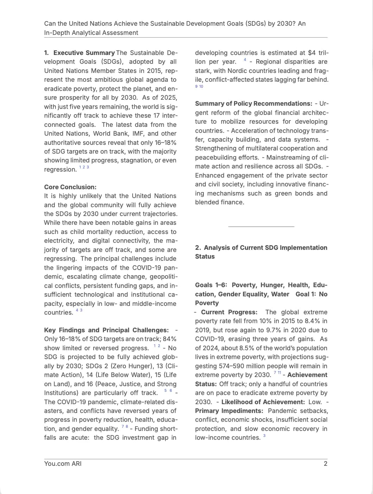

---

id: 980698

title: "AI Deep Research Agent评估:应该是首次多子代理集群评价方法与性能基准"

created_at: 2025-09-24T14:23:40.841Z

username: Frank_Frank_Lewuder

display_username: "Sol"

---

# AI Deep Research Agent评估:应该是首次多子代理集群评价方法与性能基准

## 1.1 摘要

本年是AI Agent元年,而我也看到了”Deep Research”这些AI Agent的爆发,所以我提出一套评判方法,并且测试了一遍,所以我们也建立了一个评价体系,围绕”准确性”、”全面性”、”资料可信度”、”可用性”

之后测试方法是用一个Prompt向一个AI Agent要求评价,并多次取平均值,我原本有考虑做题库,但是我认为研究方面的AI Agent不适合做比如Human Last Exam题库,因为研究没有标准答案,优秀的研究应该是去创新,问题本身就是研究的一部分,然后网络信息每秒都在变化,静态的题库无法反映真实环境的信息,评判标准也因人而异,所以最终我决定不弄一个题库。

## 1.2 机构预测

> **德勤(Deloitte)预测数据**："到2025年，25%使用生成式AI的企业将部署AI Agent，到2027年将增长到50%

> **Capgemini预测数据**：“82%的组织计划到2026年集成AI Agent，主要用于电子邮件生成、编码和数据分析等任务”

> **Gartner相关预测**：将"Agentic AI"列为《2025年十大技术趋势》报告中的第一名，到2028年，至少15%的日常工作决策将通过Agentic AI自主做出，33%的企业软件应用程序也将包含Agentic AI

> IDC预测：到2026年，将有50%的中国500强数据团队使用AI Agent来实现数据准备和分析， 麦肯锡研究：超过70%的企业CEO认为AI Agent将在未来3年内显著改变其经营模式和竞争格局

> 各大咨询公司对人工智能代理行业的预测总结比较

## 2.1 本研究包含的AI Agent模型

1. o4 Mini Deep Research

2. Claude Research

3. ARI (Updated)

4. Manus Wide Research  (由于这款产品主要偏向广泛研究,所以被挑选作为评委,因为拥有快速核查，并且创建多个子代理的功能, 很适合这次作为评委使用, 而且我认为这是一个创新点，因为Wide research可以以一次用上百个Sub Agent进行测评极大的方便了这次测评)

## 3.1 评判方法框架

准确性(30%)

全面性(30%)

资料可信度(25%)

可用性(15%)

## 3.2 测试任务设计

基础研究任务(简单查询,基础概念解释)及格:总分≥80分

中等复杂任务(多维度分析,比较研究,趋势分析)及格:总分≥70分

高难度任务(跨领域综合分析,前瞻性判断,复杂因果关系分析)及格:总分≥60分

## 3.3 测试题库

| 基础研究任务 | 中等复杂任务 | 高难度任务 |

| --- | --- | --- |

| 请研究2024年全球电动汽车销量前三名的制造商，提供具体数据和市场份额 | 从技术、市场、政策三个维度分析人工智能在医疗健康领域的发展现状和挑战 | 深入研究气候变化对全球粮食安全的影响，整合气象学、农业科学、经济学、地缘政治等多个领域的最新研究成果，提出系统性应对策略 |

| 解释什么是量子计算，包括基本原理、当前发展状况和主要应用领域 | 比较分析ChatGPT、Claude、Gemini三个大语言模型在性能、特点和应用场景方面的差异 | 基于当前技术发展轨迹和市场动态，预测并分析2030年元宇宙技术的发展状态，包括可能的突破点、应用场景和社会影响 |

| 收集整理2023-2024年欧盟新能源政策的主要变化，制作时间线总结 | 基于近三年数据，分析全球可再生能源发展趋势并预测未来5年发展方向 | 分析全球供应链重构对中国制造业转型升级的多重影响机制，探讨地缘政治、技术创新、成本结构等因素的相互作用关系 |

## 3.4 评分标准设计

我们使用Manus质量模式并调用Wide Research功能进行检查,这是Prompt,并且我们使用Wide Research功能用五个子代理每个都用一样的prompt进行评分,进行五次评分取平均值:

研究报告评估提示词.pdf (如果无法下载，而且需要请联系我)

|  | 平均总分 | 平均总分 | 平均总分 | 平均总分 | 平均准确性 | 平均全面性 | 平均可信度 | 平均可用性 |  |

| --- | --- | --- | --- | --- | --- | --- | --- | --- |

|  | mean | std | min | max | mean | mean | mean | mean |  |

| 模型 |  |  |  |  |  |  |  |  |  |

| ARI | 86.87 | 2.9 | 84.2 | 93.8 | 26.11 | 27 | 21.13 | 12.71 |  |

| Claude | 87.08 | 3.43 | 83.2 | 92.8 | 25.71 | 26.41 | 21.21 | 13.77 |  |

| O4Mini Deep Rsearch | 84.4 | 5.51 | 71.4 | 91.4 | 25.64 | 25.13 | 21.22 | 12.07 |  |

|  |  |  |  |  |  |  |  |  |  |

> “Claude的结果采用Claude.ai并选择Claude 4 sonnet得出,O4 Mini Deep Research透过Poe访问该模型得出,[ARI来自You.com](http://xn--ARIYou-ks4m556o.com)”

multi_evaluator_assessment.csv  (如果无法下载，而且需要请联系我)

file_average_scores.csv  (如果无法下载，而且需要请联系我)

如你所见,这就是我们叫Manus得出来的测评,公平起见，这些是Manus输出的数据这是Manus做这个的聊天记录:[https://manus.im/share/Oml8R6fUq6GY6ifLG2s1ln?replay=1](https://manus.im/share/Oml8R6fUq6GY6ifLG2s1ln?replay=1)

我们可以看到Claude用87.1的平均分用0.3赢过了ARI,o4 Mini则是表现最差的,我也想知道为什么,尤其是ARI实际上是25年3月的产物,居然能打赢O4 Mini Deep Research

不过我想稍微提一嘴,我个人的意见是觉得ARI能自己生产封面还要排版，是我喜欢的,请看下图

当然，这仅代表我个人的观点, 在实际测评可以看到Claude稍微比ARI好

## 结论与展望

通过对这主流的AI Agent进行测评，我们得出结论,Claude最好,ARI不错，而且带有生成封面还有自动排版的功能,O4 Mini Deep Research最差,我们也认为深度研究/广泛研究/深入研究这类产品还有很大的发展空间，所以我们会在不远的未来重新测评，并采用新的标准

本文章由Sol撰写,且仅在Linux Do以及X发布

PDF版本(Notion导出):[https://drive.google.com/file/d/1EkfQoshIjEd4J0d17JqgFhmLHly2EaLk/view?usp=drive_link](https://drive.google.com/file/d/1EkfQoshIjEd4J0d17JqgFhmLHly2EaLk/view?usp=drive_link)

[https://drive.google.com/file/d/1EkfQoshIjEd4J0d17JqgFhmLHly2EaLk/view?usp=drive_link](https://drive.google.com/file/d/1EkfQoshIjEd4J0d17JqgFhmLHly2EaLk/view?usp=drive_link)

如果您喜欢的话就请评论给一些意见吧, 这也是我第一次尝试去做这些,我认为Linux Do就是最适合放这个报告的平台, 如果你觉得有用的话就点个赞或者评论吧

---

*来源: https://linux.do/t/topic/980698.json*

