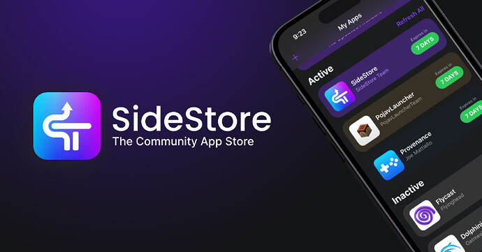
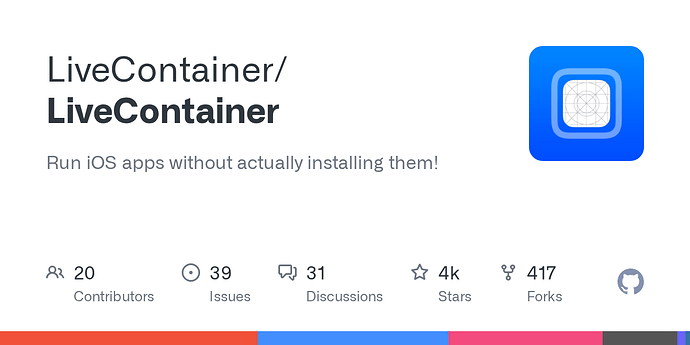

---

id: 991508

title: "【教程】在iOS/iPadOS下开启JIT，构建一个可用的Linux环境"

created_at: 2025-09-26T22:14:45.599Z

username: arxiv

display_username: "還sんì吥懂"

---

# 【教程】在iOS/iPadOS下开启JIT，构建一个可用的Linux环境

> 周末开新坑系列，先占坑。 其实本身没啥技术含量，比较讨厌的是需要先看各自的文档熟悉每个工具。

>

> 整个使用的工具有`Sidestore`, `UTM`, `Stikdebug`，等等. 欢迎佬友一起编辑补充 

> [!tip]

>

> 遇到问题的佬友欢迎留言，回复的时候正好可以顺便更新这个Wiki

## 成品图如下所示

可以使用SSH进去VM，也可以在浏览器里面访问映射出去的端口(`localhost`), 在同一个网络环境下，也可以通过iPad的ip地址来访问

## 准备工作

- 很闲很闲，碰巧也很有耐心（譬如楼主一周都在划水）

- 一个`icloud`账号 （可以注册一个船新的，只是用来登陆，可以用个人证书来进行七天的签名）。

- 访问：

### [SideStore](https://sidestore.io/)

An alternative app store that aims to make sideloading apps as seamless as possible.

获取教程，然后在下面的git repo里面，下载最新的`LiveContainer+SideStore.ipa` (小技巧其实就是直接安装这个二合一的`LiveContainer`, 这样就不需要多安装一遍 `SideStore`)

### [Releases · LiveContainer/LiveContainer](https://github.com/LiveContainer/LiveContainer/releases)

Run iOS apps without actually installing them! Contribute to LiveContainer/LiveContainer development by creating an account on GitHub.

- Wifi环境 + 魔法，这样可以丝滑访问各种服务，避免很多网络环境的错误。

- 美区的appstore账号，避免有些软件别的区没有。

- 有搜索功能的AI，方便询问遇到的各种情况。

- 一台电脑（pc/mac根据文档描述都是的，不过楼主只在mac上测试了，系统版本iOS26/iPadOS26）

## 开始

**其实没有什么技术含量，严格按照** `sidestore` [SideStore](https://sidestore.io/#get-started) 给出的教程, 在自己的电脑上安装需要的工具。 本质上就是

- 在电脑上使用 `Altserver` [GitHub - altstoreio/AltStore: AltStore is an alternative app store for non-jailbroken iOS devices.](https://github.com/altstoreio/AltStore) 登陆个人icloud账号把 `LiveContainer+SideStore.ipa` (教程里面是`SideStore.ipa`, 之前一步下载的ipa等于是二合一的功能了)

安装`LiveContainer+SideStore.ipa`后，只会出现`LiveContainer`的图标。进入`LiveContainer`点击这里，就能进入`SideStore`了

- 记得苹果设备要和电脑配对，然后根据教程，使用 `idevice_pair` [GitHub - jkcoxson/idevice_pair: Generate pair records for iOS and save them](https://github.com/jkcoxson/idevice_pair) 生成这个设备的配对文件 (**这一步挺重要的**，需要保存好，等下`LiveContainer`和`StikDebug`都会用到这个配对文件)

软件长这个样子

`Save to File`就可以保存这个配对文件了(`{{UDID}}.plist格式`)

- 弄完之后开启`StosVPN` [https://apps.apple.com/us/app/stosvpn/id6744003051](https://apps.apple.com/us/app/stosvpn/id6744003051)

就可以在SideStore里面愉快得自签名了！

### `LiveContainer` 可以绕过自签名三个软件的限制

因为UTM才是重点，所以可以自行预习这个Repo，刚刚步骤安装了LiveContainer（里面内置了`sidestore`）, 以后就可以开启`StosVPN`,在`sidestore`里面登陆自己创建的iCloud账号（这些项目都是开源的，不过还是不建议用防个人数据的账号），不需要连接电脑，就可以给自签名的app续期了。

### [GitHub - LiveContainer/LiveContainer: Run iOS apps without actually installing them!](https://github.com/LiveContainer/LiveContainer)

Run iOS apps without actually installing them!

## 安装和使用UTM

其实就是一个QEMU套了壳子。

### [GitHub - utmapp/UTM: Virtual machines for iOS and macOS](https://github.com/utmapp/UTM)

Virtual machines for iOS and macOS

需要下载并用`sidestore`自签名安装`UTM.ipa`，这样才能在没有Trollstore或者越狱的情况下开启JIT (UTM-SE应用商店都上架了，不支持JIT，所以非常非常慢)

注：在git issue里看到说也可以直接在LiveContainer里面不用签名也能安装使用UTM，不过我在iOS26上安装运行的时候不能选择文件，不确定哪里出了问题。

一切都安装了之后就可以使用 （在app store里上架了）

### [GitHub - StephenDev0/StikDebug: An on-device debugger/JIT enabler for iOS versions...](https://github.com/StephenDev0/StikDebug)

An on-device debugger/JIT enabler for iOS versions 17.4+, powered by idevice.

在`StikDebug`里面启动`UTM` (这里要注意网络通畅，`StikDebug`需要下载几个开发者镜像) 亲测iPadOS26是可以开启jit的

后面就可以在UTM里面配置自己的Debian VM辣（别的distro也是可以哒）

JIT成功开启，会有一个小窗弹出（右上角）

我直接走流程，安装了

[https://cdimage.debian.org/cdimage/archive/12.12.0/arm64/iso-cd/debian-12.12.0-arm64-netinst.iso](https://cdimage.debian.org/cdimage/archive/12.12.0/arm64/iso-cd/debian-12.12.0-arm64-netinst.iso)

## 可能遇到的问题

1. UTM提示内存不足

关闭 `Apple Intelligence` 

2. `StikDebug` 提示没有ios26的开发镜像

换个网络环境，增强魔法

---

*来源: https://linux.do/t/topic/991508.json*

