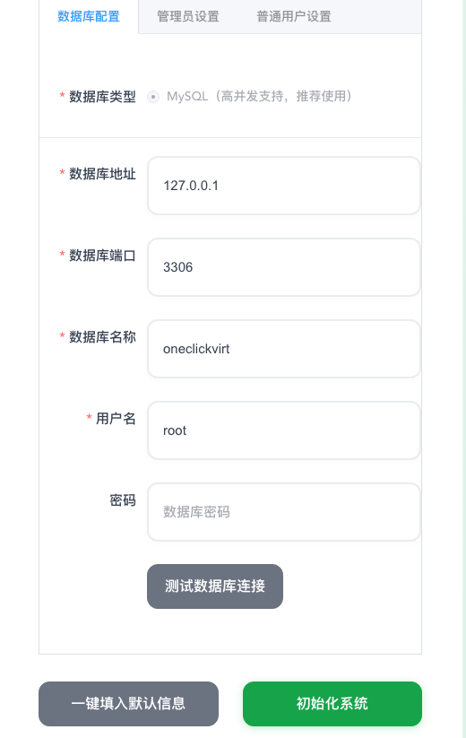
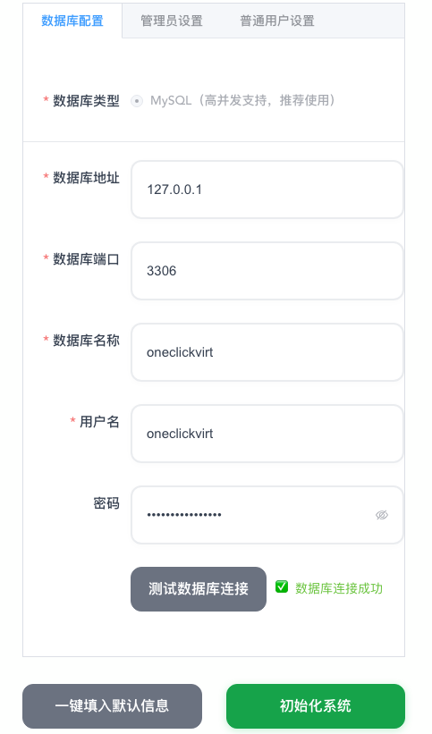
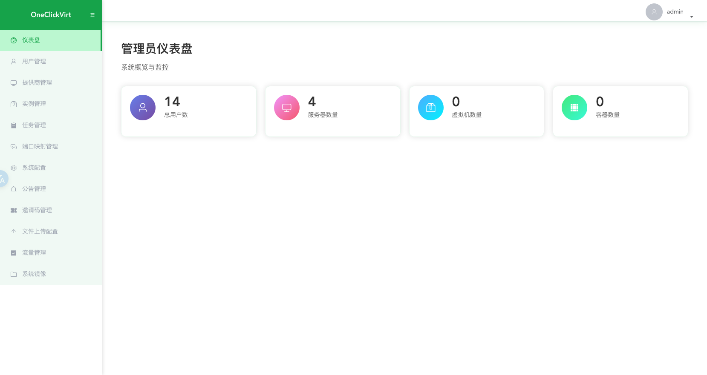
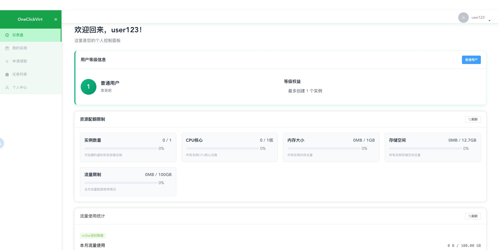
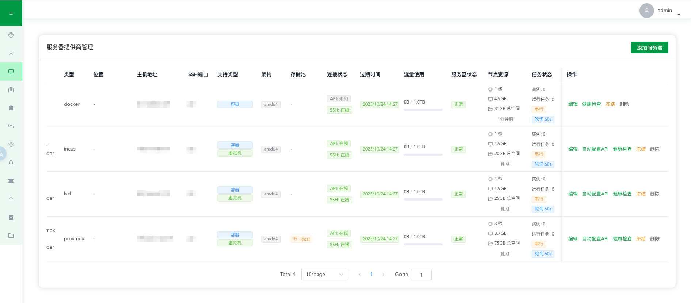
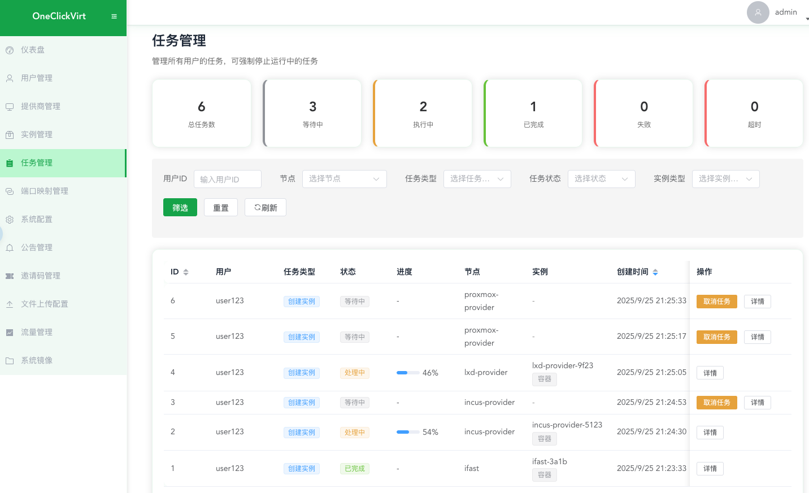
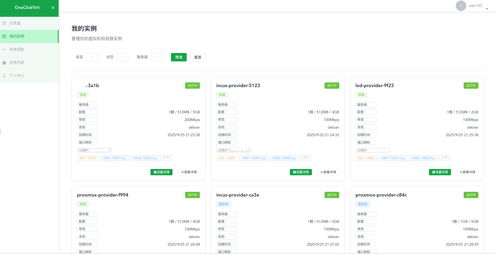

---

id: 992800

title: "可扩展的通用虚拟化管理平台，支持 LXD / Incus / Docker / Proxmox VE"

created_at: 2025-09-27T11:21:06.810Z

username: ECS

display_username: "oneclickvirt"

---


# 可扩展的通用虚拟化管理平台，支持 LXD / Incus / Docker / Proxmox VE


一个可扩展的通用虚拟化管理平台，支持 LXD、Incus、Docker 和 Proxmox VE。

开源的仓库：[GitHub - oneclickvirt/oneclickvirt: Universal Virtualization Management Platform 可扩展的通用虚拟化管理平台，支持 LXD / Incus / Docker / Proxmox VE](https://github.com/oneclickvirt/oneclickvirt)

开发的缘由：没有一个开源的，完整支持用户等级管理，邀请码注册，自带镜像，自带NAT端口映射管理，自带流量监控的对接主流虚拟化技术等内容的轻量级控制面板，官方的控制面板要么不支持用户密码登录注册，要么没有对应的流量监控和NAT端口映射等内容。

很多切小鸡切容器切虚拟机的玩家估计对本组织不陌生，这是组织下的一个新项目，兼容老项目里所有能用一键脚本操作的内容。

由于开发仓促，很多地方可能有BUG，但本地开发测试暂时无大BUG，有一些功能不可用很正常，但主要的功能没啥大问题。

首先，需要一台服务器，或者2台，这个项目只是一个带前后端的控制面板，宿主机本身能不能作为受控机器完全不影响使用。

要被控的服务器上安装 Docker 、 Incus、LXD、ProxmoxVE 可通过

### [PVE主体安装 | 一键虚拟化项目](https://www.spiritlhl.net/guide/pve/pve_install.html)

开源、易于使用的服务器虚拟化项目

### [Incus | 一键虚拟化项目](https://www.spiritlhl.net/guide/incus/incus_install.html)

开源、易于使用的服务器虚拟化项目

### [前言 | 一键虚拟化项目](https://www.spiritlhl.net/guide/docker/docker_install.html)

开源、易于使用的服务器虚拟化项目

### [LXD | 一键虚拟化项目](https://www.spiritlhl.net/guide/lxd/lxd_install.html)

开源、易于使用的服务器虚拟化项目

进行对应的安装。

面板安装添加了额外的方式

### 方式一：使用预构建镜像

使用已构建好的多架构镜像，会自动根据当前系统架构下载对应版本：

```
docker run -d \
  --name oneclickvirt \
  -p 80:80 \
  -v oneclickvirt-data:/var/lib/mysql \
  -v oneclickvirt-storage:/app/storage \
  --restart unless-stopped \
  spiritlhl/oneclickvirt:latest
```

或者使用 GitHub Container Registry：

```
docker run -d \
  --name oneclickvirt \
  -p 80:80 \
  -v oneclickvirt-data:/var/lib/mysql \
  -v oneclickvirt-storage:/app/storage \
  --restart unless-stopped \
  ghcr.io/oneclickvirt/oneclickvirt:latest
```

### 方式二：自己编译打包

如果需要修改源码或自定义构建：

```
git clone https://github.com/oneclickvirt/oneclickvirt.git
cd oneclickvirt
```

```
docker build -t oneclickvirt .
```

```
docker run -d \
  --name oneclickvirt \
  -p 80:80 \
  -v oneclickvirt-data:/var/lib/mysql \
  -v oneclickvirt-storage:/app/storage \
  --restart unless-stopped \
  oneclickvirt
```

### 方式三：在宿主机上手动安装

要安装控制面板的服务器上，需要提前安装好建站框架和MYSQL数据库，不想手动安装就多安装一个1panel吧，省事

### [在线安装 - 1Panel 文档](https://1panel.cn/docs/v2/installation/online_installation/)

1Panel 开源 Linux 服务器运维管理面板

然后开始进入正式的控制面板安装，首先是后端的安装：

下载并执行

国际

```
curl -L https://raw.githubusercontent.com/oneclickvirt/oneclickvirt/refs/heads/main/install.sh -o install.sh && chmod +x install.sh
```

国内

```
curl -L https://cdn.spiritlhl.net/https://raw.githubusercontent.com/oneclickvirt/oneclickvirt/refs/heads/main/install.sh -o install.sh && chmod +x install.sh
```

有交互地安装环境

```
./install.sh
```

无交互地安装环境

```
noninteractive=true ./install.sh
```

安装目录: `/opt/oneclickvirt`

安装成功后，需要手动启动服务:

```
systemctl start oneclickvirt
```

然后是前端的安装

前面安装脚本会将静态文件解压到

```
cd /opt/oneclickvirt/web/
```

这个路径下

使用`nginx`或`caddy`以这个路径建立静态网站即可，是否需要域名绑定自行选择。

如果使用的是1panel，那mv这文件夹到对应的网站路径覆盖原路径文件夹就行了，记得重命名为index文件夹，1panel默认展示的index文件夹。

静态文件部署完毕后，需要反代后端地址给前端使用，这里具体以`OpenResty`为例：


需要反代路径`/api`到后端的`http://127.0.0.1:8888`地址上，如果你使用的的是`1panel`，那么就只需要填写这些即可，默认的后端域名使用默认的`$host`不需要修改。

如果你使用的是`nginx`或`caddy`，请参考下方的代理源码自行修改进行代理

```
location /api {
    proxy_pass http://127.0.0.1:8888;
    proxy_set_header Host $host;
    proxy_set_header X-Real-IP $remote_addr;
    proxy_set_header X-Forwarded-For $proxy_add_x_forwarded_for;
    proxy_set_header REMOTE-HOST $remote_addr;
    proxy_set_header Upgrade $http_upgrade;
    proxy_set_header Connection $http_connection;
    proxy_set_header X-Forwarded-Proto $scheme;
    proxy_set_header X-Forwarded-Port $server_port;
    proxy_http_version 1.1;
    add_header X-Cache $upstream_cache_status;
    add_header Cache-Control no-cache;
    proxy_ssl_server_name off;
    proxy_ssl_name $proxy_host;
}
```

然后是最终的数据库创建和初始化连接上

1panel安装mysql，默认版本就行，默认非公网访问。

创建一个空的数据库`oneclickvirt`，使用类型`utf8mb4`，最好仅本地`127.0.0.1`可访问，对应用户名和密码保存好。

打开前端对应的页面后，将自动跳转到初始化界面。



填写数据库信息和相关用户信息，测试数据库链接无问题，则可点击初始化系统。



完成初始化后会自动跳转到首页，可以自行探索并使用了。


如果使用的是默认的用户信息进行初始化，那么默认的账户为：

管理员账户名

```
admin
```

管理员密码

```
Admin123!@#
```

普通用户账户名

```
testuser
```

普通用户密码

```
TestUser123!@#
```

最后贴点使用的截图












---


*来源: https://linux.do/t/topic/992800.json*

