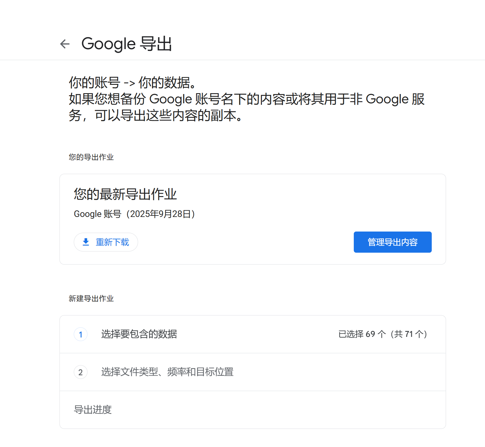
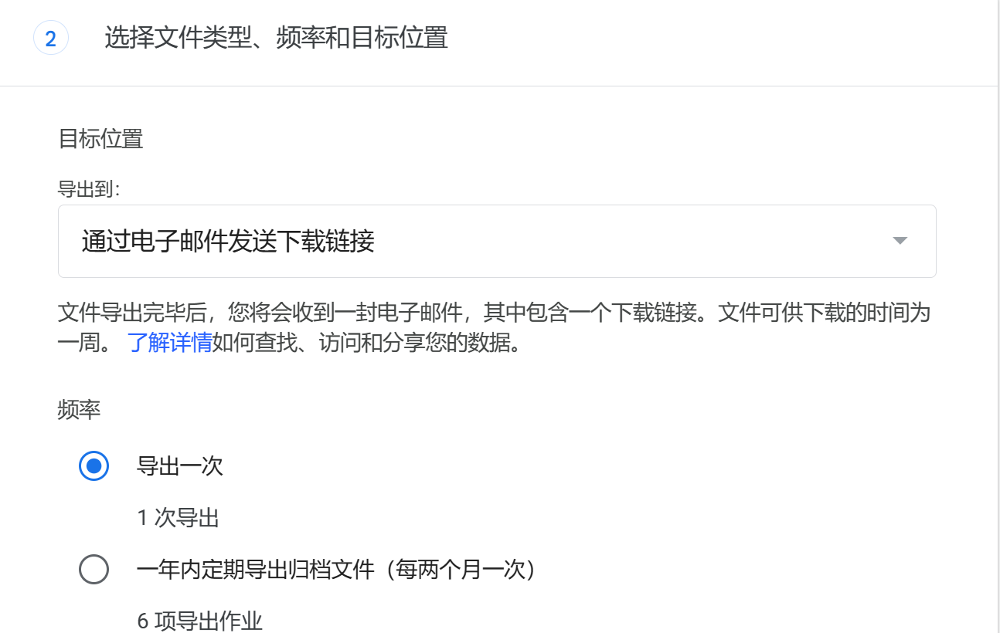
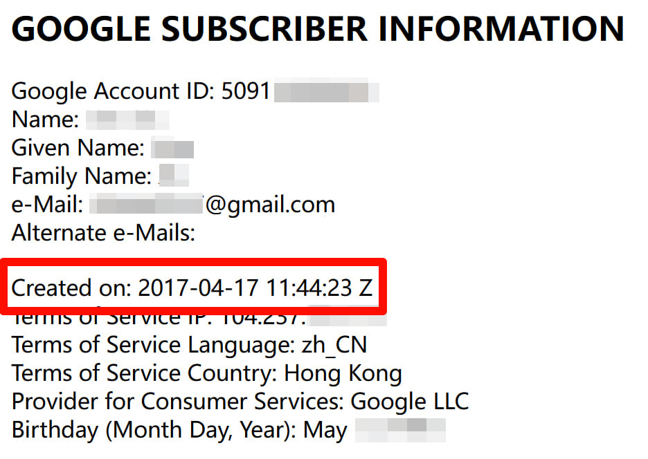

---

id: 993565

title: "查询Google账号注册日期教程"

created_at: 2025-09-28T01:28:11.987Z

username: search

display_username: "search"

---

# 查询Google账号注册日期教程

# 1. 打开 Google导出 网页 [https://takeout.google.com/](https://takeout.google.com/)

# 2. 勾选要包含的数据 **Google 账号 与注册和账号活动有关的数据。** 点击下一步。

# 3. 选择文件类型、频率和目标位置。我选择的是通过邮件发送下载链接创建导出作业。

# 4. 到Gmail邮箱查看收到的下载链接，点击下载到本地

# 5. 解压 **SubscriberInfo.html** 文件查看账号注册日期

> [!tip]

>

> 各位也晒一下是哪一年注册的吧

---

*来源: https://linux.do/t/topic/993565.json*

